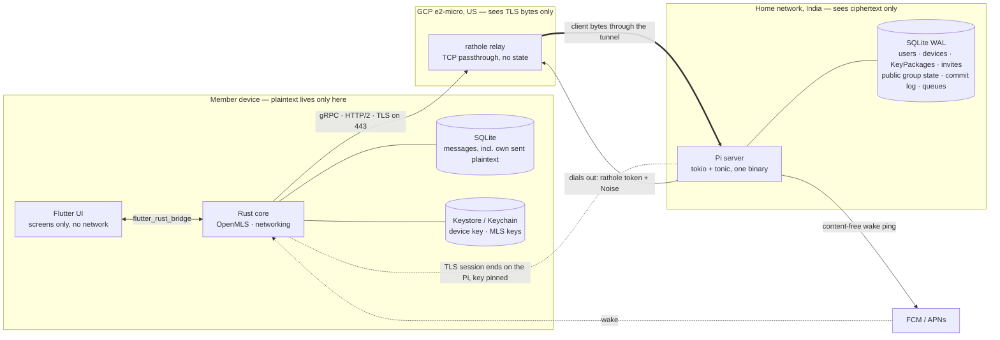
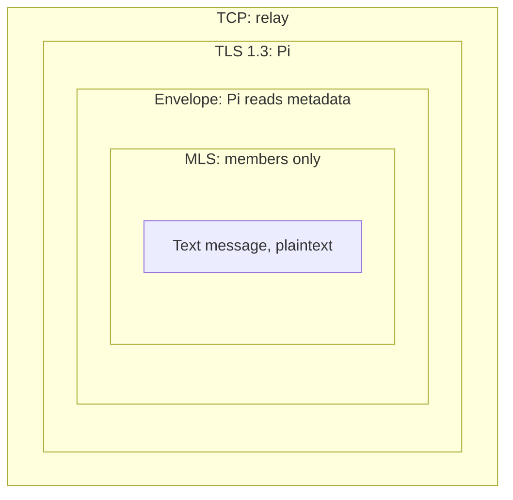
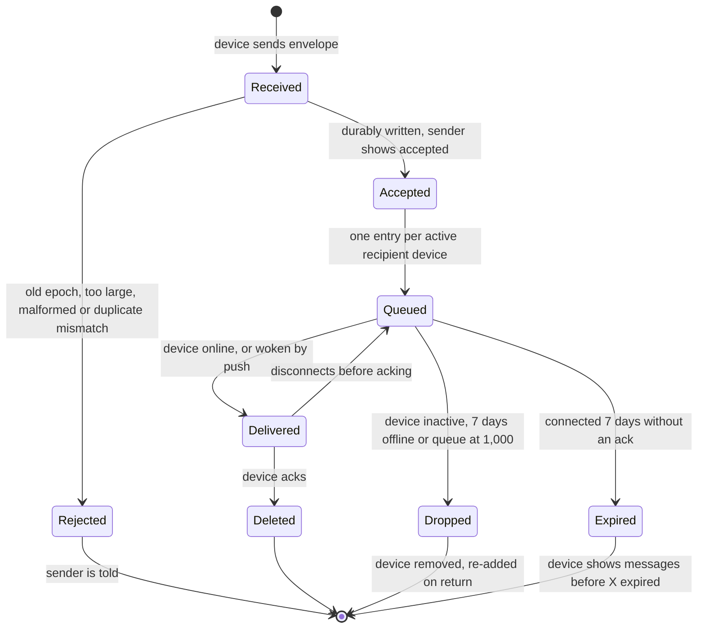
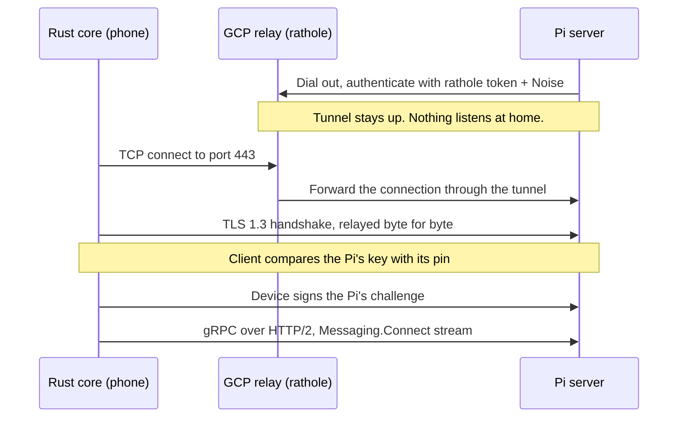

# Chat App MVP — Architecture Decisions

Nov 7, 2026 · updated Nov 8, 2026 (core-wire-protocol) · @Akhil Sasidharan

## Scope

The MVP is old-school text messaging in one admin-run group, end-to-end encrypted with OpenMLS. It replaces Vyajena, which was a learning experiment.

**In**

- Text messages only
- One group, created and managed by the admin (Akhil)
- Several devices per user, each its own MLS member
- Invite-only signup
- Store-and-forward through the Pi server
- One delivery status: accepted by the server (⏳ sending → ✓ accepted)
- Push notifications as content-free wake pings (FCM, APNs)
- Material 3 UI, `ColorScheme.fromSeed` with a muted seed and the `neutral` variant

**Out**

- DMs, more groups, user-created groups
- Read receipts, presence, typing indicators
- Media, voice, video
- Server-side message history
- Encryption at rest (no SQLCipher)

## Architecture

Four components; plaintext exists only inside the Rust core on each device.

- **Flutter UI:** draws screens only; never opens a connection.
- **Rust core:** OpenMLS, networking, local SQLite, keys in Keystore/Keychain. Linked through `flutter_rust_bridge`.
- **GCP relay:** dumb TCP passthrough so no port opens at home.
- **Pi server:** routes, orders and queues ciphertext; dispatches wake pings.

## Encryption

OpenMLS (RFC 9420) runs inside the Rust core on every device, so the relay and the Pi see only ciphertext.

| Party | Sees | Cannot see |
| --- | --- | --- |
| GCP relay | TLS bytes, client IPs, timing | Anything inside TLS |
| Pi server | Group id, member devices and their public leaf keys, admin id, epoch, sender, time, size, membership changes | Message content, group name and settings, profiles |
| Apple / Google | When a device gets a wake ping | Content, sender |

Each layer of a message on the wire, and who can open it:

- **Epoch rule (strict):** the Pi rejects any message tagged with an old epoch; the client re-encrypts and resends.
- **Key pruning:** OpenMLS default `max_past_epochs = 0` is kept; the strict rule makes it safe.
- **Sent messages:** the sender cannot decrypt its own ciphertext, so the client stores its own plaintext locally on send.
- **Devices:** every MLS member is a device. Each user has one Ed25519 identity key, held by their first device, which signs a certificate for each device; the certificate is the device's MLS credential. Losing the first device means an admin-driven reset (remove the user, new invite).
- **Credentials:** OpenMLS does not check credentials, so the core verifies every new or changed leaf's certificate against the user's pinned identity key, and that the certificate's MLS key equals the leaf's signature key.
- **Handshakes in the clear:** Commits and Proposals are MLS `PublicMessage`, so the Pi can check them with OpenMLS `PublicGroup` (signature, sender, commit rule) without any group secret. Application messages stay `PrivateMessage`.
- **Commit rule:** admin devices may commit anything. Other devices may commit only their own leaf update, adding or removing their own user's devices, and the Pi's inactivity Removes. The Pi and every client check the same rule.
- **Group metadata:** the admin's user id is in the group context, which the Pi can read (it enforces it anyway). Group name and settings travel only as encrypted `GroupSettings` messages, from admin devices.
- **Names:** the admin picks each username at invite time; it is the local part of `user@<server>` and users cannot change it. Display name and "about" travel as an encrypted `Profile`, set only by that user's devices.
- **Residual risk:** the Pi could hand out a fake identity key and KeyPackage the first time a client sees a user (keys are pinned on first sight) and read new messages. Only fingerprint verification stops this (open decision).
- **Residual risk:** the Pi cannot check membership tags, confirmation tags or encrypted path secrets. A dishonest member with a valid leaf can get a commit sequenced that honest clients reject, which stalls the group. Any MLS delivery service has this gap; there is no recovery flow yet.

## Server (Pi)

The Pi is the single authority for routing, ordering and membership, and never for message history. Rust, tokio + tonic, SQLite in WAL mode, one static binary.

- **Admin:** the admin's user id is in the Pi's config; the bootstrap invite creates that user, who creates the group with `Admin.CreateGroup` before inviting anyone.
- **Invites:** admin creates single-use invite codes, each for a username; signup = code + user identity key + device certificate.
- **Auth:** each device holds an Ed25519 auth key and signs a server challenge, bound to the TLS connection, for a session token of at most 1 hour.
- **Key directory:** stores and hands out each device's MLS KeyPackages with its certificate.
- **Membership:** tracks the group's public state with OpenMLS `PublicGroup`, checks every Commit, and as an MLS external sender proposes the removal of inactive devices.
- **Ordering:** checks the epoch on every envelope, gives each accepted one the next `server_seq` for the group, and appends Commits and Proposals to the commit log.
- **Queues:** per-device store-and-forward queue of application ciphertext.
- **Push:** sends a wake ping to FCM or APNs when a device with no open stream gets a new entry, at most once a minute.

**What it stores:** users and their identity public keys, devices with their certificates, KeyPackages, invite codes, push tokens, session token hashes, the group id + epoch + member devices + public ratchet tree and group context, the commit log with a cursor per device, pending ciphertext, and dedup records (sender device, `msg_id`) for 7 days. Nothing else.

## Delivery and limits

Messages wait on the Pi at most 7 days and are deleted as soon as the recipient device acknowledges them.

Life of one application message on the Pi (Commits, Proposals and Welcomes skip the cap and expiry):

| Rule | Value |
| --- | --- |
| Message expiry | 7 days, a backstop for a device that connects but never acks |
| Queue cap | 1,000 application messages per recipient device |
| Inactivity | A device offline 7 days, or whose queue reaches 1,000, is removed and re-added automatically when it returns |
| Max message size | 64 KB of application ciphertext |
| Handshake size | 256 KB per Commit or Proposal envelope, a Commit's Welcome included |
| Commits, Proposals and Welcomes | Exempt from expiry and cap; deleted once every device that must receive them has acknowledged |

- **Accepted** = the Pi has durably written the envelope and all its queue and log entries before it acknowledges.
- **Idempotent sends:** each envelope carries a client-generated id; the Pi deduplicates on (sender device, id) for 7 days, so retries never create duplicates.
- **Never blocked by one device:** a send is never rejected because of another device's queue. The full device is marked inactive instead.
- **Inactive devices:** the Pi stops queueing for the device, deletes its queue and sends an MLS external Remove proposal, reissued each epoch until committed. When the device returns, the Pi tells it so and sends a rejoin notice to the user's other devices and the admin's devices; the first one online re-adds it in one commit with no user action. The app shows "messages since X were not kept".
- **Catch-up:** a returning device gets everything after its cursor, commits, Welcomes and queued messages merged in `server_seq` order, before live traffic. (Replaying all commits first would leave older-epoch messages undecryptable, since `max_past_epochs = 0`.)
- **Expired gap:** messages that expired before a connected device acked them are lost; the app shows "messages before X expired".

## Connectivity

No port is opened at home: the Pi dials out to a free GCP relay, and TLS ends on the Pi, not the relay.

- **Relay:** GCP free-tier e2-micro (US region) running rathole as a TCP passthrough. It holds no state and can move to any VPS with a config change.
- **Tunnel auth:** rathole token + Noise transport, so only the Pi can attach.
- **TLS:** the client pins the Pi's TLS public key. No domain or certificate authority needed.
- **Transport:** gRPC over HTTP/2 + TLS on TCP 443. HTTP/3 (tonic-h3) stays deferred while it is experimental.
- **Latency:** India → US relay → Pi in India costs about 0.5 s per send. Accepted for the MVP.
- **Free tier limits to watch:** 1 GB/month outbound data, and a possible external IPv4 charge (about $3.65/month, check the bill).

## Storage, keys and hardening

There is no encryption at rest; keys live in the OS key store and every machine is hardened by access control.

**App**

- Plain SQLite for messages, relying on Android FBE / iOS Data Protection.
- Ed25519 device key and MLS private keys in Android Keystore / iOS Keychain, never in the DB.
- Android: `allowBackup=false` (no Google Drive copy). iOS: DB excluded from iCloud backup, `NSFileProtectionComplete`.
- Accepted risk: a rooted or jailbroken phone can read messages.

**Pi**

- SSH with keys only, no password or root login.
- nftables drops all inbound; the Pi only makes the outbound tunnel.
- Server runs as its own system user; DB file mode `600`.
- systemd sandboxing: `NoNewPrivileges`, `ProtectSystem=strict`, `PrivateTmp`.
- Unattended security updates; nothing else running on the Pi.

**Relay**

- Firewall: 443 public, tunnel port for the tunnel only, everything else closed.
- SSH keys only, or GCP IAP with no public SSH.
- VPC flow logs off, so client IPs are not kept.
- Shares its VM with an existing service: one compromise exposes both. Worst case for chat is DoS plus client IPs.

## Wire protocol

One persistent bidirectional gRPC stream carries all messaging; `.proto` files are the contract, independent of the Rust code.

The contract is package `vyajena.v1` in `proto/vyajena/v1/`.

| Service | RPCs |
| --- | --- |
| `Messaging` | `Connect` (bidi stream): protocol version hello, envelopes both ways, send results, acks, catch-up, gap / removed / rejoin / low-KeyPackage notices, heartbeats |
| `Devices` | `GetServerInfo`, `Register` (invite), `GetChallenge`, `Authenticate`, `LinkDevice`, `GetSelf`, `RevokeDevice`, `UpdatePushToken` |
| `Keys` | `UploadKeyPackages`, `FetchKeyPackages` (one user, optionally only some devices) |
| `Admin` | `CreateInvite`, `ListInvites`, `RevokeInvite`, `CreateGroup`, `RemoveUser` |

**Envelope:** `msg_id` (16 bytes, client-generated, for dedup) · `group_id` · `epoch` · `kind` (application, commit, proposal, welcome) · `ciphertext` (the MLS message) · `welcome` (on a commit only: Welcome bytes + recipient devices). Set by the Pi: `sender` · `server_seq` · `accepted_at`.

- **Welcome inside its commit:** clients never send `welcome` envelopes. A Welcome rides inside the commit that creates it; the Pi accepts or rejects both together, then sends each new device a `welcome` envelope itself.
- Server ids are `user@<server>` from day one, so federation can be added later. A device id is the first 16 bytes of SHA-256 of its auth public key.
- Every message passes through the Rust core; Flutter never opens a connection.

## Future

Nothing here is built in the MVP, but the protocol leaves room for each.

- DMs as 2-member MLS groups, id = hash of the sorted user pair
- More groups, then Discord-style servers; admin-only creation at first
- Media: client-encrypted blobs on the Pi, file key sent inside MLS
- P2P under conditions (media, voice, video) via iroh, Pi or relay as iroh-relay
- Encrypted per-user history store on the Pi, which also gives new devices history
- Federation between servers using `user@<server>` ids
- gRPC over HTTP/3 (tonic-h3) once it matures

## Open decisions

- [x] Multi-device in the MVP? **Yes** (core-wire-protocol): each device is an MLS member with a certificate signed by the user identity key; the first device holds that key and links the others; recovery is admin-driven.
- [ ] Fingerprint verification in the MVP?
- [ ] Desktop clients in the MVP, or mobile only?
- [ ] Key rotation for idle groups: every 7 days (proposed)?
- [x] Max message size? **64 KB** of application ciphertext (core-wire-protocol); Commit envelopes, Welcome included, up to 256 KB.
- [ ] Relay on the shared VM or its own VM?
- [ ] Build order (deferred to the end)
