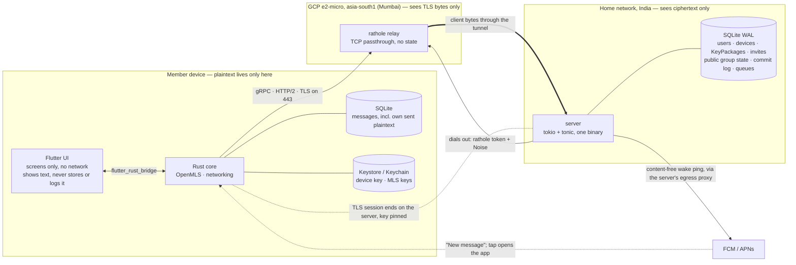
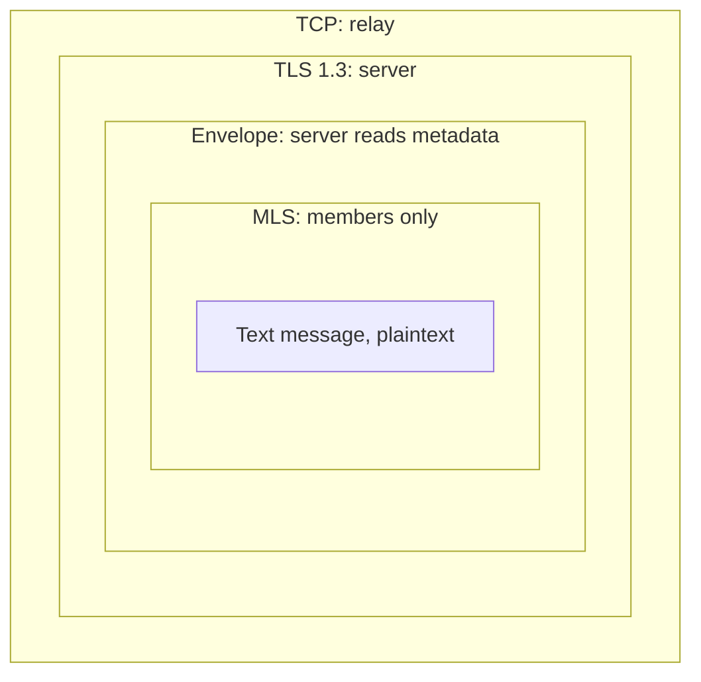
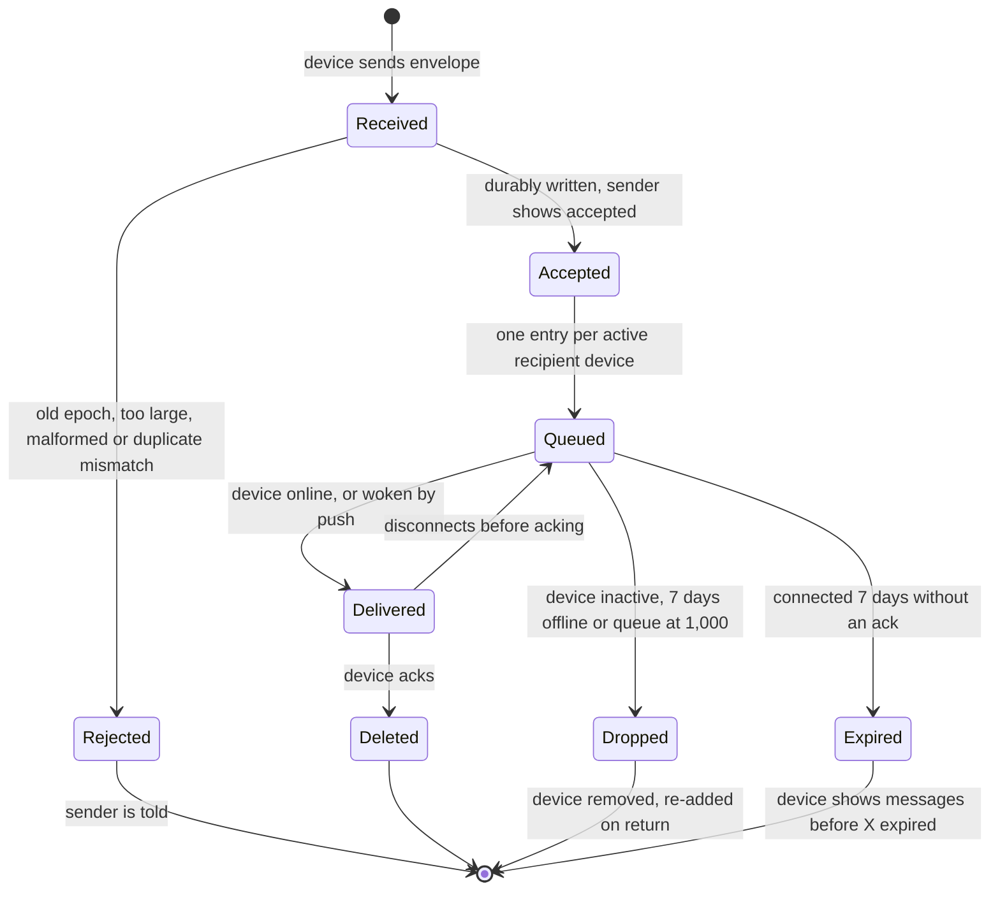
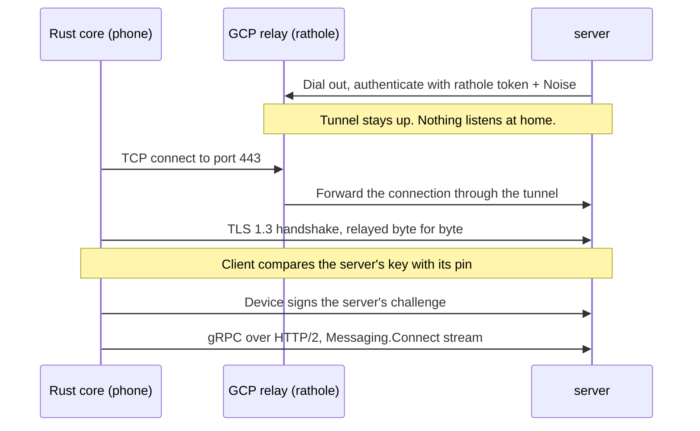

# Chat App MVP — Architecture Decisions

Nov 7, 2026 · updated Nov 8, 2026 (core-wire-protocol), Nov 12, 2026 (flutter-app), Nov 15, 2026 (relay), Nov 17, 2026 (dms), Nov 19, 2026 (media-blobs) · @Akhil Sasidharan

## Scope

The MVP is old-school messaging, text and one picture at a time, in one admin-run group plus DMs between its members, end-to-end encrypted with OpenMLS. It replaces Vyajena, which was a learning experiment.

**In**

- Text messages, with @-mentions (a member or `@everyone`, which any member may send) and replies carrying a quote of up to 100 characters, all inside the encrypted `Content` (change `mentions`, owner 2026-11-17); no edit or delete
- Picture messages (change `media-blobs`, owner 2026-11-19): one static image per message with an optional caption (which takes mentions). The core turns every picture into a WebP of at most 2048 px and 2 MB with no metadata; it travels as an encrypted blob on the server and the MLS message carries only its id, key, size and a ThumbHash blur. The full picture downloads on tap and is cached on the device; the server keeps a blob 7 days or until every member device has it
- One group, created and managed by the admin (Akhil)
- DMs (change `dms`, owner 2026-11-17):
  - each is its own MLS group holding all devices of two users
  - any member may DM any member, with no approval
  - the server knows the pair, never the text
  - the admin has no power over DMs, and removing a user closes theirs
  - no block, no mute per chat, no leaving a DM
- Several devices per user, each its own MLS member
- Invite-only signup
- Store-and-forward through the server
- One delivery status: accepted by the server (⏳ sending → ✓ accepted)
- Push notifications as content-free wake pings (FCM, APNs) showing one fixed text, "New message" (change `push`, owner 2026-11-16); decrypted on-device previews are a later change
- iOS and Android apps first; desktop later (decision #3)
- Material 3 UI, `ColorScheme.fromSeed` with a muted seed and the `neutral` variant

**Out**

- More groups, user-created groups; blocking, muting one chat, leaving a DM
- Read receipts, presence, typing indicators
- Voice, video; albums, GIFs and animated images; stickers, cutouts and picture editing (the next media changes)
- Server-side message history
- Encryption at rest (no SQLCipher)

## Architecture

Four components. Keys never leave the Rust core on each device. Decrypted text
and pictures reach the Flutter UI only to be shown: Dart never stores, logs or sends them
(owner-approved wording, 2026-11-11: a UI that shows messages cannot keep the
old "plaintext never leaves the core" literally). The relay and the server see
ciphertext only.

- **Flutter UI:** draws screens only; never opens a connection. iOS and Android (`app/`); every call goes through `flutter_rust_bridge` to the core (`bridge/`, no logic). Decrypted text is in Dart memory only while shown; the core's SQLite keeps the only copy. Pictures are made, encrypted, uploaded and decrypted by the core, which keeps them in its own cache; Dart is handed the picked file going in and WebP bytes to draw coming out (change `media-blobs`). The app watches whether the phone has a network (`connectivity_plus`, state only, no connection) and tells the core to reconnect at once when one comes up (qa-fixes).
- **Rust core:** OpenMLS, networking, local SQLite, keys in the OS key store (Keystore/Keychain on phones, the OS keychain on desktop). Linked through `flutter_rust_bridge`.
- **GCP relay:** dumb TCP passthrough so no port opens at home.
- **server:** routes, orders and queues ciphertext; stores encrypted picture blobs; dispatches wake pings.

## Encryption

OpenMLS (RFC 9420) runs inside the Rust core on every device, so the relay and the server see only ciphertext.

| Party | Sees | Cannot see |
| --- | --- | --- |
| GCP relay | TLS bytes, client IPs, timing | Anything inside TLS |
| Server | Group id, member devices and their public leaf keys, admin id, epoch, sender, time, size, membership changes; for a picture, the group it was uploaded for, its size and when | Message content, group name and settings, profiles, a picture or its key |
| Apple / Google | When a device gets a wake ping (its push token, the fixed text "New message") | Content, sender, group, count |

Each layer of a message on the wire, and who can open it:

- **Epoch rule (strict):** the server rejects any message tagged with an old epoch; the client re-encrypts and resends.
- **Key pruning:** OpenMLS default `max_past_epochs = 0` is kept; the strict rule makes it safe.
- **Sent messages:** the sender cannot decrypt its own ciphertext, so the client stores its own plaintext locally on send.
- **Devices:** every MLS member is a device. Each user has one Ed25519 identity key, held by their first device, which signs a certificate for each device; the certificate is the device's MLS credential. Losing the first device means an admin-driven reset (remove the user, new invite).
- **Credentials:** OpenMLS does not check credentials, so the core verifies every new or changed leaf's certificate against the user's pinned identity key, and that the certificate's MLS key equals the leaf's signature key.
- **Handshakes in the clear:** Commits and Proposals are MLS `PublicMessage`, so the server can check them with OpenMLS `PublicGroup` (signature, sender, commit rule) without any group secret. Application messages stay `PrivateMessage`.
- **Commit rule:** in the main group, admin devices may commit anything. Other devices may commit only their own leaf update, adding or removing their own user's devices, and the server's inactivity Removes.
  - **In a DM** (change `dms`, owner-approved 2026-11-17):
    - any member device may commit its own leaf update, an Add of a device of either of the two users, a Remove of its own user's devices, and the server's Removes
    - nobody has more: there is no admin, and never a third user
  - The server and every client check the same rules.
- **DMs (change `dms`):**
  - **Group id:** random, and the server keeps one open DM per pair. It is not a hash of the pair: after a user reset, the new DM needs a new id.
  - **Group context:** the DM extension `0xF0A2` names the two users; a DM has no admin extension.
  - **Old apps kept out:** a device can join a DM only with a KeyPackage that lists `0xF0A2`, as every version 2 core's do. A 1.0.0 core would refuse a DM Welcome and ask for a needless re-add (spike S1), so the server hands out only such KeyPackages for a DM.
  - **Who adds whom:** the server tells a DM's members (`JoinNotice` per DM) which devices of the pair are missing: the peer at creation, newly linked devices, updated apps, devices back from inactivity. It does so only once the device is in the main group.
- **Group metadata:** the admin's user id is in the group context, which the server can read (it enforces it anyway). Group name and settings travel only as encrypted `GroupSettings` messages, from admin devices. After any commit that adds devices, admin devices send the current name again and every device sends its own user's `Profile` again, so a device added later learns both; an equal value changes nothing on screen (qa-fixes).
- **Names:** the admin picks each username at invite time; it is the local part of `user@<server>` and users cannot change it. Display name and "about" travel as an encrypted `Profile`, set only by that user's devices. When a user's identity key changes (a reset), members drop the stored profile, so the new identity shows the username until it sets one.
- **Residual risk:** the server could hand out a fake identity key and KeyPackage the first time a client sees a user (keys are pinned on first sight) and read new messages. Only question-and-answer verification (decision #2, its own `qa-verification` change) stops this; until then the core pins keys and warns when one changes.
- **Residual risk:** the server cannot check membership tags, confirmation tags or encrypted path secrets. A dishonest member with a valid leaf can get a commit sequenced that honest clients reject, which stalls the group. Any MLS delivery service has this gap; there is no recovery flow yet.

## Server (server)

The server is the single authority for routing, ordering and membership, and never for message history. Rust, tokio + tonic, SQLite in WAL mode, one static binary.

- **Admin:** the admin's user id is in the server's config; the bootstrap invite creates that user, who creates the group with `Admin.CreateGroup` before inviting anyone.
- **Invites:** admin creates single-use invite codes, each for a username; signup = code + user identity key + device certificate.
- **Auth:** each device holds an Ed25519 auth key and signs a server challenge, bound to the TLS connection, for a session token of at most 6 hours (change `resume-across-restart`). The core saves the latest token in the OS key store, so a reopen (`stop()` then `start()`) within its life opens `Connect` with it and skips `GetChallenge` and `Authenticate`; device removal deletes the server's sessions and the saved token. A revoked device with a valid signature gets `PERMISSION_DENIED` (its open stream is closed the same way); the core then stops connecting and the app says the device was removed (qa-fixes). A bad signature stays `UNAUTHENTICATED`, so nobody learns whether a device is revoked without its key.
- **Key directory:** stores and hands out each device's MLS KeyPackages with its certificate.
- **Membership:** tracks the group's public state with OpenMLS `PublicGroup`, checks every Commit, and as an MLS external sender proposes the removal of inactive devices.
- **New users join on their own (flutter-app, owner 2026-11-12):** the admin inviting a user is the consent, so nobody taps "add". Once a new user's device uploads its first KeyPackages, the server sends a `JoinNotice` to the admin's connected devices, and again on every admin connect until that device is a member. The first admin device fetches that device's KeyPackage, checks its certificate (pinning the user's key on first sight) and commits the Add with its Welcome; a race loser gets `STALE_EPOCH` and does nothing. A changed identity key waits for the admin to accept it, and the accept is the add.
- **Ordering:** checks the epoch on every envelope, gives each accepted one the next `server_seq` for the group, and appends Commits and Proposals to the commit log.
- **Queues:** per-device store-and-forward queue of application ciphertext.
- **Blobs (change `media-blobs`, owner 2026-11-19):** the `Blobs` service stores a picture as opaque XChaCha20-Poly1305 ciphertext the sending device made under a fresh key that travels only inside MLS. Upload and download are checked against group membership; a blob is deleted when every member device has acked it or after 7 days. The bytes go through a pluggable backend, so a bucket or other cheap storage can replace the first one, the local filesystem at one stable path (the owner's auto-mounted drive); the metadata, access rules and expiry stay in the server's SQLite whatever the backend. With no backend, or one that is absent, `Blobs` answers `UNAVAILABLE` and messaging goes on.
- **Push (change `push`, owner 2026-11-16):** sends a wake ping when a device with no open stream gets a new entry, at most once a minute. Android: FCM HTTP v1 with a service account of GCP project `vyajena` (Firebase added to it). iOS: APNs directly, with a `.p8` key the server signs its own ES256 JWT with; no Firebase SDK on iOS. Every ping is a visible notification with the one fixed text "New message" and nothing else; a new one replaces the shown one. A token the platform calls invalid is cleared; 429/5xx back off and retry. The server stays loopback-only: pings leave through `vyajena-egress.service`, a CONNECT proxy that reaches only the FCM, Google OAuth and APNs hosts on 443. Keys live only in `~/.vyajena-push/` on the Mac and `/var/lib/vyajena/push/` on the server. The review server only logs pings. The app registers its token through the core on every connect and asks for notification permission once, at its first connect after joining.

**What it stores:** users and their identity public keys, devices with their certificates, KeyPackages (each flagged DM-capable or not), invite codes, push tokens, session token hashes, for each group (the main group and each DM, with a DM's two usernames and when it was closed) the group id + epoch + member devices + public ratchet tree and group context, the commit log with a cursor per device, pending ciphertext, and dedup records (sender device, `msg_id`) for 7 days; and, for each picture blob, its id, group, uploader, size, ciphertext hash and times (the ciphertext itself is in the blob backend, not the database). Nothing else.

## Delivery and limits

Messages wait on the server at most 7 days and are deleted as soon as the recipient device acknowledges them.

Life of one application message on the server (Commits, Proposals and Welcomes skip the cap and expiry):

| Rule | Value |
| --- | --- |
| Message expiry | 7 days, a backstop for a device that connects but never acks |
| Queue cap | 1,000 application messages per recipient device |
| Inactivity | A device offline 7 days, or whose queue reaches 1,000, is removed and re-added automatically when it returns |
| Max message size | 64 KB of application ciphertext |
| Picture | At most 2048 px on the long edge, at most 2 MB of WebP; its blob is at most that plus 40 bytes |
| Blob lifetime | 7 days from upload, or until every member device has acked it |
| Handshake size | 256 KB per Commit or Proposal envelope, a Commit's Welcome included |
| Commits, Proposals and Welcomes | Exempt from expiry and cap; deleted once every device that must receive them has acknowledged |

- **Accepted** = the server has durably written the envelope and all its queue and log entries before it acknowledges.
- **Idempotent sends:** each envelope carries a client-generated id; the server deduplicates on (sender device, id) for 7 days, so retries never create duplicates.
- **Never blocked by one device:** a send is never rejected because of another device's queue. The full device is marked inactive instead.
- **Inactive devices:** the server stops queueing for the device, deletes its queue and sends an MLS external Remove proposal, reissued each epoch until committed. When the device returns, the server tells it so and sends a rejoin notice to the user's other devices and the admin's devices; the first one online re-adds it in one commit with no user action. The app shows "messages since X were not kept".
- **Catch-up:** a returning device gets everything after its cursor, commits, Welcomes and queued messages merged in `server_seq` order, before live traffic. (Replaying all commits first would leave older-epoch messages undecryptable, since `max_past_epochs = 0`.)
- **Expired gap:** messages that expired before a connected device acked them are lost; the app shows "messages before X expired".

## Connectivity

No port is opened at home: the server dials out to a free GCP relay, and TLS ends on the server, not the relay.

- **Relay:** its own GCP e2-micro, `vyajena-relay` in `asia-south1-c` (Mumbai; moved from `us-east1-b` in change `relay-mumbai`, owner 2026-11-20, to cut ~260 ms per round trip to tens of ms; not free tier, about $11/month) (project `vyajena`, its own VPC), running rathole 0.5.0 as a TCP passthrough: 443 for devices, <tunnel-port> for the tunnel. A reserved static IPv4 named `vyajarelay.purplechaamba.com` (one A record; owner, 2026-11-16): invites name `vyajarelay.purplechaamba.com:443`, so moving the relay needs a new A record, not a re-join. The server's tunnel dials the IP and needs no DNS. It holds no state and can be rebuilt, or moved to any VPS, from `deploy/relay/` and `~/.vyajena-relay/` (change `relay`).
- **Tunnel auth:** rathole's Noise NK transport with the relay's static key pinned on the server (a fake relay cannot attach the server), plus a service token (nobody else can attach in the server's place). The tunnel port is open to all because the home IPv4 is dynamic.
- **TLS:** the client pins the server's TLS public key. No domain or certificate authority needed.
- **Transport:** gRPC over HTTP/2 + TLS on TCP 443. HTTP/3 (tonic-h3) stays deferred while it is experimental.
- **Latency:** India → US relay → server in India: two intercontinental legs per round trip, roughly 0.4–0.6 s per send. Accepted for the MVP.
- **Cost:** the static IPv4 is billed, about $3.65/month (owner, 2026-11-15); the e2-micro, 10 GB standard disk and 1 GB/month outbound data are free tier. Watch the bill and the outbound data.
- **Review server** (change `review-server`, owner 2026-11-16): store reviewers use a second, separate server on the server (own user, data, keys, pin; ids `<name>@review.purplechaamba.com`) at `vyajarelay.purplechaamba.com:<review-port>`, through the same tunnel with its own token. They never join or see the real group.
- **Direct IPv6** to the server (the Airtel router drops inbound IPv6 today) is a possible later improvement, last.

### Home-LAN phase (ended 2026-11-15)

From `server-deployment` until the `relay` change, devices on the home Wi-Fi
dialed the server at `<server-address>:<server-port>` and nothing outside home could reach it.
The relay change moved the server to `127.0.0.1:<server-port>` behind the tunnel,
removed the LAN <server-port> rule, and reset the server (no migration): every device
re-joined with an invite naming the relay.

## Storage, keys and hardening

Messages are not encrypted at rest; keys live in the OS key store and every machine is hardened by access control. The one exception is OpenMLS group state, sealed under a storage key from the key store (client-core).

**App**

- Plain SQLite for messages, relying on Android FBE / iOS Data Protection.
- Ed25519 device key and MLS private keys in Android Keystore / iOS Keychain, never in the DB and never in Dart. iOS: the data-protection keychain, `WhenUnlockedThisDeviceOnly`, not synced. Android: each secret sealed under a non-exportable Keystore AES key in app-private preferences (flutter-app D4).
- Android: the core's folder in `noBackupFilesDir`, `allowBackup=false`, and no cloud backup or device transfer. iOS: the folder in Application Support, excluded from iCloud backup, `NSFileProtectionComplete`.
- Accepted risk: a rooted or jailbroken phone can read messages.

**Desktop (terminal client; client-core)**

- The identity, device auth and MLS signature keys, and the storage key, live in the OS keychain: macOS Keychain, Linux Secret Service, Windows Credential Manager.
- Only on a machine without a keychain, and only after the user explicitly opts in, they live in one key file with mode `0600`; without the opt-in the core refuses to create keys and says how to opt in.
- OpenMLS group state (epoch secrets, leaf keys, secret tree) is stored in SQLite with every value sealed (XChaCha20-Poly1305) under the storage key, so a copied database shows messages but cannot decrypt new group traffic. Messages are plain SQLite, as on phones.

**Server**

- SSH with keys only, no password or root login.
- nftables drops all inbound except SSH from the home subnet; the server only
  makes the outbound tunnel. The server listens on loopback only and may
  reach only loopback; the tunnel (`vyajena-tunnel.service`, a dynamic user)
  only loopback and the relay.
- Server runs as its own system user `vyajena` (no login shell); database and
  keys in `/var/lib/vyajena`, mode `700`, files `600`.
- systemd sandboxing: `NoNewPrivileges`, `ProtectSystem=strict`, `ProtectHome`,
  `PrivateTmp`, no capabilities, a system call filter; writable only
  `/var/lib/vyajena`, plus the blob path when one is configured. It stops
  cleanly on `SIGTERM`.
- Picture blobs (change `media-blobs`): `BLOB_DIR` in `deploy/server/server.conf`, empty
  (images off) until the owner names the path their drive is mounted at.
  Deploy never mounts or makes it: it gives the path to the service only if it
  is on a mount of its own, so a missing drive can never turn the SD card into
  the blob store. The server boots and serves text without the drive. Blobs are
  ciphertext with no key on the server, so there is no encryption layer of its own,
  and they are not backed up: they are short-lived and can be sent again.
- Unattended security updates, never an automatic reboot (the hardening check
  reports a pending one); nothing but SSH and the server listens (mDNS off).
- Built on the Mac in an arm64 container; no toolchain on the server. Deploy,
  check and backup are one command each (`deploy/server/`).

**Relay**

- Its own VM and VPC (owner, 2026-11-15): nothing else shares it. Worst case for chat, if it is compromised: DoS plus client IPs and timing.
- VPC firewall: 443 and the tunnel port public, SSH only from Google IAP's range, everything else dropped; firewall logging off.
- SSH only through GCP IAP, keys only (the relay key in `~/.vyajena-relay/`), no root; the host key is pinned from the VM's guest attributes.
- VPC flow logs off, rathole logs at `warn`, the journal in RAM only: client IPs are not kept.
- No service account or API scopes; rathole runs under a dynamic user with only `CAP_NET_BIND_SERVICE` and no writable path.
- Unattended security updates, never an automatic reboot; checked by `deploy/relay/check.sh`.

## Wire protocol

One persistent bidirectional gRPC stream carries all messaging; `.proto` files are the contract, independent of the Rust code.

The contract is package `vyajena.v1` in `proto/vyajena/v1/`.

| Service | RPCs |
| --- | --- |
| `Messaging` | `Connect` (bidi stream): protocol version hello (1 or 2; the server lists both, and 2 means it knows `Dms`), envelopes of every group both ways (one `server_seq` across groups), send results, acks, catch-up, gap / removed / rejoin / join / low-KeyPackage / `DmClosed` notices (`JoinNotice`: a new user's device waits for the admin's device to add it, or a DM waits for a device), heartbeats |
| `Devices` | `GetServerInfo`, `Register` (invite), `GetChallenge`, `Authenticate`, `LinkDevice`, `GetSelf`, `RevokeDevice`, `UpdatePushToken` |
| `Keys` | `UploadKeyPackages` (a new device's first upload triggers the `JoinNotice`), `FetchKeyPackages` (one user, optionally only some devices; with a DM's `group_id`, only KeyPackages that list `0xF0A2`), `GetIdentityKeys` (identity keys only, consumes nothing), `RequestReadd` (a device that could not use its Welcome asks to be re-added, with fresh KeyPackages; welcome-recovery) |
| `Admin` | `CreateInvite`, `ListInvites`, `RevokeInvite`, `CreateGroup`, `RemoveUser` (also closes the user's DMs) |
| `Blobs` | `UploadBlob`, `DownloadBlob`, `AckBlob` (change `media-blobs`): unary, a blob up to 2 MB, only for a member device of the blob's group; `UNAVAILABLE` while the blob backend is absent or off |
| `Dms` | `CreateDm` (any member; `created = false` with the open DM's id when the peer opened it first; change `dms`) |

**Envelope:** `msg_id` (16 bytes, client-generated, for dedup) · `group_id` · `epoch` · `kind` (application, commit, proposal, welcome) · `ciphertext` (the MLS message) · `welcome` (on a commit only: Welcome bytes + recipient devices). Set by the server: `sender` · `server_seq` · `accepted_at`.

- **Welcome inside its commit:** clients never send `welcome` envelopes. A Welcome rides inside the commit that creates it; the server accepts or rejects both together, then sends each new device a `welcome` envelope itself.
- Server ids are `user@<server>` from day one, so federation can be added later. A device id is the first 16 bytes of SHA-256 of its auth public key.
- Every message passes through the Rust core; Flutter never opens a connection (checked by an import scan of `app/lib/`).

## Future

Nothing here is built in the MVP, but the protocol leaves room for each.

- Muting one chat (the push would need an opaque per-device chat tag), leaving a DM, blocking
- More groups, then Discord-style servers; admin-only creation at first
- More media on the blob store built in `media-blobs`: picture transforms and stickers (the next two changes), albums, voice, video, thumbnails
- A second blob backend (an object-storage bucket) behind the same trait
- P2P under conditions (media, voice, video) via iroh, server or relay as iroh-relay
- Encrypted per-user history store on the server, which also gives new devices history
- Federation between servers using `user@<server>` ids
- gRPC over HTTP/3 (tonic-h3) once it matures

## Open decisions

- [x] Multi-device in the MVP? **Yes** (core-wire-protocol): each device is an MLS member with a certificate signed by the user identity key; the first device holds that key and links the others; recovery is admin-driven.
- [x] Fingerprint verification in the MVP? **Replaced** (client-core): question-and-answer verification over a PAKE (CPace): both users type the answer to a question the asker picks, and the answer never leaves either device. It comes in its own `qa-verification` change right after the Flutter app (owner, 2026-11-11); the core already pins identity keys and warns when one changes.
- [x] Desktop clients in the MVP, or mobile only? **Mobile now, desktop later** (owner, 2026-11-11; flutter-app): the Flutter app targets iOS and Android only; desktop builds come in a later change.
- [x] Key rotation for idle groups? **Every 7 days, with jitter** (client-core): each device commits an update of its own leaf once it is 7 days old and replaces its last-resort KeyPackage once that is 7 days old, checking on connect and daily, with a random delay of up to an hour.
- [x] Max message size? **64 KB** of application ciphertext (core-wire-protocol); Commit envelopes, Welcome included, up to 256 KB.
- [x] Relay on the shared VM or its own VM? **Its own VM** (owner, 2026-11-15; relay): a new free-tier e2-micro in `us-east1`, project `vyajena` (owner, 2026-11-16; first built in `purple-eccdf`), used by nothing else; a static IPv4 (about $3.65/month) named `vyajarelay.purplechaamba.com`. Real push comes in the next change. (2026-11-20, change `relay-mumbai`: moved to `asia-south1`, no longer free tier.)
- [x] Build order? **Changed** (owner, 2026-11-11; flutter-app): 1. Server ✅, 2. Rust core library ✅, 3. Flutter app (iOS and Android; the first point where two people can chat locally, on two simulators), 4. question-and-answer verification (`qa-verification`), 5. relay and server deployment ✅ (relay first, real push (FCM/APNs) in the next change; owner, 2026-11-15), 6. the terminal client. (Was, server-core: server, core, terminal client, deployment, then the app with push.)
- [x] How is the app distributed? **Privately first** (owner, 2026-11-15; app-release): a new Play app `com.purplechaamba.vyajena` on internal testing now, TestFlight internal testing once the owner's individual Apple account exists; Android 7.0+ and iOS 15.0+, iPhone only; name "Vyajena", icon "വ്യ"; export compliance `ITSAppUsesNonExemptEncryption = NO` on App Store Connect's own answer for standard algorithms outside France (was YES; France left out); upload key and certificate held only by the owner (Keychain + password manager), never in the repo or CI; policy at https://www.purplechaamba.com/vyajena/privacy/. The old vyajena Play app and its CI deployment are deleted once this app runs. A **public** listing waits for: the relay (reviewers must reach the server), in-app account deletion, report/block, real push, and Play's 12-tester closed test. Steps: `docs/release.md`.
