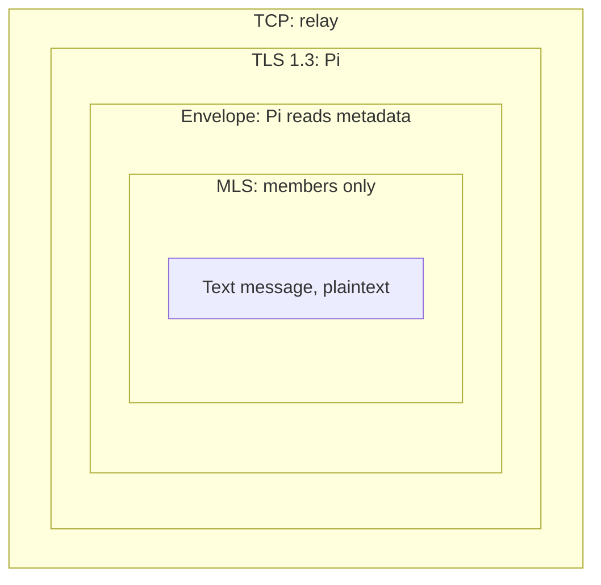
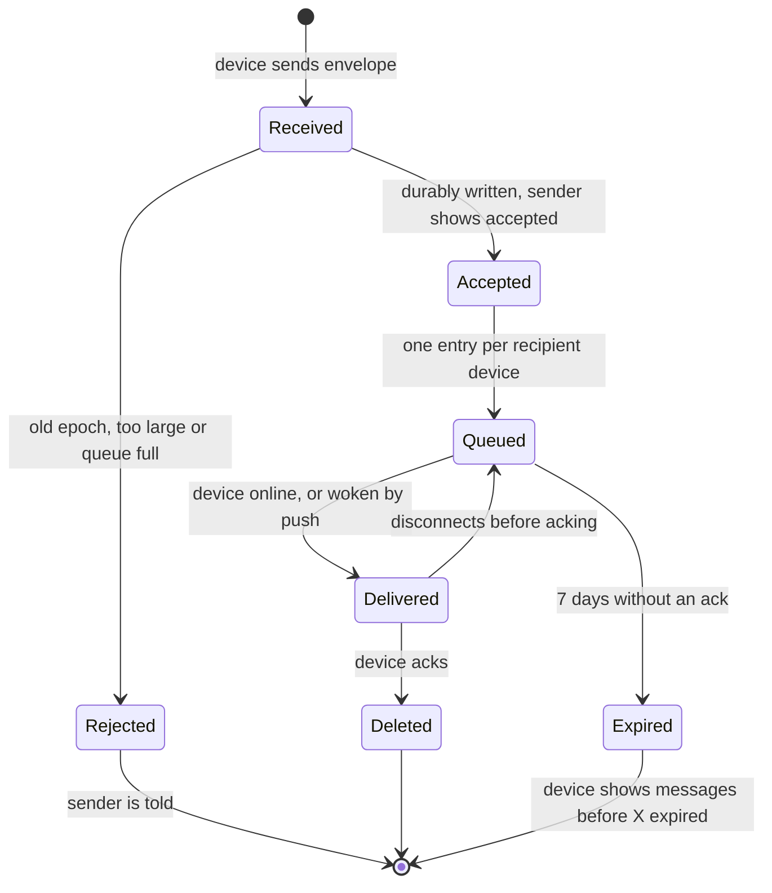
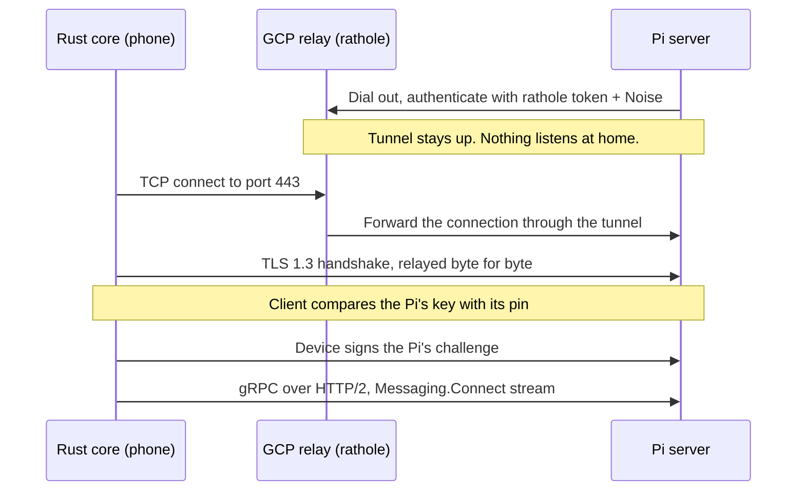

# Chat App MVP — Architecture Decisions

Nov 7, 2026 · @Akhil Sasidharan

## Scope

The MVP is old-school text messaging in one admin-run group, end-to-end encrypted with OpenMLS. It replaces Vyajena, which was a learning experiment.

**In**

- Text messages only
- One group, created and managed by the admin (Akhil)
- Invite-only signup
- Store-and-forward through the Pi server
- One delivery status: accepted by the server (⏳ sending → ✓ accepted)
- Push notifications as content-free wake pings (FCM, APNs)
- Material 3 UI, `ColorScheme.fromSeed` with a muted seed and the `neutral` variant

**Out**

- DMs, more groups, user-created groups
- Read receipts, presence, typing indicators
- Media, voice, video
- Server-side message history
- Encryption at rest (no SQLCipher)

## Architecture

Four components; plaintext exists only inside the Rust core on each device.

- **Flutter UI:** draws screens only; never opens a connection.
- **Rust core:** OpenMLS, networking, local SQLite, keys in Keystore/Keychain. Linked through `flutter_rust_bridge`.
- **GCP relay:** dumb TCP passthrough so no port opens at home.
- **Pi server:** routes, orders and queues ciphertext; dispatches wake pings.

## Encryption

OpenMLS (RFC 9420) runs inside the Rust core on every device, so the relay and the Pi see only ciphertext.

| Party | Sees | Cannot see |
| --- | --- | --- |
| GCP relay | TLS bytes, client IPs, timing | Anything inside TLS |
| Pi server | Group id, member devices, epoch, sender, time, size | Message content, group name and settings |
| Apple / Google | When a device gets a wake ping | Content, sender |

Each layer of a message on the wire, and who can open it:

- **Epoch rule (strict):** the Pi rejects any message tagged with an old epoch; the client re-encrypts and resends.
- **Key pruning:** OpenMLS default `max_past_epochs = 0` is kept; the strict rule makes it safe.
- **Sent messages:** the sender cannot decrypt its own ciphertext, so the client stores its own plaintext locally on send.
- **Group metadata** (name, admin list, settings) lives inside the MLS group, never on the server.
- **Admin-only changes:** the Pi accepts membership Commits only from the admin's devices; members may only update their own keys.
- **Residual risk:** the Pi could hand out a fake KeyPackage and read new messages. Only fingerprint verification stops this (open decision).

## Server (Pi)

The Pi is the single authority for routing, ordering and membership, and never for message history. Rust, tokio + tonic, SQLite in WAL mode, one static binary.

- **Invites:** admin creates single-use invite codes; signup = code + device public key.
- **Auth:** each device holds an Ed25519 key and signs a server challenge on every connect.
- **Key directory:** stores and hands out each device's MLS KeyPackages.
- **Ordering:** checks the epoch on every message and appends Commits to the group's commit log.
- **Queues:** per-device store-and-forward queue of ciphertext envelopes.
- **Push:** sends a wake ping to FCM or APNs when a queue gets a new item.

**What it stores:** devices and their public keys, KeyPackages, invite codes, push tokens, group id + member devices + epoch, the commit log with a cursor per member, and pending ciphertext. Nothing else.

## Delivery and limits

Messages wait on the Pi at most 7 days and are deleted as soon as the recipient device acknowledges them.

Life of one application message on the Pi (Commits and Welcomes skip the cap and expiry):

| Rule | Value |
| --- | --- |
| Message expiry | 7 days |
| Queue cap | 1,000 messages per recipient device |
| Queue full | Reject the send and tell the sender; never drop silently |
| Max message size | 64 KB (proposed) |
| Commits and Welcomes | Exempt from expiry and cap; deleted once every member has acknowledged |
| Inactivity | Member auto-removed after 30 days offline; admin re-adds |

- **Accepted** = the Pi has durably written the envelope before it acknowledges.
- **Idempotent sends:** each envelope carries a client-generated id; the Pi deduplicates on it, so retries never create duplicates.
- **Catch-up:** a returning device replays the commit log from its cursor, then drains its queue.
- **Expired gap:** messages that expired while a device was offline are lost; the app shows "messages before X expired".

## Connectivity

No port is opened at home: the Pi dials out to a free GCP relay, and TLS ends on the Pi, not the relay.

- **Relay:** GCP free-tier e2-micro (US region) running rathole as a TCP passthrough. It holds no state and can move to any VPS with a config change.
- **Tunnel auth:** rathole token + Noise transport, so only the Pi can attach.
- **TLS:** the client pins the Pi's TLS public key. No domain or certificate authority needed.
- **Transport:** gRPC over HTTP/2 + TLS on TCP 443. HTTP/3 (tonic-h3) stays deferred while it is experimental.
- **Latency:** India → US relay → Pi in India costs about 0.5 s per send. Accepted for the MVP.
- **Free tier limits to watch:** 1 GB/month outbound data, and a possible external IPv4 charge (about $3.65/month, check the bill).

## Storage, keys and hardening

There is no encryption at rest; keys live in the OS key store and every machine is hardened by access control.

**App**

- Plain SQLite for messages, relying on Android FBE / iOS Data Protection.
- Ed25519 device key and MLS private keys in Android Keystore / iOS Keychain, never in the DB.
- Android: `allowBackup=false` (no Google Drive copy). iOS: DB excluded from iCloud backup, `NSFileProtectionComplete`.
- Accepted risk: a rooted or jailbroken phone can read messages.

**Pi**

- SSH with keys only, no password or root login.
- nftables drops all inbound; the Pi only makes the outbound tunnel.
- Server runs as its own system user; DB file mode `600`.
- systemd sandboxing: `NoNewPrivileges`, `ProtectSystem=strict`, `PrivateTmp`.
- Unattended security updates; nothing else running on the Pi.

**Relay**

- Firewall: 443 public, tunnel port for the tunnel only, everything else closed.
- SSH keys only, or GCP IAP with no public SSH.
- VPC flow logs off, so client IPs are not kept.
- Shares its VM with an existing service: one compromise exposes both. Worst case for chat is DoS plus client IPs.

## Wire protocol

One persistent bidirectional gRPC stream carries all messaging; `.proto` files are the contract, independent of the Rust code.

| Service | Purpose |
| --- | --- |
| `Messaging.Connect` (bidi stream) | Send envelopes, receive envelopes, acks, commit log replay, heartbeat |
| `Devices` | Register with invite code, auth challenge, push token update |
| `Keys` | Upload and fetch MLS KeyPackages |
| `Admin` | Create invites, add or remove members |

**Envelope:** `msg_id` (client-generated, for dedup) · `group_id` · `sender_device` · `epoch` · `kind` (application, commit, welcome) · `ciphertext`.

- Server ids are `user@<server>` from day one, so federation can be added later.
- Every message passes through the Rust core; Flutter never opens a connection.

## Future

Nothing here is built in the MVP, but the protocol leaves room for each.

- DMs as 2-member MLS groups, id = hash of the sorted user pair
- More groups, then Discord-style servers; admin-only creation at first
- Media: client-encrypted blobs on the Pi, file key sent inside MLS
- P2P under conditions (media, voice, video) via iroh, Pi or relay as iroh-relay
- Encrypted per-user history store on the Pi, which also gives new devices history
- Federation between servers using `user@<server>` ids
- gRPC over HTTP/3 (tonic-h3) once it matures

## Open decisions

- [ ] Multi-device in the MVP? If yes: each device is a member, signed by a user identity key; a user may add their own devices.
- [ ] Fingerprint verification in the MVP?
- [ ] Desktop clients in the MVP, or mobile only?
- [ ] Key rotation for idle groups: every 7 days (proposed)?
- [ ] Max message size: 64 KB?
- [ ] Relay on the shared VM or its own VM?
- [ ] Build order (deferred to the end)
