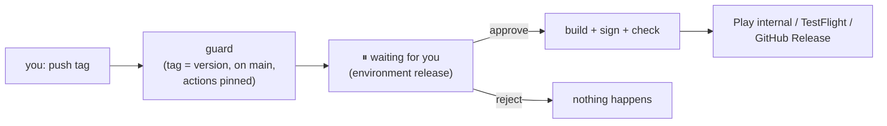

# Releasing from GitHub Actions

OpenSpec change `ci-release`. A pushed tag builds a release; **you approve
it** in GitHub before anything is signed, uploaded or published. The manual
path (`docs/release.md`) keeps working as the fallback.



| Tag | Workflow | Result |
|---|---|---|
| `app-v1.0.0+5` | `release-app` | Play **internal** track + **TestFlight** |
| `server-v0.2.0` | `release-server` | GitHub Release: `vyajena-server`, `rathole`, `SHA256SUMS`, provenance |
| Run workflow (Actions tab) | either | **dry run**: builds, checks, uploads nothing, needs no secret |

The Pi is never deployed from CI. You still run `deploy/pi/deploy.sh`.

Rules for every step below:

- Only you do these steps. No session creates secrets, keys or settings.
- Commands that set a secret read it from a file or the Keychain and pipe it
  into `gh secret set`: nothing is printed. Never paste a secret into chat.
- Every secret goes into the **environment** `release` (`--env release`),
  never a repository secret.

## One-time setup

### 1. The `release` environment (do this first, before any release tag)

If a release tag is pushed before this exists, GitHub makes the environment
itself, **without** approval. The release jobs then stop at their first step
("Refuse an unprotected environment"), so nothing ships, but set it up first.

GitHub › koppathachan/vyajena › Settings › Environments › **New environment**
› `release`:

- **Required reviewers:** add `koppathachan`. Leave "Prevent self-review"
  **off** (you are the only maintainer).
- **Allow administrators to bypass configured protection rules:** **off**.
- **Deployment branches and tags:** "Selected branches and tags" › Add rule ›
  type **Tag** › `app-v*`; again › **Tag** › `server-v*`. No branch rule.
- No environment variables needed.

### 2. Tag ruleset

Settings › Rules › Rulesets › New ruleset › **New tag ruleset**:

- Name `release tags`, Enforcement **Active**.
- Bypass list: **Repository admin** (you).
- Target tags › Include by pattern: `app-v*` and `server-v*`.
- Rules: **Restrict creations**, **Restrict updates**, **Restrict
  deletions**, **Block force pushes**.

A tag then cannot be moved after you approved it.

### 3. Fork pull requests

Settings › Actions › General › "Approval for running fork pull request
workflows from contributors": **Require approval for all external
contributors**.

### 4. Dry runs (no secrets needed yet)

After the `ci-release` PR is merged:

- Actions › **release-app** › Run workflow › branch `main` › Run.
- Actions › **release-server** › Run workflow › branch `main` › Run.

Both must go green. `android (dry run)` signs with a throwaway key;
`ios (dry run)` is unsigned; nothing is uploaded. The app dry run fails if
`app/pubspec.yaml`'s build number is not above the highest `app-v*` tag:
raise it first.

### 5. Android secrets

In a terminal on your Mac (each line prints nothing):

```bash
base64 -i ~/.vyajena-release/upload.jks | gh secret set ANDROID_UPLOAD_KEYSTORE_B64 --env release --repo koppathachan/vyajena
```

```bash
security find-generic-password -s vyajena-upload -a store -w | gh secret set ANDROID_UPLOAD_STORE_PASSWORD --env release --repo koppathachan/vyajena
```

```bash
security find-generic-password -s vyajena-upload -a key -w | gh secret set ANDROID_UPLOAD_KEY_PASSWORD --env release --repo koppathachan/vyajena
```

```bash
base64 -i ~/.vyajena-push/google-services.json | gh secret set ANDROID_GOOGLE_SERVICES_JSON_B64 --env release --repo koppathachan/vyajena
```

The job checks the bundle against the fingerprint in `app/store/signing.md`,
so it must be the same upload key Play knows.

**GitHub is not a backup:** a secret can be written, never read back. Keep
`upload.jks` and both passwords in your password manager (Bitwarden: the
`.jks` as a file attachment, which needs Premium; the passwords as fields).
If it is ever lost anyway, Play can reset the upload key (see the table at the
end); installed apps keep updating.

### 6. Play access without a key (workload identity)

You already have a Play service account and a `github-pool` workload identity
pool in GCP project `vyajena` (docs/release.md step 11). Reuse them, but make
the provider trust **only this repo's `release` environment**. You run these;
check each one before you run it.

1. This repo's numeric id (names can be reused; ids cannot):

   ```bash
   gh api repos/koppathachan/vyajena --jq .id
   ```

2. See what the provider trusts today:

   ```bash
   gcloud iam workload-identity-pools providers list --project=vyajena --location=global --workload-identity-pool=github-pool
   ```

   ```bash
   gcloud iam workload-identity-pools providers describe <provider> --project=vyajena --location=global --workload-identity-pool=github-pool
   ```

3. Tighten it (replace `<provider>` and `<repo id>`):

   ```bash
   gcloud iam workload-identity-pools providers update-oidc <provider> --project=vyajena --location=global --workload-identity-pool=github-pool --attribute-mapping="google.subject=assertion.sub,attribute.repository_id=assertion.repository_id,attribute.environment=assertion.environment,attribute.ref=assertion.ref" --attribute-condition="assertion.repository_id == '<repo id>' && assertion.environment == 'release' && assertion.ref.startsWith('refs/tags/app-v')"
   ```

4. Let that repo impersonate the service account (replace `<sa email>`,
   `<project number>`, `<repo id>`):

   ```bash
   gcloud iam service-accounts add-iam-policy-binding <sa email> --project=vyajena --role=roles/iam.workloadIdentityUser --member="principalSet://iam.googleapis.com/projects/<project number>/locations/global/workloadIdentityPools/github-pool/attribute.repository_id/<repo id>"
   ```

   Remove any older binding for other repos (`get-iam-policy` shows them).
   The IAM Service Account Credentials API must be enabled in `vyajena`.

5. Play Console › Users and permissions › the service account › **App
   permissions** › Vyajena (`com.purplechaamba.vyajena`) only:
   - "View app information (read-only)"
   - "Release apps to testing tracks"
   - "Manage testing tracks and edit tester lists"

   Nothing for production, no account permissions, no other apps. Remove its
   access to the old app `com.chaamba.vyajena`.

6. The two names as secrets (not secret, but kept out of the public repo):

   ```bash
   gh secret set PLAY_WIF_PROVIDER --env release --repo koppathachan/vyajena
   ```

   (paste `projects/<project number>/locations/global/workloadIdentityPools/github-pool/providers/<provider>`, Enter, Ctrl-D)

   ```bash
   gh secret set PLAY_SERVICE_ACCOUNT --env release --repo koppathachan/vyajena
   ```

   (paste the service account email, Enter, Ctrl-D)

### 7. iOS: a distribution certificate for CI

Your current certificate is cloud-managed (Apple keeps the key), so CI gets
its own. Keep the files in your owner-only folder and delete them after.

```bash
mkdir -p ~/.vyajena-release/ci && chmod 700 ~/.vyajena-release/ci
```

1. Keychain Access › Certificate Assistant › **Request a Certificate From a
   Certificate Authority**: your email, name "vyajena CI", **Saved to disk**
   → `~/.vyajena-release/ci/ci.certSigningRequest`.
2. developer.apple.com › Certificates › **+** › **Apple Distribution** ›
   upload the request › download, double-click (it lands in Keychain Access
   with its private key).
3. Keychain Access › My Certificates › "Apple Distribution: … (XMVHK3YASX)"
   (the new one, check the date) › right-click › **Export** › `.p12` →
   `~/.vyajena-release/ci/dist.p12` with a strong password. Put the `.p12`
   and the password in your password manager.
4. developer.apple.com › Profiles › **+** › **App Store Connect** (under
   Distribution) › App ID `com.purplechaamba.vyajena` › the **new**
   certificate › name `vyajena CI App Store` › download →
   `~/.vyajena-release/ci/appstore.mobileprovision`. (The App ID already has
   Push; the profile then has `aps-environment = production`.)

```bash
base64 -i ~/.vyajena-release/ci/dist.p12 | gh secret set IOS_DIST_CERT_P12_B64 --env release --repo koppathachan/vyajena
```

```bash
gh secret set IOS_DIST_CERT_PASSWORD --env release --repo koppathachan/vyajena
```

(type the `.p12` password, Enter, Ctrl-D)

```bash
base64 -i ~/.vyajena-release/ci/appstore.mobileprovision | gh secret set IOS_PROFILE_B64 --env release --repo koppathachan/vyajena
```

The profile expires after a year: make a new one and update the secret.

### 8. iOS: App Store Connect API key

App Store Connect › Users and Access › **Integrations** › App Store Connect
API › Team Keys › **+**: name `vyajena-ci`, access **Developer** (enough to
upload builds; not Admin, not App Manager). Download `AuthKey_<key id>.p8`
(only once) to `~/.vyajena-release/ci/`. Note the **Key ID** and the
**Issuer ID** (top of the page).

```bash
base64 -i ~/.vyajena-release/ci/AuthKey_<key id>.p8 | gh secret set ASC_KEY_P8_B64 --env release --repo koppathachan/vyajena
```

```bash
gh secret set ASC_KEY_ID --env release --repo koppathachan/vyajena
```

```bash
gh secret set ASC_ISSUER_ID --env release --repo koppathachan/vyajena
```

(paste each value, Enter, Ctrl-D.) Put the `.p8` in your password manager,
then remove the folder:

```bash
rm -rf ~/.vyajena-release/ci
```

TestFlight › Internal Testing › "First testers": turn on **automatic
distribution**, so each processed build reaches the group.

Check the list: Settings › Environments › `release` should show **12
secrets** (D13 in `openspec/changes/ci-release/design.md`) and Settings ›
Secrets and variables › Actions › Repository secrets should show **none** of
them.

## Cutting an app release

1. In a PR: raise the build number in `app/pubspec.yaml` (`1.0.0+4` →
   `1.0.0+5`; it only goes up, shared by both stores). Merge it.
2. Optional: dry run on `main` (step 4).
3. Tag the merged commit and push **only the tag**:

   ```bash
   git fetch origin && git tag -s app-v1.0.0+5 origin/main -m "app 1.0.0 (5)"
   ```

   ```bash
   git push origin refs/tags/app-v1.0.0+5
   ```

4. Actions › release-app: `guard` runs, then `android` and `ios` show
   **Waiting**. Open the run › **Review deployments** › tick `release` ›
   **Approve and deploy**. (Reject if you did not mean it.)
5. Watch both jobs. Android lands on internal testing at once; the iOS build
   shows in TestFlight after Apple's processing (5–30 min).

The tag must equal `pubspec.yaml` exactly and sit on `main`, or `guard` stops
the run. A failed or rejected release burns that build number: raise it and
tag again. Never move or delete a release tag.

If you still release by hand (`docs/release.md`), pushing that tag also starts
`release-app`: **reject** it.

## Cutting a server release

1. In a PR: bump `version` in `server/Cargo.toml` (and the `Cargo.lock` line
   `cargo build` updates). Merge it.
2. Tag and push the tag:

   ```bash
   git fetch origin && git tag -s server-v0.2.0 origin/main -m "server 0.2.0"
   ```

   ```bash
   git push origin refs/tags/server-v0.2.0
   ```

3. Actions › release-server: `build` runs (about 15 min), then `publish`
   waits: **Review deployments** › Approve.
4. Deploying it stays manual. To deploy the published files instead of a
   local build:

   ```bash
   gh release download server-v0.2.0 --repo koppathachan/vyajena --dir target/pi --clobber
   ```

   ```bash
   cd target/pi && shasum -a 256 -c SHA256SUMS && cd -
   ```

   ```bash
   gh attestation verify target/pi/vyajena-server --repo koppathachan/vyajena
   ```

   ```bash
   gh attestation verify target/pi/rathole --repo koppathachan/vyajena
   ```

   ```bash
   chmod 0755 target/pi/vyajena-server target/pi/rathole && deploy/pi/deploy.sh --no-build
   ```

   (Making `deploy.sh` do this itself is open item O1.)

## If something leaks or goes wrong

| What | Do this |
|---|---|
| **Your GitHub account** (or a `gh` token) | Settings › Sessions: revoke all; Settings › Applications and Developer settings: revoke tokens; `gh auth logout`; new password + 2FA. Check Settings › Security log. Then rotate everything below and halt/expire any rogue build. |
| A bad build reached testers | Play Console › Internal testing › **Halt** the release, ship a fixed higher build. TestFlight › the build › **Expire**. |
| Upload key | Play Console › Test and release › App integrity › **Request upload key reset**; new key → new `app/store/signing.md` fingerprint → new secrets (step 5). |
| Play access | `gcloud iam workload-identity-pools providers disable <provider> --project=vyajena --location=global --workload-identity-pool=github-pool`; Play Console › Users and permissions › remove the service account. |
| Distribution certificate | developer.apple.com › Certificates › **Revoke**; redo step 7. Installed builds keep working. |
| App Store Connect key | App Store Connect › Integrations › Keys › **Revoke** (immediate); redo step 8. |
| A rogue GitHub Release | Delete it (Releases › … › Delete); `deploy/pi/deploy.sh --rollback` if it was deployed. |
| A compromised action | Revert its pin; rotate the secrets of every job that ran it. |

More detail: `openspec/changes/ci-release/design.md` D12.
