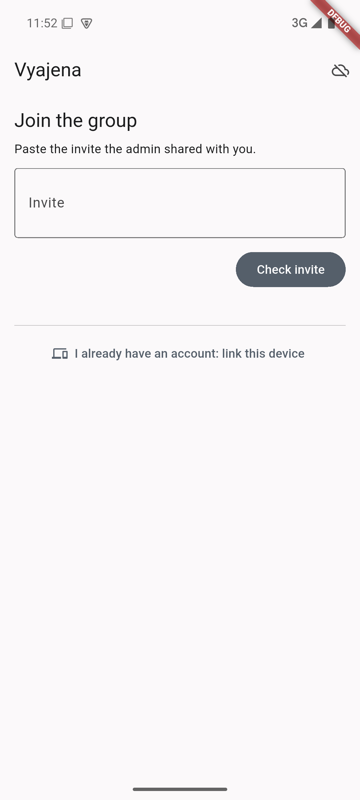
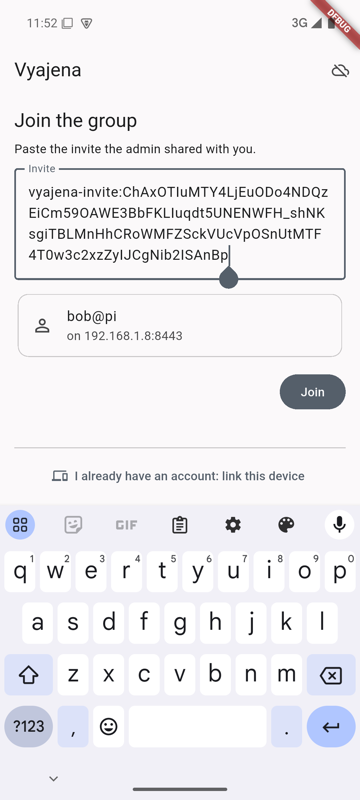
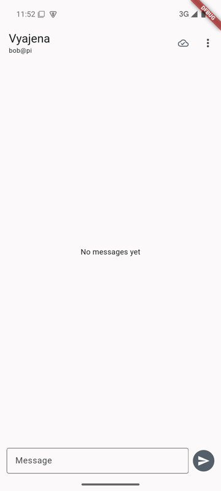
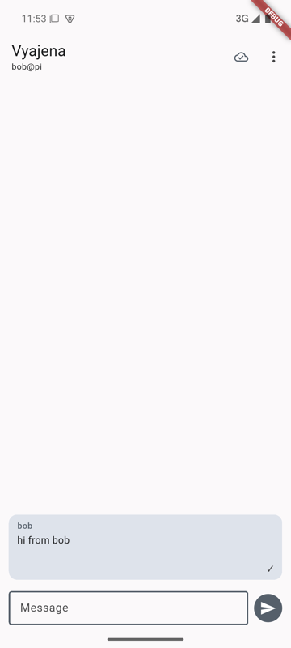
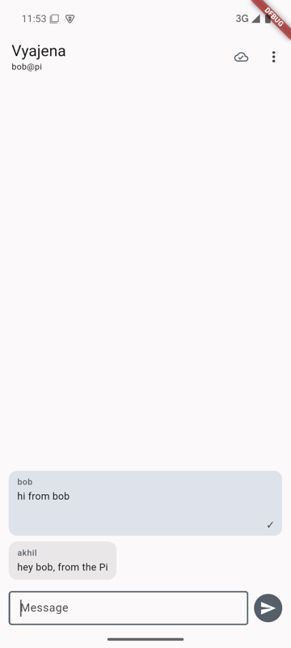
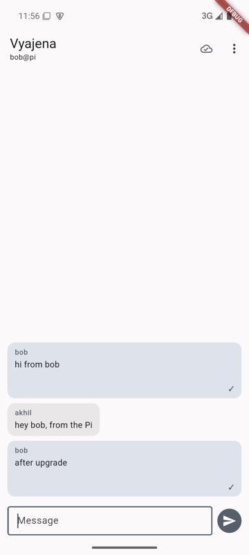
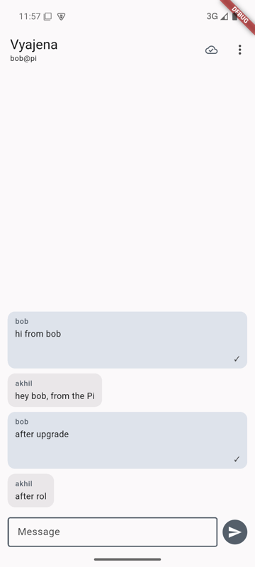

# QA run: the app through the real Pi on the home LAN (2026-11-13)

Manual run during `pi-deployment` (archived change, tasks 3.2–3.3), recorded
from its screenshots on 2026-11-14.

**Setup**

```
iOS Simulator iPhone 16 (admin akhil@pi) ─┐
                                          ├─▶ Pi 192.168.1.8:8443 (vyajena.service)
Android emulator vyajena_test (bob@pi) ───┘    no adb reverse
```

- App: `com.purplechaamba.vyajena`, debug build. Pi: release build, sandboxed service.
- Only the Android (Bob) side was captured as screenshots; the admin side is
  recorded in the session's notes.

## Results

| # | Step | Spec | Result |
| - | ---- | ---- | ------ |
| 1 | Fresh install opens on "Join the group" | app-ui: Join from an invite | ✅ |
| 2 | Paste Bob's invite, Check invite → shows `bob@pi` on `192.168.1.8:8443` before joining | app-ui: Join from an invite | ✅ |
| 3 | Join → chat opens with no admin tap (auto-add), connected icon | group-membership: Automatic add of new users | ✅ |
| 4 | Bob sends "hi from bob" → ✓ accepted | app-ui: Chat screen | ✅ |
| 5 | Admin's reply "hey bob, from the Pi" arrives | app-ui: Chat screen | ✅ |
| 6 | Pi upgraded while both apps connected → Bob sends "after upgrade" → ✓, no re-join | pi-deployment: Install and upgrade | ✅ |
| 7 | Pi rolled back → admin's "after rol…" arrives | pi-deployment: Install and upgrade | ✅ (text cut by the simulator's typing, not the app) |
| 8 | Pi journal holds no message text | app-ui: UI goes through the core | ✅ |
| 9 | Kill -9 on the Pi → back in 2 s, same pin | pi-deployment: Sandboxed service | ✅ (no screenshot) |

## Screenshots (Bob, Android)

| 1 Join | 2 Invite checked | 3 Auto-added |
| --- | --- | --- |
|  |  |  |

| 4 Sent ✓ | 5 Reply | 6 After upgrade | 7 After rollback |
| --- | --- | --- | --- |
|  |  |  |  |

The invite in screenshot 2 was single-use and is already used.

## Findings from the screenshots

- **Own messages look odd:** they stretch the full width, with a tall empty
  row under the text for the ✓, and are left-aligned like everyone else's.
  Expected: own messages right-aligned and compact.
- **Own messages are labelled "bob"** on Bob's own phone. A "You" label, or none,
  would read better.
- No display names were set, so senders show as usernames ("akhil", "bob");
  the "Ali (alice)" form was not exercised.

## Not tested yet

| Area | What |
| --- | --- |
| Real phones | A physical iPhone and Android phone on the home Wi-Fi |
| Admin screens | List and revoke invites, remove a user, rename the group |
| Profiles | Set a display name and see "Ali (alice)" everywhere |
| Members | Members screen with device counts |
| Devices | Link a second device by text (request → approve → join) |
| Reset user | Remove Bob, re-invite, key-changed warning, admin accepts, re-add |
| Offline | Airplane mode: send while offline (⏳), back online (✓), catch-up order |
| Background | App in background for an hour, back to foreground, reconnect |
| Limits | Very long paste refused in the composer |
| Look | Dark mode |
| Pi power | Pull the Pi's power mid-chat; nothing accepted is lost |
| Pi updates | Full upgrade + reboot; apps reconnect, same pin |
| IPv6 router | With the Pi's IPv6 block lifted, does the Airtel router itself drop inbound IPv6? (running 2026-11-14) |
| Inactivity | Removed after 7 days offline, rejoin notice (covered by automated tests only) |
