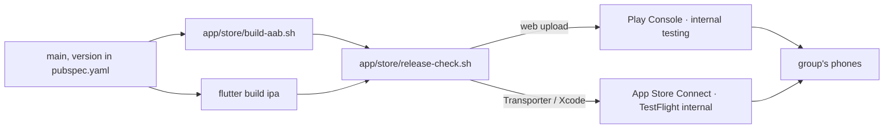

# Releasing the app

How the owner makes a store build and puts it on testers' phones
(OpenSpec change `app-release`). Distribution is **private** for now: Play
internal testing and, once the Apple account exists, TestFlight internal
testing (owner decisions R1, R7). Only the owner does these steps. No session
or CI ever holds a key, a password or a store login.

Store rules change. The limits and dates here were checked against public docs
on 2026-11-15; re-check them when submitting.



## What is fixed in the repo

| Thing | Where | Value |
|---|---|---|
| App id (both) | `build.gradle.kts`, `project.pbxproj` | `com.purplechaamba.vyajena` |
| Name | manifest, `Info.plist` | Vyajena |
| Version | `app/pubspec.yaml` `version:` | `<name>+<build>`; the build number only goes up, shared by both stores |
| Minimum OS | Flutter defaults, Podfile | Android 7.0 (API 24), iOS 15.0; target API 36 |
| iPhone only | `TARGETED_DEVICE_FAMILY = 1` | iPads run it in iPhone mode |
| Export compliance | `Info.plist` | `ITSAppUsesNonExemptEncryption = YES` |
| Privacy answers | `app/store/privacy.md` | Play Data safety + App Store labels |
| Listing text | `app/store/listing.md` | name, descriptions, keywords, URLs |
| Icons | `app/store/icon/`, `app/store/icons.sh` | "വ്യ"; `play-icon-512.png`, `feature.png` for Play |
| Screenshots | `app/store/screenshots/` | from the fake core only |
| Upload key fingerprint | `app/store/signing.md` | public SHA-256 only |

## One-time setup (owner)

### 1. Apple Developer account

Enrol in the Apple Developer Program as an **individual** (US$99/year,
https://developer.apple.com/programs/enroll/). Note the **team id**
(Membership details); it goes into the Xcode project in step 7.

### 2. The Android upload key

Make a new upload key for the new Play app. It never goes into the repo or CI.

```bash
mkdir -p ~/.vyajena-release && chmod 700 ~/.vyajena-release
keytool -genkeypair -v -keystore ~/.vyajena-release/upload.jks -alias upload \
  -keyalg RSA -keysize 4096 -validity 10000
```

`keytool` asks for the passwords. Put them in the macOS Keychain (each command
asks for the password):

```bash
security add-generic-password -s vyajena-upload -a store -w
security add-generic-password -s vyajena-upload -a key -w
```

Then the properties file, with **no passwords** in it:

```bash
printf 'storeFile=upload.jks\nkeyAlias=upload\n' > ~/.vyajena-release/key.properties
chmod 600 ~/.vyajena-release/*
```

Backup: put `upload.jks` and both passwords in your password manager.
If the key is ever lost, Play support can reset the upload key; installed apps
keep updating, because Google holds the app signing key.

Record the public fingerprint, then commit `app/store/signing.md`:

```bash
keytool -list -v -keystore ~/.vyajena-release/upload.jks -alias upload | grep SHA256
```

Paste the value after `Upload key SHA-256:` in `app/store/signing.md`.

### 3. The privacy policy and support pages

Published 2026-11-15 on GitHub Pages from `chaamba/purple-www` (the
purplechaamba.com site; the bare domain has no website, so the URLs use `www`):

- https://www.purplechaamba.com/vyajena/privacy/ (`vyajena/privacy/index.html`)
- https://www.purplechaamba.com/vyajena/ (`vyajena/index.html`, support)

Contact: privacy@purplechaamba.com. When `docs/privacy-policy.md` changes,
change that page in the same week.

### 4. Play Console: the new app

In the existing developer account, create the app:

- **Create app:** name Vyajena, default language English (US), App, Free.
- **App content:** privacy policy URL (above); ads: no; app access: "All
  functionality is restricted: an invite from the group's admin is needed, and
  the server is on a private network"; content rating: answer from
  `app/store/listing.md`; target audience: 18+ is simplest; Data safety: from
  `app/store/privacy.md`; government, financial, health, news: no.
- **Store listing:** text from `app/store/listing.md`; app icon
  `app/store/icon/play-icon-512.png`; feature graphic `app/store/icon/feature.png`;
  phone screenshots from `app/store/screenshots/android/`.
- **Testing › Internal testing:** create an email list with the group's
  Google accounts (up to 100).

## Every Android release

1. Raise the build number in `app/pubspec.yaml` (`1.0.0+1` for the first).
2. Build with the upload key from the Keychain:

   ```bash
   app/store/build-aab.sh
   ```

3. Check it:

   ```bash
   app/store/release-check.sh --android-only
   ```

   Every line must say PASS.
4. Play Console › Test and release › Testing › Internal testing › Create new
   release. On the first release, accept **Play App Signing** with a
   Google-generated key. Upload `app/build/app/outputs/bundle/release/app-release.aab`,
   add release notes, save, review, roll out.
5. Tag the commit you built and push the tag only when you push `main`:

   ```bash
   git tag app-v1.0.0+1
   ```

Testers open the internal testing link from the email list, accept, and
install from Play. The old vyajena app (`com.chaamba.vyajena`) can stay
installed beside it until step 11.

## iOS (once the Apple account exists)

### 5. Xcode signing

Xcode › Settings › Accounts: add your Apple ID. Open
`app/ios/Runner.xcworkspace`, target **Runner** › Signing & Capabilities:
Automatically manage signing, Team = your team. That writes
`DEVELOPMENT_TEAM` into `project.pbxproj`; commit it (a team id is not a secret).
Xcode makes the distribution certificate in your login keychain. Export it once
(Keychain Access › My Certificates › Apple Distribution › Export, `.p12` with
a password) and put the `.p12` and its password in your password manager.

### 6. App Store Connect record

Apps › + › New App: iOS, name Vyajena, language English (US), bundle id
`com.purplechaamba.vyajena`, SKU `vyajena`. Then:

- **App Privacy:** privacy policy URL; data collection answers from
  `app/store/privacy.md`.
- **Pricing and Availability:** free; **remove France** (export compliance, R8).
- **App Information:** category Social Networking; age rating from
  `app/store/listing.md`.
- **Export compliance** (asked on the first build): the app uses encryption;
  it is standard encryption algorithms (MLS RFC 9420, TLS 1.3, Ed25519, X25519,
  AES-GCM, ChaCha20-Poly1305) instead of or in addition to Apple's OS
  encryption; it qualifies for the mass-market exemption; no proprietary
  algorithms; no CCATS. Not legal advice.
- **TestFlight › Internal testing:** add the group as App Store Connect users
  (any role) and to an internal group (up to 100). No review is needed.

### 7. Every iOS release

```bash
cd app && flutter build ipa --release --export-options-plist=ios/ExportOptions.plist
app/store/release-check.sh --ios-only
```

Upload `app/build/ios/ipa/*.ipa` with Transporter (or Xcode › Organizer ›
Distribute App). TestFlight builds **expire after 90 days**, so upload a new
build at least every 90 days, even with no changes. Use the same build number
sequence as Android, and tag as above.

## After the first install

### 8. Real-phone check (task 7.6)

On the home Wi-Fi, with the store builds:

- iPhone: joining from an invite shows the **Local Network** prompt with the
  app's own text; after Allow, it joins.
- Android: kill and relaunch; the app still opens the group (keys survived R8).
- Device logs (`adb logcat`, or Console.app for the iPhone) show no line from
  the app and none of the test text.

### 9. Phones that ran debug builds

A store build cannot update a debug build (different signature; on iOS maybe a
different keychain team). Uninstall the debug build, install from the store,
and join again as a new device; the admin removes the old device.

### 10. Public listing later

Not before: the relay (reviewers must reach the server), in-app account
deletion, report/block for chat content, real push, and, for Play production
on a personal account, a closed test with 12+ testers for 14 days.

### 11. Retire the old vyajena (only once this app runs on the group's phones)

- Play Console: unpublish and delete the old app `com.chaamba.vyajena`.
- GitHub: delete `.github/workflows/android-internal.yml` and the
  `ANDROID_KEYSTORE_BASE64`, `ANDROID_KEYSTORE_PASSWORD`, `ANDROID_KEY_ALIAS`,
  `ANDROID_KEY_PASSWORD` secrets in `chaamba/vyajena` and `koppathachan/vyajena`.
- Play Console › Users and permissions: remove
  `<play-ci-service-account>`.
- GCP project `vyajena`: delete the `github-pool` workload identity provider
  (or the service account).
- Testers uninstall the old app. The old app's upload key
  retires with it.
