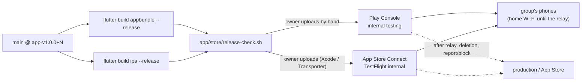
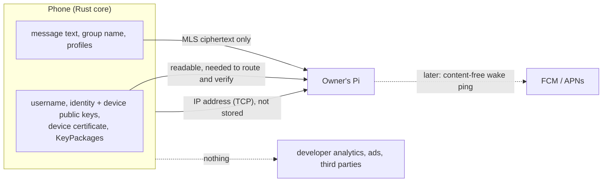
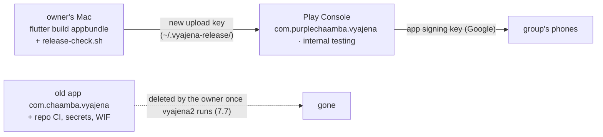

## Context

- The app (`app/`, package `vyajena`, id `com.purplechaamba.vyajena`) has only
  run as debug builds: iPhone 16 simulator, Android emulator `vyajena_test`. No
  real phone, no release build, no archive yet.
- Android: `build.gradle.kts` signs `release` with the **debug key**; no R8
  rules; label `vyajena`; Flutter's default icons; `minSdk 24`, `targetSdk 36`
  (Flutter 3.44 defaults); NDK 28.2. Kotlin glue: `MainActivity` and the JNI class
  `io.crates.keyring.Keyring` (exported by `libbridge.so`).
- iOS: deployment target 15.0, `TARGETED_DEVICE_FAMILY = "1,2"`, automatic
  signing with no team, display name `Vyajena`, default icon, no
  `PrivacyInfo.xcprivacy`, no export key. Core folder: Application Support,
  `NSFileProtectionComplete`, excluded from backup.
- Rust core: `bridge` crate (`cdylib` + `staticlib`), built by cargokit from
  `app/rust_builder` with the build mode Flutter passes. No `[profile.release]`
  in the workspace. No `tracing` subscriber in the bridge, so the core logs
  nothing on phones today. Dart logs `core event: <kind>` only under `kDebugMode`.
- Toolchain: Flutter 3.44.4, Xcode 27.2 (`flutter build ios --simulator` breaks
  in Flutter's `lipo` step), Rust targets for all Android ABIs and `aarch64-apple-ios`
  installed.
- The Pi is reachable only on the home LAN (`192.168.1.8:8443`); relay + real push
  come later. `qa-fixes` (session B) is editing `app/` now and adds
  `connectivity_plus` (`ACCESS_NETWORK_STATE`).

## Goals / Non-Goals

**Goals:**

- A signed, store-acceptable Android App Bundle and iOS archive, made by the
  owner on the Mac with one command each, checked by one script.
- Every store declaration written down once, true to what the app does.
- Ready for private distribution now; nothing to redo for a public listing
  except the blockers in the proposal.

**Non-Goals:**

- Creating developer accounts, keys, certificates, store records, or uploading.
  The owner does those (tasks group 7).
- CI release builds or automatic uploads (fastlane, App Store Connect API keys).
- Account deletion, report/block, the relay, real push. Each is its own change.
- Desktop or the terminal client.

## Decisions

### D1. Private distribution first; the build does not depend on the choice

Owner, 2026-11-15 (R1, R7): private first, before the relay. The same signed builds go to Play internal testing now and
TestFlight internal testing once the Apple account exists, and to public review later. TestFlight
builds expire after 90 days, so a private iOS release needs a fresh upload at
least every 90 days; Play internal testing builds do not expire.



### D2. The core in release mode, all store architectures, from source

cargokit already builds in the mode Flutter passes (`release` for
`appbundle` and `ipa`) and for the platforms Flutter asks for: `android-arm`,
`android-arm64`, `android-x64` for a bundle; `arm64` for an iOS device archive.
No `cargokit.yaml` precompiled-binaries entry exists, and none is added: the
core is always built here. 32-bit x86 is not shipped (Flutter does not ship it
in release).

Play requires 16 KB-aligned native libraries for apps that target Android 15+. NDK r28
links 16 KB-aligned by default, but Rust drives the linker itself, so spike S3
checks `llvm-readelf -l` on the release `libbridge.so`. If it is not aligned,
add `-C link-arg=-Wl,-z,max-page-size=16384` for the Android targets in
`app/rust_builder` (the cargokit invocation), not in a workspace-wide
`.cargo/config.toml`, so the Pi build stays the same.

No `[profile.release]` change unless S3 measures a problem: a workspace profile
change also changes the Pi server build.

S3 result (2026-11-15, `flutter build appbundle --release`, NDK 28.2, Rust
release): **no flag needed.** `llvm-readelf -lW`: every `LOAD` segment of
`arm64-v8a` and `x86_64` `libbridge.so` is aligned to `0x4000` (16 KB);
`armeabi-v7a` is `0x1000`, which Play allows (the rule is for 64-bit). AGP
strips all three and moves the symbols to `BUNDLE-METADATA/.../libbridge.so.sym`;
no `.debug_*` sections are left. Sizes in the bundle: arm64-v8a 12.1 MB,
armeabi-v7a 8.3 MB, x86_64 13.3 MB (bundle 81.6 MB with symbols; Play
serves one ABI per phone). No profile change. First full build: 8.7 min.

Flutter's own last step then failed with "failed to strip debug symbols": it
runs the SDK's `apkanalyzer`, whose launcher script breaks when the Android SDK
resolves to a path with a space (`/Volumes/Crucial X9/...` on this Mac;
`Could not find or load main class X9.Library...`). The bundle itself is
complete and stripped. So `app/store/build-aab.sh` lets exactly that failure
through when the bundle exists, and `release-check.sh` checks the stripping
itself (`stripped`). Moving `cmdline-tools` to a path without a space also
fixes it.

- *Alternative:* precompiled binaries from GitHub releases (cargokit
  supports it). Rejected: it adds a download and a signing key for binaries, for a
  one-person project that builds on one Mac.

### D3. Android upload key outside the repo; Play App Signing

- `build.gradle.kts` reads a properties file from the Gradle property
  `vyajena.keyProperties`, defaulting to `~/.vyajena-release/key.properties`
  (`storeFile`, `storePassword`, `keyAlias`, `keyPassword`). The owner may point
  `storePassword`/`keyPassword` at the macOS Keychain through a small wrapper in
  `docs/release.md`; the file itself is never in the repo.
- `signingConfigs.release` is used for `release`. If a release task runs and
  the file is missing, Gradle throws `GradleException("release signing: <path>
  not found")`. No debug fallback. `flutter run --release` therefore needs the
  key too; local performance checks use `--profile`.
- The owner makes a **new** upload key for the new Play app (R10, R11), in
  `~/.vyajena-release/`, passwords in the macOS Keychain, one backup in the
  password manager (R4). The old app's `~/vyajena-upload.jks` is not used.
- Play App Signing (required for new apps) keeps the app signing key at Google;
  the owner keeps only the **upload** key. If the upload key is lost, Play support
  can reset it, and installed apps keep updating. Its public SHA-256 fingerprint goes
  in `app/store/signing.md` (public, safe to commit) for the release check.
- `.gitignore`: `key.properties`, `*.jks`, `*.keystore`, `*.p12`,
  `*.mobileprovision`, `*.cer`, `AuthKey_*.p8`.

### D4. iOS: automatic signing, `flutter build ipa`, manual upload

- Team id in `project.pbxproj` (`DEVELOPMENT_TEAM`; an identifier, not a
  secret), `CODE_SIGN_STYLE = Automatic`, distribution certificate in the owner's
  login keychain (R4).
- `app/ios/ExportOptions.plist`: `method = app-store-connect`,
  `signingStyle = automatic`, `uploadSymbols = false`, `manageAppVersionAndBuildNumber = false`
  (D5 owns the number).
- Build: `flutter build ipa --release --export-options-plist=ios/ExportOptions.plist`.
  **Spike S1** checks it on Xcode 27.2. The known failure is in the
  simulator path (a fat `arm64`+`x86_64` `lipo`). A device archive is
  `arm64` only and may not hit it. Fallback if S1 fails:
  `flutter build ios --release --no-codesign`, then `xcodebuild -workspace
  Runner.xcworkspace -scheme Runner -configuration Release archive` and
  `-exportArchive` with the same plist, wrapped in `app/store/build-ipa.sh`.
- Upload by the owner with Xcode Organizer or Transporter. No App Store Connect API
  key exists.

S1 result (2026-11-15, Xcode 27.2, Flutter 3.44.4, no Apple account):
**`flutter build ipa --release --no-codesign` works**: `Runner.xcarchive` in
3–4 min (first build 4.2 min), `Runner` and `bridge.framework` `arm64` only. The
Xcode 27.2 `lipo` failure is only in the fat simulator path; a device archive
never hits it, so no `xcodebuild` fallback script. The signed export
(`--export-options-plist=ios/ExportOptions.plist`) can only be checked once the
owner's team exists (task 7.4). Flutter's validation warns that the launch
image is the default placeholder (a plain white screen); App Store Connect
accepts it.

### D5. Version from pubspec; release tags

`version: <name>+<build>` drives both platforms (Flutter already maps it:
`flutter.versionCode`/`versionName`, `$(FLUTTER_BUILD_NAME)`/`$(FLUTTER_BUILD_NUMBER)`).
One build number for both stores, always increasing. After a successful upload
the owner tags `app-v<name>+<build>`; the release check compares against the
highest such tag. Start: the Play app is new (R10) and nothing has been
uploaded, so the first release is `1.0.0+1`, already in pubspec. That first tag
is the baseline for the release check. Apple starts from the same number, so
both stores share one sequence.

### D6. Shrinking keeps the JNI glue

Flutter turns on R8 for release. The class `io.crates.keyring.Keyring` is only
reached by `System.loadLibrary` + a native method whose JNI name fixes its
package and class, so R8 may rename it. Add `app/android/app/proguard-rules.pro`:

```
-keep class io.crates.keyring.Keyring { *; }
-keep class io.crates.keyring.Keyring$Companion { *; }
-keepclasseswithmembernames class * { native <methods>; }
```

and `proguardFiles(getDefaultProguardFile("proguard-android-optimize.txt"), "proguard-rules.pro")`
in `release`. The `android-native-keyring-store` crate calls only framework classes
(`KeyStore`, `Cipher`, `SharedPreferences`) through JNI, which R8 does not touch.
**Spike S2** proves it: a release APK on the emulator joins a temp Pi and survives
a kill + relaunch with its keys.

S2 result (2026-11-15, throwaway AVD `vyajena_release_throwaway`, Android 15,
release APK with R8, signed with a throwaway key in `spikes/`): **pass.**
Joined a temp Pi from its bootstrap invite (`Devices.Register`), created the
group, sent a text (✓ accepted), killed and relaunched: still `akhil@pi`,
connected, history there, so the Android Keystore key and the sealed MLS state
survived. `logcat`: no line from the app's Dart code or the core, and not the
sent text (only the engine's Impeller line). Control build with the keep rules
removed: also works, because AGP's `proguard-android-optimize.txt` already keeps
classes with native methods (`-keepclasseswithmembernames ... native <methods>`).
The explicit rules stay as a guard: the JNI name is a fixed contract.
Without the key properties file, `flutter build apk --release` stops in 10 s
with "release signing: ~/.vyajena-release/key.properties not found".

### D7. Release logs nothing

Already true by construction (Context); this change pins it. A Dart test
(`app/test/release/`) checks that every `debugPrint`/`print` in `app/lib/` sits
under `kDebugMode`. The release check checks that the core can install no
`tracing` subscriber: `cargo tree -p bridge -e normal --target <each store
target>` has no `tracing-subscriber` (today it is a dev-dependency only). The release
QA run (task 7.6) greps the real device log for the test text. `app.dart` sets
`debugShowCheckedModeBanner: false` (release builds hide it anyway; this keeps profile
screenshots clean).

### D8. Export compliance

Owner, 2026-11-15 (R8): `ITSAppUsesNonExemptEncryption = YES`
in `Info.plist`. The app does not limit itself to OS encryption: its own Rust code
implements MLS (OpenMLS), TLS 1.3 (rustls) and XChaCha20-Poly1305 sealing. All of
these are standard, published algorithms, used for user data protection in a mass-market app,
which fits the US EAR mass-market exemption (§740.17(b)(1)); since 2021 no
annual self-classification report is needed for it. App Store Connect then asks
a short questionnaire once per app; `docs/release.md` records the answers
(standard algorithms, no proprietary crypto, no CCATS) so they are the same each
time. France needs an ANSSI declaration for encryption apps, so France is left
out of App Store availability (owner). Play has no
equivalent question. This is the owner's call and not legal advice.

- *Alternative:* `NO`. Rejected: it would be wrong, because Apple treats only
  encryption inside the OS as exempt from the question.

### D9. Privacy manifest for the Rust core

The Flutter engine ships its own privacy manifest; the Rust core is a static
library linked into `Runner`, so `Runner/PrivacyInfo.xcprivacy` must cover it:

| API category | Why the core uses it | Reason code |
|---|---|---|
| `NSPrivacyAccessedAPICategoryFileTimestamp` | SQLite `fstat`/`stat` on its own files | `C617.1` (files in the app container) |
| ~~`NSPrivacyAccessedAPICategorySystemBootTime`~~ | dropped by S4: Rust `Instant` uses `clock_gettime`, not `mach_absolute_time` | — |
| `NSPrivacyAccessedAPICategoryDiskSpace` (added by S4) | SQLite's unix VFS: `statfs`/`fstatfs` for filesystem flags (locking, atomic writes) | `E174.1` (check disk space / file system before writing files) |

`NSPrivacyTracking = false`, no tracking domains, collected data types from D10.
**Spike S4** lists the core's undefined symbols (`nm -u libbridge.a`) against
Apple's required-reason API list to catch others (for example disk space).

S4 result (2026-11-15, `nm -u` on the archive's
`Runner.app/Frameworks/bridge.framework/bridge`, arm64; the cargokit pod links
the core as this dynamic framework, not into `Runner`): required-reason
imports are `stat`, `fstat`, `fstatat`, `lstat` (file timestamps) and
`statfs`, `fstatfs` (disk space), all from the bundled SQLite (libsqlite3-sys
0.35: `unixSectorSize`/`osStatfs`). **No** `mach_absolute_time` or
`systemUptime`: Rust's `Instant` on iOS uses `clock_gettime(CLOCK_UPTIME_RAW)`,
which is not on Apple's list. Also imported, not on the list: `clock_gettime`,
`sysctlbyname`, `futimes`, `utimes`. `Runner` itself imports none. So the
manifest declares FileTimestamp `C617.1` and DiskSpace `E174.1`, not
SystemBootTime.

**Spec fix (apply, 2026-11-15):** "Privacy manifest" said "at least file
timestamps and system boot time" from a guess about `Instant`; S4 shows disk
space instead, so the requirement and its scenario now name FileTimestamp and
DiskSpace.

### D10. One privacy answer sheet

`app/store/privacy.md` is the single source for the policy, Play Data safety and
the App Store privacy answers. The "developer" here is the owner, who also runs the
Pi.



| Data | Leaves the phone as | Play Data safety | App Store label |
|---|---|---|---|
| Messages, group name, profiles | End-to-end encrypted ciphertext to the Pi | Not collected (end-to-end encrypted; confirm Play's wording at submission) | Not collected (unreadable to the developer) |
| Username (admin-chosen) | Plain, to the Pi | Personal info → User IDs: collected, required, app functionality, not shared | Identifiers → User ID: linked to the user, app functionality |
| Identity/device public keys, certificates, KeyPackages | Plain, to the Pi | Same entry (User IDs / Device or other IDs) | Identifiers → User ID / Device ID, app functionality |
| IP address | TCP connection; the Pi does not store it | Not collected | Not collected |
| Push token (later change) | To the Pi, then FCM/APNs | Device or other IDs, app functionality | Device ID, app functionality |

Encrypted in transit: yes (TLS 1.3, pinned). Deletion: the admin removes a user
(`Admin.RemoveUser`) today; self-service deletion is a public-release blocker
(proposal). Tracking: none.

### D11. Name and icons without a new dependency

Display name from R3 in both `AndroidManifest.xml` (`android:label`) and
`Info.plist` (`CFBundleDisplayName`, `CFBundleName`). Icons: a committed master
`app/store/icon/master.png` (1024×1024, opaque) plus `foreground.png` and
`monochrome.png` (432×432 on transparent, for the adaptive and Android 13 themed
icon). `app/store/icons.sh` uses macOS `sips` to write every `mipmap-*` and
`AppIcon.appiconset` size, plus `mipmap-anydpi-v26/ic_launcher.xml`. Outputs are
committed. The image (owner, R3): the Malayalam letter "വ" in the slate seed
colour on a light background. `app/store/icon/draw.swift` renders the three
images with CoreGraphics + CoreText in a Malayalam font that ships with macOS
(Malayalam Sangam MN), so the app itself still has no custom font. No `flutter_launcher_icons`: the "UI goes through the core" test keeps
pubspec dependencies to an allow-list, and a script is enough.

### D12. Local network access on iOS (home-LAN phase)

iOS 14+ asks before an app connects to an address on the local network, unicast
included; the simulator never asks, so no run so far could show it. Add
`NSLocalNetworkUsageDescription` ("Vyajena connects to your group's server on
your home network."). No Bonjour, so no `NSBonjourServices`. The relay change
removes the key once invites name a public address. Android needs nothing for
the LAN. Only a real iPhone can check this (task 7.6).

### D13. The release check

`app/store/release-check.sh <aab> <xcarchive>` (bash, `set -euo pipefail`,
`shellcheck` clean, read-only, never uploads), using only Xcode, JDK and
Android SDK/NDK tools already on the Mac:

| Check | How |
|---|---|
| Architectures | `unzip -l` on the AAB for the three `lib/<abi>/libbridge.so`; `lipo -archs` on the archive's `Runner` and `Frameworks/bridge.framework/bridge` (where the cargokit pod puts the core) = `arm64`; `bridge` exports `frb_get_rust_content_hash` |
| 16 KB alignment | NDK `llvm-readelf -lW` on extracted 64-bit `.so`: every `LOAD` `Align` ≥ `0x4000` |
| Signer | `keytool -printcert -jarfile <aab>` SHA-256 = `app/store/signing.md`; ≠ `~/.android/debug.keystore` |
| No key files tracked | `git ls-files` against D3's patterns |
| Version | `pubspec.yaml` build number > highest `app-v*` tag; archive's `CFBundleVersion` equals it |
| Permissions | the bundle's protobuf `base/manifest/AndroidManifest.xml`, read by an embedded `python3` reader (`aapt2` cannot read a bundle; no bundletool download): exactly `INTERNET`, `ACCESS_NETWORK_STATE`, ignoring the app's own AndroidX `DYNAMIC_RECEIVER_NOT_EXPORTED_PERMISSION` (spec fixed, see below) |
| Stripped | `BUNDLE-METADATA/.../{libflutter,libapp,libbridge}.so.sym` present; no `.debug_*` in `libbridge.so` (stands in for Flutter's apkanalyzer step) |
| iOS keys | `plutil -extract` on the archived `Info.plist`: `ITSAppUsesNonExemptEncryption`, `NSLocalNetworkUsageDescription`, display name, version; no other `NS*UsageDescription`; `PrivacyInfo.xcprivacy` present with FileTimestamp and DiskSpace |
| Name and icons | same label on both; iOS 1024 icon has no alpha (`sips -g hasAlpha`) |
| Core logs nothing | `cargo tree -p bridge -e normal --target <t>` for the four store targets: no `tracing-subscriber` (D7) |
| No tracking SDK | no `com.google.firebase.analytics`, `crashlytics`, `com.google.android.gms.ads`, `Sentry` etc. in the AAB's dex class list or the archive's frameworks |

**Spec fix (apply, 2026-11-15):** the release manifest also has
`com.purplechaamba.vyajena.DYNAMIC_RECEIVER_NOT_EXPORTED_PERMISSION`, a
signature-level permission AndroidX core defines and uses for the app's own
not-exported receivers. Nobody grants it and other apps cannot hold it, so
"Declared permissions" now says "exactly INTERNET and ACCESS_NETWORK_STATE of
the permissions a user or the system grants" and its scenario names this one
exception.

### D14. iPhone only

Owner, 2026-11-15 (R9): iPhone only, `TARGETED_DEVICE_FAMILY = 1`: iPads still install
and run the app in iPhone mode, and App Store Connect needs no iPad
screenshots and no iPad review. `UISupportedInterfaceOrientations~ipad` goes.

### D15. Listing text and screenshots

`app/store/listing.md`: name, subtitle (≤30), short description (≤80, Play),
full description, keywords (≤100, Apple), support URL (`https://purplechaamba.com/vyajena`,
R5), category Social Networking / Communication, age-rating answers. Screenshots:
a `integration_test/screenshots_test.dart` run on the **fake core** (Alice, Bob,
sample text) on an iPhone 6.9" simulator and a phone emulator, saved under
`app/store/screenshots/`. Never from the owner's group.

### D16. A new Play app; the old one retires after

Owner, 2026-11-15 (R10–R12): a **new** Play app for `com.purplechaamba.vyajena`
in the existing console, not the old vyajena's app. The old app and its CI
deployment stay until vyajena2 is deployed and running; then the owner deletes
them. Facts from the old repo (`~/code/vyajena`, mirrored publicly as
`koppathachan/vyajena`; read-only):

- Old package `com.chaamba.vyajena`, on Play internal testing, uploaded by the
  `android-internal.yml` workflow, signed with `~/vyajena-upload.jks` rebuilt
  from the `ANDROID_KEYSTORE_*`/`ANDROID_KEY_*` GitHub secrets, and pushed with
  workload identity federation as `<play-ci-service-account>`.
- Different package, so both apps install side by side on one phone, and nothing
  in vyajena2 changes (`applicationId` stays). Testers keep the old app until it
  is retired.

Retiring the old one is the owner's work on GitHub, GCP and Play Console (task
7.7), never a session's, and only after vyajena2 runs on the group's phones:
unpublish/delete the old Play app, delete the workflow and its four secrets in
`chaamba/vyajena` and `koppathachan/vyajena`, remove the service account's
Play access, and delete its workload identity provider (or the service
account). The old upload key goes with it. vyajena2 uploads by hand (Play
Console web upload), so nothing replaces the workflow.



## Risks / Trade-offs

- [Phones that ran debug builds have a different signature (Android) or keychain
  access group (iOS, if another team signed them)] → a store build cannot update
  them in place, and their keys are unreadable. Uninstall, install the store
  build, and re-join as a new device; the admin removes the old device. Say so in
  `docs/release.md`.
- [`flutter build ipa` broken on Xcode 27.2] → S1 first; `xcodebuild` fallback (D4).
- [R8 strips the JNI class] → keep rules + S2 on a real release APK.
- [Rust `.so` not 16 KB aligned → Play rejects the upload] → S3 + linker flag.
- [Upload key lost] → Play App Signing allows an upload key reset; a password-manager backup (R4).
- [iOS distribution certificate lost] → revoke and reissue; installed apps keep
  working, no user impact.
- [Privacy answers drift from the code] → one answer sheet; a spec rule that any
  change sending new data updates it.
- [`NSFileProtectionComplete` blocks the core while the phone is locked] → no
  effect now (no background work); the push change must revisit it.
- [TestFlight builds expire after 90 days] → `docs/release.md` reminder; re-upload.
- [Store rules change] → the dates and limits here are from public docs as of
  2026-11-15; `docs/release.md` says to re-check at submission.

## Migration Plan

1. After `qa-fixes` lands (it shares `AndroidManifest.xml`, `pubspec.yaml`,
   `app.dart`): spikes S1–S4 on the Mac, simulator and emulator, with throwaway
   keys made in `spikes/` (git-ignored) and deleted afterwards.
2. Code and files (groups 2–6). Every debug flow keeps working: `flutter run`,
   `run.sh`, widget tests.
3. The owner makes the accounts and keys, fills in the store records from
   `app/store/`, builds, runs the release check, uploads to internal testing, and
   installs on real phones (group 7).
4. Rollback: nothing is public. A bad build is expired in TestFlight or
   halted in Play internal testing; the next build number replaces it.

## Open Questions

None. The owner answered R1–R12 on 2026-11-15 (`proposal.md`). Every iOS
signing step waits for the Apple account (R2); the unsigned iOS build (S1 with
`--no-codesign`), the privacy manifest and the plist keys do not.
