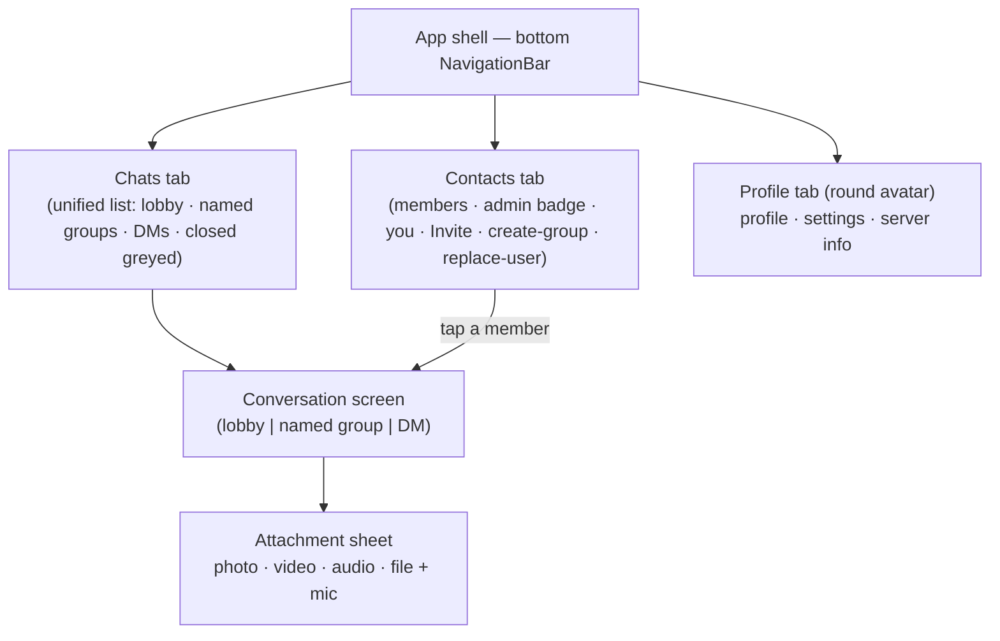

## Context

- **Screens exist but are not unified.** Today: a chat list (`dms`, app-ui: Chat
  list), per-kind screens (DM screen, Named group screen, the base Chat screen),
  admin screens, and profile/members (app-ui: Profile and members, Admin screens).
- **The core already exposes the data** the shell needs: chat summaries (kind,
  name, unread, unseen mentions, last-message time), members, profiles and server
  info, over the existing bridge. The shell is a re-layout over these.
- **Owner (2026-11-23):** three tabs (Chats / Contacts / Profile), the third being
  the user's round avatar; one unified list; one conversation screen; sender name in
  groups only.

## Goals / Non-Goals

**Goals**
- One coherent navigation shell over all existing chat features.
- A single conversation screen for the lobby, named groups and DMs.
- Reuse every existing widget and bridge call; change no behaviour.

**Non-goals**
- Any protocol/crypto/server change; new message types; changing permissions,
  membership or delete rights; re-theming beyond the current Material 3 look.

## Decisions

### D1. A bottom `NavigationBar` with three destinations

- **Chats**, **Contacts**, and **Profile** — the Profile destination's icon is the
  user's own round avatar (their profile photo, or initials when none), not a gear
  (owner, 2026-11-23). Tapping it opens the profile/settings/server-info screen.
- Switching tabs preserves each tab's scroll and state; a half-typed message in a
  conversation is not lost when the user leaves and returns (consistent with the
  `dms` "a DM arriving while the group is open does not pull the user out" rule).

### D2. Chats tab — one unified conversation list

- **Order:** the `lobby` system group pinned first, then admin-created named groups,
  then DMs by newest message; closed DMs greyed at the bottom.
- **Row:** avatar, name (the fixed "lobby" for the system group, the group name for a
  named group, the peer's display name for a DM), a last-message preview with a
  media glyph for an image / video / voice message, a timestamp, and an unread count
  with the `@` mention badge.
- **Closed DMs** carry the swipe-to-remove affordance defined in `delete-messages`
  (message-deletion: Remove a closed DM) — referenced here, its behaviour not
  redefined.

### D3. One conversation screen for all three kinds

- **Bubbles:** incoming left, outgoing right; send status on this device's own
  messages (the existing tile).
- **Sender name:** shown in the lobby and named groups only, never in a DM (owner,
  2026-11-23).
- **Content:** tappable links (`links`); inline players for image (`media-blobs`),
  audio (`audio-messages`) and video (`video-messages`); mentions and replies as
  today.
- **Composer:** an attachment sheet (photo / video / audio / file) and a mic button
  for a voice message, beside the text field.
- **App bar:** back, the group/peer avatar, title + subtitle (e.g. member count, or
  the peer's username), and an overflow menu for the screen's actions (admin actions
  only on an admin device, as those capabilities define).

### D4. Contacts tab

- The server's members, each with an avatar and name; the admin carries an `admin`
  badge; the current user is marked "you".
- **Actions:** Invite (admin), and admin entry points for create group
  (`lobby-multi-group`) and replace user (`replace-user`). Tapping a member opens the
  existing DM or starts one (dms: Open a DM).

### D5. Profile tab

- The user's own profile (display name, about — editable as app-ui: Profile and
  members defines), server info (server id, connection state), and settings. Reached
  by the avatar tab.

### D6. Reuse, re-parent, change nothing

- Every screen is composed from existing widgets (message tile, composer, mention,
  link, media, members, profile) and existing bridge calls. The shell adds
  navigation and layout, not behaviour; permission and membership rules stay owned by
  their capabilities.

## Risks / Trade-offs

- **A re-layout can regress existing flows.** Mitigated by reusing the current
  widgets and widget tests and keeping behaviour in the owning capabilities.
- **A per-row media glyph** may need a small bridge field on the chat summary; noted
  as an implementation detail, not a protocol change.
- **Forward references** (`video-messages`): the attachment sheet shows video once
  that change ships; until then the entry is hidden, like "Message" was hidden on an
  old server.

## Migration Plan

- Pure app change, shipped with an app release. No server or data migration.

## Open Questions (owner)

1. **Contacts vs a FAB:** start a new DM from the Contacts tab only, or also a
   compose button on the Chats tab?
2. **Profile tab contents depth:** how much of settings lives here now vs later
   (notifications, data, device management)?
3. **Group avatars:** a generated monogram per group, or a later custom-avatar
   feature?
