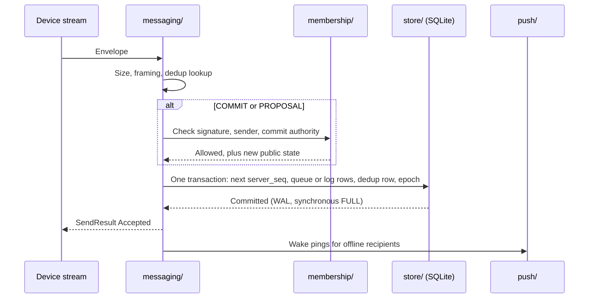
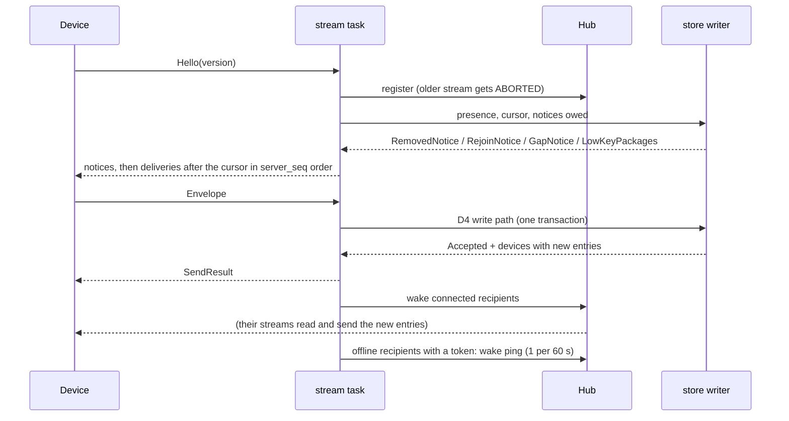

## Context

`core-wire-protocol` is archived: the `vyajena.v1` protos, six capability specs
(45 requirements) and the `protocol/` constants crate are on `main`, unpushed.
The OpenMLS spikes proved the two risky assumptions (D4/D5 of that change):
`PublicGroup` on a non-member can check and apply commits, and device
certificates ride in MLS basic credentials. Nothing runs yet. The owner decided
the build order (server, core, terminal client, deployment, Flutter) and wants
the server tested locally before publishing.

Owner conventions that shape this design: generated code is committed (one file
per side, regenerated locally, never in CI); tests live only in `tests/`
folders; folders follow features so a gRPC service can later move into its own
binary.

## Goals / Non-Goals

**Goals:**

- A server that meets every server-enforced requirement in the main specs, plus the
  new `server-runtime` capability.
- A local run the owner can start and connect to, and integration tests that
  exercise each server-enforced requirement over real gRPC.
- Shared rules in `protocol/` so the core reuses them later instead of copying.

**Non-Goals:**

- Real FCM/APNs (Flutter change), the relay and server deployment (deployment
  change), any client beyond test clients (core and terminal client changes).
- Client-only requirements: `message-content`, identity pinning in
  `key-directory`, and the client side of the commit-authority check.

## Decisions

### D1. Layout: one folder per service

```
server/
  src/main.rs          config, startup, tonic Router with one add_service per service
  src/pb.rs            generated server stubs + messages (committed)
  src/devices/         Devices: register, challenge, authenticate, link, revoke, push token
  src/keys/            Keys: KeyPackage upload and fetch
  src/admin/           Admin: invites, create group, remove user
  src/messaging/       Messaging.Connect: stream, sequencing, queues, commit log
  src/membership/      PublicGroup state, commit checks, inactivity, re-add notices
  src/store/           SQLite: schema, migrations, transactions
  src/push/            provider trait + logging provider
  src/auth/            session tokens, the interceptor every service uses
  tests/               integration tests; tests/support/pb.rs holds client stubs
```

Services talk to each other only through `store/`, `membership/` and `auth/`, so
any of them can later move into its own binary. **Alternative:** one module per
layer (handlers, db, models). Rejected: it cuts every feature into pieces.

**As built (tasks 1.3, 3.x).** The crate is a library plus a thin binary, so the
integration tests in `server/tests/` can drive it through its public API.
`src/main.rs` only parses `--config`, sets up tracing and runs
`runtime::server::start` then `server::serve`. One folder joins the D1 list:
`src/runtime/` for the `server-runtime` capability (config, first-start keys, TLS
listener, clock, bootstrap invite), and `runtime::routes()` is where each service
gets its `add_service`. The workspace also gains `pbgen/` (D2).

### D2. Code generation: one local command, output committed

`server/src/pb.rs` (server stubs) and `server/tests/support/pb.rs` (client stubs
for the tests) are generated from `proto/` and committed. First choice:
`buf generate` with a `buf.gen.yaml` and the community prost and tonic plugins,
which is the same workflow as Go. Task 1.1 checks that their output compiles
against tonic 0.14. **Fallback:** a small workspace binary that runs
`tonic-prost-build` with `protox` and writes the same two files. Either way it
is one command, documented in `CLAUDE.md`, and CI never runs it.

**Result (task 1.1): the fallback, `cargo run -p pbgen`.** `buf generate` with
the BSR remote plugins `buf.build/community/neoeinstein-prost:v0.5.0` and
`neoeinstein-tonic:v0.5.0` works, and its output compiles against tonic 0.14.9 /
prost 0.14.4 (the plugins are built on tonic-build 0.14 and emit
`tonic_prost::ProstCodec`). But it writes two files per side
(`vyajena.v1.rs` with an `include!("vyajena.v1.tonic.rs")`), so one `pb.rs` per
side would need an extra concatenation step, and it needs the network (BSR) on
every run. `pbgen/` is a small workspace binary that parses `proto/` with
`protox` (no system `protoc`), runs `tonic-prost-build` 0.14 once per side and
writes exactly `server/src/pb.rs` (messages + server stubs) and
`server/tests/support/pb.rs` (messages + client stubs, no `connect()` helper).
It works offline with versions pinned by `Cargo.lock`. No `buf.gen.yaml` is
committed. The generated modules are declared `#[rustfmt::skip]`, so
regenerating is byte-for-byte stable. CI builds `pbgen` with the workspace but
never runs it.

### D3. Shared rules in `protocol/` use plain types

`protocol/` adds:

- `device_identity`: verify a certificate signature
  (`DEVICE_CERT_CONTEXT || certificate_bytes`) and derive a device id from an auth
  public key.
- `group_membership`: the commit-authority rule as a pure function over plain
  structs (committer user, admin flag, and per proposal its kind, sender and
  target user).

Each side decodes protobuf and reads OpenMLS itself, then calls these functions.
So `protocol/` stays free of generated code and OpenMLS, and the server and core
cannot drift apart on these rules. **Alternative:** put the logic in the server
and copy it into the core later. Rejected: two copies of a security rule.

### D4. One write path per accepted envelope



A single writer task owns the group's sequence and epoch, so racing commits are
ordered without locks spread across services. **Alternative:** row locks in
SQLite per request. Rejected: harder to prove the strict epoch rule.

### D5. SQLite through rusqlite on a dedicated thread

rusqlite with bundled SQLite, WAL mode, `synchronous = FULL`, migrations embedded
in the binary. All database work runs on one blocking thread fed by a channel, which
also gives D4's single writer. **Alternative:** sqlx. Rejected for now: async
SQLite gains little on a server, and compile-time query checks need a database or
committed query metadata.

**As built (task 3.3).** `store::Store` is a cloneable handle to the thread;
`Store::call(|conn| ...)` runs a closure on it and returns its result. The
database file is created with mode 0600 before SQLite opens it (SQLite gives the
`-wal` and `-shm` files the same mode). Migrations are SQL files under
`server/src/store/migrations/`, embedded with `include_str!`, each applied in its
own transaction and counted in `PRAGMA user_version`; a newer database than the
binary knows is refused. Migration 1 holds only `meta`, `users` and `invites`;
later tasks add files. Times are stored as Unix milliseconds. At first start the
Server id is recorded in `meta`, and a later start with another `server_id` is
refused, since every stored user id contains it.

### D6. TLS and keys

rustls with a self-signed certificate around the server's key; clients check only
the SPKI pin. The external sender key for inactivity Removes is a separate Ed25519
key. Both are created on first start under the key directory with mode 0600
(`server-runtime: First start`).

**As built (task 3.2).** The TLS key is ECDSA P-256 (the most widely supported
TLS 1.3 server key), stored as `tls_key.pem` (PKCS#8); the self-signed
certificate is rebuilt from it at every start, which keeps the SPKI pin fixed.
The external sender key is Ed25519, `mls_external_sender_key.pem` (PKCS#8). The
key folder is created with mode 0700. Two safety rules beyond the spec, both
"refuse to start" rather than guess: if only one of the two key files exists,
the server stops instead of generating the other (a new external sender key
would silently break inactivity Removes for an existing group); and a key file
readable or writable by group or others is refused. The listener is TLS 1.3
only with ALPN `h2`, accepts handshakes in their own tasks (10 s timeout), and
attaches `runtime::TlsConnectInfo` to every request: the peer address and the
32-byte TLS exporter (`EXPORTER-vyajena2-auth-v1`, empty context) that
`Devices.Authenticate` (task 4.1) checks.

### D7. Time is injectable

Inactivity (7 days), expiry (7 days), challenge TTL (60 s) and heartbeats run off
a clock the tests can move, so integration tests can cover a week without
waiting.

**As built (task 3.4).** `runtime::Clock` (`now() -> SystemTime`), with
`SystemClock` and a shareable `ManualClock` (`advance`, `set`). It covers
timestamps and deadlines; timers that sleep (heartbeats, idle timeout) still need
`tokio::time` and are for task 7.1 to wire to the same clock or to
`tokio::time::pause` in tests.

### D8. Testing

Integration tests start the server in-process on a random local port with a
temporary database and keys, connect over pinned TLS using the committed client
stubs, and use OpenMLS (dev-dependency) to build real KeyPackages, commits and
Welcomes. Each test is tagged `// spec: <capability>/<title-slug>`. The three
tests dropped with `vyajena-proto` come back here: the signed certificate
round-trip, and the Welcome counting toward the commit cap. The unknown-content
test belongs to the core.

### D9. Runtime details settled while building (tasks 3.1, 3.5)

Small technical choices the specs leave open; none changes a requirement.

- **Config.** Fields: `server_id`, `admin_username`, `listen_address`,
  `public_address` (optional, the `host:port` put into invite payloads, default
  `listen_address`; the server cannot know the relay's address otherwise, so the
  `server-runtime: Configuration` text now names it), `database_path`, `key_dir`.
  Unknown fields are refused by name (typos would otherwise be silent). Relative
  paths are resolved from the config file's folder. `server_id` and
  `admin_username` must be non-empty and free of `@`, whitespace and control
  characters; no further username policy is set here. The example is
  `server/local.toml`, with data in the git-ignored `server/.server-local/`.
- **Bootstrap invite.** Created when the database has no users and no
  unused, unexpired bootstrap invite; printed only when created
  (`device-identity: Bootstrap admin` says once). A restart before the admin
  signs up logs that an invite is pending, without its code. If it expires
  unused (7 days), the next start creates and prints a new one. To see a lost
  code on a dev machine, delete `server/.server-local/` and start again.
- **Invite codes and payload text.** A code is 16 random bytes in base64url
  without padding (22 characters). The printed payload is the encoded
  `InvitePayload` in base64url without padding; the log line also shows the user
  id, code, relay address and expiry. The client changes may wrap this text in a
  QR code or link; that is theirs to decide.

### D10. Devices, keys and membership as built (tasks 4-6)

Technical choices the specs leave open; none changes a requirement.

- **Auth layer.** Token checks need the database, and tonic interceptors are
  synchronous, so the "interceptor" of task 4.2 is a tower layer
  (`auth::AuthLayer`) that `server::serve` puts in front of every service. It
  lets only `Devices.GetServerInfo`, `Register`, `GetChallenge` and
  `Authenticate` through without `authorization: Bearer <token>` and puts the
  `auth::Caller` (device id, user, admin flag) into the request extensions.
  Tokens are 32 random bytes in base64url, live exactly 1 hour, and only their
  SHA-256 is stored. A nonce is spent by any answer, right or wrong. Revoking a
  device ends its sessions, deletes its KeyPackages, and announces its id on
  `State::revocations` so the messaging service (task 7.1) can close its stream.
  The signing input and check are `protocol::wire_transport::{auth_signing_input,
  sign_auth_challenge, verify_auth_signature}`, for the core to reuse.
- **Status codes not named by the specs.** Register with an unknown, used,
  revoked or expired invite: `PERMISSION_DENIED` (one answer for all, nothing
  created). A certificate that verifies but is malformed (no user, keys not 32
  bytes, device id not derived from the auth key): `INVALID_ARGUMENT`. A user or
  device id that exists already: `ALREADY_EXISTS`; `CreateInvite` for an
  existing username too, unless that user was removed (task 6.4, D11).
  `RevokeDevice` of the caller itself: `INVALID_ARGUMENT` (the spec says
  "another device"); of a device that is not the caller's user's: `NOT_FOUND`.
  `RevokeInvite`: unknown `NOT_FOUND`, already used `FAILED_PRECONDITION`,
  already revoked or expired succeeds. `RemoveUser` of the admin:
  `FAILED_PRECONDITION`. KeyPackage upload: does not parse, fails OpenMLS
  validation, wrong ciphersuite or no last resort: `INVALID_ARGUMENT`; the
  credential is not the uploader's certificate, or the leaf key is not the
  certificate's MLS key: `PERMISSION_DENIED` (whole upload refused).
  `CreateGroup`: bad or inconsistent public state `INVALID_ARGUMENT`, the only
  member not the calling admin device `PERMISSION_DENIED`.
- **KeyPackages.** "Carries the uploading device's certificate" is checked
  strictly: the credential holds exactly the `SignedDeviceCertificate` bytes
  stored for the device. Uploads add one-time KeyPackages and replace the last
  resort. A fetch hands out the oldest one-time KeyPackage, else the last
  resort, and leaves out a device that has none at all (a freshly linked device
  that has not uploaded yet), with or without `device_ids`.
- **External sender entry.** The server's credential in `ServerInfo.external_sender`
  is an MLS basic credential whose identity is the server id (UTF-8). The group
  may list it at any position of `external_senders`; the server records the index
  for its external Removes (task 8.1).
- **Admin in the group context.** `group-membership: Group creation` says the
  group context names the admin's user id but no encoding was fixed. It is a
  group context extension of private-use type
  `protocol::group_membership::ADMIN_EXTENSION_TYPE` (0xF0A1) whose data is the
  UTF-8 user id `<username>@<server_id>`; `CreateGroup` requires it to equal
  the configured admin. Consequence for the core (rust-core-messaging): RFC 9420
  requires every member to support every group context extension, so each
  KeyPackage and leaf must list 0xF0A1 in `capabilities.extensions`, or OpenMLS
  refuses the Add. Since task 6.5 the server refuses such KeyPackages at upload
  (`INVALID_ARGUMENT`, whole upload).
- **Public state storage.** OpenMLS `PublicGroup` writes into its in-memory
  `MemoryStorage`; `membership::GroupState::save` copies that key-value map into
  `mls_public_state`, plus the epoch (`mls_group`) and each member device's leaf
  (`mls_members`, rebuilt from the tree). It is loaded per operation and saved in
  the same transaction as the rest of an accepted envelope, on the store's
  writer thread (D4, D5). `mls_group.id` is fixed to 1, so the database itself
  allows at most one group.
- **Commit checks (task 6.3).** `GroupState::check_commit(conn, caller,
  server_id, mls_message)` returns `AcceptedCommit` (new epoch, committer,
  added devices at their new leaves, removed devices) or a
  `HandshakeRejection` that maps to `RejectionReason`: not a `PublicMessage`
  commit of this group, or invalid to OpenMLS: `MALFORMED`; other epoch:
  `STALE_EPOCH` with the current epoch; a bad signature, a sender leaf that is
  not the authenticated device's, a sender that is not a member, or a commit
  breaking `protocol::group_membership::check_commit_authority`:
  `POLICY_VIOLATION`. Beyond the rule, so the server never sequences what honest
  members must reject: every added leaf must carry the certificate of a
  registered, non-revoked device that verifies against its user's stored
  identity key and names the leaf's key; the committer's new path leaf and any
  Update must keep their device's registered certificate and key. A
  `SelfRemove` counts as a Remove of the proposer's own device.
  `GroupState::check_proposal` does the same parsing and sender checks for a
  member's `PROPOSAL` and keeps it in the server's proposal store, so a later
  commit can include it by reference. Membership tags stay unchecked (the
  spike's caveat).

### D11. Messaging, inactivity and push as built (tasks 6.4-9.1)

Technical choices the specs leave open; none changes a requirement.

- **Admin reset (6.4).** `RemoveUser` sets `users.removed_at`. `CreateInvite`
  refuses only a username whose user exists and is not removed. `Register`
  with an invite for a removed username replaces that row's identity key and
  clears `removed_at`; the old devices stay revoked, so only the new devices
  can authenticate or be added. `RemoveUser` also revokes every unused invite
  for that username in the same transaction (task 6.6, owner decision after
  session C), so only an invite created after the removal can bring the user
  back.
- **KeyPackage capability (6.5).** Checked after OpenMLS validation, before
  the certificate checks; a one-time or last-resort KeyPackage without
  `0xF0A1` fails the whole upload with `INVALID_ARGUMENT`.
- **Storage (migration 3).** One `envelopes` row per accepted envelope and one
  `deliveries` row per device that still has to receive it. A device's
  application queue is its deliveries of `APPLICATION` envelopes; its
  commit-log entries are its deliveries of `COMMIT` and `PROPOSAL` envelopes
  (`welcome = 1` for the devices a commit adds, which get the Welcome in place
  of the commit); `cursors.acked_seq` is its delivery cursor. An envelope row
  goes once no delivery references it. `sequence` holds the last `server_seq`
  (one sequence, as the server holds one group). `dedup` keeps SHA-256 of the
  ciphertext and of the encoded Welcome bundle per (sender device, `msg_id`).
  New tables avoid the `mls_` prefix, which is the membership state alone
  (`group-membership: Membership state on the server`).
- **Recipients.** "Active members": devices in the tree that are neither
  revoked nor inactive. Every kind goes to the active members except the
  sending device; a `COMMIT` goes to the members of the epoch it was sent in
  (removed devices included, so they learn of it) plus a `WELCOME` to each
  added device. The server's own proposals go to every active member.
- **Check order** (in `messaging::write`): `msg_id` of 16 bytes and a known
  client kind (`MALFORMED`; a client `WELCOME` included), size
  (`TOO_LARGE`), a bundle on anything but `COMMIT` (`MALFORMED`), dedup
  (so an identical retry gets its original result even after the epoch
  moved on; different content `DUPLICATE_MISMATCH`), group id and MLS
  framing (`MALFORMED`), the strict epoch rule (`STALE_EPOCH`), the sender
  being an active member (`POLICY_VIOLATION`; a device inactive or revoked
  but still in the tree may not send while it waits to be re-added), then
  `check_commit` / `check_proposal`, then the Welcome bundle (`MALFORMED`).
  Beyond D10, a commit that adds a device which still holds a leaf is a
  `POLICY_VIOLATION` unless the same commit removes that leaf (a device has
  one leaf).
- **Stream.** The first frame must be `Hello` (else, and for a later `Hello`,
  `INVALID_ARGUMENT`); an unsupported version ends the stream with
  `FAILED_PRECONDITION` and the message `supported versions: 1`. The stream
  registers with `messaging::Hub` only after `Hello`; the older stream of the
  device gets `ABORTED`. The idle timeout is read from the injectable clock
  every second (D7), so tests move past 90 s without waiting; the stream ends
  with `UNAVAILABLE`. The session token is checked once, when the stream
  opens; the stream outlives the token's hour and is closed by revocation
  (`UNAUTHENTICATED`, from `State::revocations`). Acks are cumulative and
  clamped to the highest `server_seq` this stream sent; an ack for another
  group id is ignored.
- **Delivery.** A stream sends its device's deliveries after the last
  `server_seq` it sent, in order, starting at the cursor. Writes wake the
  recipients' streams; each stream reads from the database again, so catch-up
  and live traffic are one sequence and nothing depends on in-memory queues.
- **Sweep.** `messaging::sweep` runs every 60 s of real time and on demand
  (the tests call it after moving the clock): refresh presence of connected
  devices, mark inactive the member devices not seen for 7 days, reissue
  missing server Removes, expire application entries accepted 7 days ago or more,
  prune dedup records older than 7 days, drop unreferenced envelopes.
- **Inactivity.** "Connected" means an open stream after `Hello`. Presence is
  refreshed when a stream opens and closes, at each sweep while it is open,
  and when a commit adds the device; a member that never connected counts
  from its registration. A revoked device still in the tree is treated the
  same, so the server proposes its removal too. Marking a device inactive deletes
  all its deliveries and records `missed_since`: the `accepted_at` of the
  oldest application entry deleted, or the time of marking if there was none.
  The server's external Remove is a `PROPOSAL` envelope with a random `msg_id`, no
  sender, the current epoch, sequenced in the same transaction. After every
  accepted commit, and at a sweep, the server issues a new one for each inactive
  device still in the tree that has none for the current epoch. A commit
  adding the device back clears the inactive record.
- **Notices.** At connect, in this order before the catch-up: `RemovedNotice`
  for an inactive device (and its first return is recorded), the
  `RejoinNotice`s an active device of the same user or of the admin is owed
  for returned devices still waiting, `GapNotice` if entries expired since it
  was last told (connected devices get it at the sweep; each expiry is
  reported once), `LowKeyPackages` if fewer than 5 one-time KeyPackages
  remain. A returning device's `RejoinNotice` goes at once to the connected
  active devices of its user and of the admin. A fetch that hands out a
  one-time KeyPackage and leaves fewer than 5 sends `LowKeyPackages` through
  `State::key_packages_low` to the device if connected.
- **Wake pings.** Any new delivery for a device without an open stream that
  has a push token (application entry, commit, proposal or Welcome) asks for
  a ping, after the transaction commits. The limit of one per device per 60 s
  (injectable clock) is kept in memory; a ping inside the window is dropped,
  not deferred, since the app fetches everything when it connects. The
  provider gets only the device id and its token; `LoggingProvider` logs the
  device id and platform. `server::start_with_push` takes another provider (the
  tests record pings with it).



## Risks / Trade-offs

- [The community buf plugins may lag tonic 0.14] → task 1.1 checks first; the
  fallback is a small generator binary.
- [One writer thread caps throughput] → fine for one group on a server; revisit only
  if measurements say so.
- [Integration tests with real OpenMLS are slow to build] → shared test helpers
  build clients once per test binary.
- [Membership-tag gap from the spike] → unchanged; the server checks signatures and
  policy, members check tags.

## Migration Plan

None. First server; no deployed data.

## Open Questions

None.

## Appendix: requirement coverage (task 10.2)

Every requirement in the main specs `wire-transport`, `device-identity`,
`key-directory`, `message-delivery`, `group-membership`, `message-content`, plus
this change's `server-runtime` and its two modified requirements. **server** = the server
enforces it (or its server side), with tests tagged `// spec: <capability>/<slug>`
in the files named (`s/` = `server/tests/`, `p/` = `protocol/tests/`).
**Client** = only the client enforces it; the core change tests it. Count: 44
Server, 5 client-only, 1 CI-only. Every server requirement has a test.

| Requirement | Who | Tests |
|---|---|---|
| wire-transport/protobuf-contract-is-the-source-of-truth | CI | `buf lint` + `buf breaking` in `.github/workflows/ci.yml`; committed `pb.rs` from `cargo run -p pbgen` |
| wire-transport/grpc-over-http-2-and-pinned-tls-on-tcp-443 | server (TLS 1.3, h2, pinned key); pin check is the client's | s/pinned_tls.rs |
| wire-transport/session-authentication | server | s/session_authentication.rs, s/messaging_stream.rs, p/wire_transport.rs |
| wire-transport/single-persistent-messaging-stream | server | s/messaging_stream.rs |
| wire-transport/heartbeats | server (90 s close); 25 s sending is the client's | s/messaging_stream.rs |
| wire-transport/size-limits | server; "Client-side check" is the client's | s/messaging_stream.rs, s/server_info.rs, p/wire_transport.rs |
| wire-transport/protocol-version-negotiation | server | s/messaging_stream.rs, s/server_info.rs |
| device-identity/federation-ready-identifiers | server | s/signup.rs, p/device_identity.rs |
| device-identity/user-identity-key-and-device-certificates | server (incl. opaque certificate bytes); key store is the client's | s/signup.rs, p/device_identity.rs |
| device-identity/invites | server | s/invites.rs |
| device-identity/admin-owned-usernames | server | s/signup.rs |
| device-identity/signup-with-an-invite | server | s/signup.rs |
| device-identity/bootstrap-admin | server | s/bootstrap_admin.rs, s/signup.rs, s/running_locally.rs |
| device-identity/admin-awareness | server | s/devices.rs |
| device-identity/device-linking | server; QR scan is the client's | s/devices.rs |
| device-identity/device-revocation | server | s/devices.rs, s/messaging_stream.rs |
| device-identity/push-token-registration | server | s/devices.rs |
| key-directory/keypackage-upload (modified: 0xF0A1) | server | s/key_packages.rs |
| key-directory/keypackage-fetch | server | s/key_packages.rs |
| key-directory/replenishment-signal | server (notice); uploading more is the client's | s/inactivity.rs |
| key-directory/clients-verify-the-identity-chain | Client | identity pinning, core change |
| message-delivery/envelope | server | s/message_delivery.rs |
| message-delivery/framing-matches-the-envelope | server | s/message_delivery.rs |
| message-delivery/welcome-travels-with-its-commit | server | s/message_delivery.rs, s/messaging_stream.rs (Welcome counts toward the commit cap) |
| message-delivery/accepted-means-durable | server; "sending" display is the client's | s/message_delivery.rs |
| message-delivery/idempotent-sends | server | s/message_delivery.rs |
| message-delivery/strict-epoch-rule | server; re-encrypt and resend is the client's | s/message_delivery.rs |
| message-delivery/per-device-queues | server | s/message_delivery.rs |
| message-delivery/commit-log | server | s/message_delivery.rs |
| message-delivery/ordered-delivery-and-catch-up | server | s/message_delivery.rs |
| message-delivery/acknowledgement | server; acking after durable processing is the client's | s/message_delivery.rs |
| message-delivery/expiry-and-gap-notice | server | s/message_delivery.rs |
| message-delivery/content-free-wake-pings | server | s/wake_pings.rs |
| group-membership/device-level-membership | Client, mirrored by the server (D10) | s/group_membership.rs |
| group-membership/group-creation | server | s/group_membership.rs, p/group_membership.rs |
| group-membership/commit-authority | server; the client's own check is the core's | s/group_membership.rs, p/group_membership.rs |
| group-membership/server-validates-handshakes-without-group-secrets | server | s/group_membership.rs |
| group-membership/removing-a-user (modified: re-invite, old invites revoked) | server | s/group_membership.rs, s/message_delivery.rs |
| group-membership/inactive-devices-are-kept-out | server; admins committing pending Removes is the client's | s/inactivity.rs, s/message_delivery.rs |
| group-membership/automatic-re-add | server (notices, one winner, no old messages); the re-add itself is the client's | s/inactivity.rs |
| group-membership/membership-state-on-the-server | server | s/group_membership.rs |
| message-content/inner-content-format | Client | core change (incl. the dropped "unknown body decodes as unset" test) |
| message-content/text-only | Client | core change |
| message-content/group-settings-travel-encrypted | Client | core change |
| message-content/user-owned-profiles | Client | core change |
| server-runtime/configuration | server | s/configuration.rs |
| server-runtime/first-start | server | s/first_start.rs, s/running_locally.rs |
| server-runtime/durable-storage | server | s/durable_storage.rs, s/message_delivery.rs |
| server-runtime/push-provider-interface | server | s/push_provider.rs |
| server-runtime/running-locally | server | s/running_locally.rs, s/clock.rs |

The two tests dropped with `vyajena-proto` that belong to the server are back:
`signed_certificate_round_trips_as_opaque_bytes` (s/signup.rs, now through
`Register`, `GetSelf` and `FetchKeyPackages` with a certificate holding a field
the server does not know) and `welcome_counts_toward_the_commit_cap`
(s/messaging_stream.rs).
