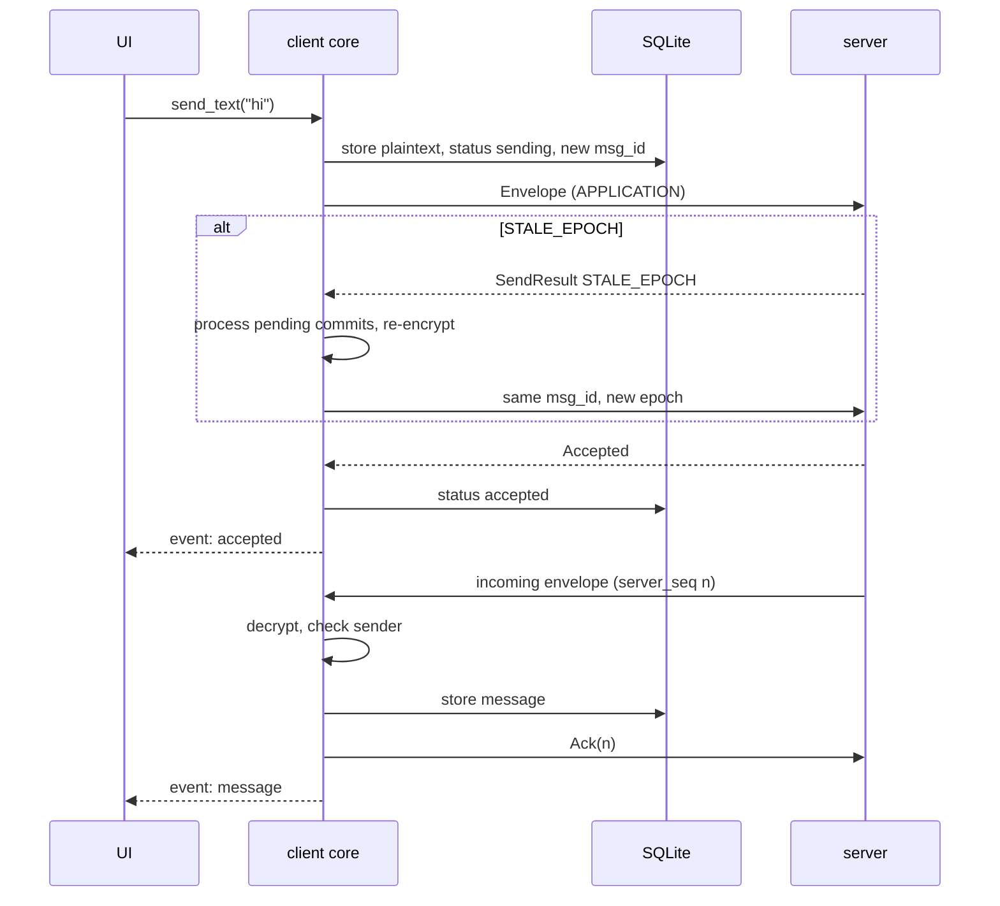
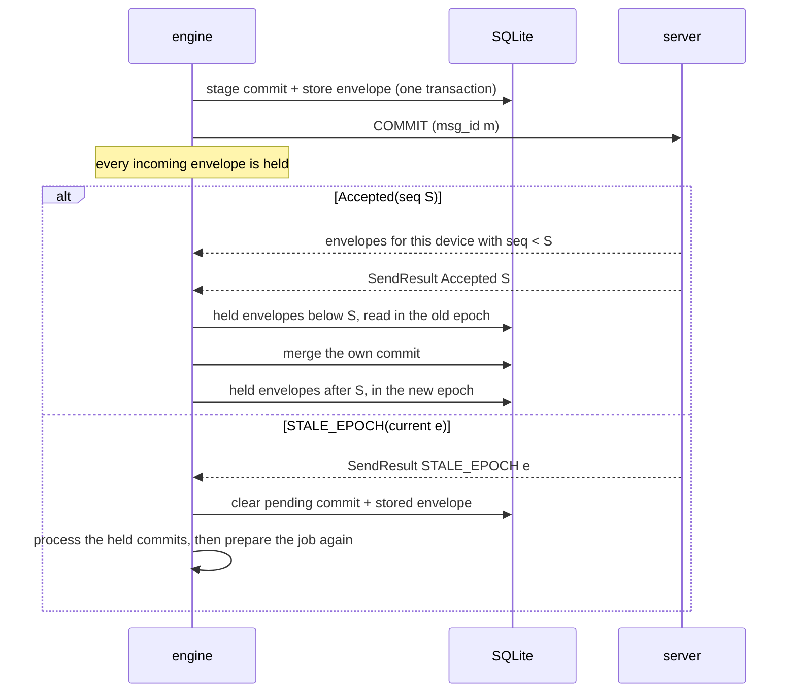
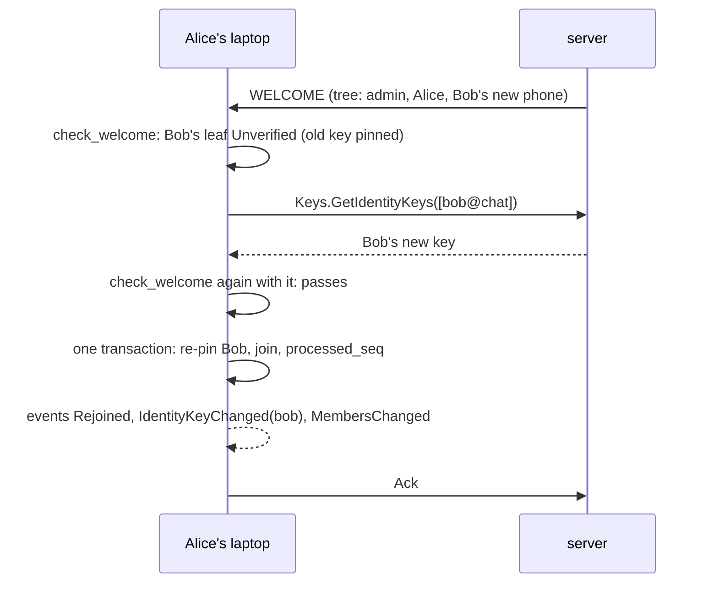

## Context

The server (`server-core`, archived) implements every server-enforced
requirement and is tested with OpenMLS test clients. Nothing on the device side
exists. The owner's build order puts this core next, then a terminal client,
deployment, and Flutter. Owner decisions feeding this change: crate name
`client`; desktop keys in the OS keychain with an opt-in 0600 file fallback;
decision #4 (7-day own-leaf rotation and last-resort refresh); decision #2
(Q&A verification over a PAKE) deferred to its own change after the terminal
client.

Owner conventions apply: committed generated code via `cargo run -p pbgen`,
tests only in `tests/`, one folder per feature, spikes git-ignored and deleted.

## Goals / Non-Goals

**Goals:**

- A library a UI can drive end to end: sign up, link a device, create the group
  (admin), add and remove people (admin), send and receive text, profiles and
  group settings, survive restarts, network drops and inactivity.
- Every client-side requirement implemented and tested against the real server.
- One API shape that the terminal client uses now and Flutter wraps later.

**Non-Goals:**

- Any UI (terminal client and Flutter changes), Q&A verification (its own
  change), real push (Flutter change), Android/iOS key stores (Flutter change;
  the key-store interface is ready for them).

## Decisions

### D1. Layout: one folder per feature

```
client/
  src/lib.rs         public API: Client, events, plain request/response types
  src/pb.rs          generated messages + client stubs (committed)
  src/keystore/      KeyStore trait; OS keychain, opt-in file, memory (tests)
  src/store/         SQLite: messages, own sent plaintext, pinned identity keys
  src/identity/      identity key, device keys, certificates, signup, linking
  src/net/           pinned TLS, auth and token renewal, Connect, reconnect
  src/mls/           OpenMLS group: create, add, process, encrypt, rotate
  src/membership/    admin actions, commit-authority check, re-add, server Removes
  src/keys/          KeyPackage upload, replenish, last-resort refresh
  src/messaging/     content bodies, send and status, receive, ack, notices
  tests/             end-to-end tests against the real server
```

Clarification from task groups 4 and 5: one private module, `src/engine/`,
sits between the feature folders. It is the single task that owns the
connection, the `Connect` stream and the `MlsGroup`, so everything that
touches them happens in one order (D4, D5). The feature folders hold the
steps it runs (`identity/` keys and payloads, `net/` TLS and auth, `mls/`
config and checks, `membership/` commit building, `keys/` KeyPackages and
rotation timing); `messaging/` holds only the minimal receive step task group
6 builds on.

### D2. API: one async Rust API plus an event stream

`Client` exposes async methods (`register`, `link_request`, `approve_link`,
`create_group`, `add_user`, `remove_user`, `send_text`, `set_profile`,
`set_group_settings`, ...) and one ordered event stream. Types are plain
structs and enums with no OpenMLS or protobuf types, so `flutter_rust_bridge`
can wrap them later unchanged. **Alternative:** design the FFI surface now.
Rejected: the terminal client is Rust and needs no FFI.

Clarifications from task 2.1: `lib.rs` declares the modules and re-exports;
`Client` lives in `src/client.rs`, the event and plain types in
`src/events.rs`, the clock in `src/clock.rs`. The feature modules are `pub` so
the tests in `tests/` (public API only) can reach them, as the server's are;
UIs use `Client` and `Event` only, and only those must stay free of OpenMLS and
protobuf types (`client::mls::MlsProvider` is an OpenMLS provider by nature).
`Client::open` runs the key store and database on `spawn_blocking`, since a
keychain call can wait on a user prompt. `Event`, `MessageBody`,
`ConnectionState` and `ClientError` are `#[non_exhaustive]`; later groups add
variants. There is one `EventStream`, taken once with `Client::take_events`.

### D3. Keys: a key-store interface

`KeyStore` stores and loads named secrets. Implementations: OS keychain via the
`keyring` crate; a 0600 file used only when the user passes an explicit opt-in;
an in-memory store for tests. Android and iOS implement the same trait later.
The core never writes the identity, auth or MLS signature keys anywhere else.

OpenMLS group state goes through a storage provider that writes to SQLite with
every value encrypted (an AEAD such as ChaCha20-Poly1305) under a storage key
created on first start and kept in the key store (owner decision, option A).
Messages are not encrypted, as the architecture decided. **Alternatives:** plain
rows relying on disk encryption (B), or the key store itself (C, impractical:
many entries changing every epoch).

**Spike result (task 1.1, openmls 0.9.2, rusqlite 0.37): works, with our own
`StorageProvider`.** The existing `openmls_sqlite_storage` 0.3 does not fit: its
`Codec` is a static trait with no access to a key, it encodes lookup keys with
the same codec (so a randomised AEAD would break lookups), it needs Rust 1.91
(the workspace pins 1.88) and pulls in `refinery`. Chosen approach, in
`client/src/mls/storage.rs`:

- One table `mls_storage(slot BLOB PRIMARY KEY, value BLOB)` in the client's
  SQLite file, shared with the message store (one connection).
- `slot` = HMAC-SHA256(slot key, storage version ‖ label ‖ serde_json key); the
  rows reveal neither labels nor group ids. `value` = 24-byte random nonce ‖
  XChaCha20-Poly1305(seal key, serde_json value, AAD = slot), so a value cannot
  be moved to another slot. Slot and seal keys are HMAC-derived from one 32-byte
  storage key that lives in the key store.
- A key-check row is written on first open and opened on every later one, so a
  wrong storage key fails with `WrongKey` instead of looking like "no group".
- The provider **refuses** `write_signature_key_pair` (and reads none): OpenMLS
  takes the signer as a parameter, so the MLS signature key never needs to be in
  storage and stays in the key store only (client-runtime: Key storage).
- The method layout follows `openmls_memory_storage` 0.6 (same key-value
  shape), without its `clear_proposal_queue` bug (it deleted unlabeled keys).

Proved in the spike: Alice and Bob each on their own encrypted file; Bob joins,
one message read, a second message in flight, both processes "restart" (all
OpenMLS objects dropped), `MlsGroup::load` restores both, Bob reads the
in-flight message, chats both ways, commits a leaf update, and restarts again.
A KeyPackage created before a restart is joined from after it (its init key
survives). The wrong key gives `WrongKey`; values swapped between rows fail to
load; the raw file contains no label, group id or credential bytes. **Atomicity:**
an OpenMLS call inside `BEGIN IMMEDIATE … ROLLBACK` on the shared connection
leaves the stored group as before (reloading decrypts the same message again),
so receiving does "decrypt + store message" in one transaction and acks after
`COMMIT`; after `COMMIT` the consumed message key is gone. The in-memory
`MlsGroup` must be reloaded after a rollback. Side finding for task 5.4: a
last-resort KeyPackage must list `LastResort` in its leaf capabilities (as well
as `0xF0A1`), or `validate` fails with `UnsupportedExtension`.

**Spike result (task 1.2, `keyring` 4.2 `v1` feature, macOS 26): works, with
caveats.** The `v1` API is `Entry::new(service, user)` with `set_secret`,
`get_secret`, `delete_credential`; on macOS it uses the login keychain (legacy
file keychain, generic passwords).

- **Persistence:** a secret set by one run is read by the next; missing entries
  are `Error::NoEntry`. About 10 ms per call.
- **Prompts:** none for the binary that created the item. A *different* binary
  (a rebuild, which changes the ad-hoc code signature, or a copy) blocks on the
  macOS "wants to use your confidential information" dialog for both
  `get_secret` and overwriting `set_secret`, until the user answers. Deleting
  needs no prompt; new entries from the new binary need none. So during
  development every rebuild of the terminal client prompts once per key
  ("Always Allow" answers it until the next rebuild); a signed release keeps its
  identity across updates. Consequences: keychain calls run off the async
  runtime (`spawn_blocking`), can take arbitrarily long, and real-keychain tests
  are `#[ignore]` (CI and `cargo test` use the memory store).
- **No keychain:** `Entry::store_status()` is an error when no store can be
  initialised (e.g. Linux without a Secret Service session); a locked or
  unavailable keychain shows up per call as `NoStorageAccess` or
  `PlatformFailure` (errSecInteractionNotAllowed over SSH is not mapped to its
  own code). Not reproduced on this Mac (a GUI session always has a login
  keychain). So the OS-keychain store probes availability with `store_status()`
  plus a read of a probe entry (`NoEntry` means available) before creating keys;
  anything else means "no keychain", and with no file opt-in the core refuses to
  create keys and says how to opt in.

Clarifications from tasks 3.1 and 3.2:

- `KeyStore` stores a fixed set of names (`KeyName`: identity key, device auth
  key, MLS signature key, storage key), so nothing else can end up in it by
  accident. Keychain entries are service `vyajena2`, account
  `<profile>/<key name>`, so several clients on one machine do not share keys.
- The opt-in is a value (`KeyFileOptIn`) a UI creates only from an explicit
  user action. Selection (`choose_key_store`): an opted-in key file that
  **already exists** keeps its keys even if a keychain has appeared since
  (otherwise the device would look new); else the keychain when available;
  else the opted-in file; else `NoKeychain`, whose message says how to opt in.
  The file is one binary file (magic line, then name/length/secret records),
  rewritten through a 0600 temp file, `fsync` and `rename`; a file with any
  group or other permission bits is refused, as is a damaged one. Unix only.
- The store and OpenMLS share one connection behind a re-entrant lock;
  `Store::transaction` is a savepoint that rolls back on error or panic. WAL,
  `synchronous = FULL`, file mode 0600, migrations embedded as in the server.
- `messages` keeps the whole encoded `Content` (plaintext), so a body this
  version does not know can still be shown by a later one. An own message in
  flight also keeps the epoch and the exact envelope ciphertext last sent: a
  resend after a crash must repeat identical bytes, because the server answers a
  retry with different ciphertext for an accepted `msg_id` with
  `REJECTION_REASON_DUPLICATE_MISMATCH`. Re-encryption (new bytes) happens only
  after `STALE_EPOCH`, which leaves no dedup record. The bytes are dropped once
  accepted or failed. Received messages are unique on `server_seq` and on
  (sender device, `msg_id`); a redelivery is reported as `Duplicate`.
- `identity_keys` pins one key per user id; a different key is kept as
  `pending_key` until `accept_identity_key` is called with exactly that key.

### D4. Sending and receiving



Receiving is strictly in `server_seq` order; the core never acks before the
message is stored (`client-runtime: Local message store`).

Clarifications from task groups 4 and 5 (the engine, `src/engine/`):



- **Connection.** `Client::start` runs the engine: pinned TLS to the relay
  address from the invite (TLS 1.3, ALPN `h2`, SNI fixed to `vyajena2-server`; the
  verifier checks only the SPKI SHA-256 pin), `GetChallenge` and
  `Authenticate` over the TLS exporter, then `Connect` with `Hello`. Reconnect
  backoff starts at 250 ms and doubles to 30 s with up to 50% jitter, reset
  on success. A heartbeat goes out when nothing was sent for 25 s; a stream
  silent for 90 s is dropped. The token is renewed on the same connection
  five minutes before it expires, timed on the client's clock from when it
  was issued (a device clock ahead of the server's would otherwise renew on every
  tick). A pin mismatch emits `ServerIdentityError` and stops connecting
  until `start` is called again.
- **Own commits, one at a time.** The envelope is stored (`outgoing_commit`)
  in the same transaction that stages the commit, and resent byte for byte
  after a reconnect or a crash, so the server's dedup answers with the original
  result. While it waits, every incoming envelope is held: a commit from
  someone else means ours is stale, and anything after our commit is in the
  next epoch (after a reconnect the catch-up can bring those before the
  dedup `Accepted`). Held envelopes are dropped on a disconnect; they were
  not acked, so the server delivers them again.
- **Merging after `Accepted`** (task 5.7, owner 2026-11-11). On the
  committer's own stream the server delivers every entry for that device below
  the commit's `server_seq` before it sends `Accepted`, also for the dedup
  answer to a resent commit (message-delivery: Ordered delivery and
  catch-up). So on `Accepted` the engine reads the held envelopes below the
  commit in the old epoch, merges at once, and then reads the rest; with
  `max_past_epochs = 0` nothing sequenced before the commit is lost. The
  former 200 ms settle wait is gone. The server orders only commits this way;
  an application message's `Accepted` merges nothing.
- **`STALE_EPOCH`** puts the job back at the front of the queue; it runs again
  once the device reached the epoch the server named and re-checks whether it is
  still needed.
- **Incoming** envelopes are processed in `server_seq` order, each in one
  store transaction that also records `processed_seq` (`group_state`), and
  acked after it commits; a redelivery at or below `processed_seq` is acked
  and skipped. Jobs run only when the stream has been quiet for 100 ms, so a
  catch-up burst is processed first.

Clarifications from task group 6 (messaging):

- **Bodies** (`client::messaging`). `send_text`, `set_profile` and
  `set_group_settings` (admin devices only; others get `NotAdmin`) encode a
  `Content` with the sender's clock as `sent_at`. An encoded `Content` above
  `MAX_CONTENT_BYTES` (the 65,536-byte cap minus a 512-byte margin; MLS adds
  under 200 bytes, no padding) is refused with `ClientError::TooLong` before
  anything is stored; the engine checks the real ciphertext against the cap
  again and marks a message failed if it is over. A `Content` that does not
  decode, or whose oneof is unset, is `MessageBody::Unsupported`, never an
  error. Migration `0003_messaging.sql` adds `messages.kind` (`chat`,
  `profile`, `settings`; the history shows only `chat`), `profiles` and
  `group_settings`.
- **Sending** (`engine/outbox.rs`). The API stores the message as sending and
  wakes the engine; it works offline and the message goes out on the next
  connect. The engine sends every sending message not in flight, oldest
  first, on connect, after each frame and on each tick: stored ciphertext
  again byte for byte, otherwise it encrypts in the current epoch and stores
  the ciphertext in the same transaction. It sends nothing while an own
  commit waits, while envelopes are held, while the group is behind the
  epoch a `STALE_EPOCH` named (keeping the order of own messages), or while
  stalled. On `STALE_EPOCH` the ciphertext is dropped (`clear_sent`) and the
  message is encrypted again after catching up, with the same `msg_id`;
  any other rejection marks it failed with the reason. In-flight results
  lost with a link are recovered by resending the same bytes. OpenMLS
  encrypts nothing while proposals are pending, so a device with a message
  to send commits the server's pending inactivity Removes itself
  (`CommitServerRemoves`), which commit authority allows any member; the admin's
  devices still commit them as soon as they arrive.
- **Own profile and settings** apply on the sending device when the server
  accepts them (with the same event the other devices emit on receipt).
- **Receiving** decrypts, checks that the MLS sender leaf's certificate names
  the device in `envelope.sender`, stores, and applies a `Profile` to the
  sending user only and a `GroupSettings` only from the admin named in the
  `0xF0A1` extension, in one transaction with `processed_seq`; the event is
  emitted after it commits and before the ack. A message that does not
  decrypt or whose MLS sender differs from the server's is acked and reported as
  `Event::Unreadable { sender, accepted_at }` (nothing dropped silently). A
  redelivery (at or below `processed_seq`, or a duplicate row) emits nothing.

### D5. Membership on the device

- Every new or changed leaf: verify the device certificate against the user's
  pinned identity key and that its MLS key equals the leaf key; apply the
  commit-authority rule with `protocol::group_membership`. Reject the commit
  otherwise.
- Identity keys are pinned on first sight. A different key for a known user
  raises an identity-key-changed event and blocks adding that user's devices
  until the user accepts the new key in the UI (Q&A verification later builds on
  this).
- On a `RejoinNotice` for its own user's device or, on admin devices, for anyone:
  fetch that device's KeyPackage and commit the re-add (pending server Remove plus
  Add), with no user action.
- Admin devices commit pending server inactivity Removes when they connect.
- Group creation sets the `0xF0A1` admin extension and lists the server as external
  sender; every KeyPackage declares `0xF0A1` in its capabilities.

Clarifications from task groups 4 and 5:

- **Learning identity keys** (task 5.5, owner 2026-11-11). A device that
  meets a user for the first time in a Welcome or in someone else's commit,
  and a newly linked device learning its own user's key, call
  `Keys.GetIdentityKeys` with every such user in one request; it consumes no
  KeyPackages (key-directory: Identity key lookup). The server answers all or
  nothing, so on `NOT_FOUND` the core asks for each user alone and leaves out
  the ones the server does not know (their leaves then fail as `NotPinned`). The
  key is pinned on first sight, as for the admin's own fetch. Only adding a
  user's devices still reads the key from `Keys.FetchKeyPackages`, which
  returns it with the KeyPackages it hands out.
- **Leaf checks** (`client::mls::verify`): every added leaf's certificate
  verifies against the pinned key, names a user of this server and certifies the
  leaf's signature key; a member's path leaf or Update keeps exactly its
  certificate and key; then `protocol::group_membership::check_commit_authority`,
  with the admin read from the `0xF0A1` extension and the server's position in the
  external senders. A Welcome is joined only if every member's leaf passes
  and the group context names the admin and lists the server.
- **A refused commit** cannot be skipped (later traffic is in the new epoch),
  so the device records it as stalled (`group_state.stalled`), acks it, emits
  `CommitRefused` and ignores the group until a Welcome re-adds it. If the
  failure was a certificate that does not verify against the pinned key, the
  device looks up the user's current key; a different one is stored as
  pending and raises `IdentityKeyChanged`.
- **A reset user re-added by the admin** (task 5.6, owner 2026-11-11). When
  the review fails with `Unverified(user)` and the committer's leaf is the
  admin's (`verify::key_lookup_allowed`), the device looks the user's key up
  with `Keys.GetIdentityKeys`. If the server returns a key different from the
  pinned one, the review runs again with it (once per user, so a commit that
  re-adds several reset users works); if it passes, the new key is re-pinned
  (`Store::repin_identity_key`, which also clears a pending key) in the same
  transaction that merges the commit, and `IdentityKeyChanged` is emitted
  after it. The member does nothing: the admin already decides who joins, so
  this adds no new trust. Any other failure, the same key again, or a commit
  from a non-admin stalls as above.
- **A Welcome naming a reset user** (task 6.4, owner 2026-11-11). A device
  re-added from a Welcome (back from holiday) may still pin a user's old key
  while the Welcome's tree holds that user's new device. When
  `verify::check_welcome` fails with `Unverified(user)`
  (`verify::welcome_key_lookup`), the device looks the user's key up with
  `Keys.GetIdentityKeys` **whoever signed the Welcome** (the committer of a
  re-add may be the user's own device, not the admin): the server already vouches
  for every key a device first sees in a Welcome. A different key runs the
  check again (once per user); if it passes, the device re-pins the key in
  the transaction that joins, then emits `Rejoined` (or `JoinedGroup`),
  `IdentityKeyChanged` and `MembersChanged`. The same key again or any other
  failure refuses the Welcome as before (`CommitRefused`, a changed key kept
  pending).


- **A message typed while removed** (task 6.4, owner 2026-11-11). It is
  stored as sending like any other. The server answers `STALE_EPOCH` while the
  device is out of the group, so the outbox waits; after the Welcome it is
  encrypted in the new epoch and sent with the same `msg_id`, and goes to
  accepted (client-runtime: Send status). Nothing fails it.
- **Adding** (admin `add_user`, re-add, linked devices) pins or compares the
  fetched identity key first: a changed key raises `IdentityKeyChanged` and
  fails with `ClientError::IdentityKeyChanged` until `accept_identity_key`.
- **Linking.** The link request is an encoded `DeviceCertificate` holding only
  the device id and the two public keys; the approval is an `InvitePayload`
  with the relay address, pin and user id and no invite code, so the new
  device knows where to connect (no new message type). The identity device
  records the new device in `pending_links` and, about once a second while
  connected, fetches its KeyPackage and commits the Add as soon as one exists
  (an own-device Add, allowed by commit authority). Revoking a device also
  commits the Remove of its leaf.
- **Re-add race.** On a `RejoinNotice` the device notes the returning device's
  current leaf (its encryption key, or none). When the job runs, a different
  leaf means someone else re-added it, and the job does nothing. Otherwise it
  commits the Add of a KeyPackage fetched for that device only, plus a Remove
  of the old leaf by value unless a pending server Remove already covers it.
- **Server Removes.** Admin devices commit pending server Removes as soon as one
  arrives and on the first quiet moment after connecting; every other commit
  includes them by reference anyway.
- **KeyPackages** list `0xF0A1` and `LastResort` in their leaf capabilities
  (one capability set for all leaves); the last-resort one carries the
  `LastResort` extension so OpenMLS keeps its key after a join. Signup and
  linking upload 20 one-time plus one last-resort; a low notice tops up to
  20; every upload carries a new last-resort KeyPackage, and the private key
  of one two refreshes old is deleted.

### D6. Rotation (decision #4)

A daily check plus one on each connect: if the device's leaf is older than 7
days, commit an update of its own leaf after a random delay of up to an hour; if
the last-resort KeyPackage is older than 7 days, upload a new one. The 7-day age
is a `protocol` constant.

Clarification from task 5.4: the check runs on the first quiet moment after
each connect and then whenever a day has passed on the client's clock. A due
leaf is rotated (an own commit with a forced update path, which also commits
pending server Removes) at a random moment within the next hour; the leaf's age
counts from group creation, joining, or the last own commit with an update
path (`group_state.own_leaf_updated_at`).

### D7. Time is injectable

Like the server, the core reads time from a clock the tests can move, so
rotation, token renewal and inactivity are testable without waiting.

### D8. Testing end to end

`client/tests/` starts the real server in-process (the `server` crate as a
dev-dependency) and runs Alice, Bob and the admin as real `Client`s with
in-memory key stores and temp databases. Scenarios follow the specs: signup,
linking, group creation, adding Bob, chatting, epoch races, catch-up, inactivity
and automatic re-add, rotation, key-changed warnings. The dropped
"unknown content body decodes as unset" test lands here.

Clarification from task 7.1: the harness grew with the tests of task groups
3 to 6 and needed nothing more. `client/tests/support/` holds `server.rs` (the
real server in-process on a temp database and keys, its own `ManualClock`,
restart on the same port, `sweep`, raw queries), `relay.rs` (a TCP relay in
front of it that tests cut to drop the network), `device.rs` (a `Client`
with a `MemoryKeyStore`, a temp data directory, its own `ManualClock`, an
event log to wait on, crash-and-restart, and helpers for the admin, invited
users and group members) and `mls.rs` (bare OpenMLS members for the pure
commit checks). The server's and each device's clocks move independently, so
token renewal, rotation, inactivity and expiry run without waiting; only
the heartbeat test waits its 25 s in real time (the core times heartbeats
on the monotonic clock).

## Risks / Trade-offs

- [OpenMLS persistent storage may not fit (crate availability, schema, or how
  it stores secrets)] → task 1.1 spikes it first.
- [`keyring` behaves differently per OS and may prompt the user on macOS] → task
  1.2 spikes it on macOS; the file fallback covers headless machines.
- [The server as a test dependency couples the crates] → test-only; the core's
  own code never imports the server.
- [The same membership logic runs on device and server] → shared rules stay in
  `protocol/`, so they cannot drift.

## Migration Plan

None. No deployed clients.

## Open Questions

None open. Resolved by the owner (2026-11-11), from questions found while
building task groups 4 and 5 (tasks 5.5–5.7):

1. **Members refusing a reset user.** After the admin resets Bob, other members
   still had his old key pinned and refused the admin's re-add, stalling. Now a
   member that sees an admin commit add a device with a changed key looks the
   key up on the server, accepts the commit, re-pins and warns (key-directory:
   Clients verify the identity chain). The admin already decides who joins, so
   this adds no new trust; members do nothing. A non-admin commit with a changed
   key is still rejected.
2. **Identity keys cost a KeyPackage.** New RPC `Keys.GetIdentityKeys` returns
   identity keys only, consuming nothing (key-directory: Identity key lookup).
   The server still vouches for each key, as with `FetchKeyPackages`.
3. **The committer's merge race.** The server now delivers, on the committer's own
   stream, every entry below the commit's `server_seq` before its `Accepted`
   (message-delivery: Ordered delivery and catch-up). The core's 200 ms settle
   wait goes away.

Session C's two questions (a Welcome naming a reset user; a message typed
while removed) were answered by the owner on 2026-11-11 and are now D5
decisions (task 6.4).

Resolved by the owner (2026-11-10): OpenMLS group state is stored in SQLite
encrypted under a storage key kept in the key store (option A; see D3).

## Appendix: requirement coverage (task 7.2)

Every requirement in the main specs plus this change's deltas (`client-runtime`
new; own-leaf rotation, last-resort refresh and identity key lookup added;
device-level membership, clients verify the identity chain and ordered
delivery modified). Tests are tagged `// spec: <capability>/<slug>` in the
files named (`c/` = `client/tests/`, `s/` = `server/tests/`, `p/` =
`protocol/tests/`). **Client** = only the device enforces it; **server** = only
the server does (no client side to test); **Both** = each has a part, and each
part has a test. Count: 58 requirements; 12 client, 10 server, 35 both, 1 CI.

| Requirement | Who | Tests |
|---|---|---|
| client-runtime/key-storage | Client | c/key_storage.rs, c/mls_storage.rs, c/local_store.rs, c/devices.rs, c/client.rs |
| client-runtime/local-message-store | Client | c/local_store.rs, c/messaging.rs, c/mls_storage.rs, c/group_membership.rs |
| client-runtime/connection-lifecycle | Client | c/connection.rs, c/messaging.rs |
| client-runtime/send-status | Client | c/messaging.rs, c/inactivity.rs (typed while removed), c/local_store.rs |
| client-runtime/events-in-order | Client | c/messaging.rs (incl. gap notice), c/inactivity.rs, c/client.rs |
| message-content/inner-content-format | Client | c/messaging.rs (incl. the dropped "unknown body decodes as unset" test) |
| message-content/text-only | Client | c/messaging.rs |
| message-content/group-settings-travel-encrypted | Client | c/messaging.rs |
| message-content/user-owned-profiles | Client | c/messaging.rs |
| key-directory/clients-verify-the-identity-chain (modified) | Client | c/commit_checks.rs, c/identity_keys.rs, c/inactivity.rs (Welcome after a reset), c/local_store.rs |
| key-directory/last-resort-keypackage-refresh (new) | Client | c/rotation_and_key_packages.rs, p/key_directory.rs |
| group-membership/own-leaf-rotation (new) | Client | c/rotation_and_key_packages.rs, c/messaging.rs, c/client.rs, p/group_membership.rs |
| key-directory/identity-key-lookup (new) | Both | c/identity_keys.rs, s/identity_key_lookup.rs |
| group-membership/device-level-membership (modified) | Both | c/commit_checks.rs, c/group_membership.rs, c/identity_keys.rs, s/group_membership.rs |
| message-delivery/ordered-delivery-and-catch-up (modified) | Both | c/messaging.rs, s/message_delivery.rs |
| device-identity/federation-ready-identifiers | Both (device computes its own id) | c/devices.rs, c/client.rs, s/signup.rs, p/device_identity.rs |
| device-identity/user-identity-key-and-device-certificates | Both | c/devices.rs, s/signup.rs, p/device_identity.rs |
| device-identity/invites | Both | c/devices.rs, s/invites.rs |
| device-identity/admin-owned-usernames | Both (id from the invite) | c/devices.rs, s/signup.rs |
| device-identity/signup-with-an-invite | Both | c/devices.rs, s/signup.rs |
| device-identity/bootstrap-admin | Both (admin registers from it) | c/group_membership.rs, s/bootstrap_admin.rs, s/signup.rs, s/running_locally.rs |
| device-identity/admin-awareness | Both | c/group_membership.rs, s/devices.rs |
| device-identity/device-linking | Both | c/devices.rs, c/inactivity.rs, s/devices.rs |
| device-identity/device-revocation | Both | c/devices.rs, s/devices.rs, s/messaging_stream.rs |
| device-identity/push-token-registration | Both | c/devices.rs, s/devices.rs |
| group-membership/group-creation | Both | c/group_membership.rs, s/group_membership.rs, p/group_membership.rs |
| group-membership/commit-authority | Both | c/commit_checks.rs, c/group_membership.rs, c/messaging.rs, s/group_membership.rs, p/group_membership.rs |
| group-membership/removing-a-user | Both | c/group_membership.rs, c/identity_keys.rs, s/group_membership.rs, s/message_delivery.rs |
| group-membership/inactive-devices-are-kept-out | Both | c/inactivity.rs, c/messaging.rs, s/inactivity.rs, s/message_delivery.rs |
| group-membership/automatic-re-add | Both | c/inactivity.rs, c/messaging.rs, s/inactivity.rs |
| key-directory/keypackage-upload | Both | c/rotation_and_key_packages.rs, s/key_packages.rs |
| key-directory/keypackage-fetch | Both (re-add fetches one device) | c/inactivity.rs, s/key_packages.rs |
| key-directory/replenishment-signal | Both | c/rotation_and_key_packages.rs, s/inactivity.rs |
| message-delivery/envelope | Both | c/messaging.rs, s/message_delivery.rs |
| message-delivery/welcome-travels-with-its-commit | Both | c/group_membership.rs, c/size_limits.rs, s/message_delivery.rs |
| message-delivery/accepted-means-durable | Both ("sending" until `Accepted`) | c/messaging.rs, s/message_delivery.rs |
| message-delivery/idempotent-sends | Both | c/messaging.rs, c/group_membership.rs, s/message_delivery.rs |
| message-delivery/strict-epoch-rule | Both | c/messaging.rs, c/rotation_and_key_packages.rs, s/message_delivery.rs |
| message-delivery/per-device-queues | Both (sender's other device) | c/messaging.rs, s/message_delivery.rs |
| message-delivery/acknowledgement | Both | c/messaging.rs, s/message_delivery.rs |
| message-delivery/expiry-and-gap-notice | Both (notice reaches the UI) | c/messaging.rs, s/message_delivery.rs |
| wire-transport/grpc-over-http-2-and-pinned-tls-on-tcp-443 | Both | c/connection.rs, s/pinned_tls.rs |
| wire-transport/session-authentication | Both | c/connection.rs, s/session_authentication.rs, s/messaging_stream.rs, p/wire_transport.rs |
| wire-transport/single-persistent-messaging-stream | Both | c/connection.rs, s/messaging_stream.rs |
| wire-transport/heartbeats | Both (25 s sending is the core's) | c/connection.rs, s/messaging_stream.rs |
| wire-transport/size-limits | Both | c/messaging.rs (application), c/size_limits.rs (commit), s/messaging_stream.rs, s/server_info.rs, p/wire_transport.rs |
| wire-transport/protocol-version-negotiation | Both (`Hello` states the version) | c/connection.rs, s/messaging_stream.rs, s/server_info.rs |
| group-membership/server-validates-handshakes-without-group-secrets | server | s/group_membership.rs |
| group-membership/membership-state-on-the-server | server | s/group_membership.rs |
| message-delivery/framing-matches-the-envelope | server | s/message_delivery.rs |
| message-delivery/commit-log | server | s/message_delivery.rs |
| message-delivery/content-free-wake-pings | server | s/wake_pings.rs |
| server-runtime/configuration | server | s/configuration.rs |
| server-runtime/first-start | server | s/first_start.rs, s/running_locally.rs |
| server-runtime/durable-storage | server | s/durable_storage.rs, s/message_delivery.rs |
| server-runtime/push-provider-interface | server | s/push_provider.rs |
| server-runtime/running-locally | server | s/running_locally.rs, s/clock.rs |
| wire-transport/protobuf-contract-is-the-source-of-truth | CI | `buf lint` + `buf breaking` in CI; committed `pb.rs` from `cargo run -p pbgen` |

Not exercised end to end, and why:

- **Commit over the cap.** A real commit over 262,144 bytes needs hundreds
  of devices, so `c/size_limits.rs` checks `membership::commit_envelope`,
  the step every own commit goes through (task 7.2 moved the check there
  from the engine).
- **A server without protocol version 1.** The test server always speaks it, so the
  core's refusal at signup and linking (`checked_server_info`) is not run;
  every connection test shows the `Hello` names a version the server accepts.
- **The real OS keychain.** `c/key_storage.rs` `os_keychain_keeps_named_secrets`
  is `#[ignore]` (a rebuilt binary prompts on macOS; D3); the rest use the
  memory store.
- **"server crashes before writing"** (accepted-means-durable) is the server's;
  `s/message_delivery.rs` covers it, the core's half is "sending until
  `Accepted`, resent on reconnect".
