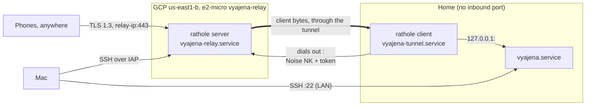
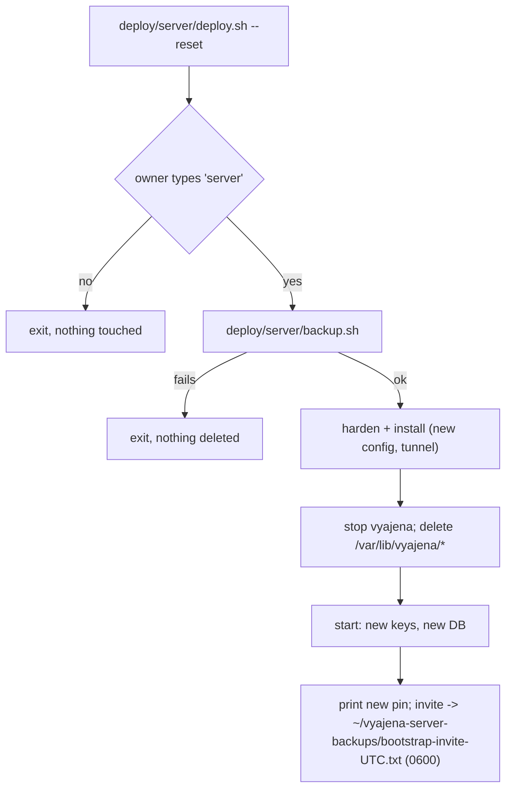

## Context

- Today (home-LAN phase, `server-deployment` D4): the server serves `0.0.0.0:<server-port>`,
  nftables lets the home subnet reach <server-port>, invites name `<server-address>:<server-port>`.
- The Airtel router drops inbound IPv6 and the home IPv4 is NATed and dynamic, so
  the server must dial out. The architecture doc always planned a dumb rathole relay
  on a free GCP VM. Direct IPv6 is deferred to last.
- Owner decisions (2026-11-15, final): relay only (push is the next change); its
  own new e2-micro in a free-tier US region of `purple-eccdf`; a raw static IPv4,
  no DNS, invites use `<ip>:443`; no migration: wipe the server, everyone re-joins.
- Owner's words (2026-11-15, relayed by the tracker): "I want to use only GCP
  services if possible"; "everyone re-joins as though its new… we treat it like
  non production"; "for now lets avoid the dns", then (2026-11-16) "lets do dns
  now" (D13).
- GCP state (after the owner logged in again, 2026-11-15): the billing account
  is **closed**; billing is off on `purple-eccdf`,
  `vyajena` and `triple-reef-499411-e4`; the Compute API was never enabled (no
  VMs, IPs or disks). **Step 0, owner only:** reopen billing and set a $1
  budget alert. Only then, with the owner's go-ahead, enable Compute
  (`create.sh`).

## Goals / Non-Goals

**Goals:** devices anywhere reach the server through `vyajarelay.purplechaamba.com:443`; nothing
listens at home; the relay is stateless, rebuildable and checked by one command;
the server starts fresh, backed up first.

**Non-Goals:** real push (next change); a CA certificate (the pin is enough); HTTP/3;
direct IPv6; migrating devices that joined in the home-LAN phase.

## Decisions

### D1. Flow



```mermaid
sequenceDiagram
  participant T as server: vyajena-tunnel
  participant R as Relay: rathole :<tunnel-port> / :443
  participant C as Phone (core)
  participant P as server: server 127.0.0.1:<server-port>
  T->>R: TCP :<tunnel-port>, Noise NK (server pins relay key)
  T->>R: Hello(service digest), token digest over nonce
  R-->>T: OK, control channel up; R starts listening on :443
  C->>R: TCP :443
  R->>T: "create data channel"
  T->>R: new Noise data channel
  T->>P: TCP 127.0.0.1:<server-port>
  C->>P: TLS 1.3 through R and T, byte for byte (pin checked)
```

### D2. GCP layout (owner: own VM, US, static IPv4)

| Thing | Value |
| --- | --- |
| Project / zone | `vyajena` (owner, 2026-11-16; was `purple-eccdf`, D12) / `us-east1-b` (free tier; closest free US region to India over Google's backbone, via Europe) |
| VM | `vyajena-relay`, e2-micro, Debian 13 (`debian-13`), 10 GB `pd-standard`, Shielded VM |
| Address | static external IPv4 `vyajena-relay` (Premium tier), ~$3.65/month in use |
| VPC | own custom-mode `vyajena-relay`, subnet `<old-subnet>`, flow logs off |
| Firewall | `vyajena-relay-public` tcp:443 0.0.0.0/0 · `vyajena-relay-tunnel` tcp:<tunnel-port> 0.0.0.0/0 · `vyajena-relay-iap-ssh` tcp:22 <iap-range>; logging off; implied deny for the rest |
| Identity | `--no-service-account --no-scopes`: the VM can call no Google API |
| Metadata | `enable-oslogin=FALSE`, `block-project-ssh-keys=TRUE`, `enable-guest-attributes=TRUE`, `serial-port-enable=FALSE`, `ssh-keys` = the relay key for user `vyajena` |

- **Own VPC, not `default`:** enabling Compute creates `default` with
  `default-allow-ssh` (22 from anywhere) and friends; the relay never joins it.
- **Tunnel port open to all:** the home IPv4 is dynamic, so no source range
  fits. Noise + token guard it (D4); a stranger learns only that rathole runs.
- **Names and sizes** live in `deploy/relay/relay.conf`, read by every script
  and by `server/tests/deploy_files.rs`. Another region is a one-line edit
  there before `create.sh`.

- **Static, not ephemeral, IPv4:** an ephemeral address changes when the VM
  stops, and every device stores the address from its invite, so a change
  means everyone re-joins.
- **DNS name** (owner, 2026-11-16, D13): invites name
  `vyajarelay.purplechaamba.com:443`, an A record for the static address.

**Cost** (per month): e2-micro, 10 GB standard disk and 1 GB egress are in the
free tier; the in-use static IPv4 is not: $0.005/h ≈ **$3.65** (sources
conflict on whether the free tier covers it: confirm on the first bill or the
$1 budget alert). Egress over 1 GB is billed (text chat stays far below). A
reserved address that is *not* attached costs more, so delete it if the VM
goes.

### D3. Getting rathole (pinned 0.5.0, built, not downloaded)

- rathole 0.5.0 (latest on crates.io) is built from its crates.io source with
  its own `Cargo.lock` (`cargo install --locked`, crate checksums checked by
  Cargo) in a `rust:1.79-bookworm` container: `linux/arm64` for the server (from
  `deploy/server/build.sh`) and `linux/amd64` for the relay (`deploy/relay/build.sh`).
  Features: `server,client,noise` only (no TLS, WebSocket or hot reload).
- No release download: the GitHub release has no published checksums.
- **Spike (2026-11-15):** with `rust:1.96-bookworm` the build fails (`time`
  0.3.x in rathole's lock: E0282 since Rust 1.80); with `rust:1.79-bookworm`
  it builds: arm64 3.3 MB, glibc only. Local Docker test with the real
  templates, `secrets.sh`'s openssl-made keys and the real server binary
  behind the tunnel:
  - control channel up with the openssl X25519 keys; `openssl s_client` and
    `grpcurl Devices/GetServerInfo` through the relay port reached the server,
    SPKI hash equal to the server's logged pin;
  - wrong token: relay logs `failed the authentication`, client retries;
  - wrong relay key on the client: `Failed to do noise handshake`;
  - rathole listens on 443 only once a control channel is up; with the server gone
    it accepts and closes at once (EOF) until the heartbeat drops it;
  - at `info` the relay logs the tunnel client's address, never visitors'; at
    `error` it logs a failed client's address.

### D4. Tunnel security

- **Noise NK** (`Noise_NK_25519_ChaChaPoly_BLAKE2s`): the relay holds the static
  private key, the server pins its public key. A fake relay cannot attach the server.
- **Token:** 32 random bytes (hex). The relay exposes 443 only for a client that
  proves it (HMAC-style digest over a server nonce), so nobody else can hijack
  the service name. The token never travels in the clear (inside Noise).
- **TLS ends on the server** (unchanged): the core pins the server's SPKI. A relay that
  terminated TLS would fail the pin, so a compromised relay sees TLS bytes,
  client IPs and timing only (the architecture's threat table). Tested in
  `client/tests/relay.rs` with a recording relay and a relay to another server.

### D5. Server changes

- `config.toml` (template): `listen_address = "127.0.0.1:<server-port>"`,
  `public_address = "@RELAY_IP@:443"`.
- `nftables.conf`: the <server-port> rule goes; inbound is replies, loopback, SSH and
  ping/DHCP from the home subnet, link-local IPv6 control. Outbound open (the
  tunnel, updates).
- `vyajena.service`: `IPAddressAllow=localhost` (it only talks to the tunnel).
  Push (next change) will widen this.
- New `vyajena-tunnel.service`: `DynamicUser`, the config as a systemd credential
  (`LoadCredential`, file `/etc/vyajena/tunnel.toml` 0600 root),
  `IPAddressAllow=localhost <relay-ip>`, no capabilities, no writable path,
  `Restart=always`, same sandbox list as the server, `AF_INET AF_INET6` only.
- `/usr/local/bin/rathole` 0755 root. `harden.sh` is unchanged (the firewall
  step applies the new `nftables.conf` with its 2-minute undo).

### D6. Secrets and rendering

- `deploy/relay/secrets.sh` makes, once, in `~/.vyajena-relay/` (0700/0600):
  `token`, `noise.key`/`noise.pub` (openssl X25519, raw 32 bytes base64, the
  format rathole's `--genkey` prints), `ssh_ed25519`(`.pub`). `create.sh` adds
  `relay.env` (`RELAY_IP=`) and `known_hosts`. Refuses a folder in the repo;
  prints names only. The owner copies the folder into the password manager.
- `deploy/relay/render.sh <what>` fills a template's `@NAME@` fields to stdout,
  checking each value's format; deploy scripts pipe it over SSH into a 0600
  file (`install -m 0600 /dev/stdin`), so no secret file is written on the Mac
  outside `~/.vyajena-relay/`.
- `deploy/.shellcheckrc` lets shellcheck follow `relay.conf`.
- **Who makes the token:** options were (a) a script the owner runs, or (b)
  generated locally into `~/.vyajena-relay/`, never printed. Picked (b): the
  apply session ran `secrets.sh` on the owner's Mac (2026-11-15); no secret
  value entered the session or the repo. The owner can switch to (a) at any
  time before the relay deploy: delete the folder and run
  `deploy/relay/secrets.sh` in their own terminal. Either way the owner keeps
  a copy in the password manager.

### D7. Admin access to the relay: IAP only

- **IAP, no public SSH** (picked over "keys only on a public 22"): port 22
  accepts only Google's IAP range, and IAP checks the owner's Google login
  first. Cost: free.
- Scripts use plain `ssh` with `ProxyCommand gcloud compute start-iap-tunnel …
  --listen-on-stdin`, the key `~/.vyajena-relay/ssh_ed25519`, user `vyajena`
  (from instance metadata; the guest agent gives it passwordless sudo), and a
  pinned host key: `create.sh` reads the VM's host keys from guest attributes
  (`hostkeys/`, over the API, not over SSH) into `~/.vyajena-relay/known_hosts`
  with `HostKeyAlias=vyajena-relay`. `deploy/relay/ssh.sh` opens a shell.
- A lock-out (bad sshd change) is recovered by recreating the VM: it is
  stateless (D8), so `deploy.sh` needs no staged undo like the server's.

### D8. Relay hardening and "no state"

- `deploy/relay/deploy.sh` (as root over IAP, idempotent): sshd drop-in (no
  root, no passwords, no keyboard-interactive), unattended-upgrades with
  `Automatic-Reboot "false"`, journald `Storage=volatile` (old journal removed),
  then rathole + `vyajena-relay.service` + `/etc/vyajena-relay/server.toml`
  (0600 root, as a credential). Keeps `rathole.prev`; `--rollback` swaps.
- `vyajena-relay.service`: `DynamicUser`, `RUST_LOG=warn` (no tunnel address
  logged; failed attempts' addresses only, in RAM), only
  `CAP_NET_BIND_SERVICE` (bounding + ambient; no `PrivateUsers`, which would
  void the capability), no writable path.
- No service account, so no Cloud Logging or agents shipping anything off the VM.
- No host firewall on the VM: the VPC firewall is enforced outside the VM and
  checked; `check.sh` also fails on any unexpected listener.

**Results on GCP (2026-11-16, tasks 4.2–4.3):** `create.sh` made the VPC, the
three rules, the static address and the VM (`vyajena-relay`, `us-east1-b`,
Debian 13, e2-micro); its address is in `~/.vyajena-relay/relay.env` and the
hand-over note, not in the repo. Enabling Compute also created GCP's `default`
network (with its `default-allow-*` rules); the relay is not on it. Fixes
found on the way:
- the first `create.sh` run hung on a gcloud "enable the API?" prompt right
  after enabling Compute: `lib.sh` now sets `CLOUDSDK_CORE_DISABLE_PROMPTS=1`;
- `rathole --version` prints `Build Version: 0.5.0` on its own line; the
  check reads that;
- Debian's `systemd-resolved` answered LLMNR on `*:5355`: `deploy.sh` turns
  LLMNR and mDNS off; loopback-only listeners (the DNS stub, exim on
  `localhost:25`) are allowed by the check.
`check.sh`: 0 failed; warnings only for the tunnel not yet attached and 443
not yet listening. `systemd-analyze security vyajena-relay.service`: **1.4**
(threshold 2.0).

### D9. Server reset (no migration)



- The wipe runs only inside `deploy.sh`'s remote install, never by hand.
- The invite line is diverted from the deploy output into the owner-only file;
  the pin (not secret, but never committed) is printed.

### D10. Checks

- `deploy/server/check.sh` adds: tunnel service active/enabled and sandboxed
  (properties, exposure, no writes), `IPAddressAllow` of both services, file
  modes of rathole/tunnel config/unit, the server on `127.0.0.1:<server-port>` only, no
  <server-port> nftables rule, a tunnel connection established to `<relay-ip>:<tunnel-port>`,
  from the Mac `<server-address>:<server-port>` closed, and the SPKI on `<relay-ip>:443`
  equal to the SPKI on the server's `127.0.0.1:<server-port>` (`openssl s_client` both ends).
- `deploy/relay/check.sh`: through `gcloud` (VM type, zone in the free-tier
  list, disk type/size, no service account, metadata, static address attached,
  exactly the three firewall rules with logging off, flow logs off, no other
  VPC rules) and over IAP SSH (rathole sandbox/version/hash, listeners, sshd,
  unattended upgrades, volatile journal, config mode); from the Mac: 443 and
  the tunnel port open, 22/80/<server-port> closed. Warns when the tunnel is not
  attached or a reboot is pending.

### D11. Tests

- `server/tests/configuration.rs`: behind the relay (loopback listen, public
  address in invites) — `server-runtime/configuration`.
- `client/tests/relay.rs`: a recording relay sees no plaintext and the pin holds
  (`relay/tls-ends-on-the-server`); a relay to another server is refused; a relay
  that accepts and closes (tunnel down) then recovers
  (`client-runtime/connection-lifecycle`).
- `server/tests/deploy_files.rs`: the committed deploy files and scripts —
  relay.conf in the free tier, firewall rules, templates fully rendered and
  free of secrets, sandbox directives, nftables without <server-port>, `secrets.sh`
  modes and idempotence in a temp folder.
- On the hosts: both checks 0 failed; TLS from the Mac to `<relay-ip>:443`
  matches the new pin.

### D12. Moved to project `vyajena` (owner, 2026-11-16)

The relay was first created in `purple-eccdf` (results under D8). The owner
then chose the existing project `vyajena` (number 80637483432, the old
vyajena's Play CI project: androidpublisher and BigQuery APIs on; billing was
off, Compute never enabled): "okay lets do it now. there should already be a
project named Vyajena." No device used the first address, so the move costs
nothing: `relay.conf` says `PROJECT=vyajena`, `create.sh` makes everything
there with a new static address (`relay.env` and `known_hosts` are rewritten),
and the `purple-eccdf` VM, address, firewall rules, subnet and VPC are
deleted. The relay's own VPC keeps it apart from anything else in the project. Done 2026-11-16: the `purple-eccdf`
relay (VM, address, rules, subnet, VPC) deleted; `create.sh` and `deploy.sh` in
`vyajena` (new static address in `relay.env` and the hand-over note);
`check.sh` 0 failed apart from `dns` until the owner adds the A record. The
owner named the host `vyajarelay.purplechaamba.com`.

### D13. A DNS name for the relay (owner, 2026-11-16)

The owner changed "for now lets avoid the dns" to "lets do dns now".

- **Name:** `vyajarelay.purplechaamba.com` (`RELAY_HOST` in `relay.conf`): one A
  record for the static IPv4, no AAAA (the relay has no IPv6). The owner adds it
  at the domain's DNS host (Squarespace); we have no access there.
- **Invites** name `vyajarelay.purplechaamba.com:443` (`public_address`, rendered
  from `RELAY_HOST`). The core already resolves names (`TcpStream::connect`
  with a `host:port` string) and uses a fixed TLS server name; the pin is still
  the server's SPKI, so DNS adds no trust. Tested in `client/tests/relay.rs`
  (an invite naming `localhost:<port>`).
- **The IP stays** where no DNS should be needed: the server's `tunnel.toml`
  `remote_addr` and its `IPAddressAllow` (which also blocks DNS lookups for the
  tunnel). The server never resolves the name.
- **Moving the relay** now means a new A record, not a re-join.
- **Checks:** `deploy/relay/check.sh` fails unless the name's A record is the
  static address and it has no AAAA; `deploy/server/check.sh` compares the pin seen
  through the name with the server's loopback pin (so a missing record fails it).

### Results: the server on the relay (2026-11-16, tasks 5.1–5.3)

- Owner's yes to the reset. `deploy/server/deploy.sh --no-build --reset` (typed
  `server`): `backup.sh` first (3 users, database ok, keys) into
  `~/vyajena-server-backups/`; the firewall step applied the new `nftables.conf`
  with its 2-minute undo and was committed; the remote install deleted
  `/var/lib/vyajena/*` and started fresh: **new TLS pin**, new bootstrap
  invite saved to an owner-only file (`bootstrap-invite-<UTC>.txt`, 0600) and
  not printed. The tunnel's control channel came up in about a second.
- `deploy/server/check.sh`: first run 3 failed, all the check's own fault:
  systemd prints `IPAddressAllow`/`IPAddressDeny` in its own order (IPv6
  first); the check now compares them as sets. Then **0 failed, 0 warnings**:
  Server exposure 0.9, tunnel exposure 1.0 (max 1.5), tunnel attached,
  `<server-address>:<server-port>` closed on the LAN, `vyajarelay.purplechaamba.com:443`
  presents the server's loopback key. `deploy/relay/check.sh`: **0 failed, 0
  warnings**.
- From the Mac (a throwaway client, not the owner's devices): `openssl
  s_client` to `vyajarelay.purplechaamba.com:443` shows the new pin;
  `grpcurl Devices/GetServerInfo` answers `serverId "server"`, protocol 1.
- **Latency** (home Wi-Fi in India → us-east1 → the server): TCP connect to the
  relay ≈ 0.26 s, TLS handshake through to the server done at ≈ 0.8–1.3 s (once
  per connection). A send on the open stream costs one round trip over both
  legs, ≈ 0.5 s, as the architecture doc expected.
- **The apps through the relay (2026-11-16, owner's request):** fresh
  installs of the current app (`eccbe4f`) on the iPhone 16 simulator (the
  admin's first device, owner's choice) and the Android emulator
  `vyajena_test2` (bob), no `adb reverse`, no LAN. The bootstrap invite
  previewed as `akhil@chat on vyajarelay.purplechaamba.com:443`; join, create
  group, invite `bob`; bob's preview `bob@chat on vyajarelay.purplechaamba.com:443`,
  join, the server sent the `JoinNotice` and the simulator added bob by itself
  ("bob joined"); messages both ways with ✓. The server's journal shows ids and
  events only. A stray `bo` invite (a typing race in the test driver, not the
  app) was revoked from the Invites screen. Both checks 0 failed after.
- Final run (task 6.2): shellcheck, `buf lint`, fmt, clippy, `openspec
  validate --strict` clean; `cargo test --workspace` 335 passed, 2 ignored.
  Two existing tests flaked once each under full-suite load and passed alone
  (`graceful_stop::sigterm_with_open_streams_exits_zero_and_keeps_the_pin` 3/3,
  `bridge text_forms::the_admin_links_a_tablet_by_text`); not touched here.

### D14. The real server's ids: `<user>@purplechaamba.com` (owner, 2026-11-16)

After the emulator test the owner reset again and renamed the ids:
`server_id = "purplechaamba.com"` (a domain the owner holds, unique if servers
ever federate) and `admin_username = "<admin>"`. `server_id` is more than a
label: the server stores it at first start and refuses another, it is in every
device certificate's user id (clients reject a leaf naming another server), it
is the server's MLS external-sender credential, and the admin's id is in the group
context, so it changes only with `--reset`. Networking does not use it.

## Risks / Trade-offs

- [Relay compromised] → sees TLS bytes, client IPs and timing; can drop traffic
  (DoS). Cannot read or forge: TLS pinned, MLS inside.
- [Static IP lost, or the relay moved elsewhere] → devices store the name, so
  a new IP needs only a new A record (and `relay.env`); nobody re-joins. Keep
  the address anyway: the A record and the server's tunnel name it.
- [DNS host compromised or the record wrong] → the name points elsewhere; the
  pin refuses any other TLS key, so the worst case is DoS. `check.sh` fails
  when the A record is not the static address.
- [Latency] → India → US → India: two intercontinental legs per round trip,
  roughly 0.4–0.6 s per send. Accepted for the MVP; measured after deploy.
- [rathole 0.5.0 is from 2023 and needs Rust 1.79] → small, pinned, built from
  source; rebuild when a new version ships.
- [Free tier rules change] → `check.sh` verifies type, zone and disk; the bill
  is the real check (budget alert, owner).
- [Home-LAN devices] → no migration: they keep `<server-address>:<server-port>` and stop
  working after the reset; the owner re-joins them.

## Migration Plan

1. Owner: reopen billing on `purple-eccdf` (budget alert), `gcloud auth login`,
   approve the `gcloud` commands and the cost.
2. `deploy/relay/build.sh`, `secrets.sh`, `create.sh`, `deploy.sh`, `check.sh`.
3. Owner: yes to the reset. `deploy/server/build.sh`, then
   `deploy/server/deploy.sh --no-build --reset` (backup first), `check.sh`.
4. Owner re-joins devices with the new bootstrap invite.

**Rollback:** restore the home-LAN files from git (`deploy/server/` at the commit
before this change), `deploy/server/deploy.sh`, then restore the backup's
`server.sqlite` and `keys/` into `/var/lib/vyajena` (old pin and users come back;
devices that re-joined the new server re-join again). The relay can stay or be
deleted (`gcloud compute instances delete`, `addresses delete`).

## Open Questions

None. Resolved by the owner (2026-11-15/16): own VM, US free tier, project
`vyajena`, static IPv4 with the DNS name `vyajarelay.purplechaamba.com`, no
migration. Picked here: IAP-only SSH (D7), `us-east1-b` (D2), tunnel
port <tunnel-port> open to all (D2), build rathole from source (D3).
