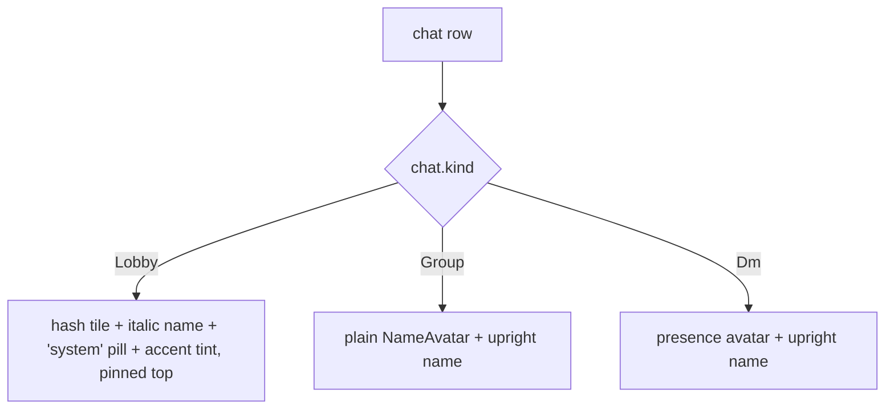

## Context

The chat list is built in `app/lib/chat/chat_list_screen.dart`. Two parts matter:

- `_arranged(...)` sorts rows by `rank`, where `ChatKindInfo_Lobby() => 0`, so the
  lobby is already first.
- `_row(ChatSummary)` switches on `chat.kind`. The `ChatKindInfo_Lobby` arm today
  builds the title from `lobbyName` (`const lobbyName = 'lobby'` in
  `chat_model.dart`) and a leading `NameAvatar(name: lobbyName, icon:
  Icons.groups_outlined)`, then composes a plain `ListTile`.

This change restyles only that arm. Named groups (`ChatKindInfo_Group`) and DMs
(`ChatKindInfo_Dm`) keep their current rows.

## Decisions

### D1. Restyle the `ChatKindInfo_Lobby` arm of `_row`; leave sort and other kinds alone

The distinct treatment lives entirely in the lobby arm of the `_row` switch and a
small "system" pill widget. The pin is already `_arranged`'s rank 0 — no sort
change. Group and DM arms are untouched, which keeps the "lobby only" requirement
true by construction.

### D2. The five visual elements

- **Hash tile avatar:** replace the lobby's `NameAvatar(..., icon:
  Icons.groups_outlined)` with a `#` glyph (e.g. `Icons.tag` or a `#` `Text`) on a
  rounded square filled with an accent-tinted surface
  (`colorScheme.primaryContainer` / a low-alpha `primary`), using the same avatar
  footprint so row height and alignment are unchanged.
- **Italic name:** the lobby title `Text` gets `fontStyle: FontStyle.italic`.
  Groups and DMs stay upright.
- **"system" pill:** a small rounded chip reading "system" beside the title
  (muted accent background, `labelSmall` text), composed into the `ListTile`
  `title` row (the same slot the mute marker already shares, so one `Row` holds
  marker + title + pill).
- **Pinned to top:** unchanged; stated as a requirement so a future sort change
  cannot silently unpin the lobby.
- **Accent row tint:** the lobby `ListTile` sits on a subtly accent-tinted
  background (e.g. `tileColor: colorScheme.primary.withOpacity(~0.04)` or a
  `primaryContainer` wash), light enough to read in both the light and (future)
  dark Material 3 schemes and not to fight the unread/selected states.

### D3. Theme-driven colors, no new palette

All tints come from the existing Material 3 `ColorScheme` (`primary` /
`primaryContainer`), so the treatment follows the app's theme and needs no new
colors. The accents are subtle by intent — recognition, not decoration.

## Spikes

None. Pure Dart presentation over the existing `ChatSummary` / `ChatKindInfo`;
covered by widget tests, no risky assumption.
