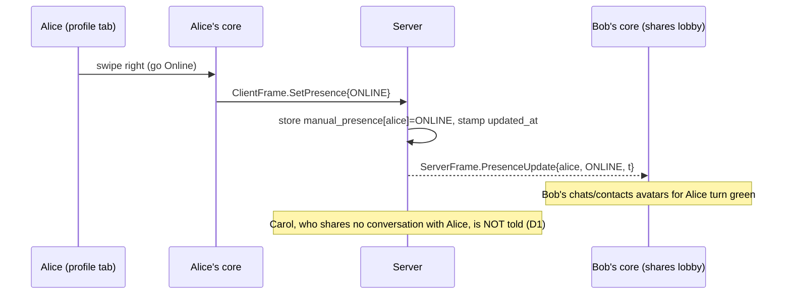
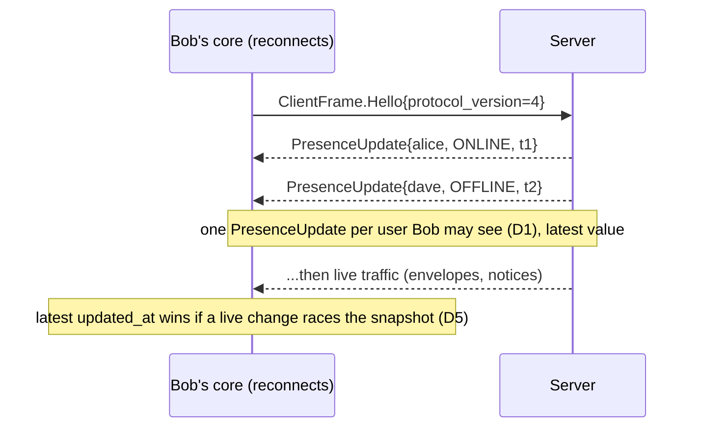

## Context

- **This is manual presence, not derived presence.** The owner was explicit: a
  self-set flag like Discord/Reddit, never inferred from the app being open, the
  stream being connected, or the user typing. So the flag is **durable**: if Alice
  sets Online and then closes the app, others keep seeing her green until she
  changes it. (The server separately treats a device as offline after 90 s of
  stream silence for *delivery* — `wire-transport`: Heartbeats — but that is a
  routing fact and is **never** surfaced as this indicator.)
- **The server already stores small per-user markers** (push tokens
  `Devices.UpdatePushToken`, the removed-conversation set `Dms.RemoveClosedDm`) and
  already fans per-conversation notices to the right devices on the one
  `Messaging.Connect` stream (`JoinNotice`, `DmClosed`, `ConversationRemoved`). A
  manual presence flag is the same shape: per-user metadata the server stores and
  routes, never message content.
- **The server is the authority for routing and membership, never history.** It
  knows, for any user, which other users share the lobby, a named group or a DM
  with them — that is exactly the set presence must reach.
- **`app-shell` (pending) gives the surfaces:** the third bottom-nav tab is the
  user's round avatar on an oval shadow; the Chats list, Contacts tab and
  conversation header all draw avatars. **`app-shell` is not yet archived**, so the
  UI requirements here live in the new `presence` capability and *refer to* those
  surfaces rather than editing the pending `app-shell` spec.

## Goals / Non-Goals

**Goals**
- A user sets their own Online/Offline flag; everyone who may see them sees it
  change within one stream round-trip.
- The flag is durable and manual — unaffected by connection state.
- The profile-tab avatar is the toggle (swipe), with its ring showing the state.
- The server sees only a two-value flag, stored like any other per-user marker.

**Non-Goals**
- Away/busy or any third state; last-seen timestamps; activity/connection-derived
  presence; per-conversation or per-device presence; hiding presence from named
  individuals.

## Decisions

### D1. Visibility scope — who may see whose status *(OPEN — owner)*

- **Proposed rule (spec is written to this):** the server sends a user's
  `PresenceUpdate` to every **other user who shares a conversation** with them —
  the lobby, any named group, or a DM. The server computes this from membership it
  already holds.
- **In practice that is every member of the server,** because everyone belongs to
  the system lobby. This server model has no separate "contacts" relation distinct
  from "members of the lobby".
- **Alternative (flagged):** a narrower **contacts-only** scope. That needs a
  contacts concept the product does not yet have, so it is deferred unless the owner
  wants it; if so, the broadcast set simply narrows and nothing else changes.
- **Why shared-conversation:** it is the privacy-maximal rule expressible today
  (you are not advertised to people you share nothing with) and reuses routing the
  server already does.

### D2. Default flag before the user sets one *(RESOLVED — owner: Offline)*

- **Resolved: Offline (red)** — private by default; the user opts in to being
  shown green. The owner chose the "private by default" alternative over the
  originally proposed Online default: presence is a self-declared "I'm around"
  signal, so a user who has never touched the toggle should not be advertised as
  online. (Recorded here because the spec is written to a `protocol/` default
  constant, now set to Offline.)
- It is the value the server stores at `Devices.Register` and the value a snapshot
  reports for a user who never changed it. The spec states the behaviour and marks
  the chosen constant (`protocol::presence::DEFAULT_PRESENCE`) as owner-set.

### D3. Per **user**, not per device

- The flag is a property of the **user**, shared by all their devices (it sits
  beside the user's `Profile`). `SetPresence` from any of Alice's devices sets
  Alice's flag; `PresenceUpdate` carries a `UserId`, not a `DeviceRef`. This matches
  how `Profile` (display name / about) is user-owned.

### D4. Carried on the existing `Connect` stream, not a new RPC

- Presence is live and already needs the server's per-connection fan-out, so it
  rides the one `Messaging.Connect` stream rather than a unary RPC (contrast
  `UpdatePushToken`, which is fire-and-forget and needs no broadcast).
- **New frames (additive):**
  - `ClientFrame.set_presence` → `SetPresence { PresenceStatus status }`.
  - `ServerFrame.presence_update` → `PresenceUpdate { UserId user; PresenceStatus
    status; google.protobuf.Timestamp updated_at }`.
  - `enum PresenceStatus { PRESENCE_STATUS_UNSPECIFIED = 0; PRESENCE_STATUS_ONLINE =
    1; PRESENCE_STATUS_OFFLINE = 2; }`.
- `SetPresence` may be sent any time after `Hello` (it is not the first frame, and
  unlike `Ack` it is not tied to a group).

### D5. Latest-wins, set-not-queue (no Ack)

- `PresenceUpdate` is **state, not a message**: there is no `Ack` and no catch-up
  queue. A device keeps the latest flag per user, and a `PresenceUpdate` with a
  newer `updated_at` supersedes an older one (so a reconnect snapshot and a
  concurrent live change converge). This mirrors `ConversationRemoved`, which is
  also a set the client reconciles rather than a queue it drains.
- The server stamps `updated_at` when it accepts a `SetPresence`; the client never
  sets it.

### D6. Durable per-user storage, authority = server

- The server stores one `manual_presence` value per user (a column on the users
  row), written in the same WAL/synchronous store as everything else
  (`server-runtime`: Durable storage) so it survives restart. It is **not** cleared
  when the user's last device disconnects — that is the whole point of *manual*.
- The server **never** writes this value except from a `SetPresence` the user's own
  authenticated device sent (or the D2 default at registration). It never derives it
  from heartbeats, reads, or connection state.

### D7. Protocol version 4, gated like `GroupClosed`

- `PROTOCOL_VERSION` `3 → 4`; `SUPPORTED_PROTOCOL_VERSIONS` `[1,2,3] → [1,2,3,4]`.
- The server sends `PresenceUpdate` only to a stream whose `Hello.protocol_version`
  is ≥ 4; a v1–v3 client never receives it (and proto3 would ignore the unknown
  oneof arm regardless). A v1–v3 client that somehow sends `SetPresence` is a
  client bug; the server may store it but need not, and this is not part of the
  contract. This is the same forward-compat gate `GroupClosed` uses for v3.

### D8. UI — a sliding toggle on the Profile screen *(REVISED — owner)*

- **Revised from the originally specced avatar swipe to a sliding toggle (a
  `Switch`) on the Profile screen.** The owner, on seeing the first cut, asked for
  an explicit, discoverable **slider** the user flips on/off — the same affordance
  as the existing "Mute all notifications" switch on the Profile tab — rather than a
  hidden horizontal swipe on the bottom-nav avatar. A swipe is easy to trigger by
  accident and gives no visible control; a labelled slide toggle makes "appear
  online" a deliberate, legible choice. The core behaviour (manual, server-visible,
  shown to others, Offline by default) is unchanged — only the gesture moved.
- The **Profile tab** carries a **"Appear online"** `SwitchListTile`: on → the core
  sends `SetPresence{ ONLINE }`, off → `SetPresence{ OFFLINE }`. The switch value
  always reflects the user's current manual flag.
- The bottom-nav **profile-tab avatar** keeps a small presence dot, now driven by
  the user's **manual** flag (green when Online, red when Offline) — **not** by the
  connection, replacing the connection-driven dot that an earlier change (#40) had
  put there.
- A small **green/red dot or ring** decorates avatars in **chat-list rows, the
  Contacts tab, and conversation headers** for every user whose flag the viewer may
  see (D1). A user whose flag is unknown (e.g. an older peer, or before the first
  snapshot) shows **no** dot rather than a wrong colour.

## Privacy

- **What the server learns:** a single two-value flag per user, set by that user.
  The server already sees far more routing metadata (who is in which group, who is
  online for delivery). This adds the user's *self-declared* intent to appear
  online or offline.
- **What other people learn:** everyone in the D1 visibility set sees the flag you
  set. It is deliberately visible — that is the feature — but it is **only what you
  chose**, never inferred behaviour.
- **No activity inference.** Because the flag is manual, the server does not and
  must not translate connection, heartbeat, read receipts or typing into presence.
  The delivery-layer "offline after 90 s" fact stays internal and is never sent as a
  `PresenceUpdate`. This keeps presence from becoming a covert last-seen signal.
- **Not content, not E2EE.** Like push tokens and the removed set, the flag travels
  as plaintext metadata (the relay/server see it); it carries no message content and
  touches no keys, so no invariant about content secrecy is affected.
- **Low sensitivity, explicitly surfaced.** Documented here and in the arch doc's
  open-decisions list so the owner signs off on the server seeing it.

## Flows

### Setting and broadcasting presence

### On-connect snapshot

## Risks / Trade-offs

- **"Manual online while actually away" is intended, not a bug** — a user who set
  Online and closed the app still shows green. Document in-app so it is not read as
  a liveness guarantee.
- **Snapshot size** is one small frame per visible user. On this single-community
  server that is bounded by the member count; if a server ever grows large, the
  snapshot can be paged or diffed, out of scope here.
- **D1 == all-members today** means presence is effectively server-wide now;
  narrowing later (contacts-only) is a pure broadcast-set change, no wire change.
