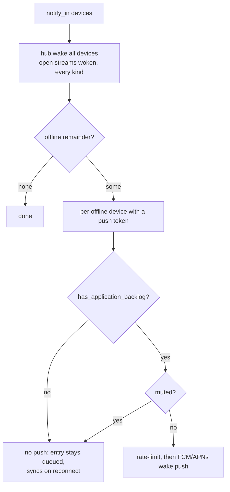

## Context

The content-free wake push exists because the server, seeing only ciphertext,
cannot carry a message's content; a push is a bare "wake up and reconnect" nudge
(message-delivery: Content-free wake pings). The reported bug is that the nudge
is also sent when the only thing waiting is MLS control traffic, which the core
applies with nothing to show the user. The fix is to make the **visible** push
decision depend on the kind of what is queued, while leaving every other wake
path alone.

## Decisions

### D1 — Only an `APPLICATION` backlog alerts an offline device

The server sends the content-free wake push to an offline device only when that
device has at least one pending `APPLICATION` delivery. `COMMIT`, `WELCOME` and
`PROPOSAL` deliveries never, on their own, cause a push.

Rationale: the push is user-facing and content-free, and the owner ruled out
silent pushes (2026-11-16). A control envelope has no user-visible result, so a
push for it is always a false alarm. The server already treats `APPLICATION`
specially throughout the delivery log (`application_queue_len` for the queue cap,
`expire` for the TTL), so keying the push off the same kind is consistent, not a
new concept.

Why control envelopes do **not** need the push: an offline device has no epoch to
keep current (it is not in a live session); it will apply any queued commits and
proposals in `server_seq` order on its next `Connect` catch-up. A device that is
**online** still gets every kind pushed to its open stream — `notify_in` calls
`hub.wake(&devices)` for all devices first, and only the *offline* remainder is
filtered — so foreground epoch currency is unchanged. The existing group-resync
and catch-up paths already recover a device that falls behind, so skipping the
push cannot wedge anyone.

### D2 — One gate, applied in the offline branch, covers every caller

`notify` / `notify_in` is the single chokepoint for the wake push: the write path
(`write::submit` → `notify`/`notify_in`), the key-rotation path
(`keys` → `notify`), the stream re-ping on loss (`stream` → `notify`) and the
sweep (`sweep` → `notify`) all funnel through it. Rather than teach each caller
the kind of what it just queued, the gate lives once in `notify_in`'s offline
loop: for each offline device with a push token, the server checks
`log::has_application_backlog(device)` and skips the push if false. This is robust
to new callers and keeps the open-stream wake (already done above the loop)
untouched.

Because the check reads the device's whole `APPLICATION` backlog, not just the
envelope that triggered this `notify`, a device that already has a real message
waiting is still pushed when a later control envelope arrives — which is correct,
there genuinely is a message to see.

### D3 — The sweep catch-up also filters by kind

The periodic sweep (notification-reliability: Sweep catch-up wake ping) nudges
offline devices that still have a backlog, bumping a durable per-device attempt
counter up to `catch_up_max`. If `backlogged_devices` returned control-only
devices, the sweep would both fire a (now D2-suppressed) push attempt and burn the
catch-up budget on a device with no message, and `prune_catchup` would not reset
it (the device still "has a backlog"). So `backlogged_devices` is narrowed to
`DISTINCT device_id` of deliveries joined to `APPLICATION` envelopes. D2 would
suppress the push regardless, but filtering here keeps the catch-up accounting
honest.

## Risks / trade-offs

- A device offline for a long window that has *only* missed commits/proposals gets
  no proactive nudge to reconnect. Acceptable: catch-up/group-resync recover it on
  the next connect, and the owner prefers no alert to a content-free false alarm.
- Slightly more work per offline push (one extra `EXISTS` query per device). The
  query is indexed on `deliveries.device_id` and `envelopes.server_seq` and runs
  only for devices already known offline with a token, so the cost is negligible.

## Migration

None. Server-only behavior change; no schema, proto, or client change. Deploy the
server; no app coordination needed.
