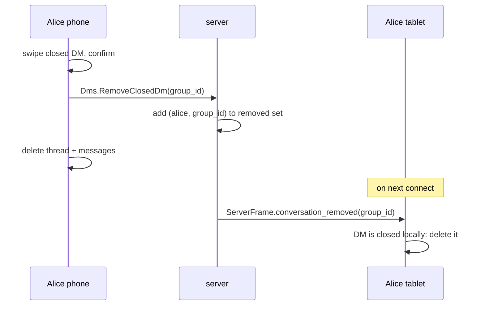

## Context

Carved from `delete-messages` D8 (kept the same decision numbering under D1 here).
A closed DM has no live channel (the server rejects its envelopes with
`GROUP_CLOSED`, the MLS group is dropped) and the removal must not leak to other
users, so it cannot travel through the DM, the lobby or a named group. There is no
self-only channel among a user's devices.

## Decisions

### D1. A private per-user removed set on the server (owner, option (a))

- `Dms.RemoveClosedDm{group_id}` adds `(username, group_id)` to a
  `removed_conversations` table, idempotently. The server accepts it only when
  `group_id` is a DM that **is closed** and whose `dm_user_a`/`dm_user_b` includes
  the caller's user; anything else (unknown id, open DM, lobby, named group, other
  users' DM) is `PERMISSION_DENIED`, so ids of others' conversations are not probed.
- On every connect the server sends the caller's set as one
  `ServerFrame.conversation_removed{group_id}` per entry, after the close notices.
  It is a **set, not a queue**: there is no ack, and a device linked later gets it
  too. Entries are conversation ids only (16 bytes each); no content or history is
  stored, so the no-durable-history invariant holds.
- Only that user's devices write (through the authenticated RPC, keyed by the
  caller's username) or read (connect frames go to the connecting device) the set.
- **Rejected alternative (b):** a self-only "notes to self" MLS group. Overkill for
  one signal.

### D2. The core calls the server first, then deletes locally

`remove_closed_dm(chat)` requires the DM to be closed locally, calls
`Dms.RemoveClosedDm`, and only on success deletes `dm_groups`, `messages`
(`chat_id`) and `chat_reads` for the chat. If the call fails (offline, an old
server) nothing is deleted and the error reaches the UI, so a removal never
exists on one device only. The media cache is keyed by blob, not chat, and is
left to its LRU.

### D3. Applying `conversation_removed` is guarded and idempotent

A device removes the named DM only if it has that DM **and it is closed locally**.
A server frame therefore cannot delete an open DM or a group. An unknown or
already-removed id is ignored. The device emits `ChatsChanged`. The server's
`DmClosed` notice is sent before the set, so a device that missed the close
learns it first.

### D4. UI: swipe + confirm

The closed-DM row's end-to-start swipe asks "Remove this chat?" (the thread and
its messages are deleted from this device and the user's other devices). Only on
confirm does it call the core; Cancel keeps the row.

## Risks / Trade-offs

- The set grows by one id per removed DM and is never pruned (bounded by the
  user's DMs; ids only).
- An old server returns `UNIMPLEMENTED`; the app surfaces it and keeps the DM.
