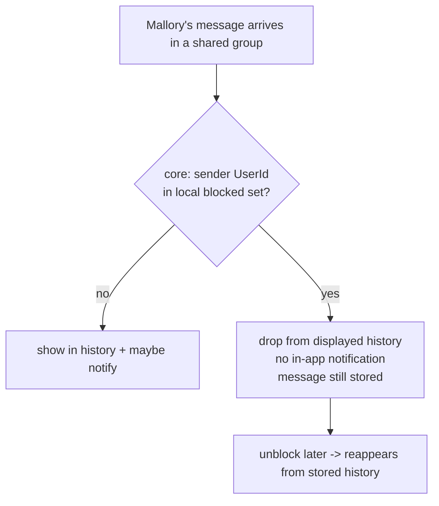

# Design — report-and-block

A minimal, user-facing moderation layer that clears Apple Guideline 1.2 and Google
Play's UGC policy by **reusing** what vyajena2 already has — the DM path, the
reply-quote format, and the admin's removal capability — and adding only a local
block list and a report action. Zero server, proto or MLS change in the MVP.

No spikes are needed: every piece rides existing, shipped mechanisms. There is
nothing to prove with throwaway code, so `spikes/` stays empty.

## D1 — Block is a local, per-device hide list

Block is the store requirement "filter / block an abusive user." The owner chose
the simplest thing that satisfies it: a device-local set of blocked `UserId`s in the
core's SQLite, with the display and notification paths skipping blocked senders. It
mirrors the *shape* of the `mute-notifications` / `remove-closed-dm` per-user marker
but drops the server entirely — there is no marker RPC and no cross-device sync.

Why local-only for the MVP:

- It needs **no** server, proto or crypto change, so it cannot touch any invariant.
- Blocking never removes anyone from a group or DM, so MLS state and commit authority
  are untouched: the blocked user keeps sending into shared groups; the blocker's
  device simply does not display them.
- The store requirement is about the *viewer* not seeing abusive content; a per-device
  hide list meets that exactly.

The cost is that a block does not follow the user to their other devices, and the
server — which never learns the block — can still send a content-free wake push for a
blocked sender's message (the app then shows nothing). Both are acceptable for the
MVP and are addressed by D4 as optional Phase-2.



The core reads the sender from the message envelope's authenticated `UserId`, never
from message text, so a blocked user cannot dodge the filter by spoofing a name.

## D2 — Report is a structured DM to the admin

Report is the store requirement "flag objectionable content." The admin (owner) is
the one human who can act, and every member already knows the admin's `UserId` and
can open a DM with any member (`dms`: Opening a DM; "Any member MAY open a DM with
any member; no approval is needed"). So the report rides the existing DM path:

- **Group / lobby content** — the admin is already in that group and holds the
  message, so the report only needs to *reference* it: reported `UserId` + group id +
  `msg_id` + reason. The admin's app resolves the reference against the copy it
  already has.
- **DM content** — the admin is **not** in the reporter's DM, so the report must
  carry the evidence. The reporter's device has the plaintext, so it *quotes* the
  offending text using the merged reply-quote rules (`message-content`: Replies —
  whitespace folded, capped at `MAX_REPLY_QUOTE_CHARS`, trailing "…"). No DM key or
  ciphertext leaves the reporter's device; only the reporter's own rendered quote
  does, which the reporter could already read.

```mermaid
sequenceDiagram
  participant A as Alice (reporter)
  participant S as Server (relay + Pi)
  participant Ad as Admin (owner)
  A->>A: build report (reported id, reason,<br/>+ msg ref OR quoted text)
  A->>S: send over DM with the admin (MLS ciphertext)
  Note over S: routes ciphertext only;<br/>never reads the report
  S->>Ad: deliver on the admin's next connect
  Ad->>Ad: show as a report (not an ordinary DM)
  Ad->>S: if warranted: Admin.RemoveUser (existing)
```

**Report payload (MVP, zero proto).** The report is a `Content.Text` whose text is a
canonical, machine-recognisable block the admin's app parses and renders specially
(and which still reads as plain text on an older admin app). Conceptually:

```
[vyajena-report v1]
reported: mallory@chat
reason:   <short reason from the reporter>
kind:     group | dm | user
group:    <group id>        # group kind only
msg:      <msg_id hex>      # group kind only
quote:    "<capped reply-quote of the offending text>"   # dm kind only
```

The exact serialization is an app/core detail, not a wire contract — it lives inside
the DM's existing `Content.Text`, so there is no proto change and no `buf` impact. A
group report uses `ReplyTo`-style identity (sender + `msg_id`) to point the admin at
the original; a DM report uses the `ReplyTo` *quote* formatting for the evidence.

## D3 — A typed `Report` wire body is deferred (Phase-2, optional)

A cleaner long-term form is a dedicated `Report` body in
`proto/vyajena/v1/content.proto` (reported `UserId`, reason enum, an optional
`MsgRef`, an optional quote) so the admin's app parses a struct instead of a text
convention, and future admin tooling (a reports inbox, dedup, counts) has a stable
shape. That is a **proto change**, so by the owner's "zero proto/server/MLS for the
MVP" rule it is **out of this change**. The MVP's text-convention payload (D2)
delivers the same information today and can be superseded by the typed body later
without changing the DM transport or the admin-removal enforcement. Flagged here as
Phase-2; not specced in this change.

## D4 — A server-side block marker is deferred (Phase-2, optional)

The MVP block is local (D1), which leaves two gaps: a block does not sync to the
user's other devices, and the content-free wake push still fires for a blocked
sender (the server does not know the block). Closing either needs a **server
change** — a private per-user *blocked set* marker on the `prefs` rail, exactly like
`mute-notifications`' mute set: `Prefs.SetBlockPref{user_id, blocked}`, delivered on
connect as a `ServerFrame`, and consulted by the wake-push sender so a blocked
sender raises no push. Because that is a server + proto change, it is **out of the
MVP** by the owner's rule. It is not required to clear either store: the stores
require that the viewer can block and no longer sees the content, which the local
list already delivers. Flagged as Phase-2; not specced here.

## D5 — Enforcement reuses the existing removal; no new RPC

The report is *information for the admin*; the *action* is the removal that already
exists (`group-membership`: Removing a user, reused by `replace-user` and
`remove-closed-dm`). This change deliberately adds no enforcement RPC, no auto-removal
and no new commit authority. Keeping report (inform) and removal (act) separate keeps
the admin in the loop — a store requirement is that a *human* acts on reports — and
keeps this change tiny and within every invariant.

## Store requirement mapping

Apple **App Review Guideline 1.2 (Safety — User-Generated Content)** lists four
precautions for apps with UGC; Google Play's **User-Generated Content** policy lists
the equivalent. Each maps to a piece of this change:

| Store requirement (Apple 1.2 / Google UGC)                     | This change                                                            | Spec requirement |
|----------------------------------------------------------------|-----------------------------------------------------------------------|------------------|
| A method for filtering objectionable content                   | Local block hides a user's messages, DMs and notifications on device  | moderation: A blocked user is hidden |
| A mechanism for users to **block** abusive users               | Block / Unblock a user, per device                                    | moderation: Block a user; app-ui: Block and unblock a user |
| A mechanism for users to **flag / report** objectionable content | Report a message or a user, delivered to the admin over a DM         | moderation: Report a message / a DM message / a user; app-ui: Report a message or a user |
| The developer **acts on reports** by ejecting offenders        | Admin reviews the report and removes the user via the existing `Admin.RemoveUser` | moderation: The admin acts on a report with the existing removal |
| A **published** method to contact the developer / policy + timeframe | Written policy (review + act within 24h) and a safety contact email, in-app and on both listings | moderation: Published moderation policy; app-ui: Safety and moderation entry |

Apple also expects the "act within 24 hours" commitment and a stated contact point;
Google expects an in-app reporting system plus published moderation. The policy below
states both, satisfying both stores.

## Moderation policy (ships with this change; publish in-app and on both listings)

> **vyajena2 — Safety & moderation policy**
>
> vyajena2 is an invite-only, end-to-end encrypted chat. Messages are encrypted on
> your device; we (the operators) cannot read them.
>
> **Block.** You can block any user from a message or from their profile. Blocking
> hides that user's messages and direct messages on your device and stops their
> notifications. You can unblock them at any time.
>
> **Report.** You can report a message or a user to the group's administrator from
> the message menu or the user's profile. Your report is sent privately to the
> administrator; for a direct message it includes a short quote of the reported
> content so the administrator can review it.
>
> **We act on reports.** The administrator reviews every report and, within **24
> hours**, removes content that violates these rules and ejects the user who posted
> it. Removal uses the administrator's existing ability to remove any member.
>
> **No tolerance** for harassment, threats, sexual content involving minors, or other
> illegal or abusive content.
>
> **Contact.** Report safety concerns to **`<SAFETY_CONTACT_EMAIL>`**.

**`<SAFETY_CONTACT_EMAIL>` is a placeholder token.** It MUST be replaced with the
owner's real safety/abuse contact address — in this policy text, the in-app "Safety &
moderation" entry, and the App Store and Play listing policy text — **before the
policy is published**. The owner has not yet supplied the address (approved
2026-11-26); the policy text and the 24-hour commitment are otherwise fixed by this
change.

## What this change does NOT touch

- No `.proto` change, so `buf lint` / `buf breaking` have nothing to check and the
  committed `pb.rs` / Dart bindings are unchanged.
- No server code, migration or wake-push change (the Phase-2 marker in D4 would).
- No MLS, commit-authority or key change: block never alters membership; report rides
  an ordinary DM.
- No new enforcement path: removal is the existing `Admin.RemoveUser` (D5).
