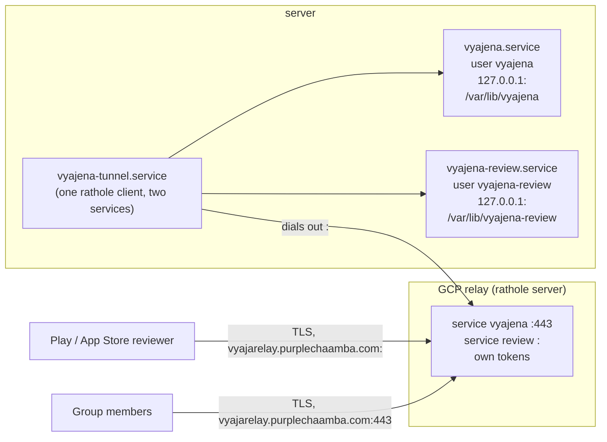

## Context

- The relay change made the server public behind `vyajarelay.purplechaamba.com:443`
  (rathole, TLS ends on the server, pinned).
- Store review needs a working account. Reviewers must never see the real
  group (owner, 2026-11-16). app-release owns the Play/App Store forms and the
  reviewer instructions (`app/store/listing.md`, "Reviewer access").
- Owner's answers (2026-11-16): public port **<review-port>**; ids
  **`review@review.purplechaamba.com`**; the review admin is a **new throwaway
  iOS simulator**; the check covers the review server, the backup does not.

## Goals / Non-Goals

**Goals:** a second, fully separate server for reviewers, reachable through
the existing relay, resettable at will, checked like the real one; the real
group untouched.

**Non-Goals:** app changes, a hidden group *inside* the real server (one group
per server is an invariant), push, a second relay or IP.

## Decisions

### D1. Two servers, one tunnel

- **Same binary**, second unit and config: `vyajena-review.service` runs
  `/usr/local/bin/vyajena-server --config /etc/vyajena/review.toml` as the
  system user `vyajena-review` with `StateDirectory=vyajena-review`. Upgrades
  restart both. Separate users and state directories mean neither can read
  the other's keys or database (each 0700 under its own owner).
- **Ids:** `server_id = "review.purplechaamba.com"`, `admin_username =
  "review"`; reviewers become `<name>@review.purplechaamba.com`. Different
  Server ids also mean a real device certificate can never validate in the
  review group or the other way round.
- **Ports:** public <review-port> → loopback <review-server-port>. rathole has no SNI routing, so a
  second public port is the free option (a second IP would cost ≈$3.65/month).
- **Tunnel:** one rathole client with a second service `review` and its own
  token (`~/.vyajena-relay/review-token`). A leaked review token cannot attach
  the real service.

### D2. Review admin and invites

- A new iOS simulator **"Vyajena Review"** (created with `xcrun simctl create`)
  holds `review@review.purplechaamba.com`; it joins with the review bootstrap
  invite, creates the review group, and makes a fresh single-use invite
  (`INVITE_TTL` 7 days) per review. The owner pastes that invite into Play's App
  access form; it never goes into the repo.
- If the simulator is wiped, `--reset-review` and join again: nothing of value
  lives there.

### D3. Ops

- `deploy/server/deploy.sh`: installs `review.toml`, `vyajena-review.service`, the
  user (`harden.sh base`), restarts both servers, then the tunnel. A first start
  of the review server saves its bootstrap invite to
  `~/vyajena-server-backups/review-bootstrap-invite-<UTC>.txt` (0600).
- `deploy/server/deploy.sh --reset-review`: type `review.purplechaamba.com`; wipes
  `/var/lib/vyajena-review/*` only and restarts it. No backup (no real data).
  Never touches `/var/lib/vyajena`.
- `deploy/server/check.sh`: the review server's user, sandbox, exposure, writes,
  file modes, loopback <review-server-port>, tunnel route, `review-pin` (relay <review-port> == server <review-server-port>)
  and **`pins differ`** (the two servers never share a key).
- `deploy/server/backup.sh`: unchanged (the real server only).
- Relay: `relay.conf` `REVIEW_PORT=<review-port>`; `create.sh` adds
  `vyajena-relay-review` (tcp:<review-port>, 0.0.0.0/0, logging off); `check.sh`
  expects four rules and rathole on <review-port>; `server.toml` gains the service.

### D4. Rollout

1. Local: templates, scripts, tests, `review-token`.
2. Owner yes → `create.sh` (only the new rule is missing), `deploy/relay/deploy.sh`
   (rathole restarts: members reconnect within seconds; <review-port> listens once the
   server's tunnel offers the review service).
3. `deploy/server/deploy.sh --no-build` (real server: same binary, same data, same
   pin; review server: first start).
4. Both checks; review admin simulator joins; app-release gets the address.

### D5. Tests

- `server/tests/deploy_files.rs`: rendered `review.toml` parses (loopback
  <review-server-port>, public `vyajarelay.purplechaamba.com:<review-port>`, review ids), unit
  isolation (user, state dir, config path), tunnel/relay services with distinct
  tokens, four firewall rules in the dry run, `secrets.sh` makes
  `review-token`, `--reset-review` guards.
- The core already refuses a server whose pin differs (client-runtime: Wrong
  pin), which is the "real invite on the review port" scenario.

### Results (2026-11-16)

- Owner's yes; `create.sh` added only `vyajena-relay-review`; relay
  redeployed; `deploy/server/deploy.sh --no-build`: `harden.sh` created
  `vyajena-review`, the real server restarted with **its pin unchanged**, the
  review server started fresh with its own pin; its bootstrap invite went to an
  owner-only file. `deploy/server/check.sh` and `deploy/relay/check.sh`: 0 failed,
  0 warnings; review exposure 0.9; `pins differ`; 443, <review-port> and <tunnel-port> answer.
- New simulator "Vyajena Review" (iPhone 16, iOS 26.5): the review bootstrap
  invite previewed `review@review.purplechaamba.com on
  vyajarelay.purplechaamba.com:<review-port>`; joined, created the review group,
  invited `tester`. The Android emulator `vyajena_test` joined as
  `tester@review.purplechaamba.com`, was added automatically, and the two
  chatted with ✓. The tester's Members screen listed only `review` and
  `tester`. The real server logged nothing during the whole test. Then
  `tester` was removed and the app uninstalled from the emulator.
- Test driving notes: the emulator's floating stylus keyboard cut long
  `adb input text`; 30-character chunks with the stylus setting off worked
  (restored afterwards).

## Risks / Trade-offs

- [Reviewers could reach the real server's port] → only with a real invite
  (single-use, made by the real admin) and the real pin; reviewers never get one.
- [Two servers on a server 4] → idle review server costs a few MB of RAM.
- [Port <review-port> is less common] → some corporate networks block it; Play's
  reviewers use normal internet. If it bites, a second IP + 443 is the
  fallback (cost).
- [Review group content] → reviewers can type anything; it lives only on the
  review server; `--reset-review` after each review.

## Migration Plan

Additive. Rollback: stop/disable `vyajena-review.service`, drop the tunnel
service and the firewall rule (`gcloud compute firewall-rules delete
vyajena-relay-review`).

## Open Questions

None: answered by the owner (D1–D3).
