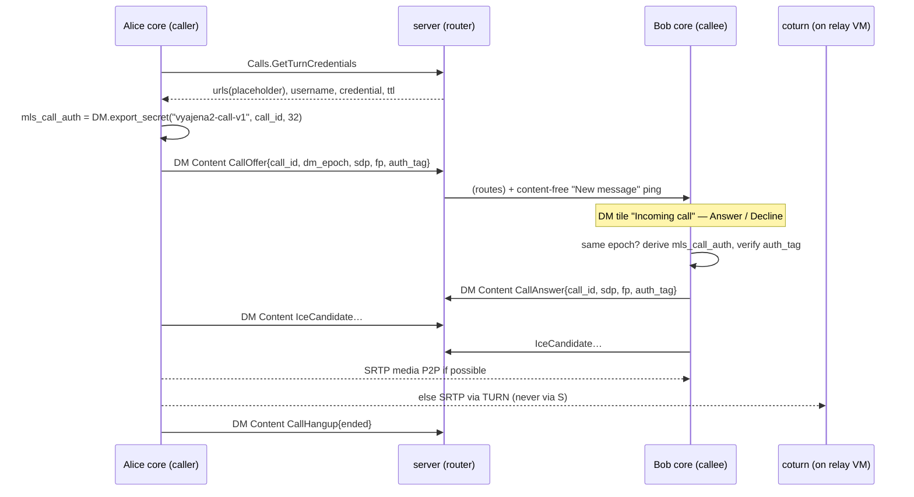

## Context

- **DMs already exist** (change `dms`): a DM is a 2-user MLS group with all devices
  of both users, the server as external sender, strict epoch rule
  (`max_past_epochs = 0`). Application messages in it are `Content` plaintexts the
  core encrypts; the server routes them and sees only ciphertext.
- **The wake ping is content-free** (message-delivery: Content-free wake pings): one
  fixed "New message", FCM notification / APNs alert, no data. The owner wants calls
  to reuse exactly this — no VoIP push.
- **The relay** is a GCP e2-micro running only rathole, pinned TLS terminated on the
  home server, firewall 443 + the tunnel port only, "nothing else on that VM"
  (relay spec). coturn changes that.
- **The core already owns all media transforms and keys** (client-runtime); Dart
  only draws. WebRTC fits this: sockets and keys in `client/`, the screen in
  Flutter.
- **Owner decisions (2026-11-20):** require an existing DM; a call is a regular DM
  message with Answer/Decline + the ordinary ping, no ring/CallKit; coturn on the
  relay VM (gated); audio-only 1:1, single active call, no history.

## Goals / Non-Goals

**Goals**
- A 1:1 voice call between two members who share a DM, end-to-end encrypted, media
  never through the home server.
- The media channel cryptographically bound to the MLS identity.
- No new push type, no native call UI, no persisted call data.

**Non-goals**
- Video, group calls, CallKit/PushKit ringing, call history/recording, a second
  TURN backend, deploying coturn (gated, separate).

## Decisions

### D1. Call signalling rides the DM as `Content` bodies

- **One `CallSignal` body** in the `Content` oneof, itself a nested oneof:
  - `CallOffer{ call_id, dm_epoch, sdp, dtls_fingerprint, auth_tag, ice_ufrag/pwd }`
  - `CallAnswer{ call_id, sdp, dtls_fingerprint, auth_tag }`
  - `IceCandidate{ call_id, candidate }`
  - `CallHangup{ call_id, reason }` (ended, missed, canceled)
  - `CallReject{ call_id, reason }` (declined, busy, unsupported, epoch_stale)
- **`call_id`** is 16 random bytes that tie one call's messages together.
- **Why ride the DM, not a side channel:** the DM already gives ordered, encrypted,
  authenticated delivery to exactly the two users' devices, with the server as a
  dumb router. The offer is then just a message, which is why it can render as a
  DM tile with Answer/Decline and needs no new push.
- **One `Content` field** for all five keeps the oneof small and the field-number
  coordination with `audio-messages`/`delete-messages` to a single number.

### D2. The DTLS-SRTP key is bound to the MLS epoch

- **At offer time** the caller's core exports from the DM group at its current
  epoch: `mls_call_auth = export_secret("vyajena2-call-v1", call_id, 32)` (OpenMLS
  `MlsGroup::export_secret`). It puts `dm_epoch` and
  `auth_tag = HMAC-SHA256(mls_call_auth, caller_dtls_fingerprint)` in the
  `CallOffer`.
- **The callee**, at the same epoch, derives the same `mls_call_auth` and checks the
  `auth_tag` against the fingerprint in the offer before answering; it binds its own
  fingerprint the same way in `CallAnswer`. A TURN relay or MITM that swaps DTLS
  keys fails the check and the call is dropped.
- **Why export at the DM epoch:** both devices share the epoch secret, so the bound
  key needs no extra exchange and no PKI beyond the device certificates MLS already
  pins.

### D3. Epoch advance mid-setup (strict `max_past_epochs = 0`)

- **The risk:** a commit (a leaf rotation, a device add) can advance the DM epoch
  between the offer and the answer. Because `max_past_epochs = 0`, a device at
  epoch N+1 can no longer export the epoch-N secret, so it cannot verify an offer
  made at epoch N.
- **The rule:** `CallOffer` carries `dm_epoch`. The callee answers only if it is at
  that epoch (processing any pending commits first to reach it). If the DM has
  already moved past `dm_epoch`, the callee replies `CallReject{epoch_stale}` and
  the caller re-offers at the new epoch with a fresh `call_id`. Calls are rare and
  a quiet DM changes epoch seldom, so the re-offer window is small; stating it keeps
  the strict epoch rule intact.

### D4. No ring; a DM message with Answer/Decline; one call at a time

- **Incoming:** the `CallOffer` shows as a DM message tile "Incoming call" with
  **Answer** and **Decline**, plus the ordinary content-free wake ping. No OS ring,
  no CallKit/PushKit (owner, MVP).
- **Unanswered offer** expires after `protocol::calls::OFFER_TTL` (~45 s): the
  caller sends `CallHangup{missed}`, both sides show "Missed call". A `CallReject`
  shows "Call declined".
- **Single active call:** a device already in or ringing a call answers any new
  `CallOffer` with `CallReject{busy}` automatically.
- **Caller side:** after sending the offer the tile shows "Calling…" with Cancel
  (`CallHangup{canceled}`).

### D5. Media: WebRTC in the core, P2P or TURN, never the home server

- **`webrtc-rs` in `client/calls/`** owns the `RTCPeerConnection`, ICE agent, DTLS
  and SRTP. Audio is **Opus mono ~48 kbps with in-band FEC**; one audio track each
  way, no data channel, no video.
- **ICE** uses STUN and TURN at the addresses `GetTurnCredentials` returns
  (placeholders in the repo). Media flows **peer-to-peer** when ICE finds a direct
  path, **TURN-relayed** otherwise. It **never** goes through the Pi server, which
  has no media path and whose egress allowlist is unchanged.
- **Dart draws only** the in-call screen (mute, hang up, elapsed, connection
  state); it holds no socket and no key (client-runtime).

### D6. TURN credentials: coturn long-term-credential, ephemeral HMAC

- **`Calls.GetTurnCredentials`** (session-authenticated) returns the TURN/STUN URLs
  (placeholder hosts/ports), a `username` and a `credential` with a TTL of at most
  `protocol::calls::TURN_CRED_TTL` (≤ 1 h). The server computes them with coturn's
  REST scheme: `username = "<expiry-unix>:<device>"`,
  `credential = base64(HMAC-SHA1(turn_shared_secret, username))`. The server holds
  `turn_shared_secret` only in `~/.vyajena-relay/` config, never in the repo.
- **Why ephemeral:** no long-lived TURN password is stored on devices or in the
  repo; a leaked credential dies within the hour.

### D7. coturn co-located on the relay VM (relay spec change)

- **coturn runs on the relay VM** next to rathole (owner). The relay firewall opens
  the TURN listening UDP port and the media relay port range (placeholders); 443 and
  the tunnel port are unchanged. "TLS ends on the server" and "relay keeps no
  state" still hold: coturn terminates no TLS and keeps no call content or
  persistent state.
- **This modifies the relay spec's "Nothing else SHALL run on that VM"** and its
  firewall requirement. Recorded as an owner-approved spec change (proposal).
- **Deploy is gated and not in this change:** the coturn service file, config
  (shared secret from `~/.vyajena-relay/`), and firewall rule are added under
  `deploy/relay/`, and stood up only behind `create.sh --dry-run` + a shown cost +
  the owner's yes. No `gcloud` runs from this change.

### D8. No persisted call state

- Call keys, ICE state, sockets and the Opus pipeline live in RAM in the core and
  are **zeroized on hangup, decline, busy or the offer timeout**. Nothing about a
  call is written to SQLite. The DM keeps only the call's message tiles ("Call
  ended", "Missed call", "Call declined") as ordinary `Content`, which hold no media
  and no key.

### D9. Threat model, honestly

- **Confidential:** the audio (SRTP under the MLS-bound DTLS key), the call content,
  and the keys (MLS-derived, in the core).
- **Observable:** that a call happened and its timing and duration. A TURN-relayed
  call shows both endpoints and media timing to coturn on the relay VM; a P2P call
  reveals each peer's public IP to the other. Signalling is ordinary encrypted DM
  traffic — the server and the push networks see that DM messages are exchanged and
  when, exactly as for any DM message, never their content. This is **not**
  "zero-metadata"; the design and any user-facing copy say so.

## Spikes (before code that relies on them)

- **S1 (feasibility, at implementation time, on real iOS + Android — NOT now):**
  `webrtc-rs` builds and runs in the core on both platforms with working microphone
  capture, **echo cancellation** and OS audio-session handling (we do not use
  CallKit, so AEC and routing come from the audio session / WebRTC APM, not from the
  system call UI). This is the biggest unknown; it decides whether `webrtc-rs` is
  viable or a platform WebRTC binding is needed. Record the result in this design
  before building the call engine.

## Risks / Trade-offs

- **`webrtc-rs` on mobile is unproven here** (S1). If it cannot deliver usable AEC,
  the fallback is a native WebRTC binding, a larger change.
- **coturn widens the relay's attack surface** (new UDP ports). Mitigated by the
  ephemeral-credential scheme, the sandboxed service, and keeping TLS and state off
  it.
- **Metadata:** a call's existence, timing and endpoints are observable (D9); the
  owner accepts this for the MVP.
- **No ring** means a call can be missed like a message; acceptable for the MVP, and
  it avoids the iOS PushKit-must-report-to-CallKit constraint entirely.

## Migration Plan

1. Land the proto, protocol and core/app code behind the feature (calls appear only
   where both sides run a version that speaks `CallSignal`; an older core shows the
   unknown-body placeholder for a call message and cannot be called).
2. Separately and gated: stand up coturn on the relay VM (`create.sh --dry-run` +
   cost + owner yes), then enable `GetTurnCredentials`.

**Rollback:** disable `GetTurnCredentials` (calls then fail to connect and show an
error); the coturn service can be removed from the relay without touching rathole.

## Open Questions (owner)

1. **Force TURN-always, or allow P2P?** P2P is lower latency and cost but reveals
   each peer's IP to the other; TURN-always hides peer IPs from each other (both are
   still seen by coturn). Which for the MVP?
2. **Offer timeout:** is ~45 s right for a no-ring, in-DM call, or shorter?
3. **Call tiles:** show call duration on the "Call ended" tile, or just "Call
   ended"?
4. **A later CallKit/PushKit upgrade** for real ringing: planned, or deliberately
   never (to keep calls content-free and push-simple)?
