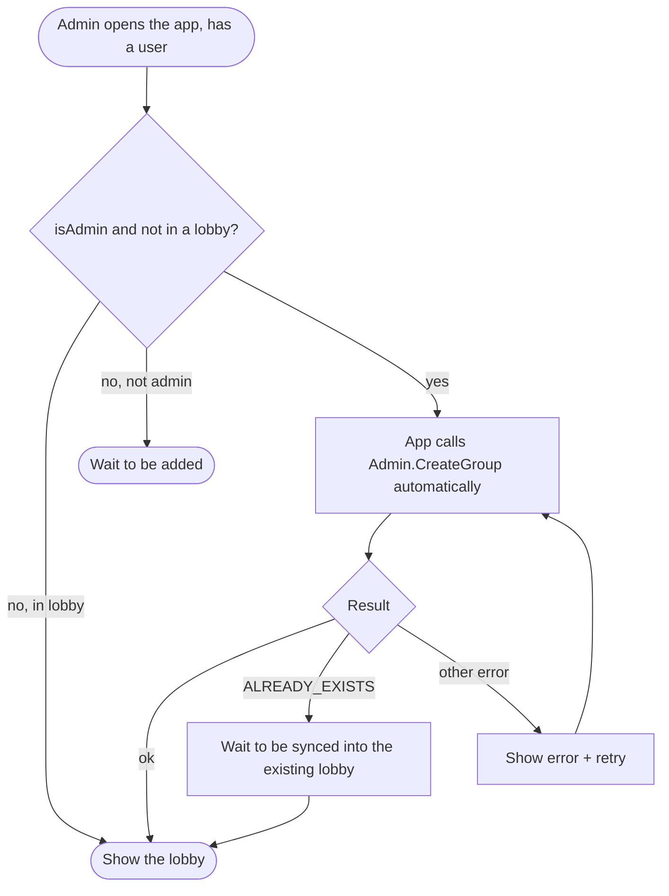

## Context

The gate `app/lib/chat/group_gate.dart` decides what a device with a user sees:

- `admin && !inGroup` → `CreateGroupScreen` (a "Create the group" button).
- `!admin && !inGroup` → the waiting screen (the admin's device will add it).
- `inGroup` → the chat.

`inGroup` is `core.epoch() != null`. The admin's first device therefore sits on a
manual button before the lobby exists. The lobby is created by
`core.createGroup()` → `Admin.CreateGroup`, which builds the MLS group **on the
device** (keys never leave the core) and registers its epoch-0 public state with
the server.

## Decisions

### D1: The admin's first device auto-creates the lobby (device-side, not server-side)

The server cannot create an MLS group (invariant). So "the lobby exists from the
start" is implemented by the admin's first device calling `Admin.CreateGroup`
automatically when it is the admin and holds no lobby, in place of the manual
button. The admin lands directly in the lobby.

Rejected alternative — the server fabricates a lobby at bootstrap: impossible
within the invariants (no server-minted MLS groups, keys never leave the core).

Optional, not taken: the server records a "default lobby intended" marker at
bootstrap. It adds server state for no behavioural gain here — the device-side
auto-create already lands the admin in the lobby — so it is left out. If a future
need arises (e.g. telling the admin app to create the lobby before the first
`GetSelf`), it can be added without changing the device-creates-the-group model.

### D2: Safe against a linked admin device (the only re-entrancy concern)

Auto-calling `Admin.CreateGroup` risks a *second* lobby only if two admin devices
both think no lobby exists. The server already prevents a duplicate: it holds at
most one system group and answers a second `Admin.CreateGroup` with
`ALREADY_EXISTS` (group-membership: Group creation). So:

- The admin's **first** device: no lobby anywhere → `Admin.CreateGroup` succeeds →
  lobby created, lands in it.
- A **linked** admin device (second device) that briefly has no local lobby before
  it syncs: its automatic `Admin.CreateGroup` is answered `ALREADY_EXISTS` → the app
  treats that as benign and waits to be synced into the existing lobby (it becomes
  `inGroup` on the next `Rejoined`/`JoinedGroup`/`MembersChanged`). No error, no
  duplicate.

The gate already listens for `JoinedGroup`/`MembersChanged`/`Rejoined` and
re-checks, so the synced-in transition needs no new plumbing.

### D3: Scope — only the admin's first device

- Only an **admin** device auto-creates; a non-admin member's device never does (it
  waits to be added — unchanged).
- Only when **no lobby exists on the device** (`!inGroup`). A device already in the
  lobby is unaffected.
- A linked admin device is covered by D2 (benign `ALREADY_EXISTS`).

So "later joins" (members, and the admin's linked devices) are **not** affected
beyond D2's benign-race handling. This answers the task's open question: the
auto-create is the admin-first-device case only; everyone else follows the existing
add/sync paths.

### D4: Error handling — distinguish benign from real failure

- `ALREADY_EXISTS` → benign (D2): show the waiting/setting-up state, let the sync
  bring the device into the lobby.
- Any other error (network, server down) → show the error with a retry, i.e. fall
  back to a visible create/retry affordance so the admin is never stuck on a silent
  failure. The old `CreateGroupScreen` error path is reused for this.

## Flow (admin's first device)

## Migration Plan

App-only. No proto, core, or server change. No data migration. Existing installs
already in a lobby are unaffected. Builds serialise on the shared external-disk
cargo target (this is a Flutter-only change, so only `flutter test`/analyze and a
simulator run).

## Open Questions

- None. The optional server "default-lobby intent" marker (D1) is explicitly out of
  scope and can be added later without changing the model.
