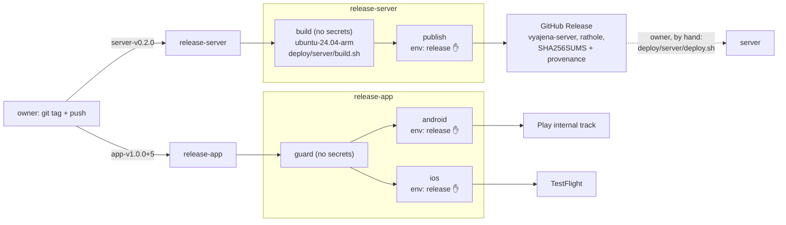

## Context

- Today (change `app-release`, `push`, `server-deployment`): the owner builds on the
  Mac. `app/store/build-aab.sh` signs with the upload key in
  `~/.vyajena-release/` (passwords in the macOS Keychain);
  `app/store/build-ipa.sh` signs with Xcode's cloud-managed Apple
  Distribution certificate; uploads are by hand; `deploy/server/build.sh` builds
  the server and rathole in arm64 containers.
- The repo is public (koppathachan/vyajena). `main` is protected: PR, green
  CI, signed commits, squash merge, admins included.
- The owner asked for this change (default design from the tracker): tags
  start releases, the owner approves each one, secrets live only in a GitHub
  Environment, server deploys stay manual.
- Nothing here touches `ci.yml`, `app/`, `deploy/` or the active changes'
  files. No `.proto` change, no invariant change.

✋ = waits for the owner's approval; the environment holds the secrets.

## Goals / Non-Goals

Goals: tag → reviewed build → owner approves → store/Release; a dry run that
needs no secret; a written threat model with an undo for each case.

Non-goals: deploying the server or relay from CI; production or closed tracks;
public App Store release; changing the manual path (it stays as the fallback).

## Decisions

### D1. Two release workflows and a lint workflow

- `.github/workflows/release-server.yml`: `push: tags: [server-v*]` and
  `workflow_dispatch`.
- `.github/workflows/release-app.yml`: `push: tags: [app-v*]` and
  `workflow_dispatch`. One tag builds both platforms.
- `.github/workflows/release-lint.yml`: on pull requests (and `main`) that
  touch `.github/**`; shellcheck, the workflow rules, the script tests.
- The logic lives in `.github/scripts/*.sh`, so it is shellchecked, tested and
  runnable on the Mac; the YAML only wires jobs, permissions and secrets.

Alternative: one workflow for everything. Rejected: a server tag would show
app jobs as skipped, and the server needs no Mac runner.

### D2. Release keys go to CI (reverses app-release D3)

`app-release` D3 and its requirement "Release signing keys stay with the
owner" say no keystore, certificate, profile or API key is given to CI. The
owner asked for CI releases, which needs exactly those, so this change
reverses that rule for the `release` environment only. The protections that
replace "never in CI": the owner approval gate (D3), environment-only secrets,
keyless Play access (D7), and Play App Signing (Google keeps the app signing
key, so the upload key alone cannot ship anything).

Files that still say "never in CI" and belong to `app-release`:
`openspec/changes/app-release/specs/app-release/spec.md`,
`openspec/changes/app-release/design.md` D3, `app/store/signing.md`,
the Gradle error text in `app/android/app/build.gradle.kts`, and
`docs/release.md`. This change does not edit them (the owner's rule); see Q1.

### D3. Owner approval: the `release` environment

The owner creates environment `release` (Settings › Environments) with:

- **Required reviewers:** `koppathachan`. "Prevent self-review" stays **off**:
  the owner is the only maintainer and pushes the tag themself.
- **Deployment branches and tags:** "Selected branches and tags", tag rules
  `server-v*` and `app-v*` only. A run on any branch (including a dispatch on
  a PR branch) cannot enter the environment.
- **Allow administrators to bypass:** off.
- All release secrets (D13) are secrets **of this environment**, never
  repository or organization secrets.

Plus a **tag ruleset** (Settings › Rules › Rulesets, target tags `server-v*`,
`app-v*`): restrict creation, update and deletion to the owner (bypass list:
the repo admin role), block force updates. A tag can then not be moved after
it was approved.

What the gate stops: a stolen token or a compromised dependency that can push
a tag but cannot approve a deployment from the owner's GitHub session. What it
does not stop: someone holding the owner's GitHub session or a token with the
owner's rights (D12, T1).

### D4. Server release files

- Runner `ubuntu-24.04-arm` (free for public repos): the same
  `rust:1.96-bookworm` container as on the Mac, run natively, no QEMU.
- The job runs `deploy/server/build.sh` unchanged (it calls
  `deploy/relay/build.sh arm64` for rathole 0.5.0 from `relay.conf`). The
  container writes as root, so the job makes `target/server` first.
- Files: `vyajena-server`, `rathole`, `SHA256SUMS`, checked as exactly these
  three both after the build and before publishing, both binaries `ARM
  aarch64`.
- `publish` (environment `release`, `contents: write`, `id-token: write`,
  `attestations: write`) checks the sums, writes a build provenance
  attestation for both binaries (`actions/attest-build-provenance`, Sigstore),
  and creates the GitHub Release with `gh release create --verify-tag`.
- Nothing config-like goes out: `config.toml`, `tunnel.toml`, the pin, the
  invite and keys are written on the server by `deploy/server/deploy.sh` and the
  relay's `render.sh` from `~/.vyajena-relay/`, which CI never has.

### D5. Version and build-number scheme

| Tag | Must equal | Also |
|---|---|---|
| `app-v<name>+<build>` | `app/pubspec.yaml` `version:` | `<build>` above every other `app-v*` tag's build |
| `server-v<major>.<minor>.<patch>` | `server/Cargo.toml` `version` | — |

- One build number for both stores (app-release D5): Android `versionCode`
  and iOS `CFBundleVersion` both come from `<build>`; it only goes up.
- **Meaning of an `app-v*` tag changes:** before, the owner tagged *after* a
  manual upload; now the tag *requests* a release. If a release fails after
  the tag (upload refused, owner rejects), the build number is burnt: raise it
  and tag again. Never move or reuse a tag (the ruleset blocks it).
- If Android uploads and iOS fails (or the reverse), fix and release the next
  build number on both; a store simply skips a number.
- `pubspec.yaml` says `1.0.0+4` today (built by `app-release`, tag not
  pushed). The first CI release uses the next number the stores have not seen.
- A manual release still works (`app/store/*.sh`). Pushing its tag starts
  `release-app`: **reject** the pending deployment in GitHub; the guard would
  pass, but the stores would refuse the duplicate build.
- Server: bump `server/Cargo.toml` `version` in the PR, then tag
  `server-v<that>`. rathole's version is in `relay.conf` and in the build log.

### D6. The release guard

`.github/scripts/release-guard.sh`, first step of every release run:

- `pins <workflow>`: every `uses:` outside this repo is `owner/repo@<40 hex>`
  with a `# v<version>` comment (local `./` actions are skipped).
- `tag <tag>`: the tag exists, `HEAD` is its commit, the commit is an ancestor
  of `origin/main` (so it went through a PR with green CI and signed commits),
  and the version rule of D5 holds.
- `version app|server`: prints the repo version (dry runs, `play-upload.sh`).

The checkout uses `fetch-depth: 0` so `origin/main` and all tags are there.

### D7. Android: signed bundle, keyless Play upload, internal track only

- `.github/scripts/android-aab.sh release` decodes the upload keystore and
  `google-services.json` into a 0600 folder under `RUNNER_TEMP` (deleted on
  exit), writes a `key.properties` with no passwords, and passes them to
  Gradle as `-Pvyajena.keyProperties=…` / `-Pvyajena.googleServices=…`; the
  passwords go in as `VYAJENA_UPLOAD_STORE_PASSWORD` /
  `VYAJENA_UPLOAD_KEY_PASSWORD`, which `build.gradle.kts` already reads. No
  change in `app/`.
- Then `app/store/release-check.sh --android-only` against
  `app/store/signing.md`: the bundle must be signed by the **recorded** upload
  key. The script drops the tag being released from the runner's clone first,
  so "above every earlier tag" holds.
- **Play access by workload identity federation**, not a JSON key:
  `google-github-actions/auth` exchanges GitHub's OIDC token for a 15-minute
  access token of the Play service account (scope `androidpublisher`). The
  provider's attribute condition admits only this repository (by numeric id)
  and the `release` environment. Nothing long-lived to leak. The owner's
  existing `github-pool` provider and service account can be reused once the
  condition is tightened (docs/release.md step 11 already warns that the old
  repo's name now points here). See Q2.
- `.github/scripts/play-upload.sh` calls the Android Publisher REST API with
  curl (edit → upload bundle → set track → commit), track and package fixed in
  the script: it cannot reach `production`, `alpha` or `beta`. No third-party
  upload action. A failed edit is deleted.
- Service account's Play permissions (app-level, this app only): "Release
  apps to testing tracks" and "View app information". Not "Release to
  production", not admin.

### D8. iOS: manual signing on a macOS runner, API-key upload

- Runner `xcode-27` (GitHub's Xcode 27 image, public preview) with
  `/Applications/Xcode_27.2.app` selected: the same Xcode as the owner's Mac.
  If the preview label goes away, `macos-26` (Xcode 26.6) is the fallback.
- **Signing:** the owner's current certificate is cloud-managed (Apple keeps
  the private key), so CI needs its own: a new **Apple Distribution**
  certificate made on the Mac (private key exported as `.p12`) and an **App
  Store** provisioning profile for `com.purplechaamba.vyajena` with Push. A
  team may have several distribution certificates; the manual path keeps
  working.
- `.github/scripts/ios-ipa.sh release`: a temporary keychain with the `.p12`
  (random password, deleted on exit, search list restored); the profile is
  checked (team + bundle id, `aps-environment = production`, no device list),
  installed, and removed on exit. Then the same steps as `build-ipa.sh`:
  unsigned `flutter build ipa`, sign the archived app once with
  `Runner.entitlements`, export with a copy of `ios/ExportOptions.plist` set
  to manual signing and this profile, verify the IPA and that
  `aps-environment = production`, run `release-check.sh --ios-only`, upload
  **that same IPA**, in a separate step, with `xcrun altool --upload-app` and the App Store Connect
  API key (`API_PRIVATE_KEYS_DIR` in the temp folder).
- **API key role: Developer** (enough to upload builds). Not Admin.
  Alternative rejected: cloud-managed signing in CI
  (`-allowProvisioningUpdates` + API key) needs an **Admin** key, which could
  also create certificates and change the team; a leak would cost more.
- TestFlight: the internal group "First testers" gets new builds when its
  "automatic distribution" is on (owner setting).

### D9. Dry run

`workflow_dispatch` on either workflow (Actions tab, any branch; only people
with write access can start it):

- runs the guard without the tag checks;
- `android-dry-run`: a throwaway PKCS12 key made in the job (2-day validity,
  random password), `-Pvyajena.allowNoPush=true` (no Firebase file), then the
  full release check against that key's fingerprint;
- `ios-dry-run`: unsigned archive, `release-check.sh --ios-only`;
- `release-server`: the full build, files kept as a 3-day workflow artifact
  only (public repo: anyone signed in can download them; they hold nothing
  secret);
- **no environment, no `secrets.*`, no upload, no write permission.** The
  release jobs are skipped (`if: github.event_name == 'push' && …`).

The dry run fails if `pubspec.yaml`'s build number is not above the highest
`app-v*` tag (the release check's rule), which is the right moment to raise it.

### D10. Least privilege in every job

- Top-level `permissions: {}`; each job lists what it needs.
- `actions/checkout` with `persist-credentials: false` (no token left in
  `.git/config` for later steps).
- **No caches** in release workflows (`actions/cache`, `rust-cache`,
  `flutter-action cache`): a cache written by another run could feed a signed
  build. Release builds are rare; slower is fine.
- `concurrency` per workflow, never cancelling a running release.
- Secrets are passed only to the one step that needs them, as `env:`; GitHub
  masks them in logs; scripts never `echo` them, write them only under
  `RUNNER_TEMP` with `umask 077`, and delete them in an `EXIT` trap. The Play
  token goes to curl through a 0600 header file, not the command line.
- Every action pinned to a full commit SHA (D6), each version at least two
  weeks old when pinned (2026-11-17):

| Action | Version | SHA |
|---|---|---|
| actions/checkout | v7.0.1 | `3d3c42e5aac5ba805825da76410c181273ba90b1` |
| actions/upload-artifact | v7.0.2 | `cf430e030ddbb5b0abf93d22962f4752f3646cd9` |
| actions/download-artifact | v8.0.2 | `9000827ccba6bdab643e8b6fd33ac0654aef8333` |
| actions/attest-build-provenance | v4.2.2 | `4d101475d8b20a2381f78447822ac1eab6504dd8` |
| actions/setup-java | v6.1.0 | `b843ebf9b913146b38da2eaa7aeddf76074ae1ad` |
| subosito/flutter-action | v2.23.0 | `1a449444c387b1966244ae4d4f8c696479add0b2` |
| google-github-actions/auth | v3.0.0 | `7c6bc770dae815cd3e89ee6cdf493a5fab2cc093` |

Flutter is pinned to `3.44.4` (the owner's Mac), Java to Temurin 21.

### D11. Pull requests never reach release secrets

- No release workflow has a `pull_request*` or `workflow_run` trigger; no
  workflow uses `pull_request_target`.
- `release-lint` runs on `pull_request` with `contents: read`; GitHub gives
  fork PRs a read-only token and no secrets anyway.
- A PR that edits a release workflow changes nothing until it is merged into
  `main` (review, green CI). Even then, the environment admits only tags.
- `.github/scripts/release-workflows-check.sh` enforces D3, D9, D10, D11 and
  "no ssh/scp/deploy.sh" on every PR; `release-scripts-test.sh` tests the
  checker and the guard with fixtures (48 cases).
- Owner setting (Settings › Actions › General): "Require approval for all
  external contributors" for fork PR workflows.

### D12. Threat model

| # | Threat | What it can do | What stops or limits it | Undo |
|---|---|---|---|---|
| T1 | **Owner's GitHub account taken over** (password + 2FA phished, or a stolen session / `gh` token on the Mac) | Everything the owner can: merge a PR, push a tag, approve the deployment, change settings. Ships an update to the internal testers (≤ 100, the group). | Strong 2FA (passkey / security key), no classic PATs, `gh auth` token only on the Mac; GitHub emails on new deployments and releases; Play and App Store Connect email when a build is processed; internal testing only, no production track. The gate does **not** stop this; it is the residual risk the tracker named. | Revoke sessions and tokens (Settings › Sessions, › Applications, `gh auth logout`), reset password and 2FA. **Play:** Internal testing › halt the release, roll out a fixed higher build. **TestFlight:** expire the build (TestFlight › build › Expire). Revoke the ASC key and the Apple Distribution certificate, request a Play upload key reset, rotate every environment secret (below). Delete any rogue GitHub Release. Check the security log for added deploy keys, SSH/GPG keys, apps. |
| T2 | **Malicious PR** (fork or branch) | Edits a workflow or script to print or send secrets. | No PR trigger on release workflows; read-only token and no secrets for PR runs; environment admits only tags; tags must be on `main` (guard) and only the owner can create them (ruleset); review before merge; `release-lint` flags rule breaks. | Close the PR; if it was merged, revert, and treat secrets as leaked only if a release ran on the bad commit. |
| T3 | **Leaked upload key + passwords** | Sign a bundle as the upload key. Cannot ship it without Play access; Play App Signing re-signs with Google's key. | Environment-only secret; Play access is keyless (D7). | Play Console › Test and release › App integrity › Upload key › **Request upload key reset** (new key, new `signing.md` fingerprint, new secret). |
| T4 | **Leaked Play access** (WIF misconfigured to trust another repo) | Upload to testing tracks of this app. | Attribute condition on repository id + environment; SA has testing-track rights on this app only. | Disable the provider (`gcloud iam workload-identity-pools providers disable`), remove the SA in Play Console › Users and permissions. |
| T5 | **Leaked distribution certificate (.p12 + password)** | Sign apps as the team. Cannot upload without App Store Connect access. | Environment-only secret; certificate only on CI and the password manager. | developer.apple.com › Certificates › **Revoke**; make a new one + profile, update both secrets. Installed TestFlight/App Store builds keep working. |
| T6 | **Leaked App Store Connect API key (.p8)** | Upload builds, manage TestFlight (Developer role). Ships to internal testers only together with T5. | Developer role, not Admin; environment-only secret. | App Store Connect › Users and Access › Integrations › Keys › **Revoke** (immediate); new key, new secrets. Expire rogue builds. |
| T7 | **Compromised third-party action** | Runs inside a job, sees that job's secrets. | SHA pins (no tag moves), few actions, secret jobs use only checkout, setup-java, flutter-action, google auth; secrets only in the step that needs them. | Revert the pin; rotate the secrets of every job that ran it. |
| T7b | **Malicious build dependency** (crate, pod, Gradle plugin, Dart package) | Runs in the build step: sees the upload keystore or distribution certificate (as on the Mac today). | No OIDC token and no App Store Connect key in build steps (D15); signing keys alone cannot ship. | Remove the dependency; T3 / T5 undo. |
| T9 | **`release` environment missing or loosened** (never created, a rule removed) | Jobs would run without approval. | First step of every release job checks the environment (D15). | Recreate the rules (docs step 1); rerun. |
| T8 | **Tampered server release file** | The owner deploys a bad binary. | `SHA256SUMS` + Sigstore provenance tied to `release-server.yml` and the commit; owner verifies before deploy; deploy stays manual. | Delete the release; `deploy/server/deploy.sh --rollback`. |

`google-services.json` is not secret (it ships inside every APK); it is an
environment secret only to keep it out of the public repo (push D8).

### D13. Secret list (all in environment `release`)

| Secret | What | Made by the owner from | Used by |
|---|---|---|---|
| `ANDROID_UPLOAD_KEYSTORE_B64` | base64 of the upload keystore | `~/.vyajena-release/upload.jks` | android |
| `ANDROID_UPLOAD_STORE_PASSWORD` | keystore password | macOS Keychain `vyajena-upload`/`store` | android |
| `ANDROID_UPLOAD_KEY_PASSWORD` | key password | macOS Keychain `vyajena-upload`/`key` | android |
| `ANDROID_GOOGLE_SERVICES_JSON_B64` | base64 of the Firebase file | `~/.vyajena-push/google-services.json` | android |
| `PLAY_WIF_PROVIDER` | `projects/<number>/locations/global/workloadIdentityPools/<pool>/providers/<provider>` | GCP project `vyajena` | android |
| `PLAY_SERVICE_ACCOUNT` | the Play service account's email | GCP project `vyajena` | android |
| `IOS_DIST_CERT_P12_B64` | base64 of the new Apple Distribution `.p12` | Keychain Access export | ios |
| `IOS_DIST_CERT_PASSWORD` | its export password | chosen at export | ios |
| `IOS_PROFILE_B64` | base64 of the App Store profile | developer.apple.com | ios |
| `ASC_KEY_ID` | App Store Connect API key id | App Store Connect | ios |
| `ASC_ISSUER_ID` | its issuer id | App Store Connect | ios |
| `ASC_KEY_P8_B64` | base64 of `AuthKey_<id>.p8` | App Store Connect (one download) | ios |

The server release needs no secret (only `GITHUB_TOKEN`).

### D14. The owner guide is `docs/ci-release.md`

The task asked for `docs/release.md`, but that file belongs to the active
changes `app-release` and `push` (owner's rule: don't edit without asking). So
the guide is a new `docs/ci-release.md`. Once the owner agrees, one line in
`docs/release.md` ("CI releases: see `docs/ci-release.md`") links them (Q1).

### D15. Hardening after review (owner: "make sure this does not make anything vulnerable")

A security pass over the first version found three gaps; all are fixed:

1. **A missing environment is created unprotected.** GitHub creates
   `release` with no rules the first time a job names it. Without secrets the
   app jobs would fail, but `publish` (server) needs none and would have
   published unapproved. Fix: every job in `release` first runs
   `release-guard.sh environment release`, which reads the environment and
   its deployment rules through the API and stops unless the owner is a
   required reviewer, administrators cannot bypass, and the rules are exactly
   tags `app-v*` and `server-v*`.
2. **Build code could mint the Play token.** The `android` job has
   `id-token: write` (for workload identity), and GitHub gives every step a
   way to ask for the OIDC token. A malicious crate, Gradle plugin or Dart
   package in the build could have exchanged it for Play access. Fix: the
   build step runs under `env -u ACTIONS_ID_TOKEN_REQUEST_TOKEN -u
   ACTIONS_ID_TOKEN_REQUEST_URL`; only the auth step can ask.
3. **The App Store Connect key was in the build step.** Fix: `ios-ipa.sh`
   has a separate `upload` mode; the key is only in the "Upload to
   TestFlight" step, after the build has finished.

The checker enforces all three (`release-workflows-check.sh`), with tests
(48 cases now).

Still true and accepted: the build step must see the **upload keystore** (or
the **distribution certificate**) to sign, the same as `build-aab.sh` /
`build-ipa.sh` on the Mac today. A process started by build code could outlive
its step until the job ends (GitHub cleans up per job); splitting signing into
another job would need a second approval per release. Upload key and
certificate leaks are recoverable (D12 T3, T5), and neither can ship a build
alone.

Not changed here (owner rule: `deploy/` untouched): `deploy/server/build.sh` and
`relay.conf` name Docker images by tag (`rust:1.96-bookworm`,
`rust:1.79-bookworm`), not by digest. Same as the local build; see O5.

### D16. `ci.yml` runs each check only when its code changed (owner, 2026-11-17)

The owner asked for this after PR #3 (no code) went red on flaky Rust tests.
A first job, `what changed`, runs `.github/scripts/ci-changes.sh` (plain
`git diff --name-only <base>...HEAD`, no third-party action) and the three
existing jobs run only when needed:

| Job (required check, name unchanged) | Runs when these change |
|---|---|
| buf lint and breaking | `proto/`, `buf.yaml`, `buf.lock` |
| cargo build (build + `cargo test`) | `Cargo.toml`, `Cargo.lock`, `protocol/`, `server/`, `client/`, `bridge/`, `pbgen/`, `proto/`, `deploy/` (server tests read `deploy/server`, `deploy/relay`) |
| flutter analyze and test | `app/` |
| all three | `ci.yml` or `ci-changes.sh` itself; no base commit |

- Base: the PR's base branch, or the push's `before` commit.
- A job skipped by `if:` reports success, so branch protection's required
  checks still pass. Path filters on the `on:` trigger were rejected: a
  workflow that never starts leaves required checks waiting forever.
- Docs, `openspec/` and the release workflows run no build or test.
- Tests: 10 detector cases in `release-scripts-test.sh` (58 total).

Known flaky tests (not fixed here; Rust test code is outside this change):
`client/tests/support/server.rs` `free_port()` binds port 0, drops the listener,
then the test server binds that address later; a parallel test can take it first
(`AddrInUse`, seen in `a_device_clock_ahead_of_the_server_does_not_renew_on_every_tick`).
And `client/tests/welcome_recovery.rs::a_member_asks_nothing_at_start` saw a
re-add request at start on a slow runner. Both passed on `main` at bf24f7c.

### Setup log (2026-11-18, docs steps 5–8, owner present)

- **Workload identity** (GCP project `vyajena`, owner yes to the commands):
  the existing provider in `github-pool` trusted `repository_owner ==
  'chaamba'` (the old org). Now: mapping `repository_id`, `environment`,
  `ref`; condition repo id + environment `release` + `refs/tags/app-v*`.
  The Play service account's `workloadIdentityUser` binding moved from
  `attribute.repository/chaamba/vyajena` to this repo's id. It has no
  user-managed keys and no project roles. Credentials/STS/Publisher APIs
  were already on. Cost: none.
- **Play Console** (owner yes): the service account had "Release apps to
  testing tracks" **account-wide** (all 3 apps). Now nothing account-wide;
  `com.purplechaamba.vyajena` only: view app information, release to testing
  tracks, manage testing tracks (plus view app quality, which Play adds).
- **Apple:** second Apple Distribution certificate (expires 2027-11-18), App
  Store profile `vyajena CI App Store` (team, app id, `aps-environment =
  production`, no devices, that certificate; expires 2027-11-18). App Store
  Connect API access was requested and granted, team key `vyajena-ci`, role
  Developer. All made by the owner.
- **Secrets:** all 12 (D13) in environment `release`, set by the owner from
  files and the Keychain; none at repository level.
  `release-guard.sh environment release`: pass.

## Open items (not built)

- **O1. `deploy.sh` from a release file.** `deploy/server/deploy.sh --release
  server-v0.2.0`: `gh release download` into `target/server/`, `sha256sum -c
  SHA256SUMS`, `gh attestation verify <file> --repo koppathachan/vyajena
  --signer-workflow koppathachan/vyajena/.github/workflows/release-server.yml`
  for both binaries, then the existing `--no-build` path. Deploys stay
  manual and from the Mac. Its own change, after the first server release.
- **O2. Pin `ci.yml`'s actions** to SHAs too (it uses `@v4`/`@v2`/`@v1`
  tags). Out of scope here: "existing CI unchanged".
- **O3. Store metadata from CI** (release notes, screenshots): not needed for
  internal testing.
- **O4. Required check:** the owner may add `release-lint` to `main`'s
  required checks.
- **O5. Pin Docker images by digest** in `deploy/server/build.sh` and
  `deploy/relay/relay.conf` (`rust:…@sha256:…`), for the local and the CI
  Server build alike.

## Questions for the owner

**Answered by the owner on 2026-11-18** (all three as recommended):

| # | Answer | What follows |
|---|---|---|
| Q1 | (b) **archive `app-release` first**, then a MODIFIED delta of its "Release signing keys stay with the owner" requirement in `ci-release` before `ci-release` is archived | `app-release` files stay as they are until then |
| Q2 | **Workload identity** (keyless), reusing `github-pool` | docs step 6; no JSON key anywhere |
| Q3 | **Second Apple Distribution certificate** for CI + App Store Connect API key with the **Developer** role | docs steps 7–8; no Admin key, no cloud signing in CI |

The original questions:

- **Q1. app-release says "no key is given to CI".** This change reverses
  that (D2). Options: (a) edit `app-release`'s requirement and D3 now (and
  `signing.md`, the Gradle message, `docs/release.md` link) in a small
  owner-approved commit; (b) archive `app-release` first, then add a
  MODIFIED delta here before archiving `ci-release`. Recommended: (b), it
  keeps each change's history honest.
- **Q2. Play access: workload identity (keyless) or a JSON key?** Recommended:
  workload identity (D7), reusing the existing pool once its condition is
  tightened to this repo id and environment `release`.
- **Q3. A second Apple Distribution certificate for CI** (D8) instead of an
  Admin API key for cloud signing. Recommended: the second certificate.

## Risks / Trade-offs

- **Untested against the real services.** Nothing here has run on GitHub yet
  (that needs a push). The dry run is the first test; the first real release
  is the second. Expect small fixes (runner Xcode, NDK download, altool).
- `xcode-27` is a preview image; fallback `macos-26`.
- Builds take longer without caches (Android ~15 min, iOS ~20 min, server
  ~15 min).
- `altool --upload-app` is Apple's older uploader; if Apple drops it, switch
  to `xcodebuild -exportArchive` with `destination upload` and
  `-authenticationKeyPath`.

## Verification (2026-11-17, on the Mac)

- `openspec validate ci-release --strict`: valid.
- `actionlint` 1.7.12: clean (all four workflows; `.github/actionlint.yaml`
  declares the `xcode-27` label).
- `shellcheck .github/scripts/*.sh`: clean.
- `.github/scripts/release-workflows-check.sh`: pass on the real workflows.
- `.github/scripts/release-scripts-test.sh`: 48 passed, 0 failed (after D15).
- `cargo build --workspace`, `cd app && flutter analyze`: unchanged, green.
- Local Android dry run (`RUNNER_TEMP=<scratch> .github/scripts/android-aab.sh
  dry-run`, Flutter 3.44.4, ~13 min): throwaway PKCS12 key, Gradle `-P`
  properties, no Firebase file; `release-check.sh --android-only` all 11 PASS
  (version 1.0.0+4 > 3, architectures, 16 KB, signer = the throwaway key,
  permissions, name, stripped, no tracking SDK). Flutter's apkanalyzer step
  failed as on every build on this Mac (SDK path with a space) and was let
  through as in `build-aab.sh`. The key folder was gone afterwards; the
  throwaway-signed bundle was deleted.
- Not run: any workflow on GitHub, the iOS scripts, any real-key build, any
  upload.
