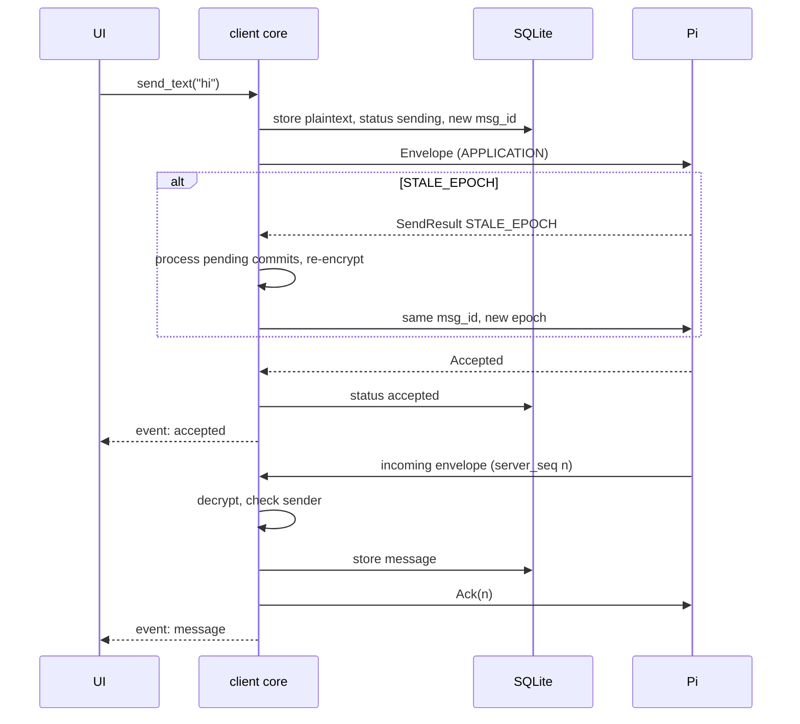

## Context

The Pi server (`pi-server-core`, archived) implements every server-enforced
requirement and is tested with OpenMLS test clients. Nothing on the device side
exists. The owner's build order puts this core next, then a terminal client,
deployment, and Flutter. Owner decisions feeding this change: crate name
`client`; desktop keys in the OS keychain with an opt-in 0600 file fallback;
decision #4 (7-day own-leaf rotation and last-resort refresh); decision #2
(Q&A verification over a PAKE) deferred to its own change after the terminal
client.

Owner conventions apply: committed generated code via `cargo run -p pbgen`,
tests only in `tests/`, one folder per feature, spikes git-ignored and deleted.

## Goals / Non-Goals

**Goals:**

- A library a UI can drive end to end: sign up, link a device, create the group
  (admin), add and remove people (admin), send and receive text, profiles and
  group settings, survive restarts, network drops and inactivity.
- Every client-side requirement implemented and tested against the real server.
- One API shape that the terminal client uses now and Flutter wraps later.

**Non-Goals:**

- Any UI (terminal client and Flutter changes), Q&A verification (its own
  change), real push (Flutter change), Android/iOS key stores (Flutter change;
  the key-store interface is ready for them).

## Decisions

### D1. Layout: one folder per feature

```
client/
  src/lib.rs         public API: Client, events, plain request/response types
  src/pb.rs          generated messages + client stubs (committed)
  src/keystore/      KeyStore trait; OS keychain, opt-in file, memory (tests)
  src/store/         SQLite: messages, own sent plaintext, pinned identity keys
  src/identity/      identity key, device keys, certificates, signup, linking
  src/net/           pinned TLS, auth and token renewal, Connect, reconnect
  src/mls/           OpenMLS group: create, add, process, encrypt, rotate
  src/membership/    admin actions, commit-authority check, re-add, Pi Removes
  src/keys/          KeyPackage upload, replenish, last-resort refresh
  src/messaging/     content bodies, send and status, receive, ack, notices
  tests/             end-to-end tests against the real server
```

### D2. API: one async Rust API plus an event stream

`Client` exposes async methods (`register`, `link_request`, `approve_link`,
`create_group`, `add_user`, `remove_user`, `send_text`, `set_profile`,
`set_group_settings`, ...) and one ordered event stream. Types are plain
structs and enums with no OpenMLS or protobuf types, so `flutter_rust_bridge`
can wrap them later unchanged. **Alternative:** design the FFI surface now.
Rejected: the terminal client is Rust and needs no FFI.

### D3. Keys: a key-store interface

`KeyStore` stores and loads named secrets. Implementations: OS keychain via the
`keyring` crate; a 0600 file used only when the user passes an explicit opt-in;
an in-memory store for tests. Android and iOS implement the same trait later.
The core never writes the identity, auth or MLS signature keys anywhere else.

OpenMLS group state goes through a storage provider that writes to SQLite with
every value encrypted (an AEAD such as ChaCha20-Poly1305) under a storage key
created on first start and kept in the key store (owner decision, option A).
Messages are not encrypted, as the architecture decided. **Alternatives:** plain
rows relying on disk encryption (B), or the key store itself (C, impractical:
many entries changing every epoch).

### D4. Sending and receiving



Receiving is strictly in `server_seq` order; the core never acks before the
message is stored (`client-runtime: Local message store`).

### D5. Membership on the device

- Every new or changed leaf: verify the device certificate against the user's
  pinned identity key and that its MLS key equals the leaf key; apply the
  commit-authority rule with `protocol::group_membership`. Reject the commit
  otherwise.
- Identity keys are pinned on first sight. A different key for a known user
  raises an identity-key-changed event and blocks adding that user's devices
  until the user accepts the new key in the UI (Q&A verification later builds on
  this).
- On a `RejoinNotice` for its own user's device or, on admin devices, for anyone:
  fetch that device's KeyPackage and commit the re-add (pending Pi Remove plus
  Add), with no user action.
- Admin devices commit pending Pi inactivity Removes when they connect.
- Group creation sets the `0xF0A1` admin extension and lists the Pi as external
  sender; every KeyPackage declares `0xF0A1` in its capabilities.

### D6. Rotation (decision #4)

A daily check plus one on each connect: if the device's leaf is older than 7
days, commit an update of its own leaf after a random delay of up to an hour; if
the last-resort KeyPackage is older than 7 days, upload a new one. The 7-day age
is a `protocol` constant.

### D7. Time is injectable

Like the server, the core reads time from a clock the tests can move, so
rotation, token renewal and inactivity are testable without waiting.

### D8. Testing end to end

`client/tests/` starts the real server in-process (the `server` crate as a
dev-dependency) and runs Alice, Bob and the admin as real `Client`s with
in-memory key stores and temp databases. Scenarios follow the specs: signup,
linking, group creation, adding Bob, chatting, epoch races, catch-up, inactivity
and automatic re-add, rotation, key-changed warnings. The dropped
"unknown content body decodes as unset" test lands here.

## Risks / Trade-offs

- [OpenMLS persistent storage may not fit (crate availability, schema, or how
  it stores secrets)] → task 1.1 spikes it first.
- [`keyring` behaves differently per OS and may prompt the user on macOS] → task
  1.2 spikes it on macOS; the file fallback covers headless machines.
- [The server as a test dependency couples the crates] → test-only; the core's
  own code never imports the server.
- [The same membership logic runs on device and Pi] → shared rules stay in
  `protocol/`, so they cannot drift.

## Migration Plan

None. No deployed clients.

## Open Questions

None.

Resolved by the owner (2026-11-10): OpenMLS group state is stored in SQLite
encrypted under a storage key kept in the key store (option A; see D3).
