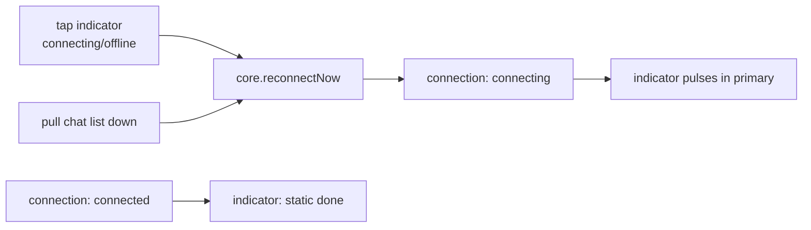

## Context

`app/lib/app/connection_indicator.dart` is a small app-bar glyph driven by
two `ValueListenable`s on `CoreService`: `connection` (connected /
connecting / disconnected) and `removed`. Today it maps each state to an
icon, a tooltip and a colour:

| State | Icon | Colour |
|---|---|---|
| connected | `cloud_done_outlined` | `primary` |
| connecting | `cloud_sync_outlined` | `onSurfaceVariant` (muted) |
| offline | `cloud_off_outlined` | `onSurfaceVariant` (muted) |
| removed | `person_off_outlined` | `error` |

The two problem states, connecting and offline, differ only by the glyph's
shape, both static and in the same muted grey. The core state behind
`connecting` is correct — the engine keeps `Connecting` during its reconnect
backoff and exposes `reconnectNow()` to skip the wait — so the fix is
entirely in how the indicator looks and what tapping it does.

## Goals / Non-Goals

**Goals:** make connecting unmistakably "working" (motion + an active
colour), give the user a one-tap way to skip the backoff, and add
pull-to-refresh as the first familiar manual-refresh gesture.

**Non-Goals:** any core/bridge/Pi/protocol change; a live "retrying in N s"
countdown (the next-attempt time is not exposed to Dart); changing the
removed state.

## Decisions

### D1. Connecting animates and uses the active colour; motion is the third signal

The indicator now distinguishes the states on three axes — glyph, colour and
motion — so no two states collide:

| State | Icon | Colour | Motion |
|---|---|---|---|
| connected | `cloud_done_outlined` | `primary` | none |
| connecting | `cloud_sync_outlined` | `primary` | pulse (opacity 0.35↔1.0, ~900 ms, repeating) |
| offline | `cloud_off_outlined` | `onSurfaceVariant` (muted) | none |
| removed | `person_off_outlined` | `error` | none |

Connecting leaves the muted grey for the active `primary` colour, so it is
plainly distinct from offline (the requirement: "distinct from the muted
offline colour"). It shares `primary` with connected on purpose: the app's
look is one neutral, low-chroma slate seed (see app-ui "Light Material 3
look"), which has no strong second hue to spend on a third state without
looking arbitrary. The pulse is what separates connecting ("working on it")
from connected ("done"); connected is deliberately still. A pulse, not a
spin, because a 360° rotation of a cloud glyph reads oddly (upside-down
cloud); a fade conveys "alive, trying" and is calmer in an app bar.

The animation is an `AnimationController` that `repeat(reverse: true)`s only
while the state is connecting, and is stopped and reset otherwise, so no
ticker runs in the connected, offline or removed states. The widget disposes
the controller, so no ticker outlives the widget.

### D2. Manual reconnect: tap the indicator, and pull the chat list down

`reconnectNow()` already exists on `CoreService` (it skips the backoff wait
when disconnected and is a no-op when connected, not started, or removed).
Two affordances call it:

- **Tap the indicator** when it is connecting or offline and this device was
  not removed. The icon becomes a button (an `InkResponse` with a `Semantics`
  button and the state label as its tooltip). Connected or removed → the tap
  does nothing (`onTap` is null): there is nothing to retry, and after a
  removal the core will not reconnect anyway.
- **Pull the chat list down** (`RefreshIndicator` around the list) → the same
  `reconnectNow()`. This is the gesture users reach for first.

Both are fire-and-forget: `reconnectNow()` returns a `Future` the UI does not
await, because the outcome shows up through the `connection` listenable
(connecting → connected) that already drives the indicator. Calling it while
connected or removed is safe (the core makes it a no-op), so neither
affordance needs to guard the core's internal rules itself; the app only
guards the obvious "nothing to retry" cases to avoid a pointless call and a
misleading affordance.

### D3. Tests assert motion behaviourally, not by inspecting the controller

Widget tests cannot read "is it animating" directly, and must never
`pumpAndSettle()` a repeating animation (it never settles). So the tests:

- pump a frame, read the connecting glyph's `FadeTransition.opacity.value`,
  pump a short duration, read it again, and assert it changed — motion;
- for connected and offline, assert the opacity stays `1.0` across the same
  pumps — no motion;
- assert the colour via a pure `ConnectionIndicator.color(scheme, status,
  removed: …)` helper, so connecting ≠ offline and removed = `error`;
- tap the indicator while offline and assert the fake core recorded
  `reconnectNow`; tap while connected and assert it did not.

Existing app-bar tests stay green: the only `pumpAndSettle()` in the suite
(`look_test`) runs with a user-less fake core, which stays `disconnected`
(offline, static), so nothing animates there.
