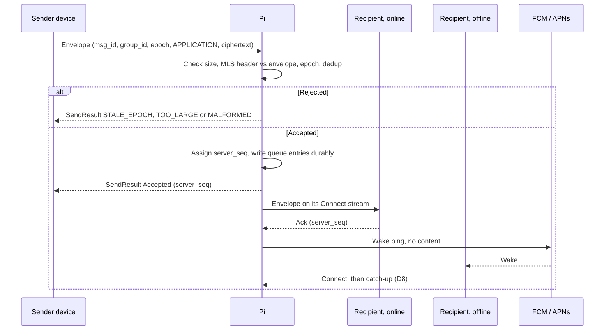
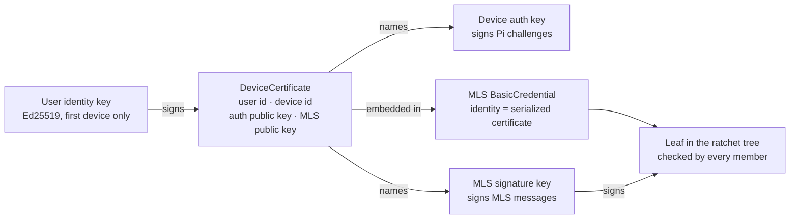
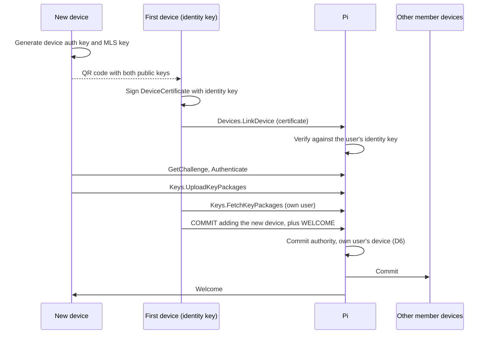
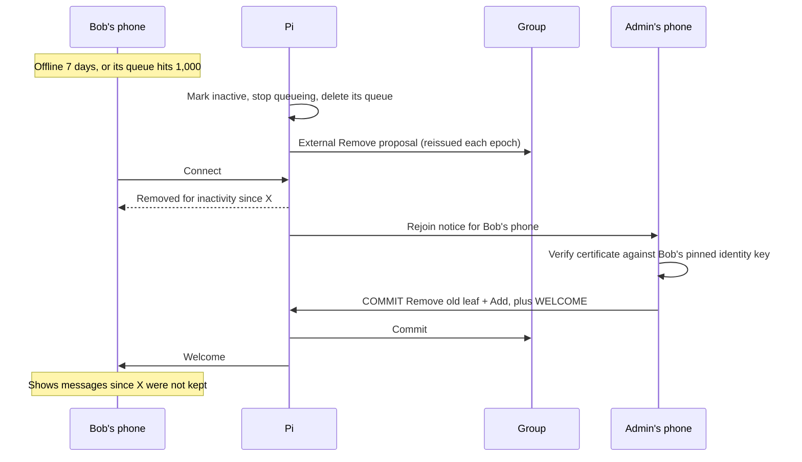
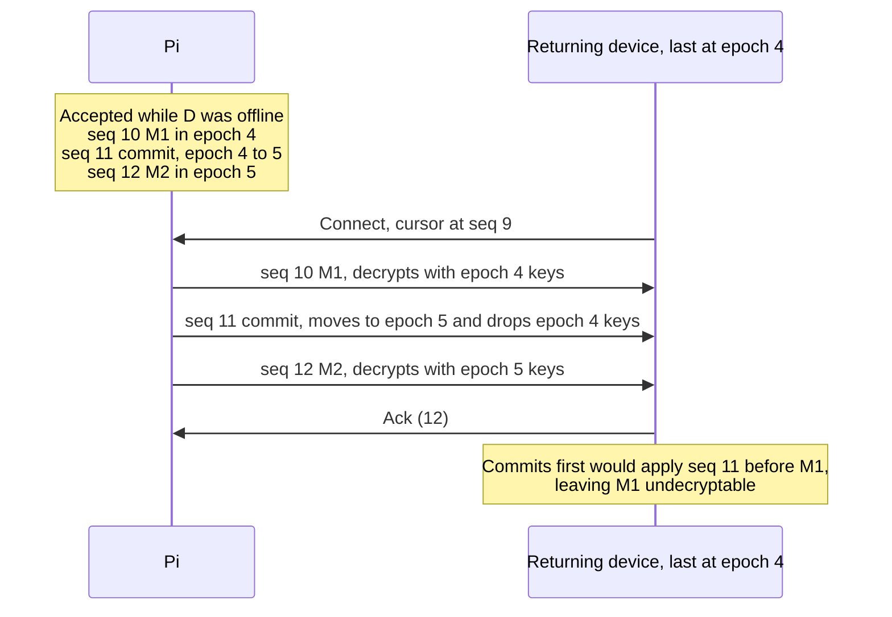

## Context

This is the first change in vyajena2. Nothing exists yet except the architecture
doc (`docs/architecture-decisions.md`) and the project conventions, which require
the `.proto` contract before any Rust or Dart that depends on it. The contract has
two consumers: the Rust core on each device (client side of every RPC) and the Pi
server (tokio + tonic). Flutter never sees protobuf. The relay is a TCP
passthrough and is unaffected.

Two open decisions are settled by the owner for this change: multi-device is in
the MVP, and application ciphertext is capped at 64 KB. Multi-device collides with
the "admin-only membership Commits" invariant, which this change relaxes.

One application message through this contract:



## Goals / Non-Goals

**Goals:**

- A complete, lint-clean `vyajena.v1` contract for everything in the MVP scope.
- An identity model where each device is an MLS member and every device is
  provably tied to its user, verifiable by other members without trusting the Pi.
- A Pi that can enforce membership policy and the strict epoch rule while seeing
  only public MLS state.
- Validate the two riskiest assumptions (below) before the server is built.

**Non-Goals:**

- Implementing Pi or Rust core behavior. Follow-up changes (`pi-server-core`,
  `rust-core-messaging`) implement these specs against the contract.
- Fingerprint verification (open decision #2), idle-group key rotation (#4),
  desktop clients (#3). The contract leaves room for each; none is required here.
- History for newly linked devices. A new device sees messages from the epoch it
  joins onward, like any new member.
- Federation. Ids are federation-ready; nothing else is.

## Decisions

### D1. Identity: user identity key signs device certificates

Each user has one Ed25519 identity key. A `DeviceCertificate` (user id, device id,
device auth public key, MLS signature public key, created_at) is signed with it
under the context string `vyajena2-device-cert-v1`. Device id = first 16 bytes of
SHA-256(device auth public key), so a device knows its own id before registering.

- **Alternative:** no user key, devices vouched for by the Pi. Rejected: the Pi
  could then add a device to any user, which is exactly the residual risk the
  architecture doc already calls out.
- **Side effect:** fingerprint verification (#2), if adopted, becomes one
  fingerprint per *user* (the identity key), not per device.

How one device is tied to its user (D1, D3, D4):



### D2. The first device holds the identity key; it links the others

The identity key never leaves the first device. Linking: the new device shows a QR
of its public keys; the identity device scans it, signs a certificate and uploads
it with `Devices.LinkDevice`; it then commits the new device's Add. No secret is
transferred and the Pi relays nothing new.

- **Alternative:** copy the identity key to every linked device (encrypted to the
  new device, relayed through the Pi), so any device can link more. Friendlier when
  the first phone is lost, but every device then carries the long-term key and the
  wire grows a secret-transfer RPC.
- **Cost:** losing the identity device means the user can no longer add devices.
  Recovery is admin-driven: the admin removes the user and issues a new invite
  (owner decision: the group is small and the admin controls who is added).



### D3. Two keys per device

Each device has a device auth key (Ed25519, signs Pi challenges) and an MLS
signature key (Ed25519, signs MLS messages and its leaf). Separate keys avoid any
cross-protocol signature confusion and let the MLS key rotate on its own.

### D4. Device certificate lives in the MLS basic credential

The MLS `BasicCredential.identity` bytes are the serialized `DeviceCertificate`.
Every member sees it in the ratchet tree and verifies it against the user's pinned
identity key, offline. **Alternative:** a custom leaf-node extension. Rejected as
more OpenMLS surface for no gain; X.509 credentials are not a good fit for one key.

### D5. Handshakes are `PublicMessage`; the Pi runs OpenMLS `PublicGroup`

To enforce commit authority the Pi has to read proposals, so Commits and Proposals
are sent as MLS `PublicMessage`. The Pi keeps the group's public state with
OpenMLS `PublicGroup` (built for delivery services), which verifies commit
signatures and applies the tree changes without any group secret. Application
messages stay `PrivateMessage`; for those the Pi reads only the unencrypted header
(group id, epoch, content type).

- **What the Pi newly learns:** nothing beyond the architecture doc's "Pi sees"
  table (members, epoch, sender), plus the public leaf keys.
- **Consequence:** anything in the group context is readable by the Pi. So the
  group name and settings move to encrypted `GroupSettings` application messages
  (`message-content`), while the admin's user id sits in the group context, which
  is fine because the Pi already enforces it.
- **Alternative:** encrypted handshakes with client-declared metadata the Pi
  trusts. Rejected: one dishonest member could get a bad commit accepted and fork
  the group for everyone.

### D6. Commit authority (relaxed invariant)

Admin devices may commit anything. Other devices may commit only: own leaf update,
Add of a device certified for their own user, Remove of their own user's device,
or a Pi-issued external Remove. The Pi and every client both check this, so a
commit the Pi accepted is one every honest client also accepts.

### D7. Inactive devices are kept out, then re-added automatically

One rule replaces both "queue full rejects the send" and "removed after 30 days
offline": a device that has been offline for 7 days, or whose queue reaches 1,000
entries, is inactive. The Pi stops queueing for it, deletes its queue and proposes
its removal. The group is never blocked by one device, and nobody has to skip
thousands of messages to catch up, so OpenMLS's default limit on skipped messages
never comes into play.

The Pi cannot commit (it is not a member), but MLS lets a listed external sender
propose. The group context lists the Pi's key in `external_senders`; the Pi sends
an external Remove proposal and reissues it every epoch until committed. The Pi
publishes this key in `GetServerInfo`.

When the device comes back, the Pi tells it that it was removed and since when,
and sends a rejoin notice to the user's other devices and the admin's devices.
Whichever gets it first re-adds the device in one commit (Add, plus the pending
Remove of its old leaf) with no user action. The commit rule (D6) already allows
both. Messages from the inactive period are not delivered.



- **Alternative:** rotate the full device's queue (drop the oldest entries). Kept
  the device in the group with a growing gap, and needed a larger OpenMLS skip
  limit. Rejected as more mechanisms for the same outcome.
- **Cost:** a re-add waits until one of the user's other devices or an admin
  device is online.

### D8. One sequence per group; delivery merged in order

Every accepted envelope gets the next `server_seq` for its group. Commits and
proposals live once in the commit log; application messages are copied into
per-device queues; each device is served both, merged by `server_seq`, and acks
cumulatively. **This corrects the architecture doc's catch-up wording** ("replay the
commit log, then drain the queue"): with `max_past_epochs = 0`, replaying all
commits first would leave queued messages from older epochs undecryptable.



### D9. Session tokens for unary calls

`GetChallenge` / `Authenticate` yields a short-lived bearer token (≤ 1 h, stored
hashed on the Pi) used in metadata for unary RPCs and `Connect`. The signature
covers the TLS exporter value, so a challenge answered on one connection cannot be
replayed on another. **Alternative:** challenge per RPC; rejected as a round trip
on every call.

### D10. Limits

- `APPLICATION` ciphertext ≤ 65,536 bytes (decision #5).
- Handshake envelopes ≤ 262,144 bytes: a Welcome carries the ratchet tree, which
  grows with the number of devices. Confirmed by the owner; fits roughly 200
  devices.
- 20 one-time KeyPackages per device, replenish below 5.

### D11. Tooling and layout

```
proto/vyajena/v1/
  common.proto     ids, DeviceCertificate, error reasons
  devices.proto    Devices: GetServerInfo, Register, GetChallenge, Authenticate,
                   LinkDevice, GetSelf, RevokeDevice, UpdatePushToken
  keys.proto       Keys: UploadKeyPackages, FetchKeyPackages
  admin.proto      Admin: CreateInvite, ListInvites, RevokeInvite,
                   CreateGroup, RemoveUser
  messaging.proto  Messaging.Connect(stream ClientFrame) -> stream ServerFrame;
                   Envelope, SendResult, Ack, GapNotice, Heartbeat, LowKeyPackages
  content.proto    Content { sent_at; oneof body { Text; GroupSettings; Profile } }
buf.yaml           lint (DEFAULT) + breaking (FILE) against main
crates/vyajena-proto   prost + tonic-build, re-exports generated code and limits
```

`buf` checks breaking changes; `tonic-build` generates the Rust code. Rejection
reasons are an enum in `SendResult` on the stream, and standard gRPC status codes
for unary RPCs.

### D12. Usernames are the admin's; profiles are the user's

The admin picks each user's username when creating the invite, and it is the
local part of the user id (`<username>@<server>`). Users cannot change it. Since
the user id is inside every device certificate, renaming means an admin reset in
the MVP. Everything else about a user (display name, a short "about" line) is a
`Profile` body sent encrypted inside the group, and only that user's devices can
change it. The Pi never sees profiles.

### D13. The admin is known to the Pi

The admin's user id is set in the Pi's config, the bootstrap invite creates that
user, and the admin creates the group with `Admin.CreateGroup` before inviting
anyone. The admin id is also in the group context, which the Pi can read; it
learns nothing new from that.

## Risks / Trade-offs

- [OpenMLS `PublicGroup` may not verify `PublicMessage` commits the way D5 needs,
  e.g. membership tags or proposal-by-reference handling] → Task 4 spikes it before
  this change is done; if it fails, D5 and the group-membership spec are revisited
  before the Pi is built.
- [OpenMLS may reject or mishandle large `BasicCredential` identities] → Task 4
  spikes it; fallback is a leaf-node extension (D4 alternative).
- [Someone away for a week, or a quiet phone in a busy group, misses messages and
  is out until re-added] → accepted by the owner; re-add is automatic (D7).
- [Losing the identity device blocks adding new devices] → admin-driven reset
  (decided).
- [Handshakes in the clear expose public leaf keys to the Pi] → no secret is
  exposed; it is the same trust the Pi already has for KeyPackages.
- [Specs describe behavior that only later changes implement] → accepted for a
  proto-first project; follow-up changes reference these requirements in their
  tasks.

## Migration Plan

None. This is the first contract; there are no deployed clients or servers.

## Open Questions

None.

Resolved by the owner (2026-11-08):

- Full queues and inactivity (D7): one rule, 7 days offline or a full queue,
  then automatic re-add. Replaces `QUEUE_FULL` rejection and the 30-day removal.

- Relaxed commit rule (D6): approved.
- Identity key recovery (D2): admin-driven reset.
- Handshake size cap (D10): 256 KB.
- Usernames and profiles (D12): admin picks the username; users edit the rest.
- Admin visible to the Pi (D13): approved. Catch-up ordering (D8) and group
  settings in encrypted messages (D5) go into the architecture doc update (task
  5.1).
