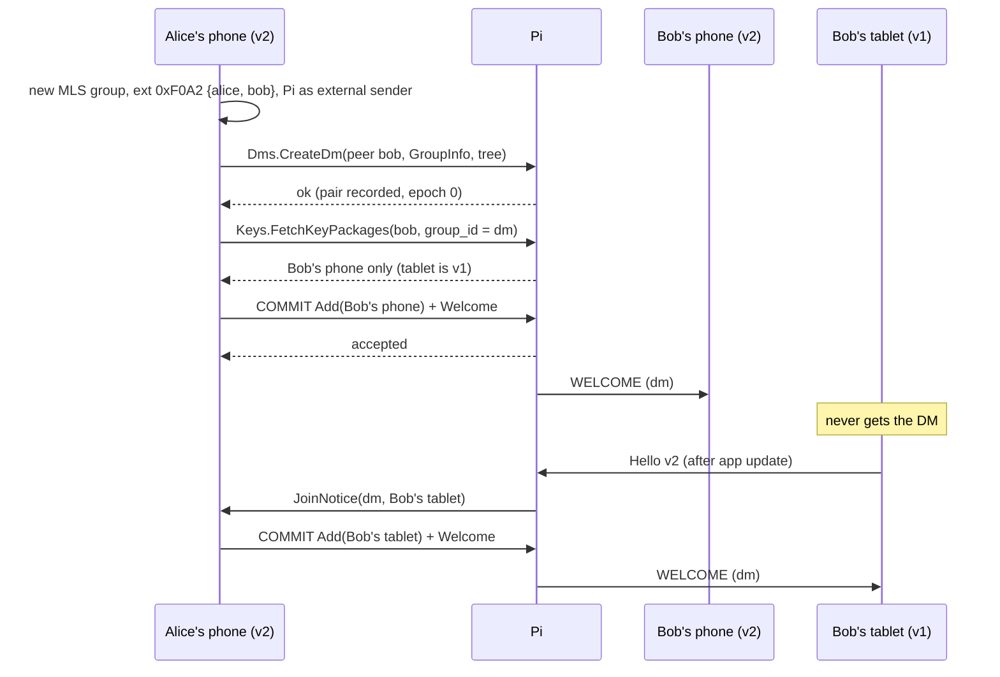

## Context

- **Today the Pi and the core assume one group.**
  - Pi: `mls_group` has a single row (`id = 1`). Members, public state and
    the commit log belong to that one group.
  - Core: the store holds one group (`store.group()`). The engine keeps one
    `MlsGroup`.
  - A Welcome is joined with `replace_old_group()`.
- **The wire already has room.** Every `Envelope`, `Ack`, `GapNotice`,
  `RemovedNotice`, `RejoinNotice` and `JoinNotice` carries a `group_id`.
- **The main group has an admin.** It is named in a `0xF0A1` group-context
  extension, and the commit authority rule depends on it.
- **Owner decisions (2026-11-17):**
  - Any member may DM any member.
  - The Pi may know the pairs.
  - The admin has no power over DMs; removing a user closes their DMs.
  - No block.

## Goals / Non-Goals

**Goals**
- DMs between any two members, end-to-end encrypted like the group.
- Every device of both users in the DM, kept there automatically.
- Old (version 1) apps keep working in the main group and never break.

**Non-goals**
- Blocking, muting one chat, leaving a DM.
- More group chats.
- History for new devices.
- Per-chat push text.

## Decisions

### D1. A DM is a 2-user MLS group

- **Members:** all devices of the two users.
- **Same machinery as the main group:**
  - external sender: the Pi
  - strict epoch rule, Welcome inside the commit, queues, acks, expiry
  - inactivity and leaf rotation
- **Why:** this reuses every rule already tested. The alternative, pairwise
  sealed messages inside the main group, would leak to the other members
  that a message exists, and would need a second encryption scheme.

### D2. DM group id: random 16 bytes; the Pi keeps one open DM per pair

- **Not a hash of the pair, as the doc sketched.**
  - The admin can reset a user: remove `bob@pi`, invite `bob@pi` again.
  - The old DM is then closed, and a new one must get a new id.
  - A hash of the pair would collide with the closed one.
- **The Pi stores the pair** (two usernames, sorted). It keeps
  `UNIQUE(user_a, user_b) WHERE closed_at IS NULL`.
- **Race:** Alice and Bob both open the DM at once.
  - The second `Dms.CreateDm` gets `created = false` and the open DM's
    group id. A plain response field, because gRPC error details are
    awkward to carry (changed from `ALREADY_EXISTS` while writing the
    proto).
  - That core drops its epoch-0 group and waits. The automatic add (D6)
    brings its devices in.

### D3. The DM extension in the group context

- **Extension type `0xF0A2`.** Data: the two user ids
  `<username>@<server_id>`, sorted, joined by `\n`. Defined once in
  `protocol::group_membership`.
- **A DM has no `0xF0A1` admin extension.**
- **The Pi checks on `CreateDm`:**
  - the extension names the caller's user and `peer`
  - the Pi is listed as external sender
  - the caller's device is the only member at epoch 0
- **Clients check on every Welcome and commit:** every leaf belongs to one
  of the two named users. A client refuses a DM Welcome that doesn't name
  its own user.

### D4. Commit authority in a DM (invariant change)

- **A member device of a DM may commit:**
  - an update of its own leaf
  - an Add of a device certified for **either** of the two users
  - a Remove of a device of its own user
  - a Remove the Pi issued as external sender
- **Nothing else.** In particular:
  - No admin override. The admin is not a member.
  - No third user, ever.
- **Who enforces it:** the Pi and every client, like the main-group rule.
- **The main-group rule is unchanged.**
- **Why both users may add the other's devices:** the creator must add the
  peer, and a re-add must work when only the peer is online.

### D5. Protocol version 2 and old apps

- **Spike S1 (done 2026-11-17, by reading the core at `app-v1.0.0+3` and
  `050e355`):** a version 1 core must never see anything of a DM.
  - **A DM Welcome:** `verify::check_welcome` requires the `0xF0A1` admin
    extension. A DM has none, so the core refuses the Welcome.
    `refuse_welcome` then shows "a change was refused" and queues
    `RequestReadd`, a needless re-add of itself to the main group.
  - **If it were accepted:** `set_group` overwrites the one `group_state`
    row (`id = 1`), so the main group would be lost.
  - **A DM application envelope:** the core decrypts it with its one
    group. That fails and shows "a message could not be read".
  - So the Pi must not queue DM envelopes, Welcomes included, for a
    version 1 device.
- **The rules:**
  - `PROTOCOL_VERSION = 2`; the Pi supports `[1, 2]`.
  - The Pi records each device's version from its last `Hello`.
  - A device that never connected counts as version 1.
- **The Pi enforces:**
  - `FetchKeyPackages` with `group_id` set to a DM returns only version 2
    devices of the pair.
  - A DM `COMMIT` that adds a version 1 device is rejected with
    `POLICY_VIOLATION`.
  - Nothing of a DM is ever queued for a version 1 device.
- **On upgrade:** a version 1 device that connects with version 2 becomes
  eligible, and D6 adds it.

### D6. Automatic add and re-add per group

- **`JoinNotice` for a DM:** the Pi sends `JoinNotice(group_id = dm)` to
  the DM's connected member devices for each device that:
  - is a non-revoked, version 2 device of either user
  - is not a member of that DM
  - is not inactive
- **The Pi sends it:**
  - after the device's first KeyPackage upload
  - on its first version 2 `Hello`
  - each time a member device of that DM connects
- **The first receiver adds it.** The race is the same as today:
  `STALE_EPOCH`, then it sees the device is a member and does nothing.
- **This covers:** the peer at creation, a newly linked device, and an app
  that just upgraded.
- **Inactivity:**
  - The inactivity state is per device, as today.
  - An inactive device gets an external Remove in **every** group it is in.
  - Its queue (all groups) is deleted.
- **`RejoinNotice(group_id)`:** sent per group to that group's member
  devices. For the main group it also goes to the admin's devices, as
  today.
- **Queue limit:** stays 1,000 entries per device, across all groups.

### D7. Closing a DM when a user is removed

- **`Admin.RemoveUser(bob)` stays one call.** Besides revoking Bob's
  devices, the Pi:
  - sets `closed_at` on every open DM with Bob
  - deletes their queued entries and public state
  - rejects later envelopes for them with `REJECTION_REASON_GROUP_CLOSED`
- **`DmClosed{group_id, closed_at}`** is sent to each of the other user's
  devices that was a member:
  - on every connect, until that device sends
    `Ack(group_id, server_seq = 0)` for it
  - this makes the notice durable without a queue entry
- **The core** marks the chat closed. The app shows it read-only with "Bob
  was removed".
- **No one commits** in a closed DM.

### D8. The Pi store

- **Migration `000N_groups.sql`:**
  - Rebuild `mls_group` without `CHECK (id = 1)`, keyed by `group_id`.
  - Add `kind` (`main` | `dm`), `dm_user_a`, `dm_user_b` and `closed_at`.
  - A partial unique index keeps exactly one `main`.
  - Add `group_id` to `mls_members`, the commit log and queue entries. The
    existing rows get the main group's id.
  - `mls_public_state` gains `group_id`, loaded and saved per group (S2).
- **Spike S2 (done 2026-11-17, by reading the code):** no key clash.
  - **Core:** `EncryptedStorage` slots are `label + serialized key`, and
    every group-scoped key contains the `GroupId`. Two `MlsGroup`s share one
    storage safely.
  - **Pi:** `membership::group` loads the whole `mls_public_state` table
    into one `MemoryStorage`, and on save deletes and rewrites all rows. So
    the table gets a `group_id` column, and each group is loaded and saved
    on its own: a save of one group never rewrites another. An end-to-end
    test with two groups confirms it (task 3.1).
  - `devices.protocol_version`.
- **Backup:** `backup.sh` and `deploy.sh` take a backup before the
  migration, as for every upgrade.

### D9. The core

- **Store migration:**
  - a `chats` table: `group_id`, `kind`, the peer for a DM, `closed_at`
  - `messages.chat_id`; existing rows go to the main chat
  - MLS state per group (already keyed by group id in the OpenMLS storage)
- **Engine:**
  - keeps a map of `group_id` to `MlsGroup`
  - routes each envelope by `group_id`
  - outbox, epoch retries, leaf rotation (jitter per group), acks and gap
    notices per group
  - Welcome joins use `replace_old_group()` only for the same group id
- **API:**
  - `chats()`, `open_dm(user) -> ChatId`
  - `send_message(chat, …)`, `history(chat, …)`
  - unseen mentions and unread per chat
  - events carry the `ChatId`
- **Mentions in a DM:** user mentions work unchanged. The core treats
  `everyone` in a DM like a mention of both users. The app does not offer
  it there.

### D10. The app

- **Home is a chat list:**
  - the main group pinned first
  - then DMs, newest message first
  - each with an unread dot and an `@ N` badge
  - closed DMs at the bottom, greyed
- **Opening a DM:** the members list and a member's sheet get a "Message"
  action. It opens the DM if one exists, else calls `open_dm`. The screen
  shows "waiting for Bob's devices" until the peer is added.
- **The DM screen** is the chat screen:
  - title = the peer's display name
  - no admin actions, no `@everyone` in the picker
  - read-only banner when closed

### D11. Push stays content-free

- **The ping and its text don't change:** the ping carries only the device
  and the token, and the text stays "New message".
- **Muting one chat is therefore impossible.** The phone can't tell which
  chat a ping is for until the app runs. iOS shows the alert from the
  payload without running the app.
- **Out of scope;** listed as an open question.

### D12. Nothing new leaves the device

- DM text, names and profiles travel only inside MLS application messages.
- **What the Pi learns** (accepted by the owner):
  - the pair
  - when the DM was created
  - envelope sizes and times per group, which it already sees for the main
    group

## Spikes (before code that relies on them)

- **S1:** done, see D5.
- **S2:** done, see D8.

## Risks / Trade-offs

- **KeyPackage use grows.** Each device joins up to one group per other
  member. Replenishment (below 5) and the last-resort KeyPackage already
  cover bursts. We watch `LowKeyPackages` in tests with 5 users.
- **A big refactor of one-group code** on both sides. Tests run per group
  for every existing rule (expiry, inactivity, re-add, rotation).
- **Metadata:** the Pi sees who talks to whom and when. The owner accepted
  this.
- **Pi first, app second:** a version 2 app needs a Pi that knows `Dms`. The
  app hides "Message" when `GetServerInfo` lists no version 2.

## Migration Plan

1. Deploy the Pi (backs up first). Version 1 apps keep working.
2. Release the app (owner step).
3. Devices that update get their DMs through D6.

**Rollback:** the Pi rollback restores the backup. DMs created since are
lost, and the main group is unaffected.

## Open Questions (owner)

1. **Mute per chat:** worth a later change where the ping carries an opaque
   per-device chat tag? That tells the Pi nothing new, but changes the push
   invariant.
2. **Leave a DM:** later, or never? Today a DM lives until a user is
   removed.
3. **Hide a DM** from the chat list on this device only (it comes back on a
   new message): in this change?
4. **Unread count on the app icon:** same question as in `mentions`.
