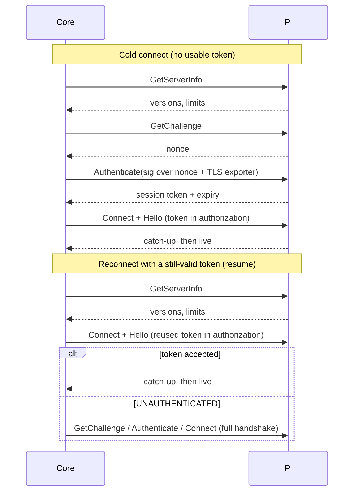

## Context

A device connects to the Pi over a pinned-TLS HTTP/2 channel and then, in
`client/src/engine/mod.rs::open_link`, does four round trips before messages
flow:

1. `Devices.GetServerInfo` — protocol versions, limits, external sender.
2. `Devices.GetChallenge` — a 32-byte nonce.
3. `Devices.Authenticate` — a signature over the nonce and this connection's
   TLS exporter; the Pi returns a session token and expiry.
4. `Messaging.Connect` — opens the stream, first frame `Hello`.

Over the US relay each round trip from India is ~0.5 s, so a cold connect spends
~1.5 s on steps 2–4 (the brief's "~3 round trips") before any traffic. Every
reconnect pays it again: a network blip, a server restart, waking from sleep.

The session token already exists (`SESSION_TOKEN_MAX_LIFETIME = 1 h`,
`TOKEN_RENEW_BEFORE = 5 min`). Today the core obtains one only through
`Authenticate` and throws it away on every disconnect (`drop_link` clears
`shared.session`), so each reconnect re-runs steps 2–3.

## Goals / Non-Goals

**Goals:**
- Cut reconnect latency by reusing a still-valid session token to skip
  `GetChallenge` and `Authenticate`, opening `Connect` directly.
- Fall back to the full handshake with no behaviour change when there is no
  usable token or the Pi rejects the token.
- Keep the wire contract backward-compatible (no proto change).

**Non-Goals:**
- Caching `GetServerInfo` across reconnects (D3 notes it as a later option).
- Changing token lifetime, renewal, or how a live connection renews.
- Any server behaviour change, relay change, or move of the relay (D4).

## Decisions

### D1: No proto change — the token is already connection-independent

The session token is a bearer token. `server/src/auth/mod.rs::AuthLayer` is a
tower layer in front of every service; on every RPC except the four
unauthenticated ones (`GetServerInfo`, `Register`, `GetChallenge`,
`Authenticate`) it reads `authorization: Bearer <token>`, looks it up by
SHA-256 in the `sessions` table (unexpired, device not revoked) and attaches the
`Caller`. `Messaging.Connect` is an authenticated path, and its handler takes
the caller straight from that layer (`let caller = caller(&request)?`). There is
**no per-connection challenge state**: the Pi never ties a token to the TLS
connection that minted it. The `sessions` row has no connection column.

So a token minted on connection A already authenticates `Connect` opened on a
new connection B. Resume needs the client to keep the token across a drop and
re-send it — nothing on the wire or the Pi changes.

The brief anticipated a `.proto` edit, `pbgen`, and a server change. On reading
the code none is needed (CLAUDE.md workflow rule 5: fix the understanding in the
spec/design, record why here). `buf breaking` is therefore trivially clean, and
`server/src/pb.rs`, `server/tests/support/pb.rs` and `client/src/pb.rs` are
untouched.

**Alternative considered:** add a `resume` hint to `Hello` or a dedicated field
so the Pi could distinguish a resumed open. Rejected: the Pi already accepts the
token with no hint, and the project's rule is that no wire message exists that
is not needed (wire-transport: Protobuf contract is the source of truth).

### D2: Resume only a token that is not yet due for renewal; fall back on rejection

`open_link` gains a resume branch before the full handshake:

- The engine keeps the current token across drops in `self.resume` (a
  `ResumeToken { token, expires_at, renew_at }`), set whenever a token is
  obtained or renewed, and cleared only when the device is removed. `drop_link`
  no longer being the end of the token is the whole point, so it does **not**
  clear it.
- On reconnect, if `self.resume` is present and `now < renew_at` (the token is
  still valid with the full renewal margin left), the core re-binds it to the
  new connection (`Conn::resume`) and opens `Connect` with it.
  - Accepted → connected in one fewer pair of round trips.
  - `UNAUTHENTICATED` from the stream open → the token is gone on the Pi (evicted,
    or clock skew at the boundary); the core falls through to the full handshake
    in the same attempt, which mints a fresh token.
  - Any other transport error → treated as a connect failure, as today.
- With no usable token (first connect, or `now >= renew_at`) the core runs the
  full handshake directly. Using `renew_at`, not `expires_at`, as the cutoff
  means a resumed token never lands already due for renewal.

Revocation still works through the fallback: a revoked device's token is gone
from `sessions`, so resume gets `UNAUTHENTICATED`, falls back to the full
handshake, and `Authenticate` answers `PERMISSION_DENIED` → `removed()`
(client-runtime: Connection lifecycle, "Revoked device"). The existing
`PERMISSION_DENIED` paths in `connect()` are unchanged.

### D3: `GetServerInfo` still runs each reconnect; token reuse is within the security model

Resume keeps `GetServerInfo` on reconnect because `Hello` needs the negotiated
protocol version and `pi_knows_dms` is read from it. So a resumed reconnect is
two round trips (`GetServerInfo` + `Connect`), a cold one four; the two saved
are exactly `GetChallenge` + `Authenticate`, as the brief asked.

**Security.** Reusing an already-minted token on a new connection does not widen
the model. The token already travels over pinned TLS and the Pi already accepts
it on any connection for every other RPC. The TLS-exporter binding in
`Authenticate` protects the *challenge signature* — it stops a signature from
being replayed on another connection to mint a token — not the token itself,
which is a bearer credential held only in the core's memory. Resume adds no new
place the token is stored or sent.

**Later option (not in this change):** cache `GetServerInfo` across reconnects
within an engine run to make a resumed reconnect a single round trip, with a
fallback that re-fetches it if `Connect` closes with `FAILED_PRECONDITION`
(version no longer supported). Left out to keep this change to the token.

### D4: Relay region — an open decision for the owner (recorded, not acted on)

The single biggest reconnect-latency win is not this change. Each round trip is
~0.5 s because the relay is a GCP `e2-micro` in the US (`us-east1-b`,
`vyajarelay.purplechaamba.com`). Moving it to India (`asia-south1`, Mumbai)
would cut each round trip to tens of milliseconds — larger than removing two
round trips here — but `asia-south1` is **not** in the GCP always-free tier, so
the VM would cost roughly $8–12/month, or a small Mumbai VPS instead.

This is an owner decision (cost vs. latency) touching `deploy/relay/`. This
change does **not** touch `deploy/relay/`, run any `gcloud`, or change the relay
region. Recorded here for the owner to decide separately.

## Risks / Trade-offs

- [A resumed token is rejected right at the renewal boundary] → The cutoff is
  `renew_at` (5 min of margin), not `expires_at`, so a resumed token always has
  time left; a boundary rejection still falls back to the full handshake in the
  same attempt, costing the two round trips it would have cost anyway.
- [A dead-but-unexpired token wastes one stream-open per reconnect while the
  backoff loop runs] → Narrow window (only if the Pi evicted the token or under
  clock skew); each wasted attempt immediately falls back and succeeds, and a
  successful connect overwrites `self.resume`.
- [Resume could mask a revoked device if `Connect` returned `PERMISSION_DENIED`
  instead of `UNAUTHENTICATED`] → It does not: a revoked device's token is
  deleted, so the Pi returns `UNAUTHENTICATED` on lookup; the fallback reaches
  `Authenticate`, which is where `PERMISSION_DENIED` is raised. Covered by a
  test.

## Migration Plan

Client-only, backward-compatible. Older cores keep doing the full handshake; the
Pi is unchanged, so new and old cores interoperate with any Pi. No data
migration, no deploy step. Rollback is reverting the client commit.

## Open Questions

- D4 (relay region) is the owner's to decide; out of scope here.
