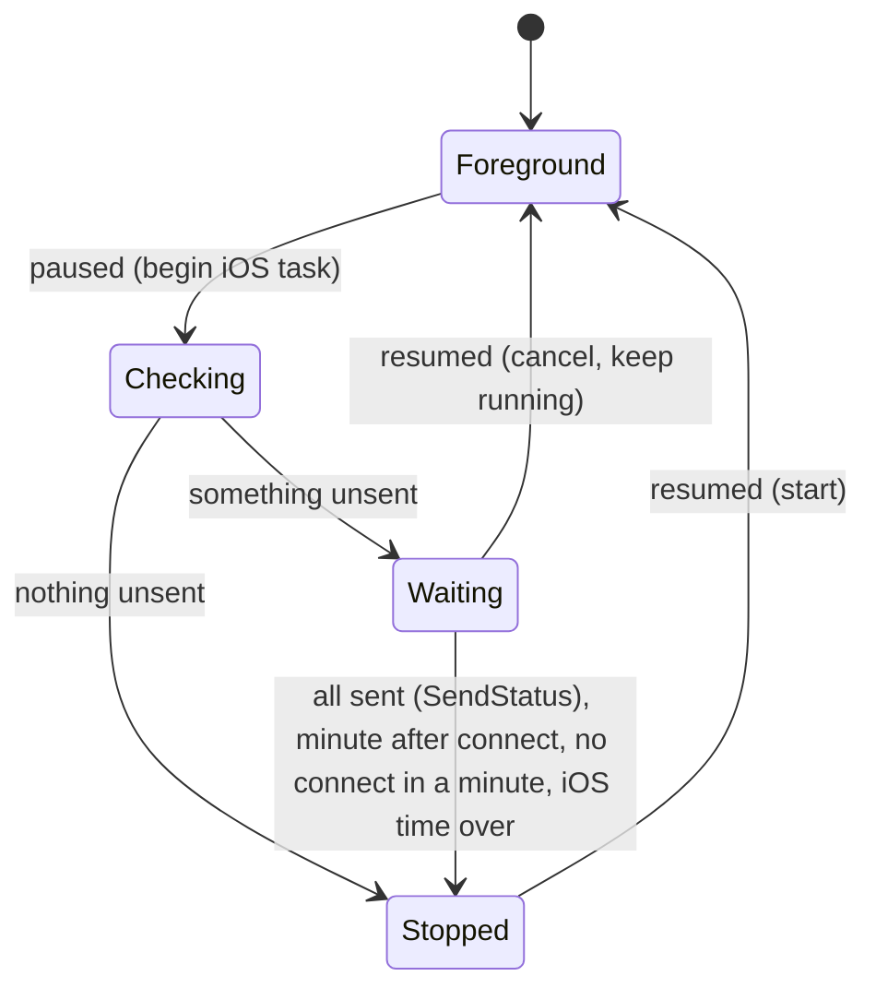

## Context

`app/lib/app/lifecycle.dart` stops the core on pause and starts it on resume (flutter-app
D9): no socket survives a suspended app and a fresh start reconnects and catches
up. The cost: a message still ⏳ when the user leaves is queued (stored, resent
unchanged later) until the next open.

## Decisions

### D1: A grace period in the lifecycle widget, driven by core events

On pause the app calls `hasUnsent()`. While waiting it listens to `SendStatus`
events (accepted or failed) and re-asks; to the connection state to start the
60 s timer at the first `connected`; and to a 60 s timer for a connection that
never comes. Whichever ends first stops the core and ends the iOS task.

### D2: The minute starts at the connection (owner), plus a connect cap (mine)

The owner's rule: one minute, counted from the successful connection. A phone with
no signal would then wait forever, so a separate 60 s cap on getting connected is
added. The owner can change either constant (`kBackgroundSendLimit`,
`kBackgroundConnectWait`).

### D3: iOS gives about 30 s, not 60

`UIApplication.beginBackgroundTask` grants a short window (about 30 s on current
iOS). The app asks for it when it pauses, ends it when the wait is over, and on
expiry (the system's callback) stops the core immediately. On iOS the effective
limit is therefore min(60 s, what the system grants). Android keeps running for a
while after the app is backgrounded (no foreground service is added, by design:
battery); it may also be frozen sooner. In both cases the message is still safe:
anything left is resent on the next open, unchanged and idempotent.

### D4: One new core call

`Client::has_unsent()` is `outgoing_in_flight()` non-empty (the store query that
already lists own messages with status `sending`, which includes image messages
whose upload is not done). It is exposed as `Core.has_unsent()`
(sync, like `history`) and `CoreService.hasUnsent()`. No proto change.

## Risks / Trade-offs

- [Keeping the connection a minute costs a little battery per leave] → only when
  something is unsent, and never longer than a minute.
- [The OS freezes the app before the send finishes] → nothing lost: queued messages
  resend on open.
- [The iOS native piece is not compiled in this change's tests] → written small,
  flagged in tasks; verify on a device before releasing.

## Migration Plan

App build only. Rollback: revert; the lifecycle returns to stop-at-once.

## Open Questions

None.
