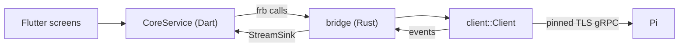

## Context

The Pi (`server/`) and the device core (`client/`, archived change client-core)
are done: 267 tests, all against a real Pi in-process. `client::Client` is a
plain-type async API with one ordered event stream, made for a UI to sit on. Its
`KeyStore` trait has OS keychain (desktop), opt-in file and memory stores; the
Android Keystore and iOS Keychain stores were left for this change. The owner
skipped the terminal client (2026-11-11), so this app is the first hand-run chat.
The toolchain is on the owner's Mac: Flutter 3.44.4, Dart 3.12, Xcode 27.2, the
Android SDK, `flutter_rust_bridge_codegen` 2.12, and the Rust iOS and Android
targets.

## Goals / Non-Goals

**Goals:** two people chat by hand on an iOS Simulator and an Android emulator
against a local Pi; every app-ui requirement has a test; the look stays very light.

**Non-Goals:** desktop builds, real push (FCM / APNs), QR codes, Q&A verification,
store releases, the relay.

## Decisions

### D1. Layout

```
app/                    Flutter project, iOS + Android only
  lib/main.dart
  lib/core/             CoreService: the one Dart door to the bridge (+ a fake for tests)
  lib/<feature>/        onboarding, chat, members, profile, devices, admin
  lib/src/rust/         generated Dart bindings (committed)
  test/                 widget tests against the fake core
  integration_test/     app on a simulator against a real local Pi
bridge/                 Rust crate in the workspace: wraps client::Client
  src/api/              functions and plain types exposed to Dart
  src/frb_generated.rs  generated (committed)
  tests/                Rust tests of the bridge API
```

Folders follow features, as on the Pi and in the core. Tests stay out of `lib/`
(Dart's own convention matches the owner's rule).

### D2. Bridge

- `bridge` holds no logic: each function forwards to `client::Client`, mapping
  types and errors. One `Client` and one tokio runtime per app process.
- Events reach Dart through one frb `StreamSink`, in the core's order.
- The generated Rust and Dart files are committed and regenerated locally by
  `flutter_rust_bridge_codegen generate` (one command, listed in `CLAUDE.md`),
  never in CI. CI only checks that the committed files build.
- `forbid(unsafe_code)` in `bridge/src/api/`; the generated FFI file is the
  isolated exception the config allows.



### D3. State in Dart

Very light: `CoreService` turns the event stream into `ValueNotifier`s and
streams; screens use `ValueListenableBuilder` / `StreamBuilder`. No Riverpod,
Bloc or routing package; `Navigator` with a few named routes.

### D4. Phone key stores

They implement the existing `KeyStore` trait in `client/src/keystore/`, so keys
never cross into Dart (invariant). Candidates, settled by spikes 1.1 and 1.2:

- **iOS:** `keyring`'s Apple-native store (the same crate as on macOS), with
  `kSecAttrAccessibleWhenUnlockedThisDeviceOnly`.
- **Android:** a `keyring`-compatible Android store crate if one works; otherwise
  JNI from Rust: an Android Keystore AES-GCM key that seals the secrets, kept in
  the app's private files. Passing keys through a Dart plugin is not an option.

### D5. Invites and links by text

Invites, link requests and approvals move as text (copy, paste, share sheet). The
core already encodes them as bytes; the bridge adds a text form (base64url with a
short prefix). QR codes come later.

### D6. Local testing

- The iOS Simulator reaches the Mac's `127.0.0.1:8443` directly.
- The Android emulator reaches it after `adb reverse tcp:8443 tcp:8443`, so the
  invite's `127.0.0.1:8443` works unchanged.
- Integration tests start their own Pi in a temp folder, never with
  `server/local.toml`, and run on both simulators.

### D7. Tests

- Widget tests in `app/test/` use a fake `CoreService`, tagged
  `// spec: app-ui/<title-slug>`.
- Bridge tests in `bridge/tests/` drive the bridge API against a real in-process
  Pi (reusing the client test approach).
- `integration_test/`: the app on a simulator chats with a second member that
  the test drives through the core directly, end to end against a temp Pi.
- "UI goes through the core" is checked by a test that scans `app/lib/` imports.
- CI gains `flutter analyze` and `flutter test` (widget tests); simulators stay
  local.

### D8. Look

Material 3, `ColorScheme.fromSeed(seedColor: <muted slate>, dynamicSchemeVariant:
DynamicSchemeVariant.neutral)`, `ThemeMode.system`, stock widgets, system font.
The seed is one constant the owner can change.

### D9. Lifecycle

`AppLifecycleListener`: on resume, the core reconnects and catches up (it already
reconnects with backoff); the app shows a small connected / connecting indicator.
Background execution and wake-on-push wait for real push.

## Risks / Trade-offs

- [Android Keystore from Rust may need JNI] → spike 1.1 first; JNI glue lives
  isolated in the keystore module.
- [frb build integration on both platforms (cargokit) may fight the workspace] →
  spike 1.3 builds a one-function bridge on both simulators first.
- [Plaintext in Dart memory] → only to show it; nothing written or logged
  (app-ui: UI goes through the core), invariant reworded with the owner's OK.
- [macOS rebuilds trigger keychain dialogs] → not on phones; simulators use their
  own keychains.

## Migration Plan

None: new code only. The owner's local Pi data in `server/.pi-local/` keeps
working; the app joins with a new invite.

## Open Questions

None open. Resolved by the owner (2026-11-11): the invariant rewording above;
iOS and Android only (#3), real push with deployment, Q&A verification right
after this change; the terminal client stays in the build order, after
deployment. The seed colour is a muted slate constant the owner can change (D8).
