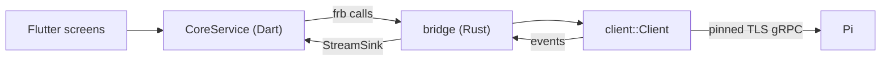

## Context

The Pi (`server/`) and the device core (`client/`, archived change client-core)
are done: 267 tests, all against a real Pi in-process. `client::Client` is a
plain-type async API with one ordered event stream, made for a UI to sit on. Its
`KeyStore` trait has OS keychain (desktop), opt-in file and memory stores; the
Android Keystore and iOS Keychain stores were left for this change. The owner
skipped the terminal client (2026-11-11), so this app is the first hand-run chat.
The toolchain is on the owner's Mac: Flutter 3.44.4, Dart 3.12, Xcode 27.2, the
Android SDK, `flutter_rust_bridge_codegen` 2.12, and the Rust iOS and Android
targets.

## Goals / Non-Goals

**Goals:** two people chat by hand on an iOS Simulator and an Android emulator
against a local Pi; every app-ui requirement has a test; the look stays very light.

**Non-Goals:** desktop builds, real push (FCM / APNs), QR codes, Q&A verification,
store releases, the relay.

## Decisions

### D1. Layout

```
app/                    Flutter project, iOS + Android only
  lib/main.dart
  lib/core/             CoreService: the one Dart door to the bridge (+ a fake for tests)
  lib/<feature>/        onboarding, chat, members, profile, devices, admin
  lib/src/rust/         generated Dart bindings (committed)
  test/                 widget tests against the fake core
  integration_test/     app on a simulator against a real local Pi
bridge/                 Rust crate in the workspace: wraps client::Client
  src/api/              functions and plain types exposed to Dart
  src/frb_generated.rs  generated (committed)
  tests/                Rust tests of the bridge API
```

Folders follow features, as on the Pi and in the core. Tests stay out of `lib/`
(Dart's own convention matches the owner's rule).

**App id (owner, 2026-11-12): `com.purplechaamba.vyajena`** (the owner owns
purplechaamba.com), replacing session A's `dev.vyajena2.vyajena`: the Android
`namespace`, `applicationId` and the Kotlin package of `MainActivity`; the iOS
`PRODUCT_BUNDLE_IDENTIFIER` (and `.RunnerTests`). The Dart package stays
`vyajena`. The owner also kept `freezed` as session A set it up (D2).

**As built (task 4.1).**

- `lib/core/core_service.dart`: `CoreService`, an abstract class with the
  shared state (`state`, `connection`, `user` as `ValueListenable`s; one
  broadcast `events` stream in the core's order) and one method per core
  call, including the sync `parseInvite` and `textFits`, so widget tests
  never load Rust. It re-exports the bridge's plain types and `CoreError`;
  screens import only it. `lib/core/rust_core_service.dart` is the real one
  (the only file besides `main.dart` that touches the bridge's `Core`);
  `lib/core/event_label.dart` names an event for debug logs without its
  text.
- The fake is test support, so it lives in
  `test/support/fake_core_service.dart`, not `lib/core/`: tests stay out of
  `lib/`. Tests push events with `emit` and read the calls made.
- `lib/app/`: the shell (`VyajenaApp`, `HomeScreen`), the theme (D8), the
  lifecycle (D9) and the connection indicator. `HomeScreen` shows only the
  core's state (opening, failed, not joined, `user@server`) until the
  feature folders `onboarding`, `chat`, `members`, `profile`, `devices`,
  `admin` arrive with their screens (tasks 5.1–5.5); empty folders are not
  committed.
- `cupertino_icons` was removed (an icon font; the look uses Material icons
  only), and the main Android manifest gained the `INTERNET` permission that
  `flutter create` puts only in the debug and profile manifests: the core
  needs it in release builds.

### D2. Bridge

- `bridge` holds no logic: each function forwards to `client::Client`, mapping
  types and errors. One `Client` and one tokio runtime per app process.
- Events reach Dart through one frb `StreamSink`, in the core's order.
- The generated Rust and Dart files are committed and regenerated locally by
  `flutter_rust_bridge_codegen generate` (one command, listed in `CLAUDE.md`),
  never in CI. CI only checks that the committed files build.
- `forbid(unsafe_code)` in `bridge/src/api/`; the generated FFI file is the
  isolated exception the config allows.

**Spike 1.3 result (2026-11-11): works on both.** A one-function frb 2.12.0
crate in a mini workspace laid out like this repo (`Cargo.toml` workspace,
`bridge/`, `app/`) ran on the iOS Simulator (iPhone 16, iOS 26.5 runtime) and
the Android emulator (API 35, arm64): an `async fn` with a `StreamSink<String>`
spawned a tokio task whose timer ticks reached Dart in order, and the stream
closed when the sink was dropped.

- Runtime: frb's default handler runs every non-`sync` function on its own
  tokio multi-thread runtime (`Runtime::new()`, all drivers), so `tokio::spawn`,
  timers and sockets work inside bridge functions. That is the one runtime per
  process (D2); the bridge creates none of its own.
- Setup: `flutter create --platforms ios,android` then
  `flutter_rust_bridge_codegen integrate --rust-crate-name bridge
  --rust-crate-dir ../bridge`; `flutter_rust_bridge.yaml` holds
  `rust_input: crate::api`, `rust_root: ../bridge/`, `dart_output:
  lib/src/rust`. It adds `app/rust_builder/` (a Flutter FFI plugin wrapping
  cargokit, which runs `cargo build` on `../../../bridge` from Xcode and
  Gradle). Edition 2024 works for the generated Rust.
- Fixes the generated scaffolding needs (Flutter 3.44.4, Xcode 27.2, Gradle
  9.1, AGP 9.0.1, Kotlin 2.3.20, NDK 28.2):
  - iOS deployment target 15.0 everywhere (Xcode 27.2 refuses 13.0):
    `ios/Podfile` `platform :ios, '15.0'` plus a `post_install` that sets
    `IPHONEOS_DEPLOYMENT_TARGET` on every pod, the Runner project, and
    `rust_builder/ios/bridge.podspec` (generated as 11.0).
  - `rust_builder/cargokit/gradle/plugin.gradle` calls `project.exec`, which
    Gradle 9 removed: inject `ExecOperations` (`@Inject abstract
    ExecOperations getExecOperations()`) and call `execOperations.exec`.
  - `rust_builder/android/build.gradle`: `compileSdkVersion 36` (androidx
    needs at least 34), `minSdkVersion 24` (Flutter's default).
  - Delete `rust_builder/{linux,macos,windows}` and their pubspec entries
    (iOS and Android only).
- Xcode 27.2's `lipo -verify_arch` takes one architecture, so
  `flutter build ios --simulator` (arm64 + x86_64) fails in Flutter's own
  `debug_unpack_ios`, even for a plain Flutter app. `flutter run -d <simulator>`
  builds the active architecture only and works; use it (and
  `flutter test integration_test -d <simulator>`) locally.
- Dart's `print`/`debugPrint` reaches the console only under `flutter run`;
  an app relaunched with `simctl launch` logs nothing visible, so restart
  checks read the screen or `adb logcat`.

**As built (tasks 2.1–2.3).**

- `bridge/src/api/core.rs`: one frb opaque `Core` wrapping `client::Client`
  (Dart: `Core.open(dataDir:)`, then methods named after the core's). The key
  store comes from `client::keystore::open_key_store` with profile `app`, so
  the phone stores of tasks 3.1–3.2 plug in there without a bridge change.
  `Core::events(sink)` hands the core's one `EventStream` to a tokio task that
  forwards every event to the `StreamSink` in order (a second call fails with
  `EventsTaken`). `open_with(ClientConfig)` and `next_event()` are
  `#[frb(ignore)]`: Rust-only, for `bridge/tests` (a `StreamSink` needs a Dart
  port).
- Plain types in `api/types.rs`: times as Unix milliseconds, device ids as hex,
  message ids as the core's `i64`. Errors are one `CoreError { kind, message }`
  that Dart throws; `kind` keeps apart what the app shows differently
  (`ServerIdentity` vs `Network`, `InvalidPayload`, `TooLong`, `Refused` for
  gRPC refusals, ...). Non-exhaustive core enums map their unknown variants to
  `CoreEvent::Other`, `ChatBody::Unsupported` and `Disconnected`.
- Rust enums with fields (`CoreEvent`, `SendState`, `ChatBody`) become Dart
  `sealed` classes, which frb 2.12 builds with `freezed`: the app depends on
  `freezed_annotation`, with `freezed` and `build_runner` as dev
  dependencies, and the generated `types.freezed.dart` is committed with the
  other bindings. Screens `switch` over them exhaustively.
- `flutter_rust_bridge.yaml` sets `web: false` (no `frb_generated.web.dart`).
  `src/frb_generated.rs` is included with `#[rustfmt::skip]` and clippy
  allows, like `pb.rs`; `api/` has `#![forbid(unsafe_code)]`.
- The real `app/` with this bridge (client, OpenMLS, SQLite) builds from the
  workspace with `flutter build apk --debug` (cargokit builds `bridge` for
  arm64, x86 and x86_64 Android) and launches on the API 35 emulator.
- Tests: `bridge/tests/support` includes `client/tests/support/{pi,relay}.rs`
  by `#[path]`, so the in-process Pi has one copy.
- The `client` crate does not build for iOS yet: `keyring`'s default `v1`
  feature enables `apple-native-keyring-store/keychain`, which refuses iOS
  without `protected` (task 3.1 adds it). Android builds.



### D3. State in Dart

Very light: `CoreService` turns the event stream into `ValueNotifier`s and
streams; screens use `ValueListenableBuilder` / `StreamBuilder`. No Riverpod,
Bloc or routing package; `Navigator` with a few named routes.

### D4. Phone key stores

They implement the existing `KeyStore` trait in `client/src/keystore/`, so keys
never cross into Dart (invariant). Candidates, settled by spikes 1.1 and 1.2:

- **iOS:** `keyring`'s Apple-native store (the same crate as on macOS), with
  `kSecAttrAccessibleWhenUnlockedThisDeviceOnly`.
- **Android:** a `keyring`-compatible Android store crate if one works; otherwise
  JNI from Rust: an Android Keystore AES-GCM key that seals the secrets, kept in
  the app's private files. Passing keys through a Dart plugin is not an option.

**Spike results (2026-11-11): both work from Rust, keys never in Dart.** A
bridge function got or created a 32-byte secret in the phone store and
returned only "created/existing" and a SHA-256 fingerprint; after the app was
killed and relaunched it reported "existing" with the same fingerprint.

- `keyring` 4.2's `Entry` (its `v1` default API, what `OsKeychain` uses)
  refuses iOS and Android (`NoDefaultStore`): it sets a default store only on
  macOS, Windows and Linux. The phone stores therefore use `keyring-core` 1.0
  and the store crates directly: `store.build(service, user, modifiers)`
  returns a `keyring_core::Entry` with `get_secret`, `set_secret` and
  `delete_credential` (`NoEntry` for missing), the same shape as today.
- **iOS (spike 1.2): `apple-native-keyring-store` 1.0.2 with feature
  `protected`** (the data-protection keychain; the crate refuses to build on
  iOS without it). `protected::Store::new()`, then `build("vyajena2",
  "<profile>/<key>", {"access-policy": "WhenUnlockedThisDeviceOnly"})`. The
  stored item reads back `kSecAttrAccessible = aku`
  (`WhenUnlockedThisDeviceOnly`) and not synchronizable. It persisted across an
  app restart on the iOS 26.5 Simulator; no entitlement was needed (default
  app access group). Note: `keyring`'s own `v1` feature turns on
  `apple-native-keyring-store/keychain` for every Apple target, so the core
  must enable `protected` on iOS or `client` does not build there.
- **Android (spike 1.1): `android-native-keyring-store` 1.0.0 works**, so no
  JNI of our own. It keeps each secret in an app-private SharedPreferences file
  (`shared_prefs/keyring-default.xml`), AES-GCM-sealed under a non-exportable
  Android Keystore AES key (12-byte IV + ciphertext + tag, base64); the prefs
  hold ciphertext only. It persisted across a force-stop and relaunch on the
  API 35 emulator.
  - It needs the `ndk-context` crate initialised with the app's Context
    before the first store call. The crate exports the JNI function
    `Java_io_crates_keyring_Keyring_00024Companion_initializeNdkContext` from
    whatever `cdylib` links it (here `libbridge.so`), so the app adds a Kotlin
    class `io.crates.keyring.Keyring` whose companion does
    `System.loadLibrary("bridge")` and declares `external fun
    initializeNdkContext(context: Context)`, and `MainActivity.onCreate`
    calls it with `applicationContext` before `super.onCreate`. Dart's
    `DynamicLibrary.open` then gets the same loaded library, so the context is
    there for every bridge call. This Kotlin is platform glue only; no key
    crosses it.
  - The store logs entry names (never secrets) at debug level through
    frb's `android_logger`; release builds log at info.

**As built (tasks 3.1, 3.2).**

- `client/src/keystore/phone.rs`: `PhoneKeyStore`, one `keyring-core`
  entry per key (service `vyajena2`, user `<profile>/<key name>`, as on
  desktop), with the entry naming, the "no entry" mapping and an
  availability probe shared by both phones. `ios_keychain` builds it on
  `apple-native-keyring-store::protected::Store` with modifier
  `access-policy = WhenUnlockedThisDeviceOnly`; `android_keystore` on
  `android-native-keyring-store::Store` named `vyajena2` (prefs file
  `keyring-vyajena2`). `open_key_store` picks it on `target_os = "ios"` /
  `"android"`, `OsKeychain` elsewhere; the selection rule
  (`choose_key_store`) is unchanged. `KeyStoreKind` gained `IosKeychain`
  and `AndroidKeystore`.
- The store crates are target dependencies of `client` (iOS with
  `protected`, which also makes `keyring`'s `keychain` feature build there);
  `keyring-core` is a plain dependency, so host tests drive `PhoneKeyStore`
  with `keyring_core::mock::Store` (`client/tests/key_storage.rs`: round
  trip, entry names, profiles apart, a store that does not answer is
  `NoKeychain`, store failures are `Keychain` errors).
- Android: without the `ndk-context` init the native store panics; the
  constructor catches that and reports `NoKeychain` naming the missing
  `MainActivity` call. `MainActivity.onCreate` calls
  `io.crates.keyring.Keyring.initializeNdkContext(applicationContext)`
  before `super.onCreate` (`android/app/src/main/kotlin/io/crates/keyring/Keyring.kt`).

**How the real stores were checked (2026-11-12).** Each phone ran the real
app (`com.purplechaamba.vyajena`, debug) against its own temporary Pi
(`target/debug/server` with a config in a temp folder, never
`server/local.toml`), through a throwaway entry point that registered from
the Pi's bootstrap invite (deleted, never committed). Then the app was killed
and started again from the launcher with the normal `main.dart` path, which
opens the core, loads the device keys from the key store and starts: the
screen showed `alice@pi` and the indicator Connected, so the Pi accepted a
login signed with the device auth key read back from the phone store.

- iOS Simulator (iPhone 16, iOS 26.5): registered, killed (`flutter run`
  stopped), relaunched with `simctl launch`: `alice@pi`, Connected. The
  simulator's keychain database held four items in access group
  `FAKETEAMID.com.purplechaamba.vyajena` with `pdmn = aku`
  (`WhenUnlockedThisDeviceOnly`) and `sync = 0`. The data folder
  `Application Support/core` carried the backup-exclusion attribute
  (`com.apple.metadata:com_apple_backup_excludeItem`). The Simulator has no
  data protection, so `NSFileProtectionComplete` is checked in code only
  (D10).
- Android emulator (API 35, arm64, `adb reverse` to the Pi's port):
  registered, `am force-stop`, relaunched with `am start`: `alice@pi`,
  Connected. `shared_prefs/keyring-vyajena2.xml` held four entries
  `app/<key name>` with base64 ciphertext only; the database was in
  `no_backup/core`; `dumpsys package` showed no `ALLOW_BACKUP` flag.
- The app was uninstalled from the emulator afterwards; both devices and
  both Pis were shut down.

### D5. Invites and links by text

Invites, link requests and approvals move as text (copy, paste, share sheet). The
core already encodes them as bytes; the bridge adds a text form (base64url with a
short prefix). QR codes come later.

As built: `vyajena-invite:`, `vyajena-link:` and `vyajena-approval:`, each
followed by base64url without padding (`bridge/src/api/text.rs`). Text
without a prefix is accepted too, because the Pi prints its bootstrap invite
bare and the admin pastes that on their first device; text with another
kind's prefix is refused naming what it is ("this is a link approval, not an
invite"). `parse_invite` (sync) returns the user and relay address to show
before joining.

### D6. Local testing

- The iOS Simulator reaches the Mac's `127.0.0.1:8443` directly.
- The Android emulator reaches it after `adb reverse tcp:8443 tcp:8443`, so the
  invite's `127.0.0.1:8443` works unchanged.
- Integration tests start their own Pi in a temp folder, never with
  `server/local.toml`, and run on both simulators.

### D7. Tests

- Widget tests in `app/test/` use a fake `CoreService`, tagged
  `// spec: app-ui/<title-slug>`.
- Bridge tests in `bridge/tests/` drive the bridge API against a real in-process
  Pi (reusing the client test approach).
- `integration_test/`: the app on a simulator chats with a second member that
  the test drives through the core directly, end to end against a temp Pi.
- "UI goes through the core" is checked by a test that scans `app/lib/` imports.
- CI gains `flutter analyze` and `flutter test` (widget tests); simulators stay
  local.

### D8. Look

Material 3, `ColorScheme.fromSeed(seedColor: <muted slate>, dynamicSchemeVariant:
DynamicSchemeVariant.neutral)`, `ThemeMode.system`, stock widgets, system font.
The seed is one constant the owner can change.

As built: `seedColor = Color(0xFF5E6B78)` in `lib/app/theme.dart`, with
`lightTheme`, `darkTheme` and `themeMode`.

### D9. Lifecycle

`AppLifecycleListener`: on resume, the core reconnects and catches up (it already
reconnects with backoff); the app shows a small connected / connecting indicator.
Background execution and wake-on-push wait for real push.

As built (task 4.2): `CoreLifecycle` (`lib/app/lifecycle.dart`) stops the
engine on `onPause` (the app is in the background) and starts it again on
`onResume`, so the core reconnects at once instead of waiting out its
backoff, and catches up in order; a short `inactive` (a notification shade,
a call banner) changes nothing. `CoreService.open` starts the core when the
device has a user. The indicator in the app bar shows Connected, Connecting…
or Offline from `CoreEvent.connection`.

### D10. Data on the phone

As built (task 4.2). The core's data folder comes from the platform over one
method channel, `vyajena/platform` `dataDir`, so Dart never picks a path:

- **iOS** (`AppDelegate.swift`): `Application Support/core`, marked
  `isExcludedFromBackup`, with `NSFileProtectionComplete` on the folder and
  on every file already in it at each start; files the core creates later
  inherit the folder's class. No data-protection entitlement, so no
  provisioning change. Consequence: about ten seconds after the phone locks
  the database cannot be opened; the engine is stopped in the background
  anyway (D9), and a received message that could not be stored is not
  acked, so the Pi redelivers it.
- **Android** (`MainActivity.kt`): `noBackupFilesDir/core`, which Android
  never backs up, plus `allowBackup="false"`, `fullBackupContent="false"`
  and `dataExtractionRules` excluding every domain from cloud backup and
  device-to-device transfer (Android 12+ ignores `allowBackup` for
  transfers).
- Keys are not in these folders: the iOS Keychain and the Android Keystore
  hold them (D4). Widget tests read these settings from the project files
  (`test/app/data_on_the_phone_test.dart`).

### D11. Automatic add of new users (tasks 4.3–4.5)

```mermaid
sequenceDiagram
  participant B as Bob's phone
  participant P as Pi
  participant A as Admin's phone
  B->>P: Devices.Register, then Keys.UploadKeyPackages
  P-->>A: JoinNotice {group_id, Bob's phone} (if connected)
  Note over A: on every connect too, until Bob's phone is a member
  A->>P: Keys.FetchKeyPackages(bob, [Bob's phone])
  Note over A: verify certificate, pin bob's key on first sight
  A->>P: COMMIT (Add) + Welcome
  P-->>B: WELCOME
  Note over B: JoinedGroup; the app leaves "waiting"
```

As built:

- Proto: `ServerFrame.join_notice = 8`, `JoinNotice { group_id, device }`
  (`buf breaking` clean).
- **When "on registration" fires:** the signup registers, then uploads
  KeyPackages in the same `register` call. A notice sent at
  `Devices.Register` would reach the admin before there is a KeyPackage to
  fetch, so the Pi sends it after the device's KeyPackage upload
  (`keys/mod.rs`), and only for devices that have KeyPackages. The admin's
  connect-time notices (`messaging/stream.rs`) follow the same rule.
- **"Never been a group member"** is a new column `devices.was_member`
  (migration 0004, back-filled from `mls_members` and `inactive_devices`),
  set whenever the member list is rebuilt after a commit. A device waits
  (`membership/joins.rs`) when it is not revoked, was never a member, its
  user is not removed and has no non-revoked member device, and it has
  KeyPackages. So a linked device of a member, an inactive device (RejoinNotice
  path) and a removed user are never announced; a reset user's new phone is.
- Recipients: the admin's member devices that are not revoked or inactive
  and have an open stream.
- Core (`engine/mod.rs`, `engine/jobs.rs`): `JoinNotice` on an admin device
  queues `Job::AddNew { user, device }` (idempotent per device; recovered
  after a crash as `add_new|…`). It fetches a KeyPackage for that device
  only, checks it through `checked_key_packages` (first-sight pin, or
  `IdentityKeyChanged` with the warning event and no add), and commits the
  Add with the Welcome. On `STALE_EPOCH` the job is prepared again after
  catching up, finds the leaf and does nothing.
- A changed key: `Client::accept_identity_key` on an admin device queues
  `AddUser` for that user, so accepting is the one tap the admin makes (no
  separate "add" button). If the engine is stopped, the next connect's
  notice adds the device instead.
- Tests that relied on a registered user staying out until `add_user` now
  stop the admin's device while that user signs up
  (`client/tests/support::device::invited_while_admin_away`);
  `member_of_group` waits for the automatic add. The server test `Stream`
  keeps `JoinNotice` frames apart, so frame-sequence tests are unchanged.

### D12. Screens (tasks 5.1–5.5)

- Routes (D3): `lib/app/routes.dart`, named routes for members, profile,
  linking (both sides) and the four admin screens. `HomeScreen` follows the
  core's state: `unregistered` → `onboarding/` (join, or push "link this
  device"); `ready` → `chat/group_gate.dart`, which shows the admin's
  "Create the group" on first start, "Waiting for the admin's device…" on
  a new member's device until `JoinedGroup`, else the chat.
- Chat (`chat/chat_model.dart`): messages are always re-read from the core's
  `history` (newest 500) on `Message` and `SendStatus`, so the list keeps
  the core's `server_seq` order even when an own message is accepted after a
  received one. Notices (gap, removed with its time, rejoined, key changed,
  unreadable, commit refused, server identity) live only in the open chat,
  each placed after the message that was last when it arrived. One
  key-changed warning per user until it is accepted (the core warns each
  time it meets the key); only admin devices get "Accept new key".
- Names: `displayName` per sender, cached until `ProfileChanged`. Composer:
  `textFits` before `sendText`; the text stays on refusal.
- Share: no share package. The `vyajena/platform` channel gained `share`
  (iOS `UIActivityViewController`, Android `ACTION_SEND` chooser), used only
  for invite, link request and approval texts (`app/platform.dart`,
  `app/text_box.dart`).
- The fake core (`test/support/fake_core_service.dart`) gained failure
  hooks per call (`fails`), display names, profiles, `epochValue`, and
  `receive` / `setStatus` that change the history and emit as the core
  would. Reads (history, members, names) are no longer recorded in `calls`.

### D10. Spec fixes during the build

- app-ui "Nothing logged" said the log names the event's `server_seq`; the
  bridge's `ChatMessage` carries only the local id, and the scenario is about
  content, so it now says the log names the kind of event (tracker,
  2026-11-12, from session B).

- Session C found that a registered user is not in the group until the admin
  commits an Add, and nothing told the admin's device. The owner chose automatic
  add (2026-11-12): new `JoinNotice` frame and group-membership: Automatic add of
  new users (tasks 4.3–4.5). It follows the RejoinNotice pattern; a changed
  identity key still needs the admin's accept, as key-directory already says.
- The requirement said the Pi sends `JoinNotice` when the device registers; a
  device has no KeyPackage until its first upload, so the Pi sends it after that
  upload (D11). Spec reworded to match (tracker, 2026-11-12).

## Risks / Trade-offs

- [Android Keystore from Rust may need JNI] → spike 1.1 first; JNI glue lives
  isolated in the keystore module.
- [frb build integration on both platforms (cargokit) may fight the workspace] →
  spike 1.3 builds a one-function bridge on both simulators first.
- [Plaintext in Dart memory] → only to show it; nothing written or logged
  (app-ui: UI goes through the core), invariant reworded with the owner's OK.
- [macOS rebuilds trigger keychain dialogs] → not on phones; simulators use their
  own keychains.

## Migration Plan

None: new code only. The owner's local Pi data in `server/.pi-local/` keeps
working; the app joins with a new invite.

## Open Questions

None open. Resolved by the owner (2026-11-11): the invariant rewording above;
iOS and Android only (#3), real push with deployment, Q&A verification right
after this change; the terminal client stays in the build order, after
deployment. The seed colour is a muted slate constant the owner can change (D8).
