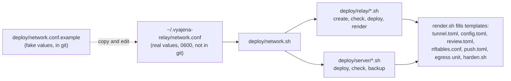

## Context

Owner request, 2026-11-20: remove information about ports and IPs from everything
in the repo, docs included ("commit history is a problem we solve later"), and make
the project generic: "pi is just how I deployed it". The ports other than 443 and 22
may change. Everything below was done mechanically and then checked by the build,
the tests and the deploy-file tests.

## Decisions

### D1: "Pi" → "server" by script, then fixed by the compiler

One script rewrote every tracked text file: `Pi server`/`Pi's`/`the Pi`/`Pi` →
`server`, the word `pi` in names and paths → `server`, `PI` → `SERVER`, test users
`@pi` → `@chat`, `Raspberry Pi` → `host`. Rust type and variant names that were
`Pi` (`runtime::Pi`, `ProposalSender::Pi`) became `Server` by hand-written rules,
and sentence starts were capitalised. Main specs were renamed in place
(`pi-deployment`→`server-deployment`, `pi-runtime`→`server-runtime`, requirement
slugs follow), as were archived and pending changes, so every `// spec:` tag still
names a requirement. `pbgen` and `flutter_rust_bridge_codegen` were re-run for the
comment text.

### D2: Real values in `network.conf`, placeholders in the repo

Keys: `SERVER`, `HOME_LAN`, `ROUTER`, `ADMIN_USERNAME`, `SERVER_PORT`,
`REVIEW_SERVER_PORT`, `EGRESS_PORT`, `TUNNEL_PORT`, `REVIEW_PORT`, `SUBNET_RANGE`,
`IAP_RANGE`. `SERVER=user@host` in the environment still overrides. Files that
used to be copied as they are and name an address or port (`harden.sh`,
`nftables.conf`, `push.toml`, `vyajena-egress.service`) are now rendered by
`render.sh server-file <name>`. `check.sh` gets its values from the same file;
its check names no longer carry numbers. Docs and specs use placeholders.

The local development default `127.0.0.1:8443` (`server/local.toml`, the app's
tests, `adb reverse`, Makefile) and the documentation-range example addresses
in tests stay: they are not the deployment.

### D3: What stays, and why

- SQL columns and table `pi_sender_key`, `pi_sender_credential`, `pi_sender_index`,
  `pi_removes`, and the old migrations: persisted in the server's and every
  device's database. A rename needs a migration, and an older binary (`--rollback`)
  could no longer read the database. Left; the Rust that names them keeps the
  same words.
- The legacy file name `pi.sqlite` appears once, in deploy's one-time move to
  `server.sqlite` (`remote_rename_legacy_database`): it needs the old name.
- `openspec/changes/push/tasks.md` and `Runner.xcscheme`: the owner's own
  uncommitted edits; not touched here.
- The domain `purplechaamba.com`, the relay name and project `vyajena`: names, not
  ports or addresses. Not part of this request.

### D4: Changing ports touches the live system

- The relay's tunnel and review firewall rules are VPC-wide and shared with the
  old relay. `create.sh` now *updates* an existing rule to the new port. After
  it runs, the old relay's tunnel and review ports are closed to new connections
  until the server is redeployed against the new relay. Run create, relay deploy,
  DNS change and server deploy back to back (change `relay-mumbai`, tasks 4.x).
  Rollback needs the old ports (the owner has them) and
  `gcloud compute firewall-rules update ... --rules=tcp:<old>`.
- The server's loopback ports change at its next deploy: units, configs, the
  tunnel's `local_addr` and the hardening check all follow `network.conf`.
- The TLS SNI name the client sends is `vyajena2-server`; the server's single
  certificate resolver ignores SNI, and the pin is the key hash, so old and new
  clients and servers still connect.

## Risks / Trade-offs

- [Mechanical rewording leaves an odd sentence] → a compile, test and spec
  validation pass, plus reading the diff of the code comments; prose in archived
  docs may still read stiffly.
- [`network.conf` lost] → the scripts refuse to run; the example lists every key.
  Keep a copy with the other relay secrets (password manager).
- [The live database file is renamed at the next deploy] → only through deploy,
  with the services stopped, WAL moved with it; `backup.sh` first, as always.

## Migration Plan

Merge, then do the owner steps of `relay-mumbai` with a `network.conf` made first.
Nothing runs on the live system before that.

## Open Questions

None.
