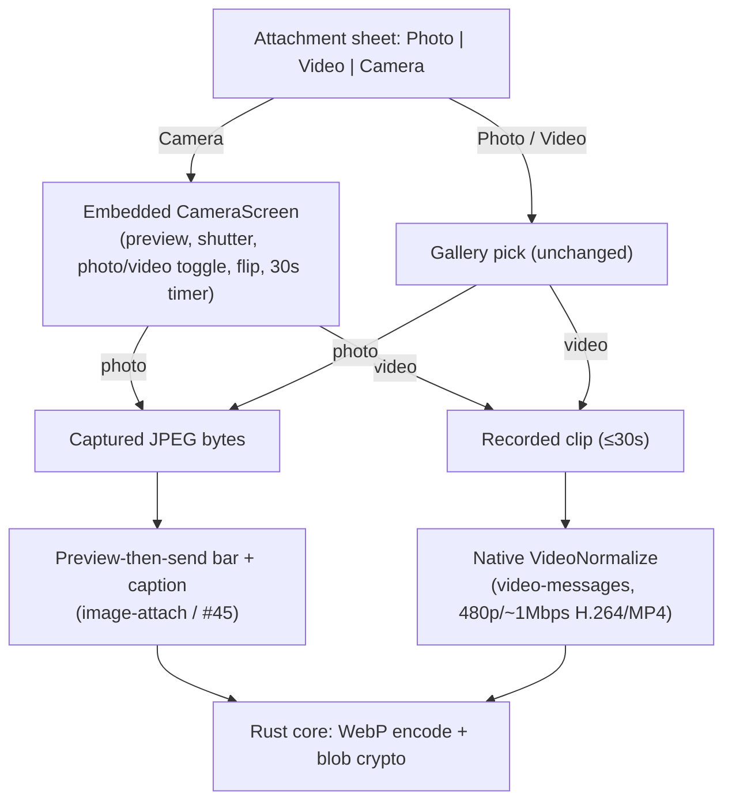

## Context

- **Capture today is two OS hand-offs behind small, test-swappable seams.**
  `picture_picker.dart` exposes `PicturePicker`/`PicturePickerScope` and only
  `ImageSource.gallery` (gallery, no capture). `video_plugins.dart` exposes
  `VideoSource`/`VideoScope` with `record()` (`image_picker`'s `ImageSource.camera`)
  and `pick()` (gallery), plus the native `VideoNormalize` MethodChannel. In both
  cases the user leaves the app for the system camera/gallery UI; widget tests inject
  a fake (`FakePicturePicker`-style, `FakeVideoSource`) through the scope so a test
  never touches the camera.
- **The attachment sheet** (`composer.dart`, `_openAttachments`) already offers
  **Photo** (gallery) and **Video** (gallery/record) entries and routes a chosen
  photo into the preview-then-send `_picture` bar + caption (the image-attach / #45
  flow) and a chosen video into `onSendVideo`.
- **The downstream is settled.** A photo's bytes go to the core, which owns the WebP
  encode (`client-runtime`: Image encode pipeline). A video's clip goes to the native
  `VideoNormalize` (H.264/AAC MP4, 480p/~1 Mbps, first-frame ThumbHash) and then the
  core's blob crypto (`video-messages`). Neither path needs to change.
- **What is missing** is capture *inside* the app: a live preview with a shutter. The
  `image_picker` camera source is a full-screen OS takeover, not an embedded preview,
  and cannot be themed, cannot show a photo/video toggle, and cannot be driven in a
  widget test. The `camera` plugin gives a `CameraController` + `CameraPreview`
  widget the app composes itself.
- **Owner decision (2026-11-26):** a full embedded in-app camera (live preview +
  shutter + photo/video toggle + flip), replacing the OS-camera hand-off for both
  media types, keeping the gallery pickers, behind a clean test seam.

## Goals / Non-Goals

**Goals**
- An embedded camera screen: live preview, shutter, photo ↔ video toggle, flip
  front/back, a record timer that stops at `videoMaxDuration` (30 s).
- A `CameraSource`/`CameraScope` seam with a `FakeCameraSource`, so every screen and
  widget test runs on the fake, never the real camera.
- Reuse — captured photo → image encode + preview-then-send; captured video →
  native `VideoNormalize` + gallery-with-trim. The camera only produces source media.
- Camera + mic permissions with a clean gallery fallback on denial; the store-release
  guard updated so the new usage string passes.

**Non-goals**
- Any wire, proto, server or core change; a new `Content` body.
- In-camera filters, zoom, grid, countdown, burst; QR/barcode scanning; a camera
  outside the chat composer; simultaneous photo+video.

## Decisions

### D1. An embedded camera screen, opened from the attachment sheet

- The composer's attachment sheet keeps **Photo** (gallery pick) and **Video**
  (gallery pick) and gains a **Camera** entry that pushes a full-screen
  `CameraScreen` route (fits `app-shell`: Conversation screen — a full-screen route,
  not a dialog).
- `CameraScreen` shows the live `CameraPreview`, a **shutter** button, a **photo ↔
  video mode toggle**, a **flip front/back** control, and, in video mode, a **record
  timer** counting up that **stops recording at `videoMaxDuration`**
  (`protocol::video::MAX_VIDEO_DURATION_MS`, 30 s) — the app enforces the cap at
  capture, the same cap `image_picker`'s `maxDuration` enforces today.
- **Nice-to-haves (not required for the MVP):** tap-to-focus on the preview and a
  flash/torch toggle. Specced as optional so their absence is not a failure.
- On **photo** capture the shutter returns the still's JPEG bytes; on **video**
  capture it returns the recorded clip's file path. The screen then pops and hands
  the result back to the composer.

### D2. The `CameraSource`/`CameraScope` seam (the clean seam)

- A single abstraction mirrors the existing seams:

  ```
  abstract class CameraSource {
    /// Opens the embedded camera in photo mode; returns the captured JPEG bytes,
    /// or null if the user backed out.
    Future<Uint8List?> capturePhoto();

    /// Opens the embedded camera in video mode; returns the normalized clip ready
    /// for the core (reusing video-messages' NormalizedVideo), or null.
    Future<NormalizedVideo?> captureVideo();
  }
  ```

- `DeviceCameraSource` is the **one file that imports the `camera` plugin**. It drives
  the `CameraController`, presents `CameraScreen`, and for a captured video hands the
  recorded file to the existing native `VideoNormalize` (so one normalizer serves both
  the gallery-pick and the capture paths — no duplicate transcode code).
- `CameraScope` is an `InheritedWidget` exactly like `VideoScope`/`PicturePickerScope`:
  `CameraScope.of(context)` returns the in-scope source, or `const DeviceCameraSource()`
  when there is none. The composer reads the source from the scope; it never constructs
  the camera directly.
- **`FakeCameraSource`** (`app/test/support/`) records what was asked and returns an
  in-memory photo or `NormalizedVideo` (reusing `FakeVideoSource`'s sample), so a widget
  test exercises the whole send flow without a camera, gallery or native plugin — the
  camera flow does **not** bypass the seam.

### D3. Captured media reuses the existing downstream (no duplication)

- **Photo:** `capturePhoto()`'s bytes enter the composer's existing `_picture`
  preview-then-send bar and caption (the image-attach / #45 path), then go to the core,
  which owns the WebP encode, EXIF strip, downscale and ThumbHash (`client-runtime`:
  Image encode pipeline). The camera does **not** transcode, encrypt or upload. A
  captured photo is an ordinary `Image`.
- **Video:** `captureVideo()`'s clip goes through the **existing** native
  `VideoNormalize` (AVFoundation / MediaCodec), producing the canonical H.264/MP4 at
  480p/~1 Mbps with the first-frame ThumbHash, trimmed to ≤ 30 s — the same
  `NormalizedVideo` the gallery-with-trim path yields. From there it is exactly the
  `video-messages` send path. A captured video is an ordinary `Video`.
- Because capture only produces source media and both downstreams already exist, this
  change touches **no** `Content` body, blob, core or server code.



### D4. Permissions and the gallery fallback

- The `camera` plugin needs the **camera** permission for both modes and the
  **microphone** permission for video recording. The mic string already exists
  (`audio-messages`); this change adds the camera declarations.
  - **iOS `Info.plist`:** add **`NSCameraUsageDescription`** ("Vyajena uses the camera
    to take photos and videos you send in a chat."). `NSMicrophoneUsageDescription`
    already exists.
  - **Android manifest:** add **`<uses-permission android:name="android.permission.CAMERA"/>`**.
    `RECORD_AUDIO` already exists (`audio-messages`).
- **Denial is graceful (owner):** if the user denies the camera (or, in video mode, the
  microphone) permission, the camera screen does not open to a black preview — the app
  shows a clear message ("Allow the camera in Settings to take a photo or video.") and
  **falls back to the gallery picker** so the user can still attach existing media.
  Permanently-denied follows the same path with a Settings hint.

### D5. App-only — the one byte-path to watch (flagged per the owner's ask)

- The intent is **no bridge/core change**: a captured photo's bytes reach the core via
  the existing `CoreService` image entry point, byte-for-byte like a picked photo, and a
  captured video reuses the existing `sendVideo`. The core's API already takes raw image
  bytes and a normalized MP4; it does not care that the camera produced them.
- **The one risk:** the `camera` plugin writes a captured still to a temp **file** (a
  path), while the picked-image path passes **bytes**. The app reads the file's bytes in
  Dart and feeds the existing bytes entry point, so the bridge signature is unchanged. We
  deliberately do **not** add a "send image from path" bridge call — that would be a
  core/bridge change for no benefit and would split the image entry point. If a future
  spike shows reading large stills into Dart memory is a problem, that is a separate
  change; this one keeps the existing bytes contract. Flagged here so an implementer does
  not reach for a new bridge call.

### D6. The `camera` plugin dependency

- Add the **`camera`** Flutter plugin to `app/pubspec.yaml`, pinned to a version that
  supports both iOS and Android — **`camera: ^0.11.1`** (the 0.11.x line is the current
  federated plugin; `camera_avfoundation` on iOS, `camera_android` on Android). Confirm
  and pin the exact resolved patch in `pubspec.lock` at implementation; record it here.
- No other new dependency. `image_picker` stays (it still backs the gallery pickers and
  the gallery fallback); `video_player` stays (playback). The native `VideoNormalize`
  MethodChannel is reused unchanged.

### D7. The store-release guard (do not re-break it)

- `app/store/release-check.sh` hard-codes the exact permission / usage-description
  allow-lists and **fails** the release if the built artifacts carry anything else
  (`app-release`: Declared permissions, Release check). PR #20 added `RECORD_AUDIO` /
  `NSMicrophoneUsageDescription` when `audio-messages` landed; this change does the same
  for the camera:
  - iOS usage-description allow-list: `NSMicrophoneUsageDescription ` →
    `NSCameraUsageDescription NSMicrophoneUsageDescription ` (sorted).
  - Android permission allow-list: insert `android.permission.CAMERA` (sorted, after
    `ACCESS_NETWORK_STATE`, before `INTERNET`).
  - Update the human-readable `pass` messages to name the camera.
- This is a **task of this change**, done when the camera declarations are added, so the
  release guard keeps passing. The matching `app-release` "Declared permissions"
  requirement is reconciled when these media changes archive (same open reconciliation as
  `audio-messages`/`video-messages`, which also add a permission the base requirement does
  not yet list).

## Risks / Trade-offs

- **A new native plugin (`camera`)** adds platform surface (camera lifecycle, orientation,
  resume/pause). Mitigated by keeping it behind `DeviceCameraSource` and the seam, and by
  reusing the settled downstream so only *capture* is new.
- **The byte-vs-path mismatch (D5)** is handled in Dart (read the still's bytes) so the
  bridge/core contract is untouched; flagged so it is not "fixed" with a new bridge call.
- **Permission friction:** the camera asks for camera (and mic for video) the first time;
  the gallery fallback means a denial never blocks attaching media.
- **Release guard drift:** forgetting the allow-list update would fail the release check
  (as designed); D7 makes it an explicit task.

## Migration Plan

1. No server or wire change — nothing to deploy. Old apps keep picking/OS-recording; they
   are unaffected.
2. Release the app: the `camera` dependency, the embedded `CameraScreen`, the
   `CameraSource` seam and fake, the attachment-sheet Camera entry, the Info.plist /
   manifest declarations, and the `release-check.sh` allow-list update.

**Rollback:** remove the Camera entry from the attachment sheet (capture is gone, picking
is unaffected); or revert the app change entirely. No data or wire implications.

## Open Questions (owner)

1. **Default mode:** open the camera in **photo** mode always, or remember the last mode
   used?
2. **Flip + mode persistence:** keep the chosen lens (front/back) across opens, or reset
   to back each time?
3. **Captured-photo preview:** reuse the existing small preview-bar only, or show a
   larger full-frame confirm (retake / use) before dropping into the composer?
