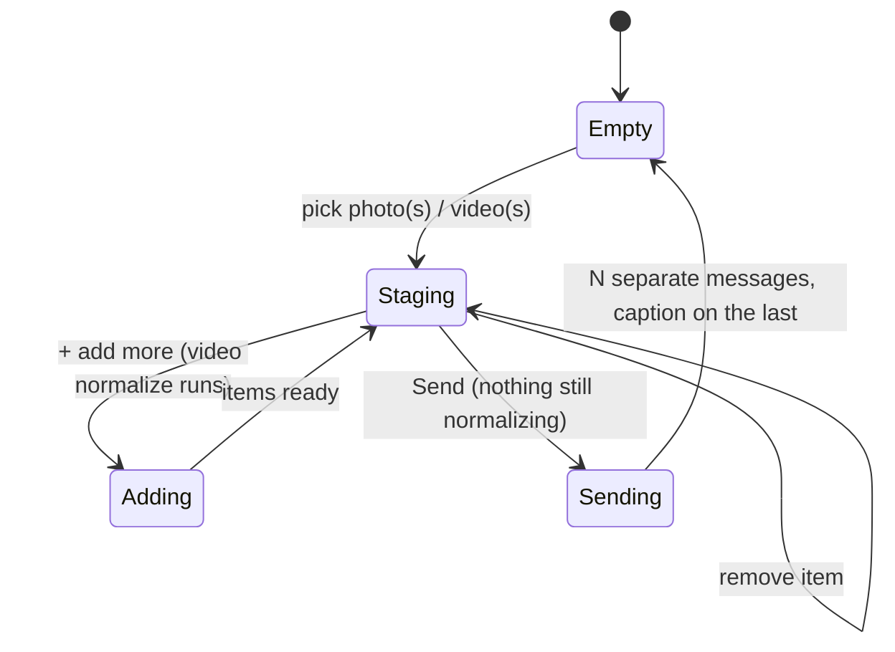
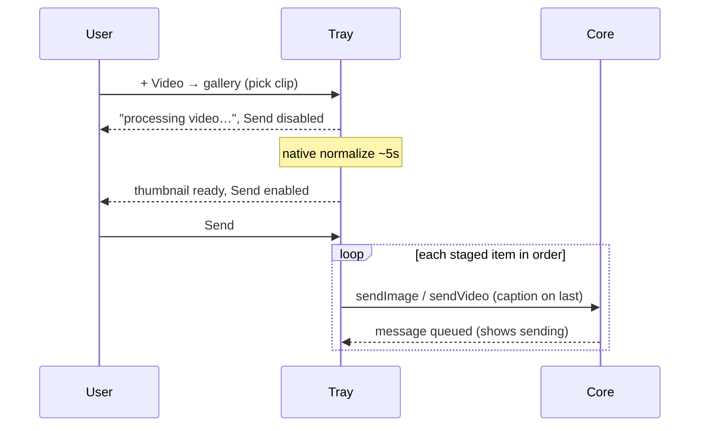

## Context

- **`media-blobs` / `video-messages` built the media path.** A `Content` body
  carries `blob_id`/`blob_key`/`blob_size` plus type-specific fields; the core does
  the blob crypto, the upload-then-`APPLICATION` send order, the cache, ack-delete
  and 7-day expiry. `Image` and `Video` each reference one blob. `Image` carries
  `caption` + `caption_mentions`; `Video` does **not**.
- **Multi-select today sends separately and captionless.** `composer.dart`
  `_sendPictures` and `chat_screen.dart` `_sendVideo` loop and send each picked
  item as its own captionless message. There is no staging area and no shared
  caption, and images and videos go through two different attachment entries.
- **Video normalize is a native plugin** (`video_plugins.dart` →
  `chat.vyajena/video` MethodChannel) that runs ~5 s+ with no UI feedback today —
  the owner's main complaint (ask #1).
- **Owner decisions (2026-11-27):** keep it the **lighter** path — separate
  messages per item (no album); one caption for the batch on the last item; video
  captions yes; keep the attachment sheet and the video Record/gallery sub-sheet;
  sticker stays its own flow; show progress while a clip normalizes; no gRPC
  streaming.

## Goals / Non-Goals

**Goals**
- Stage an ordered batch of images **and** videos in a compose tray, add more with
  **+**, one caption, one Send.
- Send the batch as separate messages, in order, caption on the last item.
- Caption parity for a single video (`Video.caption`).
- Visible progress while a clip normalizes and while blobs upload.

**Non-goals**
- A grouped/album message; per-item captions; stickers in a batch; media
  **forward**; gRPC streaming; a new media kind; any change to normalization, image
  encode or blob crypto.

## Decisions

### D1. Separate messages, in order; no new wire body

A staged batch of N items dispatches as N ordinary messages — each image through
`sendImage`, each video through `sendVideo` — in tray order. This reuses the
existing send/blob/E2EE paths unchanged; the only wire change is `Video.caption`
(D2). Visually it is a run of media bubbles, exactly what a multi-pick already
produces today.

### D2. `Video` gains `caption` + `caption_mentions` (fields 8–9)

Mirrors `Image` so a video is captionable (ask #2). Backward compatible: older
clients ignore the unknown fields and still play the clip.

```
message Video {
  // ...existing fields 1-7...
  optional string caption = 8;              // UTF-8, limited like Text.text
  repeated Mention caption_mentions = 9;    // same rules as Image.caption_mentions
}
```

### D3. One caption, attached to the last item

The tray has one caption field (with the same `@` mention picker as text). On
Send, the typed caption + its mentions attach to the **last** item in tray order;
the earlier items send captionless. The last item reads as the caption under the
final bubble of the set. A single staged item is simply captioned as today
(image → `Image.caption`, video → the new `Video.caption`).

### D4. The compose tray (app)

The `_picture` preview bar generalizes to a tray staging an ordered
`List<StagedMedia>`, each either an image (`Uint8List` bytes) or a normalized video
(`NormalizedVideo`), each shown as a thumbnail. The attachment sheet
(Photo / Sticker / Video) stays the entry; picking lands items in the tray instead
of sending. The tray shows the thumbnails, a **+** that reopens the sheet, the one
caption field, and one Send. Sticker is unchanged (its own cutout preview; never in
the tray). Removing the last item dismisses the tray.



### D5. Progress (ask #1)

- **Normalize:** adding a video runs the native normalize (~5 s+). While it runs
  the tray shows a "processing video…" placeholder and **Send is disabled** until
  it is ready. This is the missing feedback today — the key fix of ask #1.
- **Upload:** once Send is pressed, each message shows the normal media "sending"
  state until accepted. No sub-blob byte progress (no streaming).



### D6. Spec deltas ADD, to stay independent of the video archive

Base `app-ui` / `message-content` specs do not yet contain the video requirements
(still in unarchived `video-messages` / `photo-sticker`; `openspec-archive`, PR #78).
So this change's deltas **ADD** new requirements — "Video caption and mentions"
(message-content), "Compose tray for images and videos" and "Video send progress"
(app-ui) — and only lightly touch base-present ones, so they do not depend on the
video requirements being in the base. Archive ordering is coordinated with the
tracker (`local_38cf5750`); no hard dependency remains.

## Risks

- **Tray state** (mixed image/video items, a normalize in flight, remove, +)
  is the bulk of the new logic; covered by widget tests with the existing
  `fake_video.dart` / fake picker.
- **"Caption on the last item"** is a deliberate simplification of D2; if the owner
  later wants per-item captions that is a follow-up, not a redesign.
