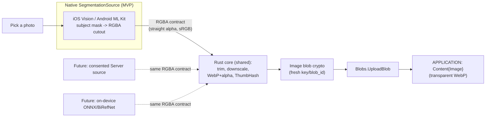

## Context

- **The image path already exists** (`media-blobs`): an `Image` body carries a
  `blob_id`/`blob_key`, the WebP `width`/`height`, a ThumbHash and the `blob_size`;
  the core owns the image encode pipeline (decode → strip metadata → downscale ≤
  `MAX_IMAGE_EDGE` → WebP at `WEBP_QUALITY` within `MAX_IMAGE_BYTES` → ThumbHash),
  does the blob crypto and the upload-then-`APPLICATION` send order, and the server
  stores opaque ciphertext. A sticker is just a transparent image on that path.
- **WebP carries an alpha channel**, so a cutout needs no new container, codec or
  `Content` body — only that the encode step keep alpha instead of flattening it.
- **The platforms ship subject segmentation:** iOS Vision
  (`VNGenerateForegroundInstanceMaskRequest`, the "lift subject" mask) and Android
  **ML Kit Subject Segmentation**. Both run on device, return a foreground mask,
  need no server and ship no model into the app bundle — so there is no license or
  attribution burden and nothing to download.
- **The core owns every media transform today** (client-runtime: Image encode
  pipeline), in pure Rust. Native segmentation must run in platform code (the Rust
  core cannot call Vision/ML Kit), so the cutout is produced natively — but the
  styling and encoding stay in the core, so every sticker is encoded identically
  regardless of which engine made the mask.
- **Owner decisions (2026-11-24):** on-device native segmentation only; a sticker is
  a transparent `Image` (no proto change); a `SegmentationSource` seam with an RGBA
  contract; styling/encode in shared Rust; allowed wherever images are.

## Goals / Non-Goals

**Goals**
- Turn a picked photo into a transparent-background sticker and send it like an
  image, end-to-end encrypted, with no wire or server change.
- Do the cutout on device with the platform's own APIs — no server, no model, no
  attribution-burdened dependency.
- Leave one seam (`SegmentationSource` + an RGBA contract) so a better engine can be
  added later without touching the send path or the encode step.

**Non-goals**
- Server-side segmentation; a bundled or downloaded model (ONNX/BiRefNet); outline /
  border / shadow styling beyond the trivial; animated or multi-subject stickers; a
  sticker reuse library; a wire hint distinguishing a sticker from a transparent
  image.

## Decisions

### D1. A sticker is an ordinary `Image` — no proto change

- The cutout is encoded as a **WebP that keeps its alpha channel** and sent in the
  existing `Image` body, reusing `blob_id`/`blob_key`, `width`/`height`, the
  ThumbHash, `blob_size` and the optional caption unchanged.
- **No new `Content` body and no new RPC:** a sticker is indistinguishable on the
  wire from any other transparent image, so there is no field-number coordination
  with `delete-messages`, `audio-calls` or `video-messages`, and `buf breaking` has
  nothing to check.
- **Receiver rendering (MVP):** a sticker shows as a normal image bubble; because it
  is transparent, the bubble SHALL render it without an opaque fill behind the
  pixels so the transparency reads. Whether to later distinguish a sticker on the
  wire (bubble-less, larger) is deferred (see Future work) and would need a proto
  field then.
- **Why:** the image path already gives durability, encryption, caching, expiry and
  resend; a sticker needs none of its own. Reusing it keeps the server, the relay
  and old clients untouched.

### D2. On-device native segmentation only (MVP)

- The subject mask is produced by the platform API — **iOS Vision** foreground /
  subject mask, **Android ML Kit Subject Segmentation** — entirely on device.
- **No server** sees the photo; **no model** is bundled or downloaded; **no
  third-party dependency** with a license or attribution obligation is added. This
  is the whole point of the MVP: the smallest thing that ships with no new legal or
  size cost.
- When the OS version lacks the API, or the engine finds no subject, the flow fails
  cleanly and tells the user (see Open Questions for the exact fallback the owner
  picks).

### D3. The `SegmentationSource` seam and its RGBA contract

- **`SegmentationSource`** is a single abstraction (an enum/trait) that names who
  produced a cutout. MVP variants: `IosVision`, `AndroidMlKit`. Reserved for later:
  `Server` (a consented server path), `OnnxLocal` (an on-device model). It is the
  one place a new engine is registered.
- **RGBA output contract (the seam's only data shape):** a segmentation source takes
  the picked photo's bytes and returns a **straight-alpha, 8-bit-per-channel RGBA**
  image in the **sRGB** color space with explicit `width`/`height`, in which
  background pixels are fully transparent (alpha 0) and subject pixels keep their
  original color at alpha 255 (soft edges allowed in between). The contract fixes:
  byte order (R,G,B,A), straight (non-premultiplied) alpha, row stride = `width`×4,
  and that orientation is already applied. **Nothing else crosses the seam** — not a
  mask-only buffer, not an encoded image — so every engine, native or future, hands
  the core the same thing.
- **Styling and encoding are in shared Rust, behind the seam:** the core receives
  the RGBA, optionally trims fully-transparent margins, downscales so the long edge
  is ≤ `MAX_IMAGE_EDGE`, and encodes **WebP preserving alpha** within
  `MAX_IMAGE_BYTES`, then computes the ThumbHash and records `width`/`height`. Every
  sticker is therefore encoded identically no matter which engine made the mask, and
  a future engine needs no encode code of its own.
- **Why a seam at all:** native segmentation is unavoidable for the MVP (the Rust
  core cannot call Vision/ML Kit), but the owner wants the door open for a better
  cutout later; isolating the engine behind one RGBA contract means a swap touches
  only the producer, never the encode or the send path.

### D4. Reuse the image blob machinery; groups and DMs

- Encrypt-with-fresh-key, upload-then-`APPLICATION` order, media cache, ack-delete,
  7-day expiry, resend and the offline queue are exactly the image path; a sticker
  blob is a blob. No new `Blobs` RPC, no new table, no size-cap change.
- A sticker is allowed wherever an image is — the lobby, named groups and DMs
  (owner).

### D5. The make-a-sticker flow

- The user picks a photo (the existing image picker), the app hands the bytes to the
  platform `SegmentationSource`, which returns the RGBA cutout; the app shows a
  **preview** of the transparent result (on a checkerboard) and, on send, hands the
  RGBA to the core, which styles, encodes and sends it as an image. The app does not
  encrypt, upload or encode — exactly as for a normal image, it goes through the
  core.

## Future work (explicitly out of MVP scope)

- **Consented server segmentation** (`SegmentationSource::Server`): with the user's
  consent, upload the photo to a server that runs a heavier model and returns a mask
  — slots behind the same RGBA contract; requires a server component and an explicit
  consent flow, so it is not in the MVP.
- **On-device model** (`SegmentationSource::OnnxLocal`, e.g. BiRefNet via ONNX):
  a bundled or downloaded model for platforms without a good native API or for a
  better cutout — slots behind the same contract; adds model size and a license to
  vet, which the MVP deliberately avoids.
- **Richer styling in the shared encode step:** a white sticker outline, a drop
  shadow or a border — cheap to add later because styling already lives in one Rust
  place.
- **A wire hint** (an `is_sticker` flag or a `Sticker` body) so receivers render a
  sticker bubble-less and larger — needs a proto field and field-number
  coordination, so it is deferred.

## Spikes (before code that relies on them, at implementation time — not planning)

- **S1:** the iOS Vision foreground/subject-mask request produces a usable
  straight-alpha RGBA cutout at the contract's format and orientation, and the
  minimum iOS version it needs; record the floor and the fallback.
- **S2:** Android ML Kit Subject Segmentation produces the same RGBA cutout within
  the contract, on-device with no model download; record device/SDK requirements.
- **S3:** the core encodes WebP-with-alpha within `MAX_IMAGE_BYTES` with acceptable
  edge quality, and the ThumbHash of a transparent image renders a sensible blur.

## Risks / Trade-offs

- **Native producer, Rust encoder split** keeps the engine out of the core;
  mitigated by the single RGBA contract so the core still owns styling/encoding and
  keys, and the swap surface for a future engine is one producer.
- **OS API availability:** older iOS/Android may lack a good subject API; handled by
  a clean fallback (Open Questions) and, later, the ONNX source behind the same
  seam.
- **Cutout quality varies by photo;** the preview lets the user reject a bad cutout
  before sending. Richer cleanup is future work.
- **Transparent WebP size:** a cutout is usually small; the existing
  `MAX_IMAGE_BYTES` cap and downscale apply unchanged.

## Migration Plan

1. No server or proto change, so nothing to deploy. Old apps are unaffected — they
   send no stickers and render a received sticker as an ordinary (transparent)
   image.
2. Release the app with the make-a-sticker flow and the native segmentation plugins.

**Rollback:** hide the make-a-sticker entry point in the app; already-sent stickers
keep working because they are ordinary images.

## Open Questions (owner)

1. **No subject / unsupported OS:** when segmentation finds no subject or the OS
   lacks the API, should the app tell the user and stop, or offer to send the whole
   photo as a normal image instead?
2. **OS version floor:** set a minimum iOS/Android version for the native subject
   API and hide the sticker entry point below it, or show it and fail gracefully?
3. **Receiver rendering:** is "render a transparent image without an opaque bubble
   fill" enough for MVP, or is a true bubble-less sticker (needing the deferred wire
   hint) wanted sooner?
