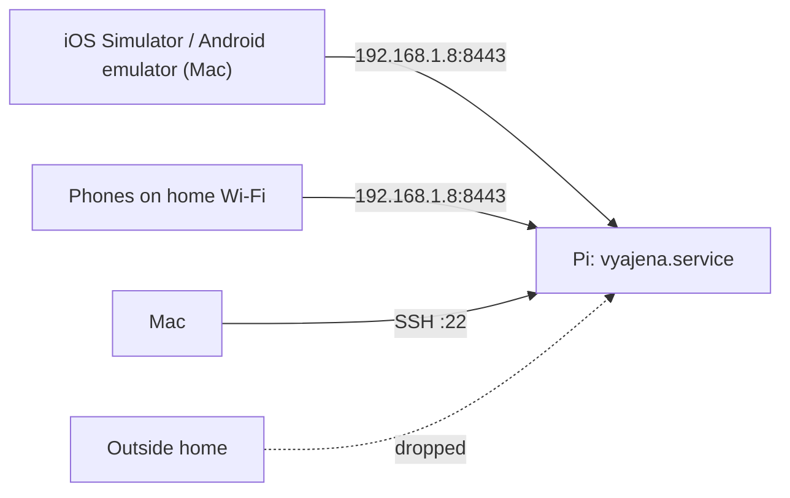

## Context

The Pi is a Raspberry Pi 4 Model B on the home network at `192.168.1.8`,
Debian 13 (trixie) `aarch64`, login `vyajan` with the owner's Mac key and
passwordless sudo. sshd already refuses passwords but still allows root with a
key. The old vyajena, Tor and `build-essential` were purged on 2026-11-13; only
SSH listens. `vyajena.local` does not resolve from the Mac, so the IP is used.
The owner's Mac is Apple silicon with Docker Desktop installed (not running at
proposal time). The server binary is `server` (crate `server`); it stops on
Ctrl-C only. The architecture doc wants the Pi behind a rathole tunnel with no
inbound traffic; that relay (decision #6) and real push are a later change.

## Goals / Non-Goals

**Goals:** vyajena2 running on the Pi as a hardened service; phones and the
Mac's simulators on the home Wi-Fi chat through it; repeatable deploys, checks
and backups from the Mac with one command each.

**Non-Goals:** the GCP relay, reaching the Pi from outside home, real push,
monitoring and alerting, automatic deploys from CI.

## Decisions

### D1. Layout

```
deploy/pi/
  build.sh           arm64 Linux release build in a container -> target/pi/vyajena-server
  deploy.sh          install or upgrade over SSH (PI=vyajan@192.168.1.8 by default)
  check.sh           hardening check over SSH, one line per failure
  backup.sh          snapshot of the DB and keys to ~/vyajena-pi-backups/<time>/
  vyajena.service    systemd unit
  nftables.conf      firewall
  config.toml        the Pi's server config (no secrets)
  harden.sh          one-time host setup, run by deploy.sh: user, sshd, nftables,
                     unattended-upgrades
```

Plain shell, `set -euo pipefail`, checked with `shellcheck`. One folder per
deploy target, so `deploy/relay/` can sit next to it later.

### D2. Build in an arm64 container

The Mac is `arm64`, so Docker Desktop runs `linux/arm64` containers natively. The
build runs `cargo build --release -p server` in `rust:<pinned>-bookworm`, with the
repo mounted and a named volume for the cargo cache. Bookworm's glibc (2.36) is
older than trixie's (2.41), so the binary runs on the Pi. SQLite is bundled; no
system libraries beyond glibc. A cross toolchain (`cross`, `cargo-zigbuild`) is
the fallback if the container route fails (spike 1.1).

**Spike 1.1 result (2026-11-13): PASS.** `rust:1.96-bookworm` (the Mac's Rust
1.96.0) as `linux/arm64` in Docker Desktop 29.3 builds `cargo build --release
--locked -p server` in about 70 s from cold, with the repo mounted, the target
dir in `target/linux-arm64/` and the cargo registry in a named volume. The
result is an `aarch64` PIE ELF of 11.7 MB that needs glibc 2.34 at most (the
Pi has 2.41). Copied to a temp folder on the Pi and started on
`127.0.0.1:18443`, it created its keys (0600) and database (0600), applied the
four migrations, logged the pin and the bootstrap invite, listened, and exited
0 on `SIGTERM`; the folder was removed. One caveat: the very first build after
Docker Desktop started died with "error waiting for container: unexpected
EOF" (the VM was still settling); the rerun with `-j 4` passed. `build.sh`
therefore waits for `docker info` and builds with `-j 4` (8 GB VM). The fallback
toolchains were not needed.

### D3. Paths, user and unit

| What | Where | Owner, mode |
| --- | --- | --- |
| binary | `/usr/local/bin/vyajena-server` (+ `.prev` for rollback) | root, 0755 |
| config | `/etc/vyajena/config.toml` | root, 0644 |
| database, keys | `/var/lib/vyajena/` (`StateDirectory=vyajena`) | vyajena, 0700 / files 0600 |
| logs | the journal (`journalctl -u vyajena`) | |

`vyajena.service`: `User=vyajena`, `DynamicUser=no`, `StateDirectory=vyajena`,
`StateDirectoryMode=0700`, `UMask=0077`, `NoNewPrivileges=yes`,
`ProtectSystem=strict`, `ProtectHome=yes`, `PrivateTmp=yes`, `PrivateDevices=yes`,
`CapabilityBoundingSet=` (empty), `RestrictAddressFamilies=AF_INET AF_INET6
AF_UNIX`, `SystemCallFilter=@system-service`, `Restart=on-failure`,
`RestartSec=2`, `KillSignal=SIGTERM`, `TimeoutStopSec=15`. The check reads
`systemd-analyze security vyajena` and fails above an agreed exposure score.

As built, the unit adds the rest of systemd's sandbox that the server does not
need: `PrivateUsers`, `PrivateIPC`, `ProtectKernel*`, `ProtectClock`,
`ProtectHostname`, `ProtectControlGroups`, `ProtectProc=invisible`,
`ProcSubset=pid`, `RestrictNamespaces`, `RestrictRealtime`,
`RestrictSUIDSGID`, `LockPersonality`, `MemoryDenyWriteExecute`,
`SystemCallFilter=~@privileged @resources`, `SystemCallArchitectures=native`,
`DevicePolicy=closed`, and, for the home-LAN phase, `IPAddressAllow=localhost
192.168.1.0/24` with `IPAddressDeny=any` (the relay change drops the subnet).

"No writes outside its folder" (pi-deployment: Sandboxed service) is read with
`PrivateTmp=yes`, which the same requirement asks for: the service's own
`/tmp` and `/var/tmp` are private, empty at start and thrown away at stop, so
SQLite can still use temp files; nothing else on the Pi sees them. `check.sh`
probes writes as the service user inside the running service's namespaces
(`nsenter`) to `/`, `/etc`, `/usr/local/bin`, `/var/lib`, `/var/log`, `/home`
and `/root` (all must fail) and to `/var/lib/vyajena` (must work).

### D4. Home-LAN phase



- `listen_address = "0.0.0.0:8443"`, `public_address = "192.168.1.8:8443"`.
- The Pi is on both Ethernet (`eth0`, `192.168.1.8`, MAC `88:a2:9e:f3:2c:55`) and
  Wi-Fi (`wlan0`, `192.168.1.9`). The static address and invites use `eth0`.
- Both interfaces also have **global IPv6 addresses** from the ISP, so the Pi may
  be reachable from the internet over IPv6. nftables uses the `inet` family and
  drops inbound IPv6 except link-local and established traffic; 8443 and SSH are
  allowed only from the home IPv4 subnet.
- nftables: default drop inbound; allow established, loopback, SSH from the home
  subnet (`192.168.1.0/24`), 8443 from the home subnet. Outbound open (updates).
- The relay change later sets `listen_address = "127.0.0.1:8443"`, closes 8443
  and keeps only the tunnel. Invites made in this phase name the LAN address;
  devices that joined keep working after the switch only if the relay change
  migrates their stored address (noted for that change).
- The Pi keeps `192.168.1.8` with a static address set on the Pi itself
  (owner, 2026-11-13): `harden.sh` sets the NetworkManager connection that is up
  today to manual, with the current address, gateway and DNS, so invites stay
  valid. Risk: the router may lease the same address to another device; the
  check warns if another host answers ARP for it.

### D5. Deploy and upgrade

`deploy.sh`: build if needed → `harden.sh` (idempotent) → copy binary to a temp
path → move the current one to `.prev` → install the new one, config and unit →
`systemctl daemon-reload && systemctl restart vyajena` → wait until active and
port 8443 listens → print the pin from the journal. First install also prints the
bootstrap invite line. `deploy.sh --rollback` swaps `.prev` back.

### D6. Backup

`backup.sh` runs SQLite's online backup on the Pi through the server binary
(`vyajena-server backup --to <path>`, a small subcommand), so no `sqlite3` CLI is
installed, then copies the snapshot and the key folder to
`~/vyajena-pi-backups/<UTC time>/` on the Mac with mode 0700/0600. Never into the
repo.

As built: `vyajena-server backup --config <file> --to <path>` (the config names
the database). It runs as the `vyajena` user (`runuser`), writes the snapshot
with mode 0600 and never over an existing file, copies every page in one
`sqlite3_backup_step(-1)` (one read transaction, so one consistent state while
the service commits), runs `PRAGMA integrity_check` on the copy and switches it
to `journal_mode=DELETE` so it is one self-contained file. `backup.sh` streams
the snapshot and `keys/` as a tar over SSH, removes the snapshot on the Pi, and
checks the copy on the Mac with the `sqlite3` tool macOS ships.

### D7. Tests

- `server/tests/`: graceful stop on `SIGTERM` (spawn the binary, send `SIGTERM`
  mid-send, exit 0, message stored or resent), the backup subcommand (snapshot
  opens, has the rows).
- `deploy/pi/` scripts: `shellcheck` clean.

Graceful stop, as built (task 1.2): `main.rs` already stopped on `SIGTERM`, but
the first test showed the process never exited while a device had a `Connect`
stream open: tonic's graceful shutdown waits for every open stream, and a
stream only ends when its device leaves. Now the shutdown signal also calls
`Hub::stop`, which ends every open stream, and every stream that opens after,
with `UNAVAILABLE` ("the server is stopping"); a stream checks it only between
frames, so an envelope being accepted is committed and answered first. Devices
already reconnect with backoff on any stream end. After the last request,
`Store::close` closes the database on its thread once the jobs queued before it
have run (SQLite checkpoints and removes the WAL). Tests:
`server/tests/graceful_stop.rs` (the binary, `SIGTERM` mid-send and with open
streams, Ctrl-C) and `durable_storage.rs` (close after queued jobs).
- On the real Pi: `check.sh` passes; a manual run from the Mac's iOS Simulator
  and the Android emulator (no `adb reverse`) joins and chats; an upgrade keeps
  the pin and users.

## Risks / Trade-offs

- [Port 8443 open on the home LAN] → only the home subnet; TLS pinned; removed by
  the relay change.
- [Pi's IP changes, or clashes with a DHCP lease] → static address on the Pi
  (D4); a router reservation or a smaller DHCP pool removes the clash risk.
- [SD card failure loses the group] → `backup.sh`; the core never keeps history on
  the Pi anyway, devices keep their own messages.
- [`systemd-analyze security` scores vary by systemd version] → threshold set
  from the first real run, recorded here.

## Migration Plan

New install; nothing to migrate. The local Mac Pi (`server/.pi-local/`) stays as a
dev server. Rollback: `deploy.sh --rollback`, or stop and disable
`vyajena.service`.

## Open Questions

None open. Resolved by the owner (2026-11-13): port 8443 from the home subnet only
during the LAN phase; security updates install unattended with no automatic
reboot (check.sh reports a pending reboot); a static `192.168.1.8` set on the Pi
itself (D4).
