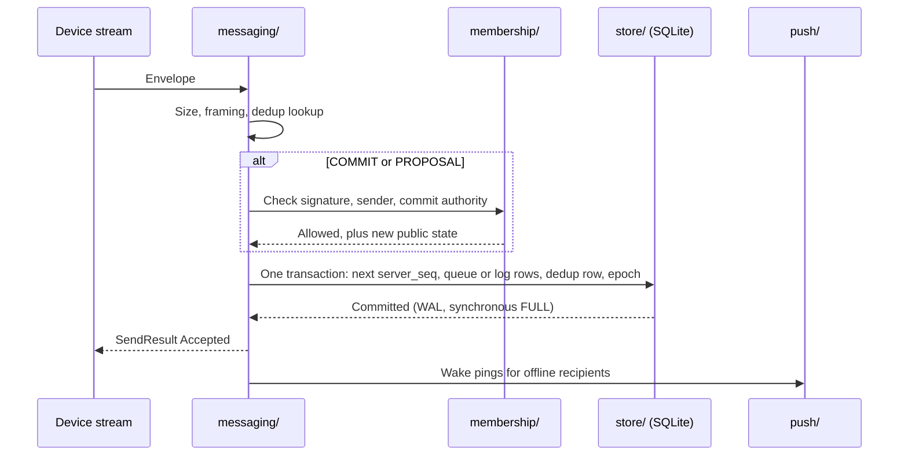

## Context

`core-wire-protocol` is archived: the `vyajena.v1` protos, six capability specs
(45 requirements) and the `protocol/` constants crate are on `main`, unpushed.
The OpenMLS spikes proved the two risky assumptions (D4/D5 of that change):
`PublicGroup` on a non-member can check and apply commits, and device
certificates ride in MLS basic credentials. Nothing runs yet. The owner decided
the build order (server, core, terminal client, deployment, Flutter) and wants
the server tested locally before publishing.

Owner conventions that shape this design: generated code is committed (one file
per side, regenerated locally, never in CI); tests live only in `tests/`
folders; folders follow features so a gRPC service can later move into its own
binary.

## Goals / Non-Goals

**Goals:**

- A server that meets every Pi-enforced requirement in the main specs, plus the
  new `pi-runtime` capability.
- A local run the owner can start and connect to, and integration tests that
  exercise each server-enforced requirement over real gRPC.
- Shared rules in `protocol/` so the core reuses them later instead of copying.

**Non-Goals:**

- Real FCM/APNs (Flutter change), the relay and Pi deployment (deployment
  change), any client beyond test clients (core and terminal client changes).
- Client-only requirements: `message-content`, identity pinning in
  `key-directory`, and the client side of the commit-authority check.

## Decisions

### D1. Layout: one folder per service

```
server/
  src/main.rs          config, startup, tonic Router with one add_service per service
  src/pb.rs            generated server stubs + messages (committed)
  src/devices/         Devices: register, challenge, authenticate, link, revoke, push token
  src/keys/            Keys: KeyPackage upload and fetch
  src/admin/           Admin: invites, create group, remove user
  src/messaging/       Messaging.Connect: stream, sequencing, queues, commit log
  src/membership/      PublicGroup state, commit checks, inactivity, re-add notices
  src/store/           SQLite: schema, migrations, transactions
  src/push/            provider trait + logging provider
  src/auth/            session tokens, the interceptor every service uses
  tests/               integration tests; tests/support/pb.rs holds client stubs
```

Services talk to each other only through `store/`, `membership/` and `auth/`, so
any of them can later move into its own binary. **Alternative:** one module per
layer (handlers, db, models). Rejected: it cuts every feature into pieces.

**As built (tasks 1.3, 3.x).** The crate is a library plus a thin binary, so the
integration tests in `server/tests/` can drive it through its public API.
`src/main.rs` only parses `--config`, sets up tracing and runs
`runtime::Pi::start` then `Pi::serve`. One folder joins the D1 list:
`src/runtime/` for the `pi-runtime` capability (config, first-start keys, TLS
listener, clock, bootstrap invite), and `runtime::routes()` is where each service
gets its `add_service`. The workspace also gains `pbgen/` (D2).

### D2. Code generation: one local command, output committed

`server/src/pb.rs` (server stubs) and `server/tests/support/pb.rs` (client stubs
for the tests) are generated from `proto/` and committed. First choice:
`buf generate` with a `buf.gen.yaml` and the community prost and tonic plugins,
which is the same workflow as Go. Task 1.1 checks that their output compiles
against tonic 0.14. **Fallback:** a small workspace binary that runs
`tonic-prost-build` with `protox` and writes the same two files. Either way it
is one command, documented in `CLAUDE.md`, and CI never runs it.

**Result (task 1.1): the fallback, `cargo run -p pbgen`.** `buf generate` with
the BSR remote plugins `buf.build/community/neoeinstein-prost:v0.5.0` and
`neoeinstein-tonic:v0.5.0` works, and its output compiles against tonic 0.14.9 /
prost 0.14.4 (the plugins are built on tonic-build 0.14 and emit
`tonic_prost::ProstCodec`). But it writes two files per side
(`vyajena.v1.rs` with an `include!("vyajena.v1.tonic.rs")`), so one `pb.rs` per
side would need an extra concatenation step, and it needs the network (BSR) on
every run. `pbgen/` is a small workspace binary that parses `proto/` with
`protox` (no system `protoc`), runs `tonic-prost-build` 0.14 once per side and
writes exactly `server/src/pb.rs` (messages + server stubs) and
`server/tests/support/pb.rs` (messages + client stubs, no `connect()` helper).
It works offline with versions pinned by `Cargo.lock`. No `buf.gen.yaml` is
committed. The generated modules are declared `#[rustfmt::skip]`, so
regenerating is byte-for-byte stable. CI builds `pbgen` with the workspace but
never runs it.

### D3. Shared rules in `protocol/` use plain types

`protocol/` adds:

- `device_identity`: verify a certificate signature
  (`DEVICE_CERT_CONTEXT || certificate_bytes`) and derive a device id from an auth
  public key.
- `group_membership`: the commit-authority rule as a pure function over plain
  structs (committer user, admin flag, and per proposal its kind, sender and
  target user).

Each side decodes protobuf and reads OpenMLS itself, then calls these functions.
So `protocol/` stays free of generated code and OpenMLS, and the Pi and core
cannot drift apart on these rules. **Alternative:** put the logic in the server
and copy it into the core later. Rejected: two copies of a security rule.

### D4. One write path per accepted envelope



A single writer task owns the group's sequence and epoch, so racing commits are
ordered without locks spread across services. **Alternative:** row locks in
SQLite per request. Rejected: harder to prove the strict epoch rule.

### D5. SQLite through rusqlite on a dedicated thread

rusqlite with bundled SQLite, WAL mode, `synchronous = FULL`, migrations embedded
in the binary. All database work runs on one blocking thread fed by a channel, which
also gives D4's single writer. **Alternative:** sqlx. Rejected for now: async
SQLite gains little on a Pi, and compile-time query checks need a database or
committed query metadata.

**As built (task 3.3).** `store::Store` is a cloneable handle to the thread;
`Store::call(|conn| ...)` runs a closure on it and returns its result. The
database file is created with mode 0600 before SQLite opens it (SQLite gives the
`-wal` and `-shm` files the same mode). Migrations are SQL files under
`server/src/store/migrations/`, embedded with `include_str!`, each applied in its
own transaction and counted in `PRAGMA user_version`; a newer database than the
binary knows is refused. Migration 1 holds only `meta`, `users` and `invites`;
later tasks add files. Times are stored as Unix milliseconds. At first start the
server id is recorded in `meta`, and a later start with another `server_id` is
refused, since every stored user id contains it.

### D6. TLS and keys

rustls with a self-signed certificate around the Pi's key; clients check only
the SPKI pin. The external sender key for inactivity Removes is a separate Ed25519
key. Both are created on first start under the key directory with mode 0600
(`pi-runtime: First start`).

**As built (task 3.2).** The TLS key is ECDSA P-256 (the most widely supported
TLS 1.3 server key), stored as `tls_key.pem` (PKCS#8); the self-signed
certificate is rebuilt from it at every start, which keeps the SPKI pin fixed.
The external sender key is Ed25519, `mls_external_sender_key.pem` (PKCS#8). The
key folder is created with mode 0700. Two safety rules beyond the spec, both
"refuse to start" rather than guess: if only one of the two key files exists,
the server stops instead of generating the other (a new external sender key
would silently break inactivity Removes for an existing group); and a key file
readable or writable by group or others is refused. The listener is TLS 1.3
only with ALPN `h2`, accepts handshakes in their own tasks (10 s timeout), and
attaches `runtime::TlsConnectInfo` to every request: the peer address and the
32-byte TLS exporter (`EXPORTER-vyajena2-auth-v1`, empty context) that
`Devices.Authenticate` (task 4.1) checks.

### D7. Time is injectable

Inactivity (7 days), expiry (7 days), challenge TTL (60 s) and heartbeats run off
a clock the tests can move, so integration tests can cover a week without
waiting.

**As built (task 3.4).** `runtime::Clock` (`now() -> SystemTime`), with
`SystemClock` and a shareable `ManualClock` (`advance`, `set`). It covers
timestamps and deadlines; timers that sleep (heartbeats, idle timeout) still need
`tokio::time` and are for task 7.1 to wire to the same clock or to
`tokio::time::pause` in tests.

### D8. Testing

Integration tests start the server in-process on a random local port with a
temporary database and keys, connect over pinned TLS using the committed client
stubs, and use OpenMLS (dev-dependency) to build real KeyPackages, commits and
Welcomes. Each test is tagged `// spec: <capability>/<title-slug>`. The three
tests dropped with `vyajena-proto` come back here: the signed certificate
round-trip, and the Welcome counting toward the commit cap. The unknown-content
test belongs to the core.

### D9. Runtime details settled while building (tasks 3.1, 3.5)

Small technical choices the specs leave open; none changes a requirement.

- **Config.** Fields: `server_id`, `admin_username`, `listen_address`,
  `public_address` (optional, the `host:port` put into invite payloads, default
  `listen_address`; the Pi cannot know the relay's address otherwise, so the
  `pi-runtime: Configuration` text now names it), `database_path`, `key_dir`.
  Unknown fields are refused by name (typos would otherwise be silent). Relative
  paths are resolved from the config file's folder. `server_id` and
  `admin_username` must be non-empty and free of `@`, whitespace and control
  characters; no further username policy is set here. The example is
  `server/local.toml`, with data in the git-ignored `server/.pi-local/`.
- **Bootstrap invite.** Created when the database has no users and no
  unused, unexpired bootstrap invite; printed only when created
  (`device-identity: Bootstrap admin` says once). A restart before the admin
  signs up logs that an invite is pending, without its code. If it expires
  unused (7 days), the next start creates and prints a new one. To see a lost
  code on a dev machine, delete `server/.pi-local/` and start again.
- **Invite codes and payload text.** A code is 16 random bytes in base64url
  without padding (22 characters). The printed payload is the encoded
  `InvitePayload` in base64url without padding; the log line also shows the user
  id, code, relay address and expiry. The client changes may wrap this text in a
  QR code or link; that is theirs to decide.

### D10. Devices, keys and membership as built (tasks 4-6)

Technical choices the specs leave open; none changes a requirement.

- **Auth layer.** Token checks need the database, and tonic interceptors are
  synchronous, so the "interceptor" of task 4.2 is a tower layer
  (`auth::AuthLayer`) that `Pi::serve` puts in front of every service. It
  lets only `Devices.GetServerInfo`, `Register`, `GetChallenge` and
  `Authenticate` through without `authorization: Bearer <token>` and puts the
  `auth::Caller` (device id, user, admin flag) into the request extensions.
  Tokens are 32 random bytes in base64url, live exactly 1 hour, and only their
  SHA-256 is stored. A nonce is spent by any answer, right or wrong. Revoking a
  device ends its sessions, deletes its KeyPackages, and announces its id on
  `State::revocations` so the messaging service (task 7.1) can close its stream.
  The signing input and check are `protocol::wire_transport::{auth_signing_input,
  sign_auth_challenge, verify_auth_signature}`, for the core to reuse.
- **Status codes not named by the specs.** Register with an unknown, used,
  revoked or expired invite: `PERMISSION_DENIED` (one answer for all, nothing
  created). A certificate that verifies but is malformed (no user, keys not 32
  bytes, device id not derived from the auth key): `INVALID_ARGUMENT`. A user or
  device id that exists already: `ALREADY_EXISTS`; `CreateInvite` for an
  existing username too, so a removed user's username stays taken.
  `RevokeDevice` of the caller itself: `INVALID_ARGUMENT` (the spec says
  "another device"); of a device that is not the caller's user's: `NOT_FOUND`.
  `RevokeInvite`: unknown `NOT_FOUND`, already used `FAILED_PRECONDITION`,
  already revoked or expired succeeds. `RemoveUser` of the admin:
  `FAILED_PRECONDITION`. KeyPackage upload: does not parse, fails OpenMLS
  validation, wrong ciphersuite or no last resort: `INVALID_ARGUMENT`; the
  credential is not the uploader's certificate, or the leaf key is not the
  certificate's MLS key: `PERMISSION_DENIED` (whole upload refused).
  `CreateGroup`: bad or inconsistent public state `INVALID_ARGUMENT`, the only
  member not the calling admin device `PERMISSION_DENIED`.
- **KeyPackages.** "Carries the uploading device's certificate" is checked
  strictly: the credential holds exactly the `SignedDeviceCertificate` bytes
  stored for the device. Uploads add one-time KeyPackages and replace the last
  resort. A fetch hands out the oldest one-time KeyPackage, else the last
  resort, and leaves out a device that has none at all (a freshly linked device
  that has not uploaded yet), with or without `device_ids`.
- **External sender entry.** The Pi's credential in `ServerInfo.external_sender`
  is an MLS basic credential whose identity is the server id (UTF-8). The group
  may list it at any position of `external_senders`; the Pi records the index
  for its external Removes (task 8.1).
- **Admin in the group context.** `group-membership: Group creation` says the
  group context names the admin's user id but no encoding was fixed. It is a
  group context extension of private-use type
  `protocol::group_membership::ADMIN_EXTENSION_TYPE` (0xF0A1) whose data is the
  UTF-8 user id `<username>@<server_id>`; `CreateGroup` requires it to equal
  the configured admin. Consequence for the core (rust-core-messaging): RFC 9420
  requires every member to support every group context extension, so each
  KeyPackage and leaf must list 0xF0A1 in `capabilities.extensions`, or OpenMLS
  refuses the Add. The Pi does not check this at upload.
- **Public state storage.** OpenMLS `PublicGroup` writes into its in-memory
  `MemoryStorage`; `membership::GroupState::save` copies that key-value map into
  `mls_public_state`, plus the epoch (`mls_group`) and each member device's leaf
  (`mls_members`, rebuilt from the tree). It is loaded per operation and saved in
  the same transaction as the rest of an accepted envelope, on the store's
  writer thread (D4, D5). `mls_group.id` is fixed to 1, so the database itself
  allows at most one group.
- **Commit checks (task 6.3).** `GroupState::check_commit(conn, caller,
  server_id, mls_message)` returns `AcceptedCommit` (new epoch, committer,
  added devices at their new leaves, removed devices) or a
  `HandshakeRejection` that maps to `RejectionReason`: not a `PublicMessage`
  commit of this group, or invalid to OpenMLS: `MALFORMED`; other epoch:
  `STALE_EPOCH` with the current epoch; a bad signature, a sender leaf that is
  not the authenticated device's, a sender that is not a member, or a commit
  breaking `protocol::group_membership::check_commit_authority`:
  `POLICY_VIOLATION`. Beyond the rule, so the Pi never sequences what honest
  members must reject: every added leaf must carry the certificate of a
  registered, non-revoked device that verifies against its user's stored
  identity key and names the leaf's key; the committer's new path leaf and any
  Update must keep their device's registered certificate and key. A
  `SelfRemove` counts as a Remove of the proposer's own device.
  `GroupState::check_proposal` does the same parsing and sender checks for a
  member's `PROPOSAL` and keeps it in the Pi's proposal store, so a later
  commit can include it by reference. Membership tags stay unchecked (the
  spike's caveat).

## Risks / Trade-offs

- [The community buf plugins may lag tonic 0.14] → task 1.1 checks first; the
  fallback is a small generator binary.
- [One writer thread caps throughput] → fine for one group on a Pi; revisit only
  if measurements say so.
- [Integration tests with real OpenMLS are slow to build] → shared test helpers
  build clients once per test binary.
- [Membership-tag gap from the spike] → unchanged; the Pi checks signatures and
  policy, members check tags.

## Migration Plan

None. First server; no deployed data.

## Open Questions

None.
