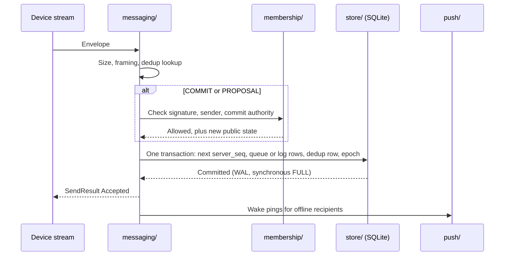

## Context

`core-wire-protocol` is archived: the `vyajena.v1` protos, six capability specs
(45 requirements) and the `protocol/` constants crate are on `main`, unpushed.
The OpenMLS spikes proved the two risky assumptions (D4/D5 of that change):
`PublicGroup` on a non-member can check and apply commits, and device
certificates ride in MLS basic credentials. Nothing runs yet. The owner decided
the build order (server, core, terminal client, deployment, Flutter) and wants
the server tested locally before publishing.

Owner conventions that shape this design: generated code is committed (one file
per side, regenerated locally, never in CI); tests live only in `tests/`
folders; folders follow features so a gRPC service can later move into its own
binary.

## Goals / Non-Goals

**Goals:**

- A server that meets every Pi-enforced requirement in the main specs, plus the
  new `pi-runtime` capability.
- A local run the owner can start and connect to, and integration tests that
  exercise each server-enforced requirement over real gRPC.
- Shared rules in `protocol/` so the core reuses them later instead of copying.

**Non-Goals:**

- Real FCM/APNs (Flutter change), the relay and Pi deployment (deployment
  change), any client beyond test clients (core and terminal client changes).
- Client-only requirements: `message-content`, identity pinning in
  `key-directory`, and the client side of the commit-authority check.

## Decisions

### D1. Layout: one folder per service

```
server/
  src/main.rs          config, startup, tonic Router with one add_service per service
  src/pb.rs            generated server stubs + messages (committed)
  src/devices/         Devices: register, challenge, authenticate, link, revoke, push token
  src/keys/            Keys: KeyPackage upload and fetch
  src/admin/           Admin: invites, create group, remove user
  src/messaging/       Messaging.Connect: stream, sequencing, queues, commit log
  src/membership/      PublicGroup state, commit checks, inactivity, re-add notices
  src/store/           SQLite: schema, migrations, transactions
  src/push/            provider trait + logging provider
  src/auth/            session tokens, the interceptor every service uses
  tests/               integration tests; tests/support/pb.rs holds client stubs
```

Services talk to each other only through `store/`, `membership/` and `auth/`, so
any of them can later move into its own binary. **Alternative:** one module per
layer (handlers, db, models). Rejected: it cuts every feature into pieces.

### D2. Code generation: one local command, output committed

`server/src/pb.rs` (server stubs) and `server/tests/support/pb.rs` (client stubs
for the tests) are generated from `proto/` and committed. First choice:
`buf generate` with a `buf.gen.yaml` and the community prost and tonic plugins,
which is the same workflow as Go. Task 1.1 checks that their output compiles
against tonic 0.14. **Fallback:** a small workspace binary that runs
`tonic-prost-build` with `protox` and writes the same two files. Either way it
is one command, documented in `CLAUDE.md`, and CI never runs it.

### D3. Shared rules in `protocol/` use plain types

`protocol/` adds:

- `device_identity`: verify a certificate signature
  (`DEVICE_CERT_CONTEXT || certificate_bytes`) and derive a device id from an auth
  public key.
- `group_membership`: the commit-authority rule as a pure function over plain
  structs (committer user, admin flag, and per proposal its kind, sender and
  target user).

Each side decodes protobuf and reads OpenMLS itself, then calls these functions.
So `protocol/` stays free of generated code and OpenMLS, and the Pi and core
cannot drift apart on these rules. **Alternative:** put the logic in the server
and copy it into the core later. Rejected: two copies of a security rule.

### D4. One write path per accepted envelope



A single writer task owns the group's sequence and epoch, so racing commits are
ordered without locks spread across services. **Alternative:** row locks in
SQLite per request. Rejected: harder to prove the strict epoch rule.

### D5. SQLite through rusqlite on a dedicated thread

rusqlite with bundled SQLite, WAL mode, `synchronous = FULL`, migrations embedded
in the binary. All database work runs on one blocking thread fed by a channel, which
also gives D4's single writer. **Alternative:** sqlx. Rejected for now: async
SQLite gains little on a Pi, and compile-time query checks need a database or
committed query metadata.

### D6. TLS and keys

rustls with a self-signed certificate around the Pi's key; clients check only
the SPKI pin. The external sender key for inactivity Removes is a separate Ed25519
key. Both are created on first start under the key directory with mode 0600
(`pi-runtime: First start`).

### D7. Time is injectable

Inactivity (7 days), expiry (7 days), challenge TTL (60 s) and heartbeats run off
a clock the tests can move, so integration tests can cover a week without
waiting.

### D8. Testing

Integration tests start the server in-process on a random local port with a
temporary database and keys, connect over pinned TLS using the committed client
stubs, and use OpenMLS (dev-dependency) to build real KeyPackages, commits and
Welcomes. Each test is tagged `// spec: <capability>/<title-slug>`. The three
tests dropped with `vyajena-proto` come back here: the signed certificate
round-trip, and the Welcome counting toward the commit cap. The unknown-content
test belongs to the core.

## Risks / Trade-offs

- [The community buf plugins may lag tonic 0.14] → task 1.1 checks first; the
  fallback is a small generator binary.
- [One writer thread caps throughput] → fine for one group on a Pi; revisit only
  if measurements say so.
- [Integration tests with real OpenMLS are slow to build] → shared test helpers
  build clients once per test binary.
- [Membership-tag gap from the spike] → unchanged; the Pi checks signatures and
  policy, members check tags.

## Migration Plan

None. First server; no deployed data.

## Open Questions

None.
