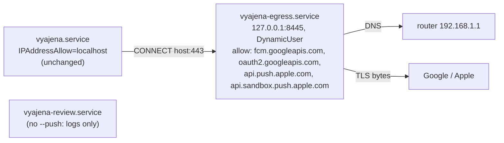
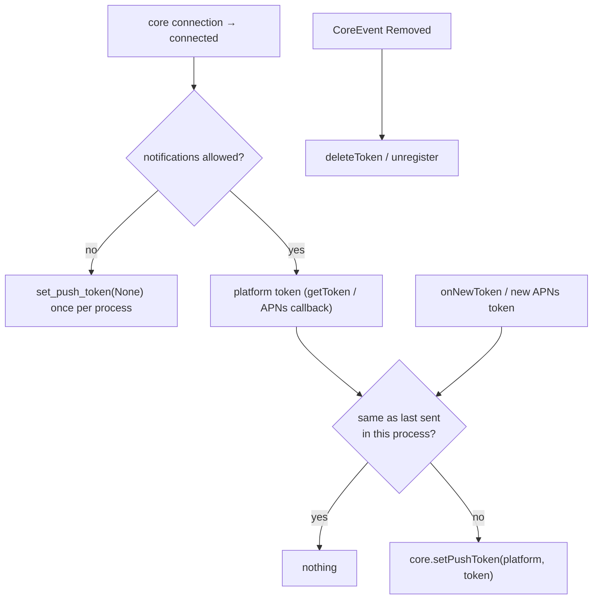

## Context

- The Pi already decides when to ping: `messaging::notify` → `PingLimiter`
  (60 s per device) → `PushProvider::wake(device_id, token)`. Only a
  `LoggingProvider` exists (`server/src/push/mod.rs`).
- The wire already has `Devices.UpdatePushToken` with `PushToken { platform:
  FCM | APNS, token }`; the core has `Client::set_push_token`. No `.proto`
  change is needed.
- `vyajena.service` may reach loopback only (`IPAddressAllow=localhost`);
  devices come in through the rathole tunnel.
- The app is on Play internal testing and TestFlight internal testing
  (app-release). The review server (`vyajena-review.service`, `:8444`) is for
  store reviewers only.
- Owner decisions (2026-11-16): FCM HTTP v1 with Firebase added to the GCP
  project `vyajena`; direct APNs with a `.p8` key the Pi signs with; no Firebase
  SDK on iOS; fixed text "New message"; previews later; review server keeps the
  stub; `google-services.json` stays out of the repo.

## Goals / Non-Goals

**Goals:** a closed app wakes up with a generic "New message"; nothing about
the message reaches Google or Apple; credentials only on the owner's Mac and
the Pi; the server stays loopback-only; everything tested against fake
FCM/APNs servers.

**Non-Goals:** decrypted previews, badges or counts, background fetch, the
review server, Play/App Store form edits (owner + app-release).

## Decisions

### D1. The ping flow

```mermaid
sequenceDiagram
  participant A as Alice's phone
  participant P as Pi (vyajena.service)
  participant E as vyajena-egress (CONNECT proxy)
  participant G as FCM / APNs
  participant B as Bob's closed phone
  A->>P: Send (ciphertext)
  P->>P: queue for Bob's phone; no open stream; token set; 60 s limiter
  P->>E: CONNECT fcm.googleapis.com:443 (or api.push.apple.com)
  E->>G: TLS bytes only (the Pi's TLS, end to end)
  P-->>G: POST "New message", collapse key "wake", no data
  G->>B: notification "New message"
  B->>B: tap → app opens → core connects
  B->>P: Connect, catch up (decrypt locally)
  Note over P,G: on 404 UNREGISTERED / 410: Pi clears Bob's token (if unchanged)
```

### D2. FCM HTTP v1

- Credentials: a Google service account key (`fcm-service-account.json`) of
  a dedicated service account `vyajena-push@vyajena.iam.gserviceaccount.com`
  with only `roles/firebasecloudmessaging.admin` (the predefined role that
  holds `cloudmessaging.messages.create`), not the Firebase Admin SDK account
  Firebase creates (that one is project-wide admin).
- Sign-in: OAuth 2.0 JWT bearer grant. The Pi signs `{iss: client_email,
  scope: https://www.googleapis.com/auth/firebase.messaging, aud: token_uri,
  iat, exp: iat+3600}` with RS256 (`ring`, the key's PKCS#8 PEM) and posts it
  to `https://oauth2.googleapis.com/token`. The access token is cached until
  5 minutes before `expires_in`. A 401 from FCM drops the cache and retries
  once.
- Send: `POST https://fcm.googleapis.com/v1/projects/<project_id>/messages:send`

  ```json
  {"message": {"token": "<token>",
    "notification": {"body": "New message"},
    "android": {"priority": "HIGH", "ttl": "86400s", "collapse_key": "wake",
                "notification": {"tag": "wake"}}}}
  ```

  A *notification* message, not a data message: Android shows it from Google
  Play services even when the app process is dead, so no app code runs on
  receipt and background limits do not apply. `tag` makes a second ping
  replace the first notification. No `data`, title, sender or count.
- The token goes only in the JSON body (no URL injection).

### D3. APNs (token-based, no Firebase on iOS)

- Credentials: the owner's `AuthKey_<KEYID>.p8` (PKCS#8 P-256). The key id
  comes from the file name, exactly as Apple names the download, so the owner
  only copies the file. Team id `XMVHK3YASX` and topic (bundle id)
  `com.purplechaamba.vyajena` are not secret and sit in `deploy/pi/push.toml`.
- JWT: header `{alg: ES256, kid}`, claims `{iss: team id, iat}`, signed with
  `ring` (fixed-size r||s). Reused for 50 minutes (Apple: refresh no more than
  every 20 minutes, valid for 60); `ExpiredProviderToken` or
  `InvalidProviderToken` re-signs once.
- Send: HTTP/2 `POST /3/device/<hex token>` with `apns-push-type: alert`,
  `apns-priority: 10`, `apns-expiration: now+1 day`, `apns-collapse-id: wake`,
  `apns-topic`, body `{"aps":{"alert":{"body":"New message"},"sound":"default"}}`.
  A visible alert (owner), not a silent push: iOS throttles silent pushes and
  never launches a force-quit app for them.
- Environment: TestFlight and store builds use production APNs, Xcode debug
  builds use sandbox, and the token does not say which. The Pi tries
  `api.push.apple.com` first and, only on `400 BadDeviceToken`, the sandbox
  host. A token is cleared only when both say `BadDeviceToken` (or on 410 /
  `DeviceTokenNotForTopic`). No proto change.
- The token is in the URL path, so both the Pi (`UpdatePushToken`) and the
  provider accept only 64–200 hex characters.

### D4. Errors, backoff, logging

| Answer | Action |
|---|---|
| 200 | sent |
| FCM 404 `UNREGISTERED`, 403 `SENDER_ID_MISMATCH`, 400 with field violation `message.token` | clear token |
| APNs 410, 400 `DeviceTokenNotForTopic`, `BadDeviceToken` on both hosts | clear token |
| FCM 401 / APNs 403 `ExpiredProviderToken`/`InvalidProviderToken` | new access token / JWT, retry once |
| 429, 5xx, connect/timeout | wait `Retry-After` or 1 s, 2 s, 4 s; at most 3 retries; then drop |
| anything else (400 payload, 403 auth) | drop, log `error` with the status only |

- **Clearing** is the provider's answer (`WakeOutcome::TokenInvalid`); the
  messaging code clears with `UPDATE … WHERE device_id = ? AND push_token = ?`,
  so a token registered meanwhile survives.
- **Backoff gate:** one per provider. While it waits, other pings to that
  platform wait behind it (a `tokio::sync::Mutex<Instant>`), so a 429 storm
  does not multiply. A dropped ping only delays delivery to the next app open.
- **Timeouts:** 10 s per request, 30 s overall per ping.
- **Logs:** `device_id`, `platform`, `outcome` (and the HTTP status on errors).
  Never the token, the FCM message name, the `apns-id`, or a response body.
- Wake calls run in the existing spawned task in `messaging::notify`, so a
  slow provider never holds up `Send`.

### D5. Egress: a hostname-allowlist proxy, the server stays loopback-only

Options for how `vyajena.service` reaches Google and Apple:

| Option | Server can reach | Upkeep | Verdict |
|---|---|---|---|
| A. `IPAddressAllow=any` on `vyajena.service` | the whole internet and the LAN | none | rejected: a compromised server can exfiltrate anywhere and scan the LAN |
| B. Allow Google's + Apple's IP ranges | thousands of Google prefixes (`goog.json`) + `17.0.0.0/8` | ranges change; silent breakage | rejected: brittle, and "all of Google" is barely a limit |
| C. **Separate CONNECT proxy unit with a hostname allowlist** | loopback only; the proxy reaches 4 names on :443 | none (names are stable) | **chosen** |



- Same binary: `vyajena-server egress-proxy --listen 127.0.0.1:8445`, ~150
  lines, no secrets, no state, no TLS (it never sees plaintext: the server's
  TLS runs end to end through the tunnel, and certificates are still checked
  by the server against the webpki roots).
- It refuses non-`CONNECT` (405), other hosts or ports (403), and names that
  resolve to loopback/private/link-local/CGNAT/unspecified addresses (403:
  no DNS rebinding to the LAN). Tunnels end after 5 minutes idle.
- Unit: `DynamicUser=yes`, the same sandbox as the tunnel,
  `IPAddressAllow=localhost 192.168.1.1/32` (DNS) and `IPAddressDeny` of
  private, link-local, CGNAT and ULA ranges, so it reaches the public internet
  only. `RestrictAddressFamilies=AF_INET AF_INET6 AF_UNIX` (AF_UNIX for
  glibc's resolver bits).
- `vyajena.service`'s `IPAddressAllow` therefore does **not** widen; the
  check keeps asserting loopback-only for both servers.
- Port 8445: 8443/8444 are the servers. Anything local could use the proxy,
  but it only reaches the four push hosts.

### D6. Configuration and credentials

- `vyajena-server --config /etc/vyajena/config.toml --push /etc/vyajena/push.toml`
  — a separate file and flag, not new `config.toml` fields: the review server
  just has no `--push`, and `config.rs` (also changed by review-mode, PR #1)
  stays untouched.
- `deploy/pi/push.toml` (in the repo, no secrets):

  ```toml
  credentials_dir = "/var/lib/vyajena/push"
  proxy = "http://127.0.0.1:8445"
  apns_team_id = "XMVHK3YASX"
  apns_topic = "com.purplechaamba.vyajena"
  ```

- `credentials_dir` holds `fcm-service-account.json` and/or one
  `AuthKey_<KEYID>.p8`. Either may be missing: that platform logs only (start
  log says which). Group/other-readable files, bad keys or two `.p8` files
  stop the start.
- Mac: `~/.vyajena-push/` (0700, files 0600) holds those two files plus
  `google-services.json` (for app builds, D8). `deploy.sh` refuses looser
  modes, copies the two Pi files over the open SSH session into
  `/var/lib/vyajena/push/` with `install -m 0600 -o vyajena`, removes Pi files
  that are gone on the Mac, and never prints them.
- `backup.sh` keeps taking only the database and `keys/`: the push keys are
  re-copyable from the Mac and the password manager, so they stay out of
  backups.

### D7. Review server: no push (owner, 2026-11-16)

`vyajena-review.service` runs without `--push`, so it uses the logging
provider. Push credentials exist only in `/var/lib/vyajena/push/`, which the
review user cannot read (0700 `vyajena`). Reviewers chat normally; they just
get no notification.

### D8. App: platform code, not the Firebase Flutter plugins

- `firebase_messaging` (Flutter) would link Firebase pods into iOS, against
  the owner's decision. So a small method channel `vyajena/push` instead:
  - **Android:** `com.google.firebase:firebase-messaging` (BoM 35.2.0) in
    Gradle; `VyajenaMessagingService.onNewToken` → channel `tokenChanged`;
    `getToken`, `deleteToken`, `requestPermission` (POST_NOTIFICATIONS on 13+),
    `clearNotifications`. A notification channel "Messages" is created at
    start and set as FCM's default.
  - **iOS:** `UNUserNotificationCenter.requestAuthorization([.alert, .sound])`,
    `registerForRemoteNotifications`, the hex device token via
    `didRegisterForRemoteNotificationsWithDeviceToken`,
    `removeAllDeliveredNotifications`, `unregisterForRemoteNotifications`.
    `Runner.entitlements` with `aps-environment` (Xcode's export sets
    production for TestFlight).
- **Firebase config without `google-services.json` in git:** Gradle reads
  `~/.vyajena-push/google-services.json` (property
  `vyajena.googleServices` overrides) and writes the four string resources
  the Google Services plugin would (`google_app_id`, `gcm_defaultSenderId`,
  `google_api_key`, `project_id`), so Firebase starts itself. Without the file
  the build works and push is off (CI, emulators, contributors). A release
  build without it stops, like the upload key gate, unless
  `-Pvyajena.allowNoPush=true` (throwaway release tests).

### D9. When the app asks for permission

- Not at first launch: a stranger's first screen is the invite paste; a prompt
  there has no context and gets denied.
- **The first time the core connects after the device joined or was linked**
  — the user just got in and the chat is on screen, so "allow notifications
  for new messages" makes sense. Asked once per install (a flag in
  `SharedPreferences` / `UserDefaults`, which iOS enforces anyway; Android 13+
  stops showing it after two denials).
- Denied → no token is registered (an existing one is cleared), the app works
  as before. The owner can turn it on later in system settings; the next
  connect registers then.

### D10. Token registration



- Sent on every process's first connect (one cheap RPC), so rotation while the
  app was dead is covered; the "last sent" value is in memory only.
- Failures (offline) retry on the next connect.
- The Pi side clears tokens itself on revoke (`auth::revoke_device`), because a
  revoked device can no longer call `UpdatePushToken`.

### D11. Opening the app

- Tap → the launcher activity / the app → the lifecycle's existing resume
  path starts the core, which connects and catches up.
- `CoreLifecycle` also calls `clearNotifications` on open and resume, so the
  "New message" goes away once the app is in front.

### D12. Store and release impacts (app-release owns these)

- Android merged manifest gains `POST_NOTIFICATIONS`, `WAKE_LOCK`,
  `com.google.android.c2dm.permission.RECEIVE` and Firebase's own signature
  permission. app-release's "Declared permissions" requirement and
  `release-check.sh` say "exactly INTERNET + ACCESS_NETWORK_STATE" and iOS "no
  capability beyond the keychain": both need updating in app-release (its
  files; told to that session and the owner).
- Play Data safety: the FCM token / Firebase installation id is a device id
  shared with Google for app functionality; App Store: a device id
  (`NSPrivacyCollectedDataTypeDeviceID`, already declared). `app/store/privacy.md`
  and the policy need a push line. Owner + app-release.

### D13. No proto change

`PushToken`/`PushPlatform`/`UpdatePushToken` already carry everything; the
APNs environment is found by trying production then sandbox (D3). The token
checks in D3 are server-side only.

## Risks / Trade-offs

- Google and Apple learn *when* a device gets a ping (already in the
  architecture doc's "who sees what") — not content, sender or group.
- Android notification messages are shown by Play services: no Play services,
  no push (fine for this group).
- Pings are dropped, never queued: a dropped ping delays delivery to the next
  app open, never loses a message (accepted means durable).
- A payload bug could make FCM say `INVALID_ARGUMENT` for every token; only the
  `message.token` field violation clears, so a payload bug clears nothing.

## Owner steps (never done by Claude)

1. `mkdir -p ~/.vyajena-push && chmod 700 ~/.vyajena-push`
2. **Firebase:** console.firebase.google.com → *Add project* → *Add Firebase to
   a Google Cloud project* → `vyajena` → Analytics off. Then *Add app* →
   Android → package `com.purplechaamba.vyajena` → download
   `google-services.json` → `~/.vyajena-push/google-services.json`, `chmod 600`.
3. **FCM service account** (shown here for the owner's yes; the owner runs
   them after `gcloud auth login`):

   ```
   gcloud services enable fcm.googleapis.com --project vyajena
   gcloud iam service-accounts create vyajena-push --project vyajena --display-name "vyajena Pi wake pings"
   gcloud projects add-iam-policy-binding vyajena --member serviceAccount:vyajena-push@vyajena.iam.gserviceaccount.com --role roles/firebasecloudmessaging.admin --condition None
   gcloud iam service-accounts keys create ~/.vyajena-push/fcm-service-account.json --iam-account vyajena-push@vyajena.iam.gserviceaccount.com
   chmod 600 ~/.vyajena-push/fcm-service-account.json
   ```

   Cost: none (FCM is free). Put a copy in the password manager.
4. **APNs key:** developer.apple.com → Certificates, IDs & Profiles → Keys →
   + → name "vyajena push", tick *Apple Push Notifications service (APNs)*,
   environment *Sandbox & Production*, key restriction *Team scoped* →
   Register → Download `AuthKey_<KEYID>.p8` (only once) →
   `~/.vyajena-push/`, `chmod 600`; copy to the password manager.
5. **App ID:** Identifiers → `com.purplechaamba.vyajena` → *Push
   Notifications* on — only if Xcode's automatic signing does not add it.
6. Yes to deploy (Claude runs `backup.sh`, `build.sh`, `deploy.sh --no-build`,
   `check.sh`).
7. New builds: `app/store/build-aab.sh` → Play internal testing;
   `app/store/build-ipa.sh --upload` → TestFlight (bump the build number).

## Rollback

- Server: `deploy/pi/deploy.sh --rollback` swaps back the previous binary; if
  that binary has no `--push` (`--help` does not list it), the rollback also
  drops `--push` from the installed `vyajena.service` so it starts. The data
  and pin are untouched either way.
- Push off without a deploy: delete the files in `/var/lib/vyajena/push/` via
  an emptied `~/.vyajena-push/` + `deploy.sh` (the server then logs only), or
  `sudo systemctl stop vyajena-egress` (pings fail at connect and are dropped;
  messaging is unaffected).
- App: older builds simply never register a token.
- Credentials: revoke the service account key (`gcloud iam service-accounts
  keys delete …`) and the APNs key (developer.apple.com → Keys → Revoke).
