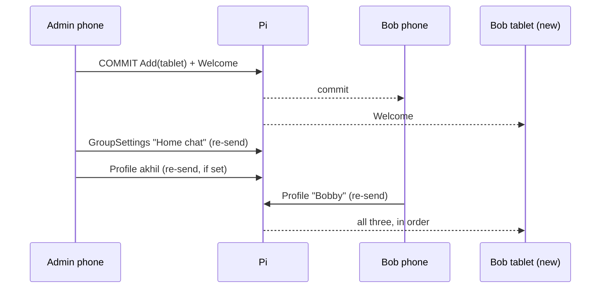

## Context

QA runs 1 and 2 through the real Pi found seven gaps (F1–F7) plus the look of
own messages. The owner decided (2026-11-14): fix them all before
`qa-verification`; own messages get no label; a reset user's old profile is
cleared; all notices (removed, rename, member/device); reconnect on network
return; the Pi kernel check.

## Goals / Non-Goals

**Goals:** every device shows the same names; removed devices know it; the
chat explains membership changes; own messages read as own; faster reconnect;
`check.sh` catches a pending kernel reboot.

**Non-Goals:** keeping notices across app restarts (still in app memory only),
a "rejoin with a new invite" flow on a removed device (reinstall, as today),
history for new devices, profile-change notices.

## Decisions

### D1. Own-user messages (run 1, F4)

`ChatMessage` gets `own_user: bool` (the sender is this device's user), next to
`outgoing` (this device sent it). The core sets it (`client::Message`), the
bridge maps it. Own-user messages are right-aligned, sized to
their text and have no sender label; only `outgoing` ones show ⏳/✓, inline at
the end of the bubble.

Cause of the full width: the status `Align` inside the bubble's `Column`
stretches to the maximum width, so the bubble fills the screen and looks
left-aligned. The fix sizes the bubble to its content.

### D2. Late joiners get the group name and profiles (F1)

Group name and profiles are only sent when they change, so a device added later
never sees them. MLS has no channel for app state in a Welcome that the Pi can't
read: group-context extensions travel in the commit, which the Pi checks
(breaks "group settings and profiles travel only inside encrypted messages").

So after a device merges a commit that adds one or more devices:

- each **admin** device re-sends the current `GroupSettings` if a name is set;
- **every** device re-sends its own user's `Profile` if one is set.

Duplicates are harmless: a received value that equals the stored one changes
nothing. A notice shows only when a stored value existed and changed (D5), so
re-sends and a new device's first sync are silent. Re-sends go through the normal
outbox (same `STALE_EPOCH` handling). The cost is one message per device per add
in a small group.

### D3. Reset clears the old profile (F3)

When the core raises `IdentityKeyChanged` for a user, it deletes that user's
stored profile at once, so the warning and later messages show the username only
("bob's key changed"). A new profile comes only from the new identity's devices.

### D4. Removed devices are told (F2)

Today a revoked device's `Authenticate` gets the same `UNAUTHENTICATED` as a
replayed nonce, so the core retries forever.

- **Pi:** `Authenticate` checks the signature first; only for a valid signature
  from a revoked device does it return `PERMISSION_DENIED` ("device revoked").
  Without the device's auth key nobody learns whether a device is revoked. An open
  `Connect` stream of a device being revoked closes with `PERMISSION_DENIED`.
- **Core:** on `PERMISSION_DENIED` from `Authenticate` or the stream, it emits
  `Removed` once, stops connecting (like `ServerIdentityError`), and keeps local
  history readable.
- **App:** a notice "This device was removed from the group.", the indicator shows
  removed, the composer is disabled.

Admin removal and a user revoking their own lost device both revoke, so the
text names the device, not the reason.

Implementation (part A): the core also treats `PERMISSION_DENIED` from a
token renewal on the open connection as removed. `Removed` is emitted once per
`start()`; a later `start()` (an app restart) authenticates again and emits it
again, so the app learns it on every launch. `reconnect_now` does nothing once
removed.

### D5. Chat notices (F6)

- `GroupSettingsChanged` gains `by: UserId`. The app shows "akhil renamed the
  group to “Home chat”" when a stored name existed and differs.
- `MembersChanged` gains `added: Vec<Member>`, `removed: Vec<Member>` and
  `by: Option<UserId>` (the committer's user). The app shows:

| Change | Notice |
| --- | --- |
| first device of a user added | "bob joined" |
| another device of a member added | "bob added a device" |
| all devices of a user removed by another user | "akhil removed bob" |
| one device removed by its own user | "bob removed a device" |
| inactivity Remove (Pi proposal) or re-add of the same device id | none |

A device that has just joined shows no notices for the commit that added it.

Implementation (part A), the shapes the app gets:

- `MembersChanged { added, removed, by, automatic }`: `added` and `removed`
  list every device the commit changed; `automatic` lists those of them that
  changed on their own (a Remove the Pi proposed for inactivity, and the
  re-add of such a device id, also a Remove + Add of the same id in one
  commit). The UI shows no notice for a device in `automatic`. For a Welcome
  (this device joined or rejoined) all lists are empty and `by` is `None`; for
  creating the group they are empty with `by` the admin.
- To know a re-add, each device records the device ids the Pi's Removes took
  out (client migration `0004_inactive_devices.sql`) and drops the row when
  the id is added again. A device that joined after the inactivity Remove has
  no row, so it would show the re-add as "bob added a device"; acceptable for
  a rare case.
- `GroupSettingsChanged { name, previous, by }` and `ProfileChanged` are
  emitted only when the stored value changes, so re-sends (D2) emit nothing.
  `previous` is the name stored before: `None` means a first sync (the device
  just joined), when the app shows no rename notice.
- `IdentityKeyChanged` is followed by `ProfileChanged` with both fields unset
  when a stored profile was dropped (D3), so the app reloads that name.

### D6. Reconnect when the network returns (F5)

The app listens to `connectivity_plus` and, on a change to any connection,
calls `reconnect_now()`. The core skips the current backoff wait if it is
disconnected and does nothing if connected. The core can't watch the phone's
network itself without platform code, so the app does it. `connectivity_plus` is
a Flutter Community package for iOS and Android with no extra permission beyond
Android's `ACCESS_NETWORK_STATE`.

### D7. Pending kernel reboot (F7)

Raspberry Pi kernel packages don't create `/run/reboot-required`. `check.sh`
warns `kernel-reboot` when `/lib/modules/` has a kernel with the running
kernel's flavour suffix (e.g. `+rpt-rpi-v8`) whose version sorts above
`uname -r`. Other flavours (`-2712` for the Pi 5) are ignored. A warning, not a
failure, like `reboot-required`.

### D8. Invite revoke is logged

The Pi logs `revoked an invite` (the kind of event and ids, never content), like
`created an invite`.

## Risks / Trade-offs

- [Re-send storm in a busy add] → one message per device per add; the group is
  small and adds are rare.
- [A removed device keeps old history] → expected; it was readable before. It no
  longer receives anything.
- [`PERMISSION_DENIED` from an old Pi] → old Pis send `UNAUTHENTICATED`; the core
  behaves as before (retries).

## Migration Plan

Deploy the new server to the Pi after `backup.sh`. Old apps keep working (they
retry on `PERMISSION_DENIED` as on any error). The group is kept; no re-join.
