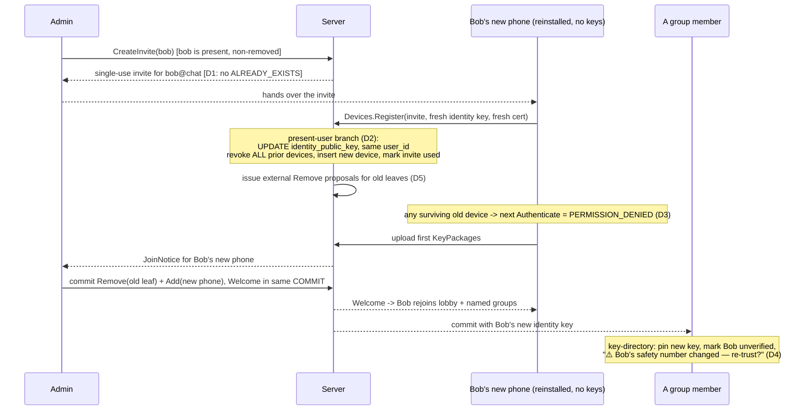

# Design — reinvite-user

## Context

A person reinstalls the app (or clears its data). The OS key store that held their
identity, auth, MLS and storage keys is gone, so the fresh install comes up with **no
account** (`client/src/client.rs`: `register()` only guards against an account that is
still present — there is none here, so the stuck-device dead end `replace-user` has to
solve does not arise). On the server the username still exists with `removed_at IS
NULL`. The admin wants them back on the **same name**.

The server has every piece already; it just gates them behind a prior remove:

- `Admin.CreateInvite` (`server/src/admin/mod.rs:58-104`) rejects a present,
  non-removed username at `:76` (`records::user(..).is_some_and(|u| !u.removed)` →
  `ALREADY_EXISTS`), then idempotently returns any still-usable invite, else mints one.
- `register()` (`server/src/devices/mod.rs:384-440`) validates the invite first
  (`:391-405`: absent / used / revoked / expired → `PERMISSION_DENIED`), verifies the
  certificate names `username@server_id` (`:407-413`), then branches on the user row:
  - `None` → create user + device (`:412-418`).
  - `Some(user) if user.removed` → **re-key**: `UPDATE users SET identity_public_key =
    ?, created_at = ?, removed_at = NULL` (`:419-427`); old devices stay revoked.
  - `Some(_)` → `ALREADY_EXISTS` (`:434`).

The removed-user re-key machinery at `:419` is exactly what a re-invite needs; the only
new work is to **reach it for a present user when a valid invite vouches for it**, and
to revoke the present user's still-active devices (the removed-user branch can assume
they are already revoked by `RemoveUser`; the present-user branch cannot).

## Decisions

### D1. A fresh single-use admin invite is the whole authorization — no new flag, field or RPC.
Considered a dedicated "re-key" RPC or a `bool rekey` on `CreateInviteRequest`.
Rejected: the invite is **already** the capability. It is admin-only
(`device-identity: Invites`), single-use, username-bound and 7-day-expiring; whoever
holds a fresh one for `bob@chat` has been authorized by the admin to onboard a device
as `bob@chat`. Letting that same artifact also authorize a re-key keeps the trust model
("the admin vouches via the invite") identical to the removed-user reset path, adds no
wire surface, and keeps the proto untouched (D6). The server infers "this is a re-key"
purely from the fact that the invite's bound username is a present user at register
time. Trade-off: an admin who mints an invite for a name they forgot is still live will
re-key (and kick) that live user — mitigated entirely in UX by the mandatory confirm
(D3), not by a wire flag.

### D2. Register re-keys a present user in a new branch, with no prior `RemoveUser`.
Add a branch to `register()` between the removed-user and the `ALREADY_EXISTS` cases:
`Some(user) if !user.removed` → treat as a re-key **because the invite is valid** (the
invite has already been validated above, so reaching this branch means an admin
authorized it). It runs the same `UPDATE users SET identity_public_key = ?,
created_at = ? WHERE username = ?` as the removed-user branch (here `removed_at` is
already NULL, so it need not be cleared), then **revokes every one of the user's prior
devices** (`auth::revoke_device` per `records::active_devices`, the same call
`Admin.RemoveUser` makes at `server/src/admin/mod.rs:279`) before `insert_device` adds
the new one and the invite is marked used. Keeping the same `users` row keeps the same
`user_id` (`username@server_id`), so to peers this is "same user, new identity key",
not a new user.

Alternative rejected: have the client call `RemoveUser` then `CreateInvite` under the
hood (today's two-step, scripted). Rejected: it still closes DMs and revokes invites as
a side effect, briefly marks the account `removed`, and needs two round trips and admin
authority wired into the re-invite button; the direct branch is one transaction and one
gesture.

### D3. Re-key invalidates **all** of the user's existing devices; the UI must warn and confirm.
Unlike the removed-user path (where `RemoveUser` already revoked the devices), a present
user may still have a **working** phone or tablet. The re-key MUST revoke them — two
identity keys for one user would break `key-directory: Clients verify the identity
chain` for everyone. So re-inviting a user who still has live devices **logs those
devices out** (they fail their next `Devices.Authenticate` with `PERMISSION_DENIED`,
and the core treats that as `Removed`, `client-runtime: Connection lifecycle`). This is
correct for the intended case (the person lost their only device) but destructive if
done by mistake, so the admin app MUST show a confirm dialog naming the person and
spelling out "this resets their devices; they keep the username but lose on-device
history" **before** calling `CreateInvite` (D8, `app-ui: Re-invite action`). There is no
in-band notice to the kicked device beyond `PERMISSION_DENIED`; a durable "you were
re-keyed" frame is `replace-user`'s surface (its `AccountRemoved` frame) and is left to
reconcile there, not duplicated here.

### D4. Peers re-trust through the existing identity-change mechanism — no new client requirement.
The re-key changes the user's pinned identity key. `key-directory: Clients verify the
identity chain` already mandates, for **any** user whose pinned key changes, that the
client pins the new key to keep decrypting, marks the user **unverified / pending
re-trust**, shows "⚠️ `<user>'s` safety number changed — re-trust?", and never silently
auto-accepts (its scenarios "Admin re-adds a reset user" and "Back from holiday after a
reset" are this exact shape). A re-invite is indistinguishable from those at the member:
an admin-committed Add of a device whose certificate needs a new identity key. So no
new or modified client requirement is needed; `reinvite-user: Re-invite changes the
user's identity key for peers` states the delegation and gives the change a testable
home, and enforcement stays in `key-directory` (the client). The one guard that matters
is already there: only an **admin**-committed Add with a changed key is accepted; the
same change in a non-admin commit is rejected — and the re-key's re-add is admin-driven
(D5).

### D5. No orphaned old leaf: server evicts the revoked leaves, the admin re-adds via the normal path.
After the re-key, the old devices are revoked but their leaves still sit in the lobby
and named groups, and `RemoveUser`'s precondition ("the admin first commits Removes of
all the user's devices") was never run. Two sub-decisions:

- **Eviction of the stale leaves** reuses the server's existing external-Remove
  machinery for revoked/inactive devices (`group-membership: Inactive devices are kept
  out`): the server issues an MLS external Remove proposal for each revoked old leaf,
  reissued each epoch until a member commits it. Implementation should mark the re-keyed
  user's old leaves for removal in the same way a revocation does, rather than inventing
  a second eviction path.
- **Re-adding the reinstalled device** uses `group-membership: Automatic add of new
  users` unchanged: once the new device uploads its first KeyPackages, the server sends
  the admin a `JoinNotice`; the admin's device fetches a KeyPackage, sees the changed
  identity key, re-trusts (D4), and commits the Add — ideally **together** with the
  pending Remove of the old leaf, Welcome in the same `COMMIT`, so there is never an
  epoch with both leaves or a lingering orphan.

**DMs** are deliberately not covered normatively (D below): the lobby/named-group path
above is the scope.

### D6. Proto-first check: nothing in `proto/vyajena/v1/` must change.
`CreateInviteRequest` already carries `username` and `RegisterRequest` already carries
the invite code, identity key and signed certificate. The behaviour change is entirely
server-side validation (`create_invite`, `register`) plus client UX. No message, field
or enum is added or altered, so there is no `buf lint` / `buf breaking` / `cargo run -p
pbgen` step and `PROTOCOL_VERSION` does not move. An old client is unaffected: it simply
gains the ability to onboard against a username that previously returned
`ALREADY_EXISTS`.

### D7. Standalone `reinvite-user`, reconciled with `replace-user` — recommended over folding.
`reinvite-user` and `replace-user` (Phase 1) share one surface — the `register()`
re-key branch — and both change the user's identity key so peers re-trust. But they are
**different triggers with different mechanisms**:

| | `reinvite-user` | `replace-user` Phase 1 |
|---|---|---|
| Trigger | user reinstalled, keys gone | admin removes + re-issues |
| Prior `RemoveUser`? | **No** | Yes |
| Server re-key path | **new** present-user branch | existing removed-user branch (`:419`) |
| Client `reset()`? | No (no local account) | Yes (stuck device must be wiped) |
| New `ServerFrame`? | No | Yes (`AccountRemoved`) |
| Proto change? | No | Yes (`messaging.proto`) |
| Username | same only | same or new |

Folding would push `reinvite-user`'s distinct server branch and admin UX into an already
large bug-fix-plus-feature change, and gate a small, independently shippable win behind
`replace-user`'s proto, `reset()` and removed-device-screen work. Keeping it standalone
lets it ship on its own and, in fact, makes `replace-user`'s **same-username** case
redundant: re-invite is "replace when the name is unchanged" without the remove or the
wipe. `replace-user` stays needed for (a) **new-username** replacement and (b) the
**stuck device that still holds its old account** (reset path).

**Requirement overlap to keep the two changes from conflicting:**

- Both want to change `device-identity`'s register behaviour. To avoid two `MODIFIED`
  deltas colliding on `Requirement: Signup with an invite` (whichever applies second
  would fail to match the baseline text), `reinvite-user` **ADDs** a distinct
  `Requirement: Re-inviting an existing user` instead of modifying "Signup with an
  invite". `replace-user`'s `MODIFIED: Signup with an invite` and this ADDED requirement
  coexist. Implementation MUST land the two `register()` re-key branches
  (removed-user and present-user-with-invite) coherently — ideally in whichever change
  merges first, with the second rebased onto it.
- Both touch `app-ui`'s admin surface. `replace-user` `MODIFIED: Admin screens`;
  `reinvite-user` **ADDs** `Requirement: Re-invite action` rather than modifying the
  same requirement, so there is no `app-ui` collision either.
- `reinvite-user` does **not** touch `group-membership: Removing a user` (which
  `replace-user` modifies) or `key-directory` (D4 delegates without a delta), so those
  surfaces have no overlap.
- Sequencing: land `reinvite-user` **independently of but reconciled with**
  `replace-user` — whichever is implemented first defines the `register()` re-key
  structure the other reuses. The tracker coordinates which merges first.

### D8. The one-tap "Re-invite" affordance: this change, as the deferrable slice.
Spec the `app-ui` requirement now and build it in this change, as the last slice. The
server behaviour (D1–D5) is the part that must land; the button is a thin call to
`Admin.CreateInvite(sameUsername)` plus the share sheet already used by the create-user
affordance, behind a confirm dialog. It can be deferred to a follow-up without blocking
the server change (the two-step admin flow keeps working), but it is small enough to
include. Recommendation: **include it**; mark its task deferrable so the owner may split
it if they want the server change to ship first.

### D (scoped out). DMs after a re-key.
On re-key the user's old DM leaves go stale (old devices revoked). DMs are not in the
baseline `openspec/specs/` (the `direct-messages` capability lives in the still-unarchived
`dms`/`remove-closed-dm` work), so a `direct-messages` delta would fail `openspec
validate --strict` and would collide with `replace-user`'s folded DM clause. This change
therefore leaves DM re-establishment **out of the normative spec**: the peer sees the
changed identity key via `key-directory` like any other re-key, and full DM re-key /
re-open behaviour is reconciled with `remove-closed-dm` / `replace-user` when `dms` is
archived. Called out here so implementers do not assume DMs "just work" after a re-key.

## Flow (re-invite on a reinstalled device)

## Open questions for the owner

- **OQ1:** Confirm a re-invite should **hard-kick** any still-live devices of that user
  (D3), rather than refusing when the user still has an active device. (Assumed: kick,
  since the whole point is a lost-device recovery; a refuse-if-active variant would make
  the common case need a remove again.)
- **OQ2:** Should `Admin.CreateInvite` for a present user be allowed **unconditionally**
  (any present user), or only when the user has **no active device** (server checks
  `records::active_devices` is empty)? Unconditional is simpler and matches "the admin
  knows what they're doing + confirm dialog"; the no-active-device guard is safer but
  blocks re-keying a user whose old phone is merely online. (Assumed: unconditional,
  gated by the UI confirm.)
- **OQ3:** Reuse of the inactive-device external-Remove path for eviction (D5): confirm
  that marking a re-keyed user's old leaves through the existing revocation/inactivity
  machinery is acceptable, versus requiring the admin device to commit the old-leaf
  Removes explicitly (as `RemoveUser`'s precondition does today).

## Spikes

- **S1:** Prove that adding the present-user re-key branch to `register()` plus revoking
  the user's active devices in the **same transaction** leaves no window with two valid
  identity keys and no `insert_device` collision (the reinstalled device mints a fresh
  `device_id`, so the `:52` same-`device_id` guard is not hit). Result → here.
- **S2:** Prove the old leaves are evicted with no orphan: after the re-key, the server's
  external Remove for each old leaf and the admin's combined Remove+Add (Welcome in the
  same `COMMIT`) leave the group with exactly the new device's leaf, across the lobby and
  a named group, with a member offline during the re-key catching up cleanly on
  reconnect. Result → here.
