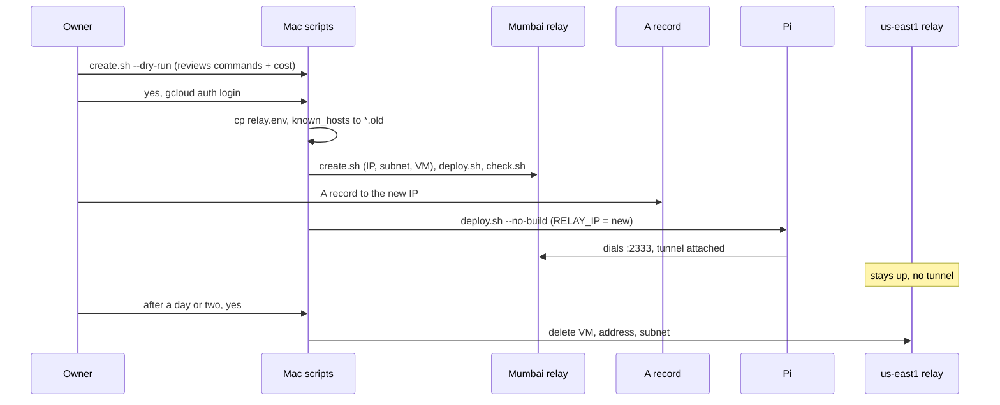

## Context

The relay (`vyajena-relay`, rathole 0.5.0, a native systemd unit; Docker is used
only at build time) is in `us-east1-b`. The Pi and all users are in India.
Measured 2026-11-20 from India: TCP connect to `vyajarelay.purplechaamba.com:443`
takes 0.25–0.32 s, every time. The round trip is the cost, not the relay's
work. It is stateless: ciphertext passthrough, logs in RAM, no service
account; TLS ends on the Pi.

## Goals / Non-Goals

**Goals:** relay region `asia-south1`; no re-join, no new pin; a reversible move
on the owner's word only.

**Non-Goals:** a bigger VM (e2-micro kept; e2-small is an option if CPU-burst TLS
spikes persist), containerising the relay, any change to rathole, the Pi or the
apps, tuning rathole's data-channel pool (a separate idea).

## Decisions

### D1: Mumbai (`asia-south1`), zone `-c`

GCP has no Bangalore region. India is `asia-south1` (Mumbai) and `asia-south2`
(Delhi). Mumbai is older, cheaper and has every service. Expected round trip
260 ms → 20–40 ms. Zone `-c` is one of three zones (`-a`, `-b`, `-c`); any works
for a single e2-micro.

### D2: What does not change, and why the move is low-risk

| Thing | Effect |
|---|---|
| Pi TLS pin | Unchanged: TLS ends on the Pi, never on the relay |
| Invites and devices | Unchanged: they name `vyajarelay.purplechaamba.com:443`, and a device resolves it on each connect |
| Noise key pair, rathole token, SSH key | Reused from `~/.vyajena-relay/`; not region-bound |
| Firewall rules, VPC | Global; they already exist, `create.sh` skips them |
| Static IP | Regional: a new Mumbai address, same name `vyajena-relay` (names are unique per region) |
| Subnet | A new `vyajena-relay` subnet in `asia-south1` with a **new range** `10.43.0.0/28`: the VPC is global and subnet ranges must not overlap while the old `10.42.0.0/28` exists |
| Pi | `relay.env` `RELAY_IP` → new IP, tunnel unit and config redeployed; the Pi dials out to the new relay |
| Data | None to move |

### D3: Cost, runbook and rollback

**Cost** (on-demand list, asia-south1): e2-micro ~$7.3, static IPv4 ~$3.65
(already paid today), 10 GB standard disk ~$0.4, egress negligible ≈ **$11/month
(~₹1,120 with 18% GST)**, about **₹600/month more** than now. The us-east1 VM is
free tier. Owner approved 2026-11-20.



Order matters at the cut-over. Devices that still resolve the old IP reach a relay
with no tunnel, so they fail and retry with backoff until the TTL passes; the
window is the A record's TTL (lower it ahead). Devices that resolve the new IP
before the Pi attaches fail the same way for the minutes between the DNS
change and the Pi deploy, so the owner does the two back to back.

**Rollback** (while the old VM exists): put the A record back to
`104.196.102.174`; `cp relay.env.old relay.env; cp known_hosts.old known_hosts`
(the scripts then talk to the old IP; the old VM's zone is `us-east1-b`, so use
`ZONE=us-east1-b REGION=us-east1` from `git show` of the old `relay.conf` if a
script must reach it); `deploy/pi/deploy.sh --no-build` re-renders the tunnel
with the old IP. Nothing else changed on the Pi.

**Delete the old relay** (only on the owner's yes, after devices have connected
through Mumbai, and not before DNS has propagated):

```
gcloud compute instances delete vyajena-relay --zone=us-east1-b --project=vyajena
gcloud compute addresses delete vyajena-relay --region=us-east1 --project=vyajena
gcloud compute networks subnets delete vyajena-relay --region=us-east1 --project=vyajena
```

`create.sh` and `check.sh` read `relay.conf` only; after this change they manage
the Mumbai VM, never the old one.

### D4: `check.sh` enforces the region

The old check passed any of three free-tier US regions. It now wants
`asia-south1` and says why. The disk limit stays (pd-standard, at most 30 GB): it
is a size discipline, not a free-tier claim, and the message no longer says
"free tier". The deploy test pins `REGION`, the zone prefix, the subnet range and
`--region=asia-south1` on the dry run's regional commands.

### D5: What this change does not do

It touches no real system. `relay.conf` is read by `deploy/relay/*.sh` and
`deploy/pi/*.sh`, so the next `deploy/pi/deploy.sh` or `relay/check.sh` after
this lands on `main` already assumes Mumbai. **Do not run any of them until the
owner has done the move (tasks 4.x), or the checks will look for a VM that does
not exist yet.** Merge and run the move as one sitting.

## Risks / Trade-offs

- [Scripts read the new region before the new VM exists] → D5: land the commit
  and do tasks 4.x in the same sitting.
- [DNS cache keeps some devices on the old IP for the TTL] → lower the TTL ahead;
  keep the old VM until devices are seen on the new path.
- [Mumbai e2-micro CPU-burst spikes] → same hardware class as now; e2-small
  (~2×) is the lever if they show up.
- [`create.sh` overwrites `relay.env` and `known_hosts`] → tasks 4.3 copies them first.
- [New money] → owner approved (₹600/month more).

## Migration Plan

Tasks 4.1–4.9. Rollback: D3.

## Open Questions

None for the owner beyond the yes before the dry run's real run.
