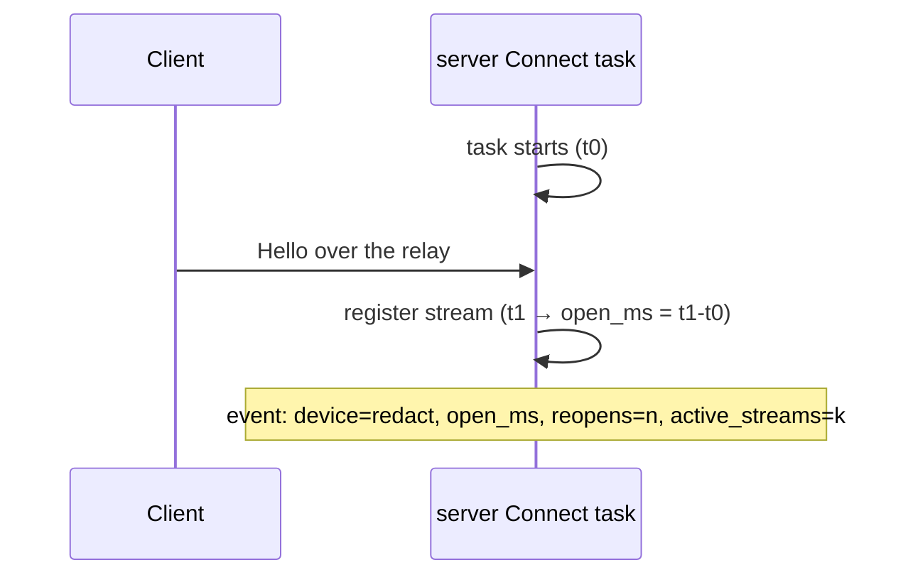

## Context

The server uses `tracing` with an `EnvFilter` (`info` by default; the service sets
`RUST_LOG=info`). Ids are formatted for logs with
`runtime::server_keys::hex(&bytes)` — full hex. A `device_id` is a 16-byte stable
id; several `info!`/`debug!`/`warn!` lines print it in full. There is no metrics
facility.

An audit of `server/src/` found no log of a message body/ciphertext, session
token or invite code; usernames and hashed MLS refs are logged, which are ids,
not secrets.

## Goals / Non-Goals

**Goals:**
- A device id never appears raw in a log — only a short stable hash so lines can
  still be correlated.
- A guarantee (with a test) that bodies, tokens and invites never reach logs or
  metrics.
- Enough connection-lifecycle signal in the journal to diagnose slow connects.

**Non-Goals:**
- A metrics exporter / `/metrics` endpoint or a new dependency (D2).
- Instrumenting rathole or the relay VM (out of this repo; D3).
- Changing what is stored, or any wire/proto change.

## Decisions

### D1 — Short stable hash for ids, not truncation

`redact(id) = hex(SHA-256(id))[..12]` in a new `server/src/runtime/redact.rs`,
exposed as a `Display` wrapper so call sites read
`tracing::debug!(device = %redact(&device_id), ...)`. A hash (not a prefix of
the raw id) means the log value is stable for correlation but is not the id
itself, so a leaked journal does not hand out device ids. 12 hex chars (48 bits)
is enough to avoid collisions across one server's devices. `server_keys::hex`
stays for non-id bytes (e.g. pins already shown truncated).

**Alternative:** truncate the raw id (first N bytes) — rejected: that is still
part of the real id.

### D2 — Metrics as structured tracing events, not an exporter

The server is loopback-only and privacy-first; adding a Prometheus endpoint means a
new port, surface and dependency. Instead, emit `tracing` events with numeric
fields at the lifecycle points, so `journalctl -u vyajena -o json` yields the
numbers. On a `Connect` stream opening, one event carries:

- `open_ms`: the time in the `Connect` task from the task starting to the stream
  registering with the hub — i.e. how long the client took to send its first
  `Hello` over the relay once the stream RPC began. This is the server-visible
  connect latency and the signal a "slow to connect over the relay" report needs.
- `reopens`: how many times this device's stream has (re)opened this process run
  (a reconnect counter), from a per-device count in the hub.
- `active_streams`: the hub's live-stream count — the server-side "pool" gauge (D3).
- `device = %redact(id)`.

**Why not `auth_ms` / `connect_ms` (changed from the first draft — code review,
CLAUDE.md "fix the spec first"):** the server cannot usefully measure them. Per-RPC
auth is a single indexed SQLite token lookup (sub-millisecond, never the
slow-connect cause), and the client's multi-round-trip handshake
(`GetChallenge` → `Authenticate` → `Connect`) arrives as separate RPCs the server
does not stitch into one per-device timeline. `open_ms` captures the
server-visible part of the connect latency; the rest is a client-side concern
(faster-connect already addresses the round trips).

**Alternative:** a real metrics crate (`metrics`/`prometheus`) — deferred; the
journal-event approach fits the loopback model and needs no new surface.

### D3 — "Backhaul pool" on the server = the active-stream count

The relay↔server backhaul is rathole, a separate process; the Rust server cannot see
rathole's connection pool. The server-side signal for "pool health" is the hub's
`active_streams` gauge (D2). The design records this boundary so the metric is
not mistaken for rathole's pool.

### D4 — A test proves the redaction

A `server/tests/` test captures the subscriber output while it runs a real
connect → auth → stream (temp server), then asserts the captured text contains
neither the raw `device_id` hex, nor any body/token/invite, and does contain the
`redact(id)` value plus the timing fields. A shared `tracing` capture layer
(a `Vec<String>` writer) makes the assertion deterministic.

## Risks / Trade-offs

- **[Hash correlation]** → a redacted id is still a stable pseudonym, so a
  journal still correlates one device's lines. That is intended (needed to debug
  a single device); it just no longer reveals the real id. Acceptable.
- **[Journal-based metrics]** → no scraping/dashboards out of the box; fine for a
  single server debugged over SSH, and revisitable if an exporter is ever wanted.
- **[Timing overhead]** → three `Instant` reads per connect; negligible.

## Open Questions

- None blocking. If the owner later wants scrape-able metrics, D2 can grow into
  an exporter without changing the redaction work.
