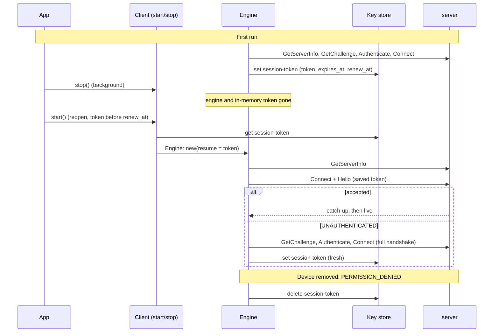

## Context

`faster-connect` (merged, live) lets a running engine reopen its `Connect` stream
with the session token it already holds: two round trips (`GetServerInfo` +
`Connect`) instead of four. But the token is `Engine::resume`, a field set to
`None` in `Engine::new`. The app calls `core.stop()` when it goes to the
background and `core.start()` when it comes back (`app/lib/app/lifecycle.dart`,
by design: no socket survives a suspended app, and a fresh run catches up in
order). Each `start()` builds a new engine, so the token is lost and every
reopen pays the full handshake over the ~260 ms India→US→India relay.

Tokens also live only one hour (`SESSION_TOKEN_MAX_LIFETIME`), so even a kept
token would be dead for most reopens. The owner decided (2026-11-20): 6 hours,
and keep the token across `stop()`/`start()` in the OS key store.

## Goals / Non-Goals

**Goals:**
- A reopen within the token's life takes the two-round-trip resume path.
- The token is never written outside the key store.
- Failure of the key store, or a stale/unknown token, only costs the old full
  handshake.

**Non-Goals:**
- Caching `GetServerInfo` (faster-connect D3 "later option").
- Any proto, server behaviour or relay change (the relay region is change `relay-mumbai`).
- Keeping a socket open while the app is suspended (the OS does not allow it).

## Decisions

### D1: No proto change

The token is a connection-independent bearer (faster-connect D1); the server
authenticates `Connect` from `authorization` alone. Persisting it on the device
adds nothing to the wire. `buf breaking` is trivially clean, `pbgen` is not run.

### D2: The token lives in the key store as `KeyName::SessionToken`

`KeyName` gets a fifth secret, name `session-token`, next to the identity, auth,
MLS and storage keys. Everything already built for those (OS keychain, iOS
Keychain, Android Keystore, the opt-in 0600 file, the in-memory test store)
stores it with no new code, and the invariant "secrets only in the key store,
never SQLite, logs or files" holds without an exception. The value is
`version(1) | expires_at secs (u64 BE) | renew_at secs (u64 BE) | token utf-8`.
Unknown version, short or non-UTF-8 value decodes to `None` (full handshake), never
an error. Times are seconds since the Unix epoch, compared with the core's clock as today.

The test that said `KeyName::parse("session-token") == None` guarded the name from
being a key; it now checks another unknown name.

### D3: Security — a 6 h bearer token on the device

Longer life means a longer window if the token is stolen. What bounds it:

- It sits in the same key store as the device's auth key, which would let a thief
  mint tokens at will anyway; the token adds no weaker place than the key already
  has. It is never in SQLite, logs or files (a log line only says "resume token
  saved/loaded" and its expiry, never the value).
- Removing a device revokes it on the server: `revoke_device` deletes all its
  `sessions` rows (`server/src/auth/mod.rs::end_sessions`), so a stolen token
  stops working the moment the admin removes the device. A revoked device with a
  token gets `UNAUTHENTICATED` on the stream, falls back to `Authenticate` and
  meets `PERMISSION_DENIED` (faster-connect, covered by a test).
- The token authenticates one device's RPCs over the server's pinned TLS; it never
  decrypts anything: MLS keys are separate and unchanged. A stolen token can open
  the stream and receive ciphertext, nothing more.
- iOS Keychain survives an app reinstall: a leftover token from an older install is
  just rejected or expired, and `create_fresh` deletes it when the device gets new
  keys.

The owner accepted the 6 h window; removal is the revocation path.

### D4: Save on obtain/renew, load on start, delete on removal

- **Load** in `Client::start()` beside `DeviceKeys::load`, already in
  `spawn_blocking` (a keychain call can wait on a permission dialog); passed to
  `Engine::new`. Any error or malformed value is a `warn!` and `None`.
- **Save** when `connect()` succeeds with a token that differs from what was last
  saved, and after each renewal. A resumed connect reuses the same token, so no
  write. It runs in `spawn_blocking` and is awaited, so the engine loop never
  makes a blocking keychain call and writes stay in order. Failure is a `warn!`;
  the in-memory token still resumes in-run reconnects.
- **Delete** in the engine's `removed()` (the one place `PERMISSION_DENIED` ends
  up) and in `DeviceKeys::create_fresh`. `removed()` stays synchronous and starts
  the delete as a blocking task, since nothing connects after it.
- The existing rule `usable(now) = now < renew_at` still gates reuse, so a loaded
  token lands with at least 5 minutes of margin.

### D5: Old and new, server and core, interoperate

The core reads the token's lifetime from the server's `expires_at`, capped at
`SESSION_TOKEN_MAX_LIFETIME`. An old server (1 h) with a new core: a 1 h token is
saved and resumed within the hour, no harm. A new server (6 h) with an old core: the
core renews 5 min before expiry as before, now every 5 h 55 m. Rollout order is
free; there is no migration.

### D6: Tests move with the lifetime

The two tests that advance the device clock by 56 min to reach the renewal point
of a 1 h token now advance 5 h 56 min. They pin `renew_at = lifetime − 5 min`
without hard-coding the new number twice: a `SESSION_TOKEN_MAX_LIFETIME`-based
constant in the test.

## Risks / Trade-offs

- [A 6 h token is stolen with the device's key store] → The auth key in the same
  store is worse; removal deletes the sessions on the server (D3).
- [Keychain write on every first connect adds a blocking call] → One small write
  per fresh token (about once per 6 h of use), off the engine thread.
- [Stale token from a previous install or account] → Rejected with
  `UNAUTHENTICATED`, one wasted stream open, then the full handshake (faster-connect risk,
  unchanged); deleted on fresh keys.
- [Clock skew makes a loaded token look valid or expired] → A wrongly valid token
  is rejected by the server and falls back; a wrongly expired one only skips the
  speed-up.

## Migration Plan

Client + one constant. Deploy the server (`deploy/server/build.sh && deploy.sh --no-build`)
and ship an app build, in either order. Rollback: revert the commit; the saved
`session-token` entry is then ignored and left in the key store (harmless, expires
in at most 6 h).

## Open Questions

None. The relay region is change `relay-mumbai`.
