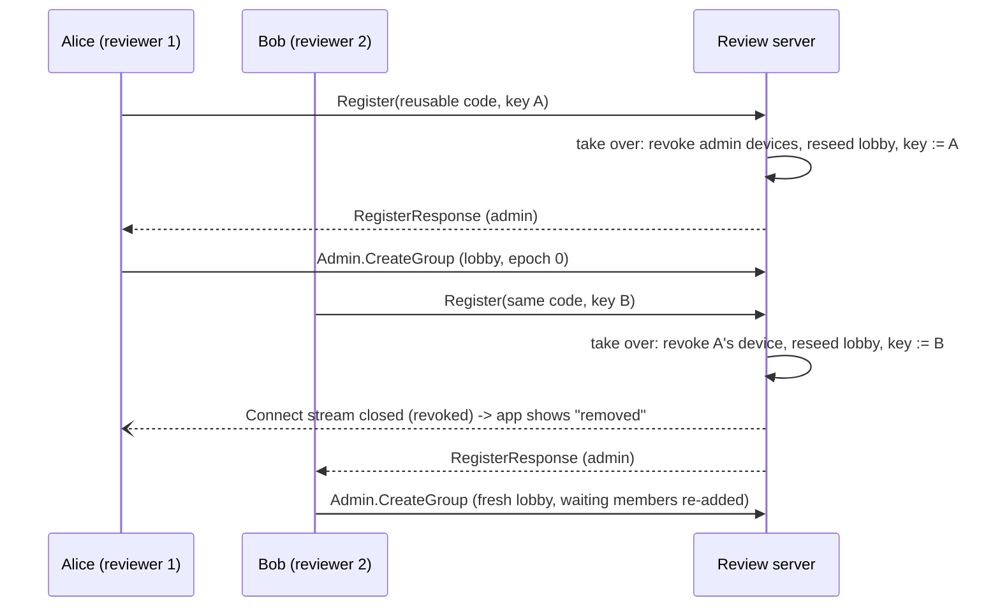

# Design: review-admin-invite

## Context

The review server (change `review-server`) is a second, empty instance of the
server for store reviewers. The reviewer is its admin, so they reach every
feature. Today the only way in is the single-use, 7-day bootstrap invite, so
each review needs an owner reset. The owner wants: provision once, hand off one
invite, reviewers join and re-join freely (2026-11-27).

Everything needed already exists: the invite payload, the re-key path in
`Devices.Register`, and the `admin-reset` transaction (revoke the admin's
devices, re-seed the lobby, re-announce members). This change wires them
together behind one config flag.

## Decisions

### D1 — The reusable invite is an invite row with a `reusable` flag

A new migration adds `invites.reusable INTEGER NOT NULL DEFAULT 0`. When the
config sets `[review] reusable_admin_invite = true`, startup ensures exactly one
row with `reusable = 1`, `username = admin_username`, a random code from
`invites::new_invite_code()`, `expires_at` far in the future (ignored for
reusable rows) and `used_at` never set. It survives restarts and upgrades;
`deploy.sh --reset-review` wipes it along with the TLS key, so the payload
changes only then.

Rejected: the code as a secret in `review.toml`. It needs a new secret in
`~/.vyajena-relay/`, `secrets.sh` and `render.sh` plumbing, and puts the code in
a file outside the database for no gain.

### D2 — Using it takes over the admin seat (last join wins)

`register()` checks for a reusable row first. If the code matches one and the
flag is on, it runs `take_over_admin` in the same transaction:

1. revoke every active admin device (returned, so their streams close);
2. revoke the admin's unused **single-use** invites (never the reusable one);
3. `membership::group::reseed_system_group` (drops the lobby, re-announces
   members), the same call `admin-reset` makes;
4. set the admin's identity key to the new one and clear `removed_at`
   (insert the user if it does not exist yet);
5. insert the device; do **not** set `used_at`.

Steps 1–3 move out of `runtime::admin_reset::reset_admin` into a shared
function both paths call, so the two can never drift.

With the flag off, a reusable row is treated as unknown (`PERMISSION_DENIED`),
so turning the flag off disables the invite without a database edit.

Owner, 2026-11-27: one invite and last join wins, not one per store. Reviews
rarely overlap; a reviewer pushed out pastes the invite again.

### D3 — No bootstrap invite on a review server

`ensure_bootstrap_invite` returns `NotNeeded` when the flag is on; startup calls
`ensure_reusable_admin_invite` instead. One way in, not two.

### D4 — Hand-off by a host-only subcommand, not a log line

`server review-invite --config <toml>` opens the database and the key dir,
builds the `InvitePayload` (public address, TLS pin, code, admin user id) and
prints it. `deploy.sh --review-invite` runs it as `vyajena-review` over SSH and
writes the output straight to a 0600 file under `~/vyajena-server-backups/`.
The owner can fetch it again at any time, so losing the file is harmless. The
server logs only "review admin invite ready", never the code.

Rejected: printing it once at creation, like the bootstrap invite. A missed log
line would mean a reset.

### D5 — Guard rails for the real server

- The flag defaults to false; `deploy/server/config.toml` has no `[review]`
  table. `server/tests/deploy_files.rs` asserts that, and that `review.toml`
  sets it.
- `check.sh` fails `real review flag` if `/etc/vyajena/config.toml` contains
  `[review]`.
- A startup `WARN` on every start with the flag on.

### D6 — Spec carve-out in admin-recovery (owner-approved, 2026-11-27)

`admin-recovery` forbids any network path that re-seats the admin. That rule
protects a server with real members. The review server has none, and the
operator opts in with host access by setting the flag. The requirement now names
this one exception. `docs/architecture-decisions.md` records it next to the
break-glass decision.

### D7 — No proto, app or core change

The payload is an ordinary `InvitePayload`; the app's paste → Check invite →
Join flow and the core's `register` are unchanged. Registering on a fresh
install already takes the re-key path. A pushed-out reviewer's device gets
revoked, the core emits `Removed` and the app says so; to rejoin on that phone
they reinstall the app (an in-app "start over" is `replace-user`'s scope).

### D8 — What a takeover loses

Lobby history for the new admin device, and the previous reviewer's named groups
(the new admin is not a member of them). Acceptable on a server with no real
data. Members the previous reviewer invited are re-added to the fresh lobby.

### D9 — PR 71 is closed

Owner, 2026-11-27. Nothing from it is kept. Its `max_users` cap is useful on its
own but is not needed here; it can come back as its own change.

## Risks

- **Anyone with the invite can take the review admin seat.** Accepted: the
  server holds only test data, and the invite goes only into the store forms.
- **A review overlapping another** pushes one reviewer out. Accepted (D2); the
  store note says to paste the invite again.

## Spikes

None. Every step reuses code that already ships (`admin-reset`, the re-key
path, the lobby re-seed).
