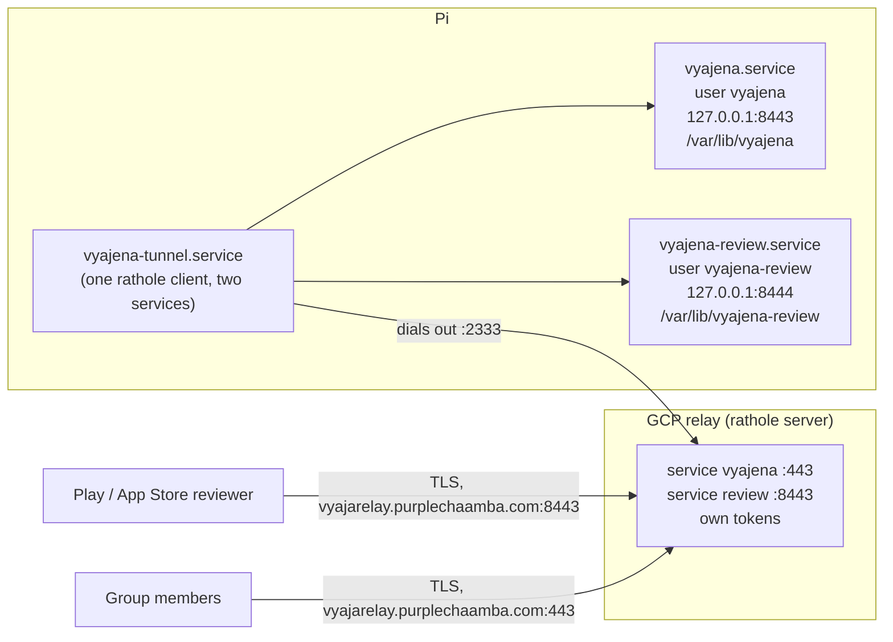

## Context

- The relay change made the Pi public behind `vyajarelay.purplechaamba.com:443`
  (rathole, TLS ends on the Pi, pinned).
- Store review needs a working account. Reviewers must never see the real
  group (owner, 2026-11-16). app-release owns the Play/App Store forms and the
  reviewer instructions (`app/store/listing.md`, "Reviewer access").
- Owner's answers (2026-11-16): public port **8443**; ids
  **`review@review.purplechaamba.com`**; the review admin is a **new throwaway
  iOS simulator**; the check covers the review server, the backup does not.

## Goals / Non-Goals

**Goals:** a second, fully separate server for reviewers, reachable through
the existing relay, resettable at will, checked like the real one; the real
group untouched.

**Non-Goals:** app changes, a hidden group *inside* the real server (one group
per server is an invariant), push, a second relay or IP.

## Decisions

### D1. Two servers, one tunnel

- **Same binary**, second unit and config: `vyajena-review.service` runs
  `/usr/local/bin/vyajena-server --config /etc/vyajena/review.toml` as the
  system user `vyajena-review` with `StateDirectory=vyajena-review`. Upgrades
  restart both. Separate users and state directories mean neither can read
  the other's keys or database (each 0700 under its own owner).
- **Ids:** `server_id = "review.purplechaamba.com"`, `admin_username =
  "review"`; reviewers become `<name>@review.purplechaamba.com`. Different
  server ids also mean a real device certificate can never validate in the
  review group or the other way round.
- **Ports:** public 8443 → loopback 8444. rathole has no SNI routing, so a
  second public port is the free option (a second IP would cost ≈$3.65/month).
- **Tunnel:** one rathole client with a second service `review` and its own
  token (`~/.vyajena-relay/review-token`). A leaked review token cannot attach
  the real service.

### D2. Review admin and invites

- A new iOS simulator **"Vyajena Review"** (created with `xcrun simctl create`)
  holds `review@review.purplechaamba.com`; it joins with the review bootstrap
  invite, creates the review group, and makes a fresh single-use invite
  (`INVITE_TTL` 7 days) per review. The owner pastes that invite into Play's App
  access form; it never goes into the repo.
- If the simulator is wiped, `--reset-review` and join again: nothing of value
  lives there.

### D3. Ops

- `deploy/pi/deploy.sh`: installs `review.toml`, `vyajena-review.service`, the
  user (`harden.sh base`), restarts both servers, then the tunnel. A first start
  of the review server saves its bootstrap invite to
  `~/vyajena-pi-backups/review-bootstrap-invite-<UTC>.txt` (0600).
- `deploy/pi/deploy.sh --reset-review`: type `review.purplechaamba.com`; wipes
  `/var/lib/vyajena-review/*` only and restarts it. No backup (no real data).
  Never touches `/var/lib/vyajena`.
- `deploy/pi/check.sh`: the review server's user, sandbox, exposure, writes,
  file modes, loopback 8444, tunnel route, `review-pin` (relay 8443 == Pi 8444)
  and **`pins differ`** (the two servers never share a key).
- `deploy/pi/backup.sh`: unchanged (the real server only).
- Relay: `relay.conf` `REVIEW_PORT=8443`; `create.sh` adds
  `vyajena-relay-review` (tcp:8443, 0.0.0.0/0, logging off); `check.sh`
  expects four rules and rathole on 8443; `server.toml` gains the service.

### D4. Rollout

1. Local: templates, scripts, tests, `review-token`.
2. Owner yes → `create.sh` (only the new rule is missing), `deploy/relay/deploy.sh`
   (rathole restarts: members reconnect within seconds; 8443 listens once the
   Pi's tunnel offers the review service).
3. `deploy/pi/deploy.sh --no-build` (real server: same binary, same data, same
   pin; review server: first start).
4. Both checks; review admin simulator joins; app-release gets the address.

### D5. Tests

- `server/tests/deploy_files.rs`: rendered `review.toml` parses (loopback
  8444, public `vyajarelay.purplechaamba.com:8443`, review ids), unit
  isolation (user, state dir, config path), tunnel/relay services with distinct
  tokens, four firewall rules in the dry run, `secrets.sh` makes
  `review-token`, `--reset-review` guards.
- The core already refuses a server whose pin differs (client-runtime: Wrong
  pin), which is the "real invite on the review port" scenario.

### Results (2026-11-16)

- Owner's yes; `create.sh` added only `vyajena-relay-review`; relay
  redeployed; `deploy/pi/deploy.sh --no-build`: `harden.sh` created
  `vyajena-review`, the real server restarted with **its pin unchanged**, the
  review server started fresh with its own pin; its bootstrap invite went to an
  owner-only file. `deploy/pi/check.sh` and `deploy/relay/check.sh`: 0 failed,
  0 warnings; review exposure 0.9; `pins differ`; 443, 8443 and 2333 answer.
- New simulator "Vyajena Review" (iPhone 16, iOS 26.5): the review bootstrap
  invite previewed `review@review.purplechaamba.com on
  vyajarelay.purplechaamba.com:8443`; joined, created the review group,
  invited `tester`. The Android emulator `vyajena_test` joined as
  `tester@review.purplechaamba.com`, was added automatically, and the two
  chatted with ✓. The tester's Members screen listed only `review` and
  `tester`. The real server logged nothing during the whole test. Then
  `tester` was removed and the app uninstalled from the emulator.
- Test driving notes: the emulator's floating stylus keyboard cut long
  `adb input text`; 30-character chunks with the stylus setting off worked
  (restored afterwards).

### D6. Review mode (2026-11-16, owner)

- **Why:** Play's App access form wants one set of sign-in details, reused for
  every update and never expiring. Invites are single-use and expire after 7
  days, and a reviewer could only be added while the "Vyajena Review" simulator
  (the review admin) is online. A reusable invite in the proto was rejected by
  the owner: "this is the separate server, don't they have autonomy to do what
  they want? we can restrict it to one admin and one client [...] our code is
  opensource so they should be able to test it however they want." So the
  reviewer becomes the admin, and the exception lives only in the review
  server's config. No proto or app changes.
- **Config:** `review_mode = true` (optional bool, default false) only in
  `deploy/pi/review.toml`; `deploy/pi/config.toml` never has it
  (`deploy_files.rs` checks both).
- **Bootstrap invite:** created with `expires_at` 9999-12-31T23:59:59Z
  (`invites::never()`, the latest protobuf `Timestamp`). `Devices.Register`
  accepts it again after use, only in review mode; `used_at` is set on each use,
  so a used one is not listed and `RevokeInvite` says it was already used.
- **Fresh review** (`server/src/review/`): in the signup's transaction, after
  the certificate checks out, every table but `meta`, `invites` (bootstrap row
  only) and `sequence` (reset to 0) is emptied. The table list is read from
  `sqlite_master`, so tables added later are wiped too; foreign keys are
  deferred to the commit. Keys live in `key_dir`, so the pin is unchanged. After
  the commit every open stream is ended with `PERMISSION_DENIED` ("a new review
  started"); old sessions are gone, so those devices cannot authenticate.
- **Cap:** in review mode `Admin.CreateInvite` is refused with
  `FAILED_PRECONDITION` while a non-removed user other than the admin exists or
  a non-bootstrap invite is pending: 1 admin + 1 client. Removing the user or
  revoking the invite frees the slot. Linked devices are not capped.
- **Trade-offs:** anyone with the invite wipes the review in progress (two
  stores reviewing at once kick each other out; the owner accepts this). The
  review server already deployed has a used 7-day bootstrap invite: after the
  deploy, `--reset-review` creates the never-expiring one.
- **Real server:** no `review_mode`, so every path is as before: single-use,
  `INVITE_TTL`, no cap. Tests prove it.
- **Tests** (`server/tests/review_mode.rs`): a fresh review wipes every table but
  the kept ones and keeps the pin and server id; the new reviewer creates the
  group; the old devices' streams end and they cannot authenticate; the cap;
  the never-expiring bootstrap invite survives a restart and 10 years; the real
  server's bootstrap invite is single-use and expires, and it has no cap;
  `review_mode` config parsing.

## Risks / Trade-offs

- [Reviewers could reach the real server's port] → only with a real invite
  (single-use, made by the real admin) and the real pin; reviewers never get one.
- [Two servers on a Pi 4] → idle review server costs a few MB of RAM.
- [Port 8443 is less common] → some corporate networks block it; Play's
  reviewers use normal internet. If it bites, a second IP + 443 is the
  fallback (cost).
- [Review group content] → reviewers can type anything; it lives only on the
  review server; `--reset-review` after each review.

## Migration Plan

Additive. Rollback: stop/disable `vyajena-review.service`, drop the tunnel
service and the firewall rule (`gcloud compute firewall-rules delete
vyajena-relay-review`).

## Open Questions

None: answered by the owner (D1–D3, D6).
