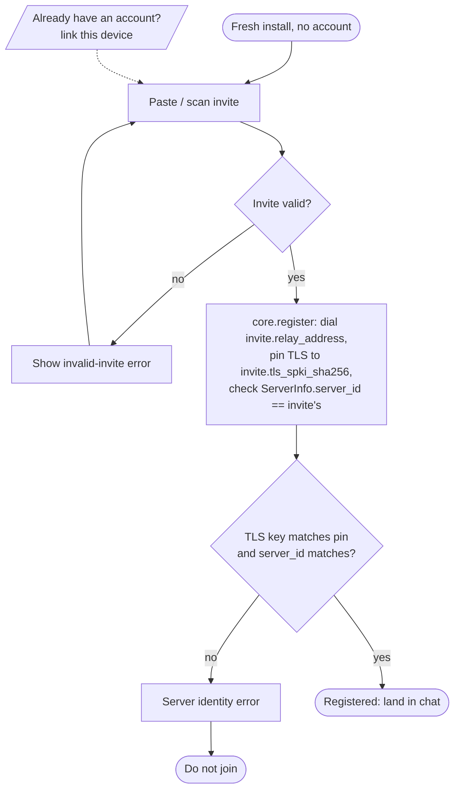

## Context

Owner intent (confirmed): publish one generic app so **operators** — people who
run a server for their own friend group, like the owner — can have their friends
join. A friend uses an invite and is in; no server install on the friend's side.

What the code on `main` actually does today (verified, not assumed):

- The invite payload `InvitePayload` (`proto/vyajena/v1/admin.proto`) carries
  `relay_address`, `tls_spki_sha256` (the server's TLS SPKI pin), `invite_code`,
  and `user_id` (whose `server_id` is the server's).
- The core connects straight from the invite:
  `client/src/client.rs::register` → `open_conn(&invite.relay_address,
  invite.tls_pin)`; `Conn::open(address, pin)` dials `address` and pins the TLS key
  to `pin` (`client/src/net/conn.rs`, `client/src/net/tls.rs`), then
  `checked_server_info` asserts the server's reported `server_id` equals the
  invite's.
- The account persists the chosen server (`relay_address`, `tls_pin`,
  `server_id`) in device state (`client/src/store/device_state.rs`).
- A fresh server prints a bootstrap invite for the configured admin on first start
  with an empty database (`server/src/runtime/bootstrap.rs`; device-identity:
  Bootstrap admin), and the bridge's invite box accepts that prefix-less text
  (`bridge/src/api/text.rs`).
- `grep` across `client/`, `bridge/`, `app/lib/` finds **no** baked relay
  endpoint, `server_id`, or TLS pin. The real relay DNS appears only in `README`
  and docs. The owner's `purplechaamba.com` is the publisher's store identity
  (bundle id), not a runtime server constant.

So the app is **already operator-agnostic at runtime**: whichever invite you apply
decides the server, and the invite carries the proof. The premise "the server is
baked into the client" was true of an earlier design (or reflects that the owner
only ever hands out their own invites); it is not true of the current client. This
reshapes the change from "rip out a hardcoded server" into "guarantee nothing gets
baked, keep onboarding neutral, and write down the invite-as-trust-root model".

The relay-D2 invariant (CLAUDE.md): the real IP and non-standard ports stay in
`~/.vyajena-relay`, but the **public relay DNS + 443 are shareable** — which is
exactly the value an operator puts in `public_address` and the invite then carries.

## Decisions

### D1: Trust model — the invite carries the server's TLS pin (option A)

The invite — minted by that server and shared over the trusted channel the invite
already requires — carries `tls_spki_sha256`, `server_id`, and the relay address.
The core pins the TLS key to the invite's pin before any application data flows,
so there is **no trust-on-first-use window**.

- **Option A (chosen, and already implemented): the invite carries the pin.** No
  new trust machinery, no invite proto fields.
  - Cost: the invite payload must stay integrity-protected (already true — it is
    the signup credential) and shared over a trusted channel (already true).
- **Option B (rejected): trust-on-first-use (TOFU).** Drop/ignore the invite's
  pin; pin whatever key the typed server presents on first connect, and show the
  SPKI fingerprint for out-of-band verification. It reintroduces a first-connect
  MITM window, is *more* work than A (A already ships), and only makes sense if the
  invite is slimmed to "just a code" that no longer names the server — which D2
  rejects.

**Decision: option A.** Stronger model, already built, no proto fields.

### D2: No pre-invite "choose a server" screen (option A2) — RESOLVED BY THE OWNER

Because the invite already names the server (D1), a typed "choose a server"
address would only repeat what the invite carries. The owner has resolved this:

- **A2 (chosen): no separate screen.** Keep today's invite-only onboarding (it is
  already generic). Onboarding goes straight to the invite; the invite is the one
  source of truth for the server. Least surface, no second place a server address
  can diverge, and it keeps TLS always-pinned (no screen ever contacts a server
  before the pin is known).
- **A1a (rejected): local pre-step.** A choose-server screen records the relay DNS
  and shows it, makes no network call, and the app cross-checks the invite against
  it. Recommended in the earlier draft, but the owner judged the extra screen not
  worth it when the invite already names and proves the server, and the cross-check
  guards against a non-problem (the user pastes one invite).
- **A1b (rejected): live preview.** The screen calls `Devices.GetServerInfo` on a
  typed address before the invite. Needs an **unpinned** TLS connection (no pin yet)
  and shows attacker-controllable data before trust is established. More code, a new
  surface, no gain. Rejected with A1a.

**Decision: A2.** The spec deltas encode A2: `app-ui` gains an operator-neutral,
invite-only onboarding requirement (and explicitly no choose-server step); no
"Choose a server" requirement and no modification to the base "Join from an invite"
flow, which is already invite-only.

### D3: One server per install for the MVP

Device state holds a single server (`relay_address`, `server_id`, `tls_pin`), so
single-server-per-install is already the shape, and one identity per install.
Multiple servers or accounts in one install is **out of scope**: it needs
per-server storage, key-store namespacing, and a server switcher. Noted, not built.

### D4: "Remove the hardcoded server" = a guard, not a deletion

There is nothing to delete in the client runtime. The requirement is to keep it
that way: a guard test (`client`/`app` level) asserts the shipped build embeds no
default relay address, `server_id`, TLS pin, or bootstrap invite, and that
onboarding copy names no single implied server. This is the durable form of the
owner's request.

### D5: Relay topology — own relay vs shared relay (OPEN, surfaced for the owner)

An operator's server sits behind a relay (rathole), and the invite's
`relay_address`/`public_address` is that relay's public `host:port`. Two shapes,
**not decided here**:

- **Shared relay:** operators share one relay (as the owner's friends share the
  Mumbai relay today). An operator only runs a server and is handed a relay
  endpoint + a tunnel slot; lowest setup cost, but the relay operator sees every
  operator's ciphertext traffic metadata and is a shared dependency.
- **Own relay:** each operator stands up their own relay (`deploy/relay/`). Fully
  independent, but more to run (a GCP VM or equivalent, gcloud, cost) and more for
  the self-host docs to cover.

The invite model is unaffected either way (it names whatever relay address the
operator uses), so this does not block the spec. It changes **operator setup**
(what the docs tell a new operator to stand up) and is the owner's call. Surfaced,
not resolved.

## Operator setup (what the docs will say)

A new operator runs one server process with a TOML config
(`server-runtime: Configuration`). The fields:

- `server_id` — the server's id; becomes the `@server_id` of every user id.
- `admin_username` — the bootstrap admin's local part; the first bootstrap invite
  is minted for `admin_username@server_id` on first start.
- `listen_address` — where the server listens (e.g. `127.0.0.1:8443` behind a relay).
- `public_address` — the relay's public `host:port` written into invite payloads
  (defaults to `listen_address`); this is the shareable relay DNS + 443.
- `database_path` — the SQLite database (WAL, mode 0600).
- `key_dir` — the directory for the TLS and MLS external-sender private keys
  (created on first start, mode 0600; the TLS pin is logged and never changes).
- `[blob_store]` — **required for audio and images.** With `backend = "filesystem"`
  and a stable `path`, the server stores encrypted blobs and serves the `Blobs`
  RPCs. **With no `[blob_store]`, the server still runs and carries text, but every
  `Blobs` RPC returns `UNAVAILABLE`** (server-runtime: Blob storage degrades
  gracefully), so voice messages and images cannot be sent. An operator who wants
  audio/images must configure it.

First start with an empty key directory and empty database logs the TLS pin and
prints one bootstrap invite for the admin (device-identity: Bootstrap admin); the
operator's first device pastes that invite. From then on the admin creates invites
for everyone else with `Admin.CreateInvite`.

## First-run flow (A2)

The only step that touches the network and establishes trust is `core.register`,
which pins to the **invite's** pin (D1). There is no earlier server-choice step
(D2, A2).

## Risks / Trade-offs

- **[No visible server anchor before joining]** → acceptable: the invite preview
  already shows the user id and relay address the invite names before Join
  (app-ui: Join from an invite), so the user does see which server they are about
  to join. A2 just removes a *typed* anchor, not the shown one.
- **[A guard test over-fits to current strings]** → scope the guard to concrete
  constants (no 32-byte pin literal, no default `relay_address`, no `server_id`
  constant, no embedded bootstrap invite) plus a check that onboarding copy carries
  no hardcoded server host, not to prose wording in general.
- **[Owner expected to also rename the app generic]** → out of scope; stated in
  the proposal. One published app, runtime server choice.

## Migration Plan

Spec-only. No wire change, no data migration, no server change. When built: add the
guard test, neutralise any owner-implying onboarding copy, and write the
operator-setup docs. Existing installs are unaffected (they already hold their
server in device state).

## Open Questions

- **D5 (relay topology):** own relay per operator vs a shared relay. Surfaced for
  the owner; does not block the spec. Affects operator-setup docs only.
