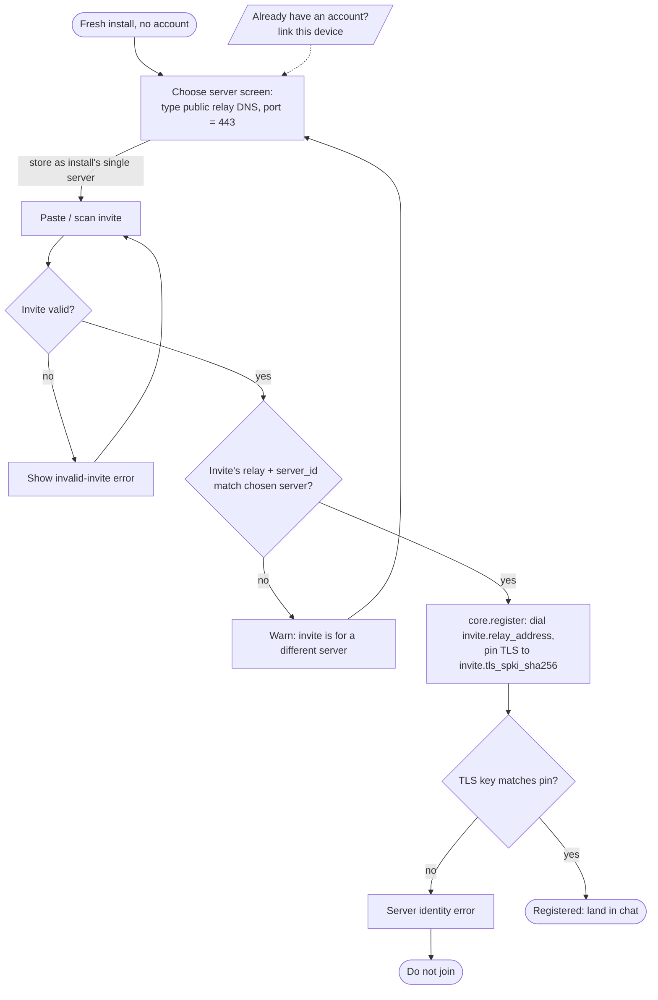

## Context

Owner intent (confirmed): publish one generic app so **operators** — people who
run a server for their own friend group, like the owner — can have their friends
join. A friend enters the operator's public relay DNS, uses an invite, and is in;
no server install on the friend's side.

What the code on `main` actually does today (verified, not assumed):

- The invite payload `InvitePayload` (`proto/vyajena/v1/admin.proto`) carries
  `relay_address`, `tls_spki_sha256` (the server's TLS SPKI pin), `invite_code`,
  and `user_id` (whose `server_id` is the server's).
- The core connects straight from the invite:
  `client/src/client.rs::register` → `open_conn(&invite.relay_address,
  invite.tls_pin)`; `Conn::open(address, pin)` dials `address` and pins the TLS key
  to `pin` (`client/src/net/conn.rs`, `client/src/net/tls.rs`), then
  `checked_server_info` asserts the server's reported `server_id` equals the
  invite's.
- The account persists the chosen server (`relay_address`, `tls_pin`,
  `server_id`) in device state (`client/src/store/device_state.rs`).
- `grep` across `client/`, `bridge/`, `app/lib/` finds **no** baked relay
  endpoint, `server_id`, or TLS pin. The real relay DNS appears only in `README`
  and docs. The owner's `purplechaamba.com` is the publisher's store identity
  (bundle id), not a runtime server constant.

So the app is **already operator-agnostic at runtime**: whichever invite you paste
decides the server. The premise "the server is baked into the client" was true of
an earlier design (or reflects that the owner only ever hands out their own
invites); it is not true of the current client. This reshapes the change from
"rip out a hardcoded server" into "guarantee nothing gets baked, and add the
first-run UX the owner wants".

The relay-D2 invariant (CLAUDE.md): the real IP and non-standard ports stay in
`~/.vyajena-relay`, but the **public relay DNS + 443 are shareable** — which is
exactly the value the user types on the choose-server screen.

## Decisions

### D1: Trust model — the invite carries the server's TLS pin (option A) — OWNER TO CONFIRM

Typing a DNS address tells the app *where* the server is, not that the server is
genuine: a MITM on the path could answer on first connect and impersonate it. Two
ways to close that gap:

- **Option A (recommended, and already implemented): the invite carries the
  pin.** The invite — minted by that server, shared over the same trusted channel
  the invite already requires — carries `tls_spki_sha256`, `server_id`, and the
  relay address. The core pins the TLS key to the invite's pin before any
  application data flows, so there is **no trust-on-first-use window**. Typing the
  DNS adds no new trust requirement; the invite is the proof.
  - Cost: the invite payload must stay integrity-protected (already true — it is
    the signup credential) and shared over a trusted channel (already true).
- **Option B (rejected): trust-on-first-use (TOFU).** Drop/ignore the invite's
  pin; pin whatever key the typed server presents on first connect, and show the
  SPKI fingerprint for out-of-band verification. Simpler mental model, but:
  - reintroduces a first-connect MITM window (the whole gap option A closes);
  - is *more* work than option A, since option A already ships — B means removing
    the pin from the trust path and building a fingerprint-confirm UX;
  - only becomes necessary in a world where the invite is slimmed to "just a
    code" and no longer names the server (see D2).

**Decision: option A.** It is the stronger model and it is already built, so this
change adds no trust machinery and no invite proto fields. Documented here so the
owner can confirm it rather than inherit it silently.

### D2: Does the separate "choose server" screen earn its place? — OWNER'S HEADLINE QUESTION

Because the invite already names the server (D1), the first-run flow the owner
described — *enter relay DNS → paste invite → register* — has the user supply the
relay address twice (typed, and inside the invite). So the real question is what
the typed address is **for**. Three shapes:

- **A1a — local pre-step (recommended).** The choose-server screen records the
  relay DNS as the install's single server and shows it; it makes **no network
  call**. The invite pasted next is the authenticator (its pin, D1). The app
  cross-checks the invite's `relay_address` and `server_id` against the chosen
  server and surfaces a mismatch before joining. The invite's `relay_address`
  stays the canonical connect address, so an invite pasted without a typed server
  still works.
  - Keeps TLS always-pinned (the wire-transport invariant): no unpinned
    connection is ever opened. No proto change. Gives the owner the "which server
    am I on" anchor, operator-neutral branding, and a natural seam for future
    multi-server (D3). The typed address is a confirmation + anchor, not a second
    source of truth.
- **A1b — live preview.** The screen calls `Devices.GetServerInfo` on the typed
  address to show `server_id` and reachability *before* the invite. This needs an
  **unpinned** TLS connection (the app has no pin until the invite), which the
  current pinned-only `tls::connect` does not do, and it displays
  attacker-controllable data before any trust is established. More code, a small
  new surface, little gain over A1a. Not recommended.
- **A2 — no separate screen.** Keep today's invite-only onboarding (already
  generic) and do only the branding + guard work. Least effort; loses the explicit
  server anchor the owner asked for.

**Recommendation: A1a.** The spec deltas below encode A1a. If the owner prefers
A2, drop the "Choose a server" requirement and keep the rest; if B (D1) is ever
chosen, A1b/A2 become the only coherent flows (the typed address would then carry
real weight). The spec is written so A2 is a clean subtraction.

### D3: One server per install for the MVP

Device state holds a single server (`relay_address`, `server_id`, `tls_pin`), so
single-server-per-install is already the shape. Multiple servers or accounts in
one install is a later nicety: it needs per-server storage, key-store namespacing,
and a server switcher. Noted, not built here.

### D4: "Remove the hardcoded server" = a guard, not a deletion

There is nothing to delete in the client runtime. The requirement is to keep it
that way: a guard test (`client`/`app` level) asserts the shipped build embeds no
default relay address, `server_id`, TLS pin, or bootstrap invite, and that
onboarding copy names no single implied server. This is the durable form of the
owner's request.

## First-run flow (recommended, A1a)

Note: the only step that touches the network and establishes trust is
`core.register`, which pins to the **invite's** pin (D1). The choose-server step is
local (A1a).

## Risks / Trade-offs

- **[Typed address vs invite address diverge]** → the app treats the invite's
  `relay_address`/`server_id` as canonical and *warns* on mismatch rather than
  silently preferring one; the user re-chooses or re-pastes. Keeps one source of
  truth (the invite) while honouring the typed anchor.
- **[A guard test over-fits to current strings]** → scope the guard to concrete
  constants (no 32-byte pin literal, no default `relay_address`, no embedded
  bootstrap invite) plus a check that onboarding copy carries no hardcoded server
  host, not to prose wording in general.
- **[Owner expected to also rename the app generic]** → out of scope; stated in
  the proposal. One published app, runtime server choice.

## Migration Plan

Spec-only. No wire change, no data migration, no server change. When built: add
the choose-server screen and stored server address in the app, add the guard
test, neutralise onboarding copy. Existing installs are unaffected (they already
hold their server in device state).

## Open Questions

- **D1 (trust model):** confirm option A (invite-borne pin). Recommended.
- **D2 (choose-server screen):** confirm A1a (local pre-step), A2 (no screen), or
  A1b (live preview). Recommended A1a. This is the owner's headline call.
