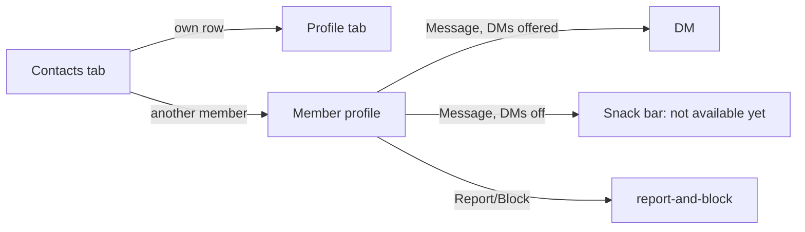

## Context

The `app-shell` restyle gave the app three tabs (Chats, Contacts, Profile). Two
leftovers from the pre-shell navigation still duplicate it: the conversation
overflow menu re-lists the tabs, and a contact tap enters a DM with no profile in
between. This change removes both without any protocol/core/server change.

## Decisions

### D1 — The conversation overflow menu keeps only conversation-scoped actions

`ChatMenu` (used for the lobby and DMs) listed, via `MenuEntry`: Members, Profile,
Link a new device, Invite, Invites, Remove a user — plus the mute toggle and, for
the lobby, the greyed "name is fixed / cannot be closed" notes.

- Members and Profile are the Contacts and Profile tabs → dropped.
- Link a new device already lives on the Profile tab (`settings-link-device`) →
  dropped from the menu (nothing lost).
- Invite, Invites, Remove a user are already on the Contacts tab (admin only) →
  dropped.

What remains is conversation-scoped: mute/unmute, and the lobby's greyed notes. So
the overflow **button stays** (it still has mute). The now-empty `MenuEntry` enum
is deleted. Named groups are untouched: they use a separate `GroupMenu`
(members-of-that-group, add/remove member, rename, close), which is genuinely
group-scoped, not a tab duplicate.

The spec allows for a conversation with no overflow action (then no button), but in
practice mute is always present.

### D2 — A contact tap opens a member profile; Message opens the DM

`contacts_tab.dart` `_tapMember` opened the DM directly (`messageUser`). Now:

- own row → Profile tab (unchanged);
- another member → push `MemberProfileScreen(member)` (the `MemberUser` already in
  hand carries the user and their devices).

`MemberProfileScreen` shows avatar, display name, device count, a **Message**
button, and **Report** / **Block/Unblock**. Message re-asks `core.dmsAvailable()`
on tap (the answer can arrive after the tab loaded, `arcade-restyle`: Contact tap)
and either `messageUser(...)` or shows `dmsUnavailableText`. So the guarantee "a
tap never does nothing" holds at both levels: the contact tap opens the profile,
and Message always either opens the DM or explains why not.

### D3 — Retire MembersScreen, extract its helpers

`MembersScreen` was a second, standalone members list reached from the chat menu
(removed in D1) and from the Profile tab's "Members and devices" entry. Its
per-member Message + report/block is exactly the member-profile interaction, so it
moves into `MemberProfileScreen`. With both callers gone, the screen and
`Routes.members` are removed.

The file also held `MemberUser`, `byUser(...)` and `devicesText(...)`, imported by
`contacts_tab`, `chat_list_screen`, `admin/remove_user_screen` and
`admin/create_named_group_screen`. These are the member **data model**, not the
screen, so they move to `members/member.dart` and the four importers re-point
there. `members_screen.dart` is then deleted.

Removing the Profile tab's "Members and devices" entry is the one change that
touches the owner-approved Profile tab; it is called out in the proposal for owner
review. The Contacts tab (members list + per-member profile with device count and
moderation) now covers everything that entry reached.

### D4 — MODIFY over an un-archived base; archive ordering

The requirements changed here — `app-ui`: Contact tap and Open a DM, and
`app-shell`: Conversation screen / Contacts tab — are **ADDED** in the still-active
`arcade-restyle`, `dms` and `app-shell` changes; they are not yet in
`openspec/specs`. `openspec validate --strict` checks delta structure, not the
base, so MODIFY validates. For a clean sync, archive `arcade-restyle`, `dms` and
`app-shell` **before** this change so each MODIFY lands on a present requirement.
The new **Member profile** requirement is ADDED, so it has no ordering constraint.
This mirrors the project's existing practice of sequencing archives across related
in-flight changes.

### D5 — "Message" now always present, old server explains itself

The `dms` change's **Open a DM** said the members list shows **no** Message action
on an old (protocol v1) server. The member profile instead always shows a Message
button, and on an old server tapping it shows the "direct messages are not available
yet" notice. This is the owner's "a tap never does nothing" guarantee applied to the
button, so **Open a DM** is MODIFIED to match rather than kept as-is.

## Risks / trade-offs

- **Coordination:** `chat_screen.dart` may also be touched by the copy/forward/share
  session. The edits here are confined to `ChatMenu`/`MenuEntry` and are small, so a
  merge conflict, if any, is local. Commit only this change's files.
- **Lost affordance?** None. Everything dropped from the conversation menu is
  reachable from a tab; the members list's moderation moves into the member profile.
