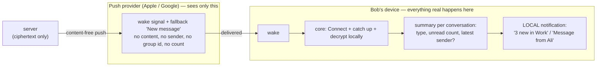
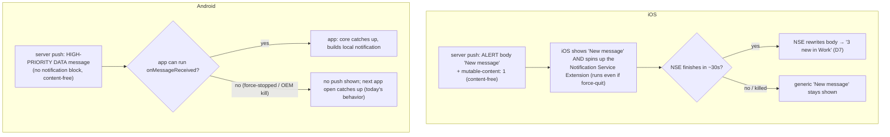

## Context

- Push today (change `push`, deployed 0.5.0): the server sends one visible
  "New message" alert through FCM/APNs when an offline device has an `APPLICATION`
  backlog (message-delivery: Content-free wake pings, revised by `push-kind-aware`).
  The owner chose a **visible** alert, not a silent push, because iOS throttles
  silent pushes and never launches a force-quit app for them (push design D3).
- The server sees ciphertext only and must never read content, a sender or a group
  name (config.yaml invariants). A push payload reaches Apple/Google, so it is
  "who sees what": the provider may learn *that* and *when* a device is pinged,
  never content, sender or group (docs/architecture-decisions.md).
- What the client knows **without decrypting**, from the wire `Envelope`
  (messaging.proto): `group_id`, `epoch`, `kind`
  (`APPLICATION`/`COMMIT`/`WELCOME`/`PROPOSAL`), `msg_id`, `server_seq`. The client
  maps `group_id` → a local conversation it already classifies as the lobby, a named
  group, or a DM. So **conversation type is derivable locally with no decryption.**
- What needs decryption: the message **sender** and the message **body** live inside
  the MLS `PrivateMessage` (content.proto), so a sender name requires the core to
  decrypt. The body is never shown.
- The chat list already tracks **unread** per conversation (changes `unread-divider`,
  `about-chat-list`), so the count is on-device data, not something to derive from
  the push.
- Admin-events the user cares about already arrive as core notices
  (`RemovedNotice`, `GroupClosed`, `JoinNotice`, membership notices — app-ui:
  Notices in the chat) or as membership facts the server authoritatively routes.

## Goals / Non-Goals

**Goals:** a wake turns into a count + DM/group/admin type + optional sender, built
on the device; nothing beyond a content-free wake (and a generic fallback string)
reaches a push provider; the generic "New message" still shows when the device
cannot enrich; the design composes with mute and does not disturb wake scheduling.

**Non-Goals:** decrypted previews (never); implementing mute; changing wake
scheduling (that is `notification-reliability`); a proto change.

## Decisions

### D1. The privacy model — enrich on the device, never in the payload

The single rule everything else serves: **the server/push-provider payload is a
content-free wake signal.** It may carry the fixed generic string "New message"
(so something shows if the device cannot enrich) and the platform wake flags of D5,
and nothing else — no content, no sender, no `group_id`, no count. The user-visible
richness is produced by the core after it decrypts, and shown as a local
notification. This is the new invariant; the owner's requirement 3 (never message
content in a notification) is a consequence of it, extended to sender, group id and
count in the *payload* as well.

### D2. What the client computes, and from what

| Shown value | Source | Needs decrypt? |
|---|---|---|
| Conversation **type** (DM / named group / lobby / admin-event) | `Envelope.group_id` → local conversation record; admin-events from core notices | No |
| **Unread count** per conversation | the core's existing per-conversation unread (unread-divider / about-chat-list), recomputed after catch-up | counts `APPLICATION` messages, which catch-up already decrypts; no extra decrypt |
| **Sender** display name (opt-in only) | the latest unread message's MLS sender → the user's profile display name | Yes (already done during catch-up) |
| Admin-event **phrase** | the core notice type (`RemovedNotice`, `GroupClosed`, membership) | No (control traffic; the server knows the membership fact) |

The core already decrypts everything during catch-up; the notification builder
reads the *result* of catch-up, so it adds no new decryption and keeps all content
inside the core (app-ui: UI goes through the core). The builder emits a typed
summary (`type`, `unread_count`, `sender_display_name?`) — **never a message body**.

### D3. Count semantics — per-conversation line + total badge (owner decision b)

- **Recommendation:** the notification body is **per conversation**: "3 new in Work"
  (named group), "2 new messages" (a DM, no name shown unless the sender setting is
  on), "5 new in the lobby". When several conversations are unread, the OS groups
  them (Android notification group / iOS thread-id per `group_id`) and the app icon
  **badge** shows **total unread** across conversations.
- **Why not one "N new messages" blob:** per-conversation is what the owner asked
  to distinguish (DM vs group), reads better, and matches the chat-list unread the
  user already sees. The badge gives the single total for an at-a-glance number.
- The count is **unread**, not "new since last push": it stays correct after a
  missed/collapsed push (notification-reliability) because it is recomputed from the
  core's unread state on every catch-up, not accumulated from pushes.
- **Owner to confirm:** per-conversation lines + total badge, vs a single total
  line. Exact wording ("3 new in Work" vs "Work: 3 new") is a UX detail for apply.

### D4. Admin-events — a chosen, content-free set (owner decision c)

Admin-events are control traffic, so `push-kind-aware` sends **no** wake for a
control-only backlog. Two things follow:

1. **Which events notify.** Recommendation — only events that materially change the
   user's own access, each already a core notice:
   - **"You were removed from <group>."** (`RemovedNotice` / the admin's Remove)
   - **"<group> was closed."** (`GroupClosed`, `DmClosed`)
   - **"You were added to <group>."** — a new named group / accepted invite
     (`JoinNotice` for self / `JoinedGroup`). **Not** the quiet inactivity re-add
     (app-ui already suppresses that notice).
   - **Not notified by default:** other members joining/leaving, device links,
     renames, key-changed warnings — these show in-chat but are noisy as pushes.
2. **How the device learns in time to notify.** For a removal/close/add, the server
   knows the membership fact authoritatively (it is the membership authority) and
   can wake the affected device **content-free** even though the triggering envelope
   is control. Recommendation: the server emits the content-free wake for these
   specific membership changes to the affected device (a narrow, enumerated
   extension of "when to wake", still carrying nothing in the payload); the device
   then renders the fixed phrase from the core notice it receives on catch-up. The
   phrase is a **fixed string**, never derived from message content; the group name
   is local (D1), safe in a local notification.

- **Owner to confirm:** the event set and the exact wording. Open sub-question: do
  removal/close pushes bypass mute (they are account-level, arguably should still
  notify)? Recommendation: an admin-event about *your own* access ignores
  per-conversation mute but honors whole-app mute. Owner to confirm.

### D5. Platform mechanics — reliable silent-wake, or degrade to the generic alert (owner decision d)

The tracker's model is "silent wake → decrypt → local notification". Taken
literally (a pure silent/background push) it is **unreliable on iOS**: iOS throttles
`content-available` silent pushes to a small best-effort budget and **never launches
a force-quit app** for one — so a force-quit iPhone would get *nothing*, worse than
today's visible "New message". The reliable shape is platform-specific, and in both
cases keeps a **visible generic fallback** so the user is never left with silence:

- **iOS — alert + `mutable-content` + Notification Service Extension (NSE).** The
  push is a *visible alert* carrying only "New message" and `mutable-content: 1`
  (content-free). iOS shows it immediately **and** launches the NSE — a short-lived
  separate process that runs **even when the app is force-quit**, for ~30 s — which
  rewrites the notification before display. If the NSE cannot run or times out, the
  generic alert simply stays. This is the standard E2EE pattern (Signal/WhatsApp):
  nothing sensitive is in the payload, the enrichment is on-device. It does change
  the push `apns-push-type` from the current plain alert to an alert with
  `mutable-content` — a server payload tweak, no content added.
- **Android — high-priority data message.** A `data`-only FCM message (no
  `notification` block) wakes `VyajenaMessagingService.onMessageReceived` even when
  backgrounded; the app runs the core, catches up, and posts the local notification.
  This replaces the current `notification`-block message (which Play services shows
  without running app code). Trade-off: a `data` message does **not** reach a
  force-stopped app until it is opened once, and aggressive OEM battery managers can
  delay it; the fallback is the existing catch-up on next open. (A last-resort hybrid
  — data message plus a minimal `notification` block — would guarantee a visible
  generic alert but reintroduces a system-shown "New message" the app then has to
  reconcile; recommended **against** for v1 to avoid double notifications. Owner to
  weigh.)
- **Net:** the invariant holds on both platforms (payload content-free); iOS always
  shows at least the generic alert; Android degrades to catch-up-on-open when it
  cannot wake. Owner confirms this degradation is acceptable.

### D6. Sender names — opt-in, off by default (owner decision a)

- **Trade-off:** showing "Message from Ali" on the lock screen reveals *who contacts
  whom* to anyone glancing at the phone — directly against the app's privacy
  promise. Hiding it costs a little immediacy.
- **Recommendation:** a **per-device** setting "Show who messaged", **default off**.
  Off → "New message" / "N new in <group>" (no personal name). On → a DM reads
  "Message from Ali", a group "Ali in Work". The sender display name comes from the
  decrypted sender's profile, computed in the core only when the setting is on.
- **Why per-device, not server-synced:** the choice only affects how *this* device
  renders a *local* notification; it carries no privacy value to the server and
  needs no `notification-prefs` rail (that rail is for mute, which gates the server
  push). Keeping it local avoids a proto/prefs change here. If the owner prefers it
  to follow the user across devices, it can move onto the `notification-prefs` rail
  later (a small additive change); flagged, not decided alone.
- **Owner to confirm:** default off; a setting (not all-or-nothing); per-device vs
  synced.

### D7. iOS NSE — metadata-only or full decrypt (owner decision d, sub-question)

The NSE is a *separate process* from the app. To show a **count** and **type** it
needs only on-device metadata (the last-persisted per-conversation unread + the
`group_id`→type map), or it can connect and count queued `APPLICATION` envelopes by
`group_id` **without decrypting** (envelope metadata only). To show a **sender** or a
decryption-exact count it must **decrypt MLS inside the extension**, which means:
sharing the SQLite store via an App Group, sharing keychain items via a keychain
access group, running a slim core entrypoint in the extension, and — the real risk —
two processes touching MLS group state under the strict-epoch invariant
(`max_past_epochs = 0`): an extension that advances the epoch while the app is also
running could desynchronize state.

- **Recommendation for v1: metadata-only NSE.** Show count + type (+ group name,
  which is local) with **no decryption in the extension** and **no sender on iOS**
  until the app itself next runs. This delivers requirements 1 and 2 (count + type)
  with far less risk; the sender name (requirement 4, already opt-in) appears once
  the app is foregrounded, or is a later iteration that adds decrypt-in-NSE behind a
  spike proving the epoch-safety story (a read-only decrypt that never commits).
- A spike (`spikes/nse-decrypt/`, per config.yaml) would validate decrypt-in-NSE
  epoch safety before any full-decrypt path is committed; its result goes here.
- **Owner to confirm:** metadata-only NSE for v1 (sender on iOS deferred to app
  foreground), vs investing in decrypt-in-NSE now.

### D8. Composition with mute (out of scope to implement here)

Mute (change `mute-notifications`) gates the **server** push: a muted conversation /
`muted_all` gets no wake. This design composes cleanly: if no wake arrives, the
device builds nothing. The local build also re-checks the core's mute view before
posting, so a conversation muted after a wake was already in flight is still
silenced locally. No mute code is written here; the pipeline just leaves the two gate
points (server push, local build) where mute already plugs in.

### D9. Why not carry the type/count in the push as a server hint

Rejected: even "this is a DM" or "count = 3" in the payload leaks to the provider
(who-messages-whom frequency, group vs DM activity) and violates D1. The marginal
latency saved (showing richness ~1 wake-and-catch-up sooner) is not worth weakening
the invariant. Everything stays on the device.

## Risks / Trade-offs

- **[iOS force-quit]** → always at least the generic "New message" (D5); richness on
  next NSE run or app open.
- **[Android force-stopped / OEM battery kill]** → data message may not wake the app;
  degrades to catch-up on open (D5). Acceptable for this group; revisit if reports
  come in.
- **[NSE epoch safety]** → metadata-only NSE for v1 sidesteps it entirely (D7);
  full decrypt gated behind a spike.
- **[Count drift]** → count is recomputed from the core's unread, not accumulated
  from pushes, so a missed push does not corrupt it (D3).
- **[Sender on the lock screen]** → off by default, opt-in (D6).
- **[Provider learns ping timing]** → unchanged from today and already in the
  architecture doc's "who sees what"; no new metadata added (D1, D9).

## Migration / Rollout

- Deployable after `push` (which lands the real providers). The server payload tweak
  (alert+`mutable-content` on iOS, data on Android) ships with a server deploy; older
  apps ignore the extra flags and keep showing the generic alert, so the server and
  app roll out independently.
- The iOS NSE is a new target in the app project; a build without it still shows the
  generic alert. The Android data-message path replaces the `notification`-block
  message; an older app that only handles `notification` messages would stop showing
  the generic alert on the new server — so the **app ships before or with** the
  Android payload switch (noted for apply; a server flag could keep the old
  `notification` shape until the app is out).
- No data migration, no proto regeneration, no new credentials.

## Owner decisions to confirm before apply

| # | Decision | Recommendation |
|---|---|---|
| a | "Message from <username>" | A per-device setting, **default off** (generic); opt-in to show sender (D6) |
| b | Count semantics | Per-conversation line + total-unread app badge (D3) |
| c | Which admin-events notify + wording | Removed / group-closed / added-to-new-group only, fixed phrases; own-access events ignore per-conv mute, honor mute-all (D4) |
| d | Platform mechanics | iOS alert+`mutable-content`+NSE (metadata-only for v1), Android high-priority data message, generic-alert/catch-up fallback (D5, D7) |

Implementation is **held** until the owner resolves a–d; the specs below are written
to the recommended answers and will be revised if the owner chooses differently.
