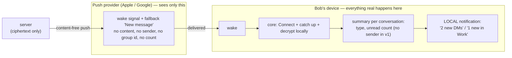
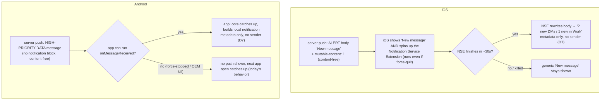

## Context

- Push today (change `push`, deployed 0.5.0): the server sends one visible
  "New message" alert through FCM/APNs when an offline device has an `APPLICATION`
  backlog (message-delivery: Content-free wake pings, revised by `push-kind-aware`).
  The owner chose a **visible** alert, not a silent push, because iOS throttles
  silent pushes and never launches a force-quit app for them (push design D3).
- The server sees ciphertext only and must never read content, a sender or a group
  name (config.yaml invariants). A push payload reaches Apple/Google, so it is
  "who sees what": the provider may learn *that* and *when* a device is pinged,
  never content, sender or group (docs/architecture-decisions.md).
- What the client knows **without decrypting**, from the wire `Envelope`
  (messaging.proto): `group_id`, `epoch`, `kind`
  (`APPLICATION`/`COMMIT`/`WELCOME`/`PROPOSAL`), `msg_id`, `server_seq`. The client
  maps `group_id` → a local conversation it already classifies as the lobby, a named
  group, or a DM. So **conversation type is derivable locally with no decryption.**
- What needs decryption: the message **sender** and the message **body** live inside
  the MLS `PrivateMessage` (content.proto), so a sender name requires the core to
  decrypt. The body is never shown.
- The chat list already tracks **unread** per conversation (changes `unread-divider`,
  `about-chat-list`), so the count is on-device data, not something to derive from
  the push.
- Admin-events the user cares about already arrive as core notices
  (`RemovedNotice`, `GroupClosed`, `JoinNotice`, membership notices — app-ui:
  Notices in the chat) or as membership facts the server authoritatively routes.

## Goals / Non-Goals

**Goals:** a wake turns into a count + DM/group/admin type (no sender in v1 — D6),
built on the device, identical on iOS and Android; nothing beyond a content-free wake
(and a generic fallback string)
reaches a push provider; the generic "New message" still shows when the device
cannot enrich; the design composes with mute and does not disturb wake scheduling.

**Non-Goals:** decrypted previews (never); implementing mute; changing wake
scheduling (that is `notification-reliability`); a proto change.

## Decisions

### D1. The privacy model — enrich on the device, never in the payload

The single rule everything else serves: **the server/push-provider payload is a
content-free wake signal.** It may carry the fixed generic string "New message"
(so something shows if the device cannot enrich) and the platform wake flags of D5,
and nothing else — no content, no sender, no `group_id`, no count. The user-visible
richness is produced by the core after it decrypts, and shown as a local
notification. This is the new invariant; the owner's requirement 3 (never message
content in a notification) is a consequence of it, extended to sender, group id and
count in the *payload* as well.

### D2. What the client computes, and from what

| Shown value | Source | Needs decrypt? |
|---|---|---|
| Conversation **type** (DM / named group / lobby / admin-event) | `Envelope.group_id` → local conversation record; admin-events from core notices | No |
| **Unread count** per conversation | the core's existing per-conversation unread (unread-divider / about-chat-list), recomputed after catch-up | counts `APPLICATION` messages, which catch-up already decrypts; no extra decrypt |
| ~~**Sender** display name~~ | **deferred past v1 (D6)** — would need MLS sender → profile | n/a in v1 |
| Admin-event **phrase** | the core notice type (`RemovedNotice`, `GroupClosed`, membership) | No (control traffic; the server knows the membership fact) |

The core already decrypts everything during catch-up; the notification builder
reads the *result* of catch-up, so it adds no new decryption and keeps all content
inside the core (app-ui: UI goes through the core). The builder emits a typed
summary (`type`, `unread_count`) — no sender in v1 (D6), **never a message body**.

### D3. Count semantics — per-conversation line + total badge (owner decision b)

- **Recommendation:** the notification body is **per conversation**: "3 new in Work"
  (named group), "2 new messages" (a DM, no name — D6), "5 new in the lobby". When
  several conversations are unread, the OS groups
  them (Android notification group / iOS thread-id per `group_id`) and the app icon
  **badge** shows **total unread** across conversations.
- **Why not one "N new messages" blob:** per-conversation is what the owner asked
  to distinguish (DM vs group), reads better, and matches the chat-list unread the
  user already sees. The badge gives the single total for an at-a-glance number.
- The count is **unread**, not "new since last push": it stays correct after a
  missed/collapsed push (notification-reliability) because it is recomputed from the
  core's unread state on every catch-up, not accumulated from pushes.
- **Owner to confirm:** per-conversation lines + total badge, vs a single total
  line. Exact wording ("3 new in Work" vs "Work: 3 new") is a UX detail for apply.

### D4. Admin-events — a chosen, content-free set (owner decision c)

Admin-events are control traffic, so `push-kind-aware` sends **no** wake for a
control-only backlog. Two things follow:

1. **Which events notify.** Recommendation — only events that materially change the
   user's own access, each already a core notice:
   - **"You were removed from <group>."** (`RemovedNotice` / the admin's Remove)
   - **"<group> was closed."** (`GroupClosed`, `DmClosed`)
   - **"You were added to <group>."** — a new named group / accepted invite
     (`JoinNotice` for self / `JoinedGroup`). **Not** the quiet inactivity re-add
     (app-ui already suppresses that notice).
   - **Not notified by default:** other members joining/leaving, device links,
     renames, key-changed warnings — these show in-chat but are noisy as pushes.
2. **How the device learns in time to notify.** For a removal/close/add, the server
   knows the membership fact authoritatively (it is the membership authority) and
   can wake the affected device **content-free** even though the triggering envelope
   is control. Recommendation: the server emits the content-free wake for these
   specific membership changes to the affected device (a narrow, enumerated
   extension of "when to wake", still carrying nothing in the payload); the device
   then renders the fixed phrase from the core notice it receives on catch-up. The
   phrase is a **fixed string**, never derived from message content; the group name
   is local (D1), safe in a local notification.

- **Owner to confirm:** the event set and the exact wording. Open sub-question: do
  removal/close pushes bypass mute (they are account-level, arguably should still
  notify)? Recommendation: an admin-event about *your own* access ignores
  per-conversation mute but honors whole-app mute. Owner to confirm.

### D5. Platform mechanics — reliable silent-wake, or degrade to the generic alert (owner decision d)

The tracker's model is "silent wake → decrypt → local notification". Taken
literally (a pure silent/background push) it is **unreliable on iOS**: iOS throttles
`content-available` silent pushes to a small best-effort budget and **never launches
a force-quit app** for one — so a force-quit iPhone would get *nothing*, worse than
today's visible "New message". The reliable shape is platform-specific, and in both
cases keeps a **visible generic fallback** so the user is never left with silence:

- **iOS — alert + `mutable-content` + Notification Service Extension (NSE).** The
  push is a *visible alert* carrying only "New message" and `mutable-content: 1`
  (content-free). iOS shows it immediately **and** launches the NSE — a short-lived
  separate process that runs **even when the app is force-quit**, for ~30 s — which
  rewrites the notification before display. If the NSE cannot run or times out, the
  generic alert simply stays. This is the standard E2EE pattern (Signal/WhatsApp):
  nothing sensitive is in the payload, the enrichment is on-device. It does change
  the push `apns-push-type` from the current plain alert to an alert with
  `mutable-content` — a server payload tweak, no content added.
- **Android — high-priority data message.** A `data`-only FCM message (no
  `notification` block) wakes `VyajenaMessagingService.onMessageReceived` even when
  backgrounded; the app runs the core, catches up, and posts the local notification.
  This replaces the current `notification`-block message (which Play services shows
  without running app code). Trade-off: a `data` message does **not** reach a
  force-stopped app until it is opened once, and aggressive OEM battery managers can
  delay it; the fallback is the existing catch-up on next open. (A last-resort hybrid
  — data message plus a minimal `notification` block — would guarantee a visible
  generic alert but reintroduces a system-shown "New message" the app then has to
  reconcile; recommended **against** for v1 to avoid double notifications. Owner to
  weigh.)
- **Consistency — both platforms show the same thing (owner, 2026-11-27).** v1
  shows **metadata only on both iOS and Android**: a count and a type ("2 new DMs",
  "1 new in Work"), **no sender**. The platforms differ only in *mechanism* (NSE vs
  data message), never in *what is shown* (D7). So a user with an iPhone and an
  Android device sees the same notification content on both.
- **Net:** the invariant holds on both platforms (payload content-free); iOS always
  shows at least the generic alert; Android degrades to catch-up-on-open when it
  cannot wake. Owner confirms this degradation is acceptable.

### D6. Sender names — deferred past v1 (owner, 2026-11-27)

- **Decision:** v1 shows **no sender name** on either platform; notifications are
  count + type only ("2 new DMs", "1 new in Work"). The "Show who messaged" setting
  of the earlier draft is **deferred to a later iteration**, not shipped in v1.
- **Why:** (1) **Consistency** — the owner wants iOS and Android to match, and a
  sender on iOS needs decrypt-in-NSE (D7) which Android would not; dropping it keeps
  parity. (2) **Privacy** — a sender on the lock screen reveals *who contacts whom* to
  a glance, against the app's promise; off-by-v1 is the safest default. (3)
  **Simplicity** — count + type need no per-message decryption at all (D2), so v1
  avoids the whole decrypt-in-extension problem.
- **Later:** if the owner wants sender names, they return as a **per-device,
  default-off** setting, on both platforms together, gated behind the iOS
  decrypt-in-NSE spike (D7) so parity holds. Flagged for a future change, not decided
  now.

### D7. Both platforms metadata-only in v1 (owner, 2026-11-27)

Neither platform decrypts for the notification in v1; both show **count + type**,
derived from metadata the device already has (D2): the `group_id`→conversation-type
map and the per-conversation unread / queued-`APPLICATION` count. No message is
decrypted *for the notification*.

- **iOS — metadata-only NSE.** The NSE is a *separate process*; it reads the
  last-persisted per-conversation unread and the `group_id`→type map from the shared
  App Group container (or counts queued `APPLICATION` envelopes by `group_id` with no
  decrypt) and rewrites the notification to "2 new DMs" / "1 new in Work". **No
  decryption in the extension**, so the strict-epoch risk (two processes touching MLS
  group state under `max_past_epochs = 0`) never arises. If the NSE cannot run, the
  generic "New message" stays.
- **Android — metadata-only too, for parity.** The data-message handler wakes the
  full app, which catches up and decrypts as usual *for the chat* — but the
  **notification is rendered from the same count + type metadata**, deliberately
  **without the sender**, so it matches iOS. (Android *could* name the sender cheaply
  since the app has decrypted; v1 chooses not to, for consistency — D6.)
- **Count freshness:** on iOS the count is the last-persisted value until the app
  runs, so it can lag slightly; on Android it is current (the app just caught up).
  Both are "unread", recomputed from core state (D2), never accumulated from pushes.
- A `spikes/nse-decrypt/` spike (per config.yaml) is needed **only if** a later
  change adds sender names on iOS (decrypt-in-NSE epoch safety); not needed for v1.

### D8. Composition with mute (out of scope to implement here)

Mute (change `mute-notifications`) gates the **server** push: a muted conversation /
`muted_all` gets no wake. This design composes cleanly: if no wake arrives, the
device builds nothing. The local build also re-checks the core's mute view before
posting, so a conversation muted after a wake was already in flight is still
silenced locally. No mute code is written here; the pipeline just leaves the two gate
points (server push, local build) where mute already plugs in.

### D9. Why not carry the type/count in the push as a server hint

Rejected: even "this is a DM" or "count = 3" in the payload leaks to the provider
(who-messages-whom frequency, group vs DM activity) and violates D1. The marginal
latency saved (showing richness ~1 wake-and-catch-up sooner) is not worth weakening
the invariant. Everything stays on the device.

### D10. Notification detail level — Basic vs More (owner, 2026-11-27)

The owner asked for a customizable client option between **basic** and **more**
notifications. A single **per-device** setting "Notification detail" with two levels:

- **Basic** — the generic, content-free notification only: "New message" (today's
  behavior); no count, no type name; the barest lock-screen information.
- **More** — the metadata notification: count and type ("2 new DMs", "1 new in
  Work"), **no sender** (D6), still content-free and built entirely on the device
  (D1), identical on iOS and Android (D7).

v1 has no sender tier (D6), so the ladder is simply **Basic → More**. If sender names
return in a later change they become a further, default-off step on top of More.

- **Default — Basic (owner, 2026-11-27).** The owner chose **Basic** as the default:
  the barest lock screen out of the box ("New message"), most in keeping with the
  app's privacy-first stance, and the user opts up to More to get the count and type.
  (More was the alternative; the count/type leak nothing off-device, but Basic is the
  more conservative default.) Both ship the identical setting; only the default
  differs.
- **No server/payload impact.** Basic and More both ride the same content-free server
  push (D1); the level only changes how the device renders locally, so it needs no
  server change, no payload change and no proto change. It composes with mute (D8).

## Risks / Trade-offs

- **[iOS force-quit]** → always at least the generic "New message" (D5); richness on
  next NSE run or app open.
- **[Android force-stopped / OEM battery kill]** → data message may not wake the app;
  degrades to catch-up on open (D5). Acceptable for this group; revisit if reports
  come in.
- **[NSE epoch safety]** → metadata-only NSE for v1 sidesteps it entirely (D7);
  full decrypt gated behind a spike.
- **[Count drift]** → count is recomputed from the core's unread, not accumulated
  from pushes, so a missed push does not corrupt it (D3).
- **[Sender on the lock screen]** → not shown at all in v1; deferred (D6).
- **[Provider learns ping timing]** → unchanged from today and already in the
  architecture doc's "who sees what"; no new metadata added (D1, D9).

## Migration / Rollout

- Deployable after `push` (which lands the real providers). The server payload tweak
  (alert+`mutable-content` on iOS, data on Android) ships with a server deploy; older
  apps ignore the extra flags and keep showing the generic alert, so the server and
  app roll out independently.
- The iOS NSE is a new target in the app project; a build without it still shows the
  generic alert. The Android data-message path replaces the `notification`-block
  message; an older app that only handles `notification` messages would stop showing
  the generic alert on the new server — so the **app ships before or with** the
  Android payload switch (noted for apply; a server flag could keep the old
  `notification` shape until the app is out).
- No data migration, no proto regeneration, no new credentials.

## Owner decisions — resolved (owner, 2026-11-27)

| # | Decision | Resolution |
|---|---|---|
| a | "Message from <username>" | **Deferred (owner, 2026-11-27).** No sender in v1 on either platform; sender names return later as a default-off setting, both platforms together (D6) |
| b | Count semantics | **Accepted.** Per-conversation count + total-unread app badge (D3) |
| c | Which admin-events notify + wording | **Accepted.** Removed / group-closed / added-to-new-group only, fixed phrases; own-access events ignore per-conv mute, honor mute-all (D4) |
| d | Platform mechanics | **Accepted, both metadata-only & consistent (owner, 2026-11-27).** iOS alert+`mutable-content`+metadata-only NSE; Android high-priority data message rendering the same count+type; generic-alert/catch-up fallback; no decryption for the notification on either (D5, D7) |
| e | Basic vs More detail level (owner added) | **Added & accepted.** Per-device "Notification detail" with Basic / More (More = count+type, no sender); default **Basic** (owner, 2026-11-27) (D10) |

The owner accepted b–e and **deferred sender names** (a): v1 is **metadata-only and
identical on iOS and Android** — count + type, no sender. The specs are written to
these answers and no owner decision is outstanding. This also drops the
decrypt-in-NSE spike from v1 scope. Implementation remains gated on the tracker's
pre-step of archiving the unarchived `push` / `push-kind-aware` changes (tasks.md
gate 0).

## Apply-time findings (2026-11-27)

Recorded while implementing; each is a place the code showed the first reading of
the design needed a precision, not a change of decision.

- **A1. `RemovedNotice` is the inactivity notice, not the admin's removal.** In the
  core, `RemovedNotice` means the *server's inactivity Remove* (and that is exactly
  the routine, un-notified case). The user's removal from a named group reaches the
  device as the admin's Remove **commit** (control traffic, merged during catch-up),
  so the core raises the Removed admin-event when it merges a commit that takes
  *this* device out of a named group, committed by another user and not an
  inactivity Remove. Closed comes from `GroupClosed` / `DmClosed`; Added from the
  Welcome that joins a named group. The local-notifications spec wording is fixed
  accordingly. The admin's own device raises none of the three (it is the actor).
- **A2. The admin-event wake is sent from the places that know.** The server
  (`messaging/write.rs`) reads the old members before saving an accepted commit and
  wakes every device of a user the commit removes entirely, and the devices of a
  user the commit adds to a *named* group where they had none. It skips the
  committer's own leave, other devices being linked or unlinked, the server's
  inactivity Removes, and the lobby and DMs. Close wakes come from `CloseGroup`,
  `RemoveUser` (the peer of a closed DM) and account deletion. A whole-account
  `RemoveUser` itself wakes nobody: the removed devices are revoked and cannot
  connect. The wake bypasses `push-kind-aware`'s application-backlog check and a
  conversation's own mute; whole-app mute still silences it (D4).
- **A3. iOS shows what the app last saved.** The extension cannot connect or
  decrypt (D7), so it copies the one line the app saved in the App Group when it
  last went to the background (`Push.saveSnapshot`), already worded at the chosen
  detail level. That line is the unread state *as of the app's last run*: the
  message that triggered the push is not in it, and with nothing unread then the
  generic "New message" stays. Admin-events are cleared when the user has been in
  the app, so they never reach the extension; on iOS an admin-event is therefore
  the generic alert until the app opens. The count is still never accumulated from
  pushes (local-notifications: Unread count, not push count), which is why a fresher
  iOS count needs a later change (an extension that connects and counts queued
  envelopes, no proto change) rather than a counter here.
- **A4. Android runs the wake in the app's engine, or a headless one.**
  `onMessageReceived` posts to the live Flutter engine if there is one (Dart does
  nothing while the app is in front), otherwise starts a headless engine at
  `notificationWake`. FCM allows a pushed app only a few seconds, so the wait is
  capped at 9 s; past it the work is dropped and the next open catches up (D5). The
  core is "caught up" once connected and quiet for 1.2 s. A user opening the app
  during that window runs a second core on the same database for the few seconds
  left; accepted for v1.
- **A5. Basic sets no badge.** The badge is a count, so at Basic it is left at zero;
  More sets it to the unread total of notifiable conversations (muted and closed
  ones excluded).
- **A6. Identity of a conversation in a notification is the core's chat id.** The
  summary names a conversation by the core's local `ChatId` (stable on the device)
  rather than the wire `group_id`, which the app never needs; `Core.chat_group_id`
  gives the wire id where a test must classify one.
- **A7. Release steps only the owner can do.** The new iOS extension needs its App ID
  (`com.purplechaamba.vyajena.NotificationService`) and the App Group
  `group.com.purplechaamba.vyajena` registered in the Apple developer portal, and
  provisioning profiles for both; Android needs the app shipped before or with the
  server's data-message switch (Migration), since an app without this change shows
  nothing for a data wake.
