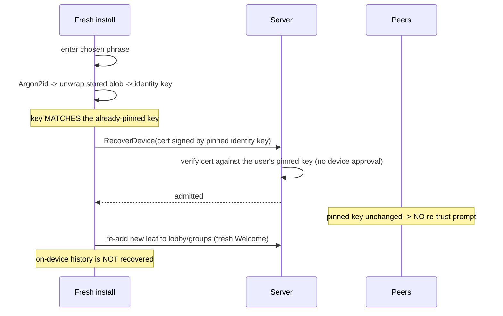

# Design — trust-verification (DEFERRED / design-only)

> **DEFERRED — not for build.** This records the full design behind the bare key-change
> acknowledgement that `admin-recovery` ships, so the thinking survives. Promote a part
> to its own build-ready change only on owner approval. Decisions are numbered so a
> promoted change can cite them.

## Context

`admin-recovery` solves the authority half of a locked-out admin (operator reset →
re-bootstrap → re-register). It leaves two rough edges that this design smooths:

1. The recovered admin **re-keys**, forcing every peer to re-trust. Part A removes the
   re-key entirely for the common case (recover the *same* key). Part B makes the
   re-key case's re-trust evidence-based instead of a bare banner.
2. There is no **verified** state for any identity. Part C adds one, built from signed
   attestations.

Single-admin, self-hosted, web-of-trust. Distinct from `replace-user` Phase 2 (several
admins co-signing a successor — the multi-admin variant); here one admin anchors trust
and members hold signed attestations.

The through-line: **all trust is a signed attestation, and the server is never
trusted to assert trust.** A tally, a badge and a recovered key each reduce to "who
signed what, verified against a pinned identity key".

## Part A — Recovery phrase (same-key recovery)

### D1. The phrase WRAPS a full-entropy key; it is never the seed.
A user-chosen 24-word phrase is low-entropy (word choice is not uniform, and users
reuse patterns). Deriving the identity key *from* the phrase would cap the key's
strength at the phrase's guessability — catastrophic for an identity key an attacker
can grind offline. So:

- the identity key is a **full-entropy random** Ed25519 key (as today);
- it is stored as an **encrypted blob**, wrapped by a symmetric key **derived from the
  phrase with Argon2id** (memory-hard, tuned parameters);
- recovery **unwraps** the stored blob; it never regenerates the key from the phrase.

The phrase is a recovery factor over a random key, not the key's source.

### D2. User-chosen, min 24 words, with a real strength check.
The owner wants the phrase user-chosen (memorable, not an app-generated BIP-39 string).
Minimum 24 words is a floor, not a guarantee — "the the the …" is 24 words. So phrase
choice is gated by an **entropy estimate** (e.g. zxcvbn-style over the whole phrase,
not per-word), rejecting weak phrases and nudging length/variety. The 24-word floor and
the estimate together are the strength requirement.

### D3. Rate-limit and lock recovery attempts.
Unwrapping is an **offline-guessable** operation once an attacker has the blob (which
lives on the server or a backup). Argon2id raises the per-guess cost; a **recovery
attempt limit with exponential backoff and a lockout** raises it further and bounds
online attempts. Specify the attempt curve when promoted (OQ).

### D4. `RecoverDevice` = LinkDevice minus the approve step; the identity signature is the authority.
Today a new device is admitted either by an invite (new identity) or by
`Devices.LinkDevice`, which needs an **existing device** of the user to sign the new
cert. A recovering user has **no existing device**. So Part A adds a `RecoverDevice`
RPC that admits a device certificate **signed directly by the pinned identity key**
(unwrapped from the phrase), with **no existing-device approval**. This is sound
because the pinned identity key is exactly the authority the server already uses to
verify every leaf cert — the recovering device proves possession of it. Same identity
key ⇒ the pinned key is unchanged ⇒ **no peer re-trust**.

### D5. Wrinkle: MLS rejoin and history.
The phrase recovers **identity**, not **group state**. The recovered device holds no
MLS group secrets, so its new leaf must be **re-added** to the lobby and each group
(an ordinary Add + Welcome), and **prior on-device encrypted history is unrecoverable**
— max_past_epochs = 0 and keys never leave the core, by invariant. Spec the rejoin as
the existing Add/Welcome path keyed by the (unchanged) identity, and state the history
loss plainly so it is not mistaken for a bug.

## Part B — Quorum re-trust (for the re-key case)

### D6. In-band challenge + quorum, every vouch signed.
When the admin *did* re-key (no phrase), a nicer path than the bare per-member banner:
the admin poses an **in-band challenge** — a shared-secret question, or a true/false
only the two know — and a **quorum** of members who answer correctly **vouch** for the
admin's new key. Each vouch is an **attestation cryptographically signed by that
member's identity key** over "admin's key = K". The receiving device verifies each
signature against the voucher's pinned key, so a **hostile or lying server cannot forge
or inflate** the tally. Signed attestations are the trust primitive; the challenge is
just how a member becomes willing to sign.

### D7. The tally is advisory and names names; the owner still taps.
A device shows "**3 of 5 vouched — accept?**" **and lists WHO vouched**, and still
requires the **owner's explicit tap**. It SHALL NEVER push the new key onto other
members as trusted on the tally's strength. The quorum raises confidence; it does not
replace consent. This is the key difference from a naive "enough votes ⇒ auto-trust".

### D8. Small and variable groups, offline members.
The threshold is a **floor/fraction with sane small-group behaviour**: a 2-person group
cannot require 3 vouches, so the rule is something like `min(configured_floor,
ceil(fraction × eligible_members))` with a hard minimum of 1 and the admin excluded
from their own tally. **Offline members** have simply not vouched yet; the tally is a
**live snapshot**, not a vote that closes, so it grows as members come online and never
blocks on an absent member.

## Part C — Verified badges

### D9. Admin badge is intrinsic; member badges are admin-signed attestations.
The **admin's badge is intrinsic** — the bootstrap/invite chain already establishes
which user id is the admin (`device-identity: Bootstrap admin`, Invites), so no
attestation is minted for it. **Members have no badge by default.** A member **requests**
a badge (out-of-band, or via the Part B challenge), and the admin **grants** it by
**signing an attestation** binding "member X's key = K". A **badge is a valid,
unrevoked admin signature** over that binding; it is revoked by the admin signing a
revocation or by the key changing. Same primitive as Part B — the badge is the admin's
attestation surfaced on the member's identity.

### D10. Everything reduces to signed attestations.
Part A (identity-key-signed device cert), Part B (member-signed vouch) and Part C
(admin-signed badge) are the same shape: a signature over a key binding, verified
against a pinned identity key, never the server's assertion. A promoted change should
define one attestation format and reuse it across all three.

## Relationship to replace-user Phase 2

`replace-user` Phase 2 is **co-signed succession**: in a multi-admin world, several
admins co-sign to carry identity/authority to a successor. This change is the
**single-admin** world: one admin anchors trust, members hold admin-signed badges and
can quorum-vouch for a re-keyed admin. The attestation format should be designed so the
two do not duplicate signing machinery, but the governance models are different and
should not be merged.

## Deferred — nothing to build

No tasks are promoted from this change. Each part becomes build-ready only as its own
owner-approved change, citing the decisions above. `tasks.md` here lists only the
promotion checkpoints, not implementation work.
