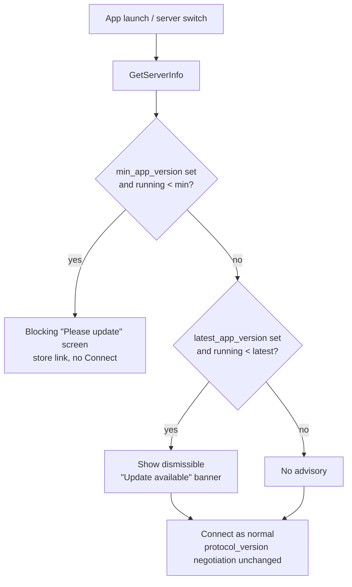

## Context

The client fetches `ServerInfo` with an unauthenticated `GetServerInfo` RPC
*before* it opens `Connect` (wire-transport: Protocol version negotiation;
device-identity: unauthenticated endpoints). `ServerInfo` already carries the
server id, supported protocol versions, size limits and the external sender key.
Protocol-version negotiation itself is unchanged: a client whose
`protocol_version` is unsupported still has its `Connect` stream closed with
`FAILED_PRECONDITION`. This change adds an *advisory* layer on the same handshake
so the user sees a reason and a remedy instead of an opaque failure.

## Decisions

### D1. Two optional version fields on `ServerInfo`, filled from config

`ServerInfo` gains `latest_app_version` (5) and `min_app_version` (6), both
optional semver strings. The server fills them from a new optional `[app]` TOML
table (`latest_version`, `min_version`), each optional and defaulting to unset,
advertised then as the empty string. This mirrors `configurable-limits`: optional,
operator-set, behaviour-neutral when absent, logged (non-secret) at startup.

- **Why `ServerInfo`, not a new RPC:** the client already calls `GetServerInfo`
  on every connect; no new round trip, and the advisory is available before the
  first `Connect` frame.
- **Why strings, not a numeric code:** human-readable, matches the store version
  the user sees, and lets us advertise a version the server binary itself need not
  understand.
- **Why config, not compiled-in:** the operator ships a new app build and sets
  `latest_version`; raises `min_version` only when a protocol bump makes old apps
  unusable — a config edit + restart, no server rebuild.

### D2. Version-compare rule (client), numeric and fail-open

The app reads its running version from the platform package info and takes the
`major.minor.patch` of `pubspec` `version` (e.g. `1.6.0` from `1.6.0+10`); build
metadata after `+` is ignored. It parses each advertised value the same way and
compares component-by-component as integers (major, then minor, then patch);
a missing component is 0.

- An advertised value that is empty or not a dotted numeric version is **ignored**
  (that advisory is treated as absent). The app never blocks or nags on an
  unparseable string — a fail-open rule, because a wrong parse must not lock a
  user out.
- Equality is "up to date": `running == min` is allowed; `running == latest` shows
  no banner.

### D3. Two UI states, blocking takes precedence

```
running < min_app_version   → blocking "Please update" screen (store link; no bypass on this server)
else running < latest_app_version → dismissible "Update available" banner (store link)
else                        → nothing
```

- **Precedence:** if both conditions hold (running is below both), the blocking
  screen wins; the banner is not also shown.
- **Banner** is dismissible for the session (dismiss hides it until the next app
  launch / next `GetServerInfo`); it is a soft nudge, never modal.
- **Blocking screen** is shown instead of proceeding to `Connect`, so the user
  never reaches the `FAILED_PRECONDITION` failure. It offers only the store link
  (and, as a courtesy, a retry that re-reads `ServerInfo`). This is per server:
  a different server with a lower `min_app_version` is unaffected.

### D4. The store link is a client-side constant, never server-supplied

The store URLs (App Store on iOS, Play Store on Android) are compile-time
constants in the app. The server advertises *version numbers only*, never a URL.

- **Why (security — client enforces):** a URL taken from `ServerInfo` and opened
  by the app would let a compromised or hostile server send users to a phishing
  "update" page. Advertising only an opaque version number removes that lever.
  The instruction-source boundary applied to our own wire: data from the server
  parameterises a fixed client behaviour, it does not choose the destination.

### D5. Advisory runs before `Connect`, turning an opaque failure into a remedy

Because `GetServerInfo` is unauthenticated and precedes `Connect`, the app
evaluates the advisory as soon as it has `ServerInfo`. A blocking state short-
circuits before the `Connect` attempt that would otherwise fail with
`FAILED_PRECONDITION`.



## Spikes

None. No new RPC, no crypto, no risky assumption: additive optional proto fields,
a config string pair (same shape as `configurable-limits`), and a pure client
comparison. The version-parse rule is covered by ordinary unit tests, not a spike.
